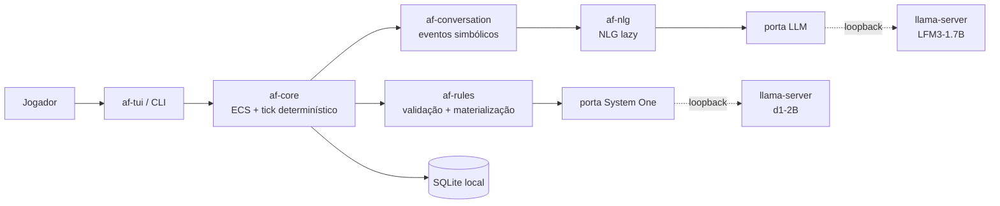

# AI Fantasy

**Simulação procedural offline em blocos, com diálogos simbólicos, regras determinísticas, modelos locais de 2B e visualização 2D isométrica (sem 3D).**

<p align="center">
  <a href="https://github.com/frederico-kluser/ai-fantasy/actions/workflows/ci.yml"></a>
  <a href="https://securityscorecards.dev/viewer/?uri=github.com/frederico-kluser/ai-fantasy"></a>
  <a href="LICENSE"></a>
  
</p>

> **Status: fundação (`v0.1.0-docs`).** Ainda **não há código executável**. Este
> repositório contém a arquitetura, as regras de engenharia, a estratégia de testes e a
> governança que antecedem a primeira linha de Rust. O objetivo desta fase é deixar o
> projeto **100% testável por construção**, não “provar que roda”.

## O que é

**AI Fantasy** é um RPG de mundo aberto inspirado no *Adventure Mode* de *Dwarf
Fortress*, com o mundo numa **grelha de blocos** e visualização final **2D isométrica**,
com o motor **Hermeneutic Core**:

- O mundo é uma **grelha de blocos** estilo *Dwarf Fortress*/*Minecraft*: todo o
  **material de construção do mapa é um cubo** (pedra, madeira, parede, telhado, chão) e
  **todas as construções são montadas a partir deles** — casa, caverna, buraco, árvore,
  parede, água. Itens de uso, consumo, vestimenta e combate **não** são blocos: são itens
  normais de inventário.
- **Cada personagem é uma individualidade**: um **mini perceptron (MLP)** próprio,
  treinado pela experiência de vida e herdado/evoluído darwinianamente por raça/espécie.
- A simulação é **matemática e determinística**: nenhum texto é gerado no *game loop*.
- As interações sociais são gravadas como **tuplos simbólicos** (zero-string log).
- O diálogo é traduzido **sob procura** (*lazy NLG*), quando o jogador o abre.
- Toda a inferência corre **localmente** (offline), em modelos pequenos de ~2B.
- Regras emergentes são **propostas** por um modelo local e **materializadas por código
  determinístico** — nunca executadas diretamente pelo modelo.

## Visualização: 2D isométrico, sem 3D real

**A visualização final do jogo é 2D com visão isométrica** — os blocos são projetados em
diamante, como nos clássicos isométricos. **Não haverá nada de 3D real, nem agora nem ao
final**: sem câmara 3D, sem malhas, sem *engine* 3D. A profundidade é pura projeção
isométrica 2D; a TUI/ASCII fica apenas como interface de depuração e *fallback*.

**Renderiza-se apenas o que é visto** — lógica de *fog of war* à la *Dwarf Fortress* e
*Age of Empires*, em três camadas:

1. **Visão ativa** — onde o personagem **olha** (campo de visão com direção): o mundo ao
   vivo, com criaturas e construções atualizadas.
2. **Memória de ambientes** — onde já viu mas não olha agora: o caminho fica **meio
   apagado** e **congelado** (sem atualizar criaturas nem mudanças de construção) — é a
   **memória do personagem sobre o ambiente**.
3. **Escuro** — onde nunca viu: **totalmente escuro**.

Personagens (o próprio e outros) **por detrás de uma construção** aparecem como
**silhueta**, e a câmara sobe/desce no eixo de altura para ver andares **acima ou abaixo**
(z-levels). Tudo está registado no [roadmap](docs/architecture/roadmap.md) (secções 2.9
a 2.11).

## Regra zero: tudo offline

O runtime não abre ligações à Internet. Ponto.

- O jogo e os modelos correm na mesma máquina.
- Os únicos sockets permitidos são **loopback** (`127.0.0.1`) para os *sidecars*
  `llama-server` locais.
- Modelos, pesos e *prompts* são ficheiros locais; não há telemetria, conta ou API key.
- Se um modelo não estiver disponível, o jogo continua com o **fallback determinístico**:
  a ausência de IA degrada a experiência, não bloqueia a simulação.

## Correção importante: JEV não é um motor

Rascunhos antigos tratavam “JEV” como um motor de regras dinâmicas que corria em paralelo
com a simulação. **Isso está errado.** O JEV era apenas o **rótulo do papel de System
One**; o modelo que materializa esse papel neste projeto é o **d1-2B local**. Nada
“executa no JEV”, não existe processo JEV, servidor JEV, base JEV nem dependência JEV.

A errata completa, com as afirmações corrigidas e as consequências para o código, está em
[`docs/architecture/roadmap.md`](docs/architecture/roadmap.md#0-errata-jev-não-é-runtime).

## Arquitetura em uma vista



Nenhuma seta atravessa a Internet. O núcleo (`af-core`) não conhece HTTP, SQLite nem
modelos: fala apenas com **portas** (traits) que os adaptadores implementam. Essa é a
propriedade que torna tudo testável.

## Princípios

1. **Offline por construção** — rede é um erro de arquitetura, não uma opção.
2. **O modelo propõe; o núcleo dispõe** — saída de LLM é dado não confiável, validado
   contra um schema fechado e aplicado por um interpretador determinístico.
3. **Determinismo** — mesmo `seed` + mesmas entradas ⇒ mesmo estado e mesma saída
   canónica. Sem relógio de parede, sem ordem de `HashMap`, sem `f32` no estado autoritativo.
4. **Testabilidade é arquitetura** — toda a dependência externa é injetada; todo o
   comportamento é observável por uma porta pública.
5. **Complexidade baixa** — funções curtas, um motivo para mudar, sem aninhamento
   profundo. Limites numéricos em [`docs/engineering/code-quality.md`](docs/engineering/code-quality.md).
6. **Humano primeiro** — nomes claros, documentação de decisão (ADR), código que se lê
   como prosa e se refatora sem medo.

## O que já existe nesta base

| Área | Estado |
| --- | --- |
| Arquitetura de software, C4 e ADRs | ✅ documentada, sem código |
| Regras de desenvolvimento, TDD, E2E e complexidade | ✅ normativas |
| Roadmap técnico corrigido (JEV, d1-2B, LFM3) | ✅ |
| Governança open-source (licença, contribuição, segurança, rulesets, CI) | ✅ |
| Memória e catálogo CoALA locais | ✅ `.agents/ai-fantasy-coala-agent-skill/` |
| Workspace Rust, crates e binários | ⏳ primeira fase de código |
| Modelos e *sidecars* locais | ⏳ fase de integração |

## O que ainda não existe

Este repositório **não** tem, por decisão consciente:

- `Cargo.toml`, crates, binários ou testes de código;
- pesos de modelos, *downloads* automáticos ou *scripts* de inferência;
- *build* de release, instalador ou pacote publicável;
- qualquer chamada a serviços de IA na nuvem.

O primeiro PR de código será `feat(core): scaffold the Rust workspace`, e só entra quando
os critérios de aceitação de [`docs/engineering/testing-strategy.md`](docs/engineering/testing-strategy.md)
estiverem satisfeitos.

## Documentação

Comece por aqui:

| Documento | Para quê |
| --- | --- |
| [Roadmap e errata JEV](docs/architecture/roadmap.md) | A visão técnica completa, corrigida e com arquitetura, TDD, E2E e complexidade. |
| [Arquitetura de software](docs/architecture/overview.md) | C4, crates, portas/adaptadores, determinismo, dados e runtime offline. |
| [Regras de desenvolvimento](docs/engineering/development-rules.md) | O contrato normativo do dia a dia. |
| [Estratégia de testes](docs/engineering/testing-strategy.md) | TDD, pirâmide, E2E, cobertura, mutação e testes com modelos. |
| [Qualidade de código](docs/engineering/code-quality.md) | Complexidade ciclognitiva/cognitiva, documentação e refatoração. |
| [IA offline](docs/engineering/offline-ai.md) | d1-2B, LFM3, *sidecars*, licenças e fallback. |
| [ADRs](docs/architecture/adr/) | As decisões que explicam o “porquê”. |
| [Glossário](docs/glossary.md) | Vocabulário canónico (System One, JEV, tick, regra, etc.). |
| [Governança](GOVERNANCE.md) | Quem decide, como e com que transparência. |

## Desenvolvimento

Ainda não há comandos de build. Quando o workspace existir, o contrato será:

```bash
cargo fmt --all -- --check
cargo clippy --workspace --all-targets --all-features -- -D warnings
cargo nextest run --workspace --profile ci
cargo llvm-cov nextest --workspace --fail-under-lines 90
cargo mutants --workspace --in-place
```

Enquanto isso, a validação desta base é documental:

```bash
# lint de Markdown, links e governança (quando o Node estiver disponível)
npx markdownlint-cli2 "**/*.md"
```

## Contribuir

Contribuições são bem-vindas, mas o padrão é alto e explícito. Leia
[`CONTRIBUTING.md`](CONTRIBUTING.md), o [Código de Conduta](CODE_OF_CONDUCT.md) e as
[regras de desenvolvimento](docs/engineering/development-rules.md) **antes** de abrir um
PR. Commits seguem [Conventional Commits](https://www.conventionalcommits.org/); branches
seguem `<tipo>/<slug>`; a integração é **merge (squash), nunca rebase**.

## Segurança

Não abra issues públicas para vulnerabilidades. Use o
[Private Vulnerability Reporting](https://github.com/frederico-kluser/ai-fantasy/security/advisories/new)
e leia [`SECURITY.md`](SECURITY.md). O escopo inclui o runtime offline, a cadeia de
fornecimento dos modelos e a fronteira “modelo propõe / núcleo dispõe”.

## Licença

O **código** deste repositório é distribuído sob a licença **MIT** — ver [`LICENSE`](LICENSE).

Os **pesos dos modelos** **não** são distribuídos nem relicenciados por este projeto. Eles
pertencem aos respetivos fornecedores e estão sujeitos à **LFM Open License v1.0** (Liquid
AI), que permite uso comercial gratuito apenas para entidades com receita anual inferior a
US$ 10 milhões. Leia [`docs/engineering/offline-ai.md`](docs/engineering/offline-ai.md#licenças-e-distribuição)
antes de empacotar o jogo para terceiros.

---

## English overview

**AI Fantasy** is an offline-first procedural RPG engine inspired by *Dwarf
Fortress* adventure mode. The world is a block grid (houses, caves, holes, trees) and the
final visualization is **2D isometric — no real 3D at all**; each character is an
individual with its own mini perceptron (MLP) shaped by life experience and darwinian
evolution. The simulation is deterministic and emits symbolic tuples, not
prose; dialogue is rendered lazily by a local LFM3-1.7B model, and fast typed decisions
are made by a local d1-2B System One model. No cloud calls, no telemetry, no “JEV
runtime”: JEV was only the historical label for the System One role. The repository is in
its foundation phase — architecture and engineering rules first, code next. See
[the architecture overview](docs/architecture/overview.md) and
[the corrected roadmap](docs/architecture/roadmap.md).

## Agradecimentos

- [Liquid AI](https://www.liquid.ai/) pela família LFM3 e pelo modelo d1-2B.
- [Flecs](https://github.com/SanderMertens/flecs) pelo ECS com relacionamentos nativos.
- [Contributor Covenant](https://www.contributor-covenant.org/) pelo Código de Conduta.
- [Keep a Changelog](https://keepachangelog.com/) e
  [Conventional Commits](https://www.conventionalcommits.org/) pelas convenções.
