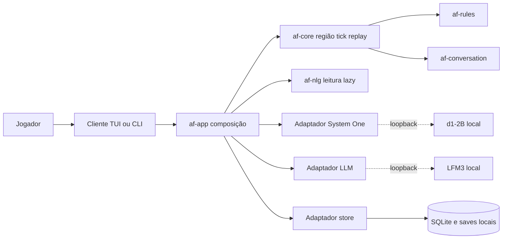

# AI Fantasy

**Simulação procedural offline em blocos, com diálogos simbólicos, regras determinísticas, modelos locais de 2B e visualização 2D isométrica (sem 3D).**

<p align="center">
  <a href="https://github.com/frederico-kluser/ai-fantasy/actions/workflows/ci.yml"></a>
  <a href="https://securityscorecards.dev/viewer/?uri=github.com/frederico-kluser/ai-fantasy"></a>
  <a href="LICENSE"></a>
  
</p>

> **Status: F0 — fundação documental. Revisão: 2026-11-08.** Ainda não há aplicação
> executável. Este repositório planeja arquitetura, engenharia, testes e governança;
> aprovar Markdown não autoriza construir código, scaffold, CI, worktrees ou releases.
> Primeiro validar o motor; depois entregar o primeiro jogável 2D. Não houve bump de
> versão de software ou edição manual de changelog nesta revisão.

## O que é

**AI Fantasy** é um RPG inspirado no Adventure Mode de Dwarf Fortress, com o motor
**Hermeneutic Core**, grelha de blocos e visualização final **2D isométrica**. A primeira
base simulável já é uma **região procedural com várias localidades**: o foco inicial em
relações sociais e rumores permite observar interações entre áreas e corrigir problemas
antes que escalem, não reduz o mundo a uma vila isolada.

**Tempo por ação:** movimentar-se e falar no mundo avançam ticks com custo determinístico;
NLG, espera de inferência e câmera/UI não acrescentam simulação. Focar uma localidade não
congela as outras nem retira suas entidades do estado canônico. Valores de custo e política
regional ainda exigem contrato, não um relógio obrigatório de 100 ms.

- O mundo é uma **grelha de blocos** estilo *Dwarf Fortress*/*Minecraft*: todo o
  **material de construção do mapa é um cubo** (pedra, madeira, parede, telhado, chão) e
  **todas as construções são montadas a partir deles** — casa, caverna, buraco, árvore,
  parede, água. Itens de uso, consumo, vestimenta e combate **não** são blocos: são itens
  normais de inventário.
- **Cada personagem é uma individualidade**: um **mini perceptron (MLP)** próprio,
  treinado pela experiência de vida e herdado/evoluído darwinianamente por raça/espécie.
- A simulação é **matemática e determinística**: nenhum texto é gerado no *game loop*.
- As interações sociais são gravadas como **tuplos simbólicos** (zero-string log).
- O diálogo é traduzido **sob procura** (*lazy NLG*), quando o jogador o abre.
- LLM e System One rodam localmente (offline) fora do tick; a mini-MLP individual é uma
  função pura em ponto fixo na trilha posterior, alimentada por percepção autoritativa.
- Regras emergentes são **propostas** por um modelo local e **materializadas por código
  determinístico** — nunca executadas diretamente pelo modelo.

## Visualização: 2D isométrico, sem 3D real

**A visualização final do jogo é 2D com visão isométrica** — os blocos são projetados em
diamante, como nos clássicos isométricos. **Não haverá nada de 3D real, nem agora nem ao
final**: sem câmara 3D, sem malhas, sem *engine* 3D. A profundidade é pura projeção
isométrica 2D; a TUI/ASCII fica apenas como interface de depuração e *fallback*.

O **ambiente** segue três camadas de percepção: visão ativa do personagem, memória
last-seen desvanecida/congelada e desconhecido escuro. Memória só muda com percepção
autoritativa, nunca por navegar na câmera ou gerar texto.

**Exceção deliberada:** todos os personagens atrás das construções, inclusive os não
percebidos, aparecem como **silhuetas em um overlay privilegiado** para o jogador.
É a escolha explícita de “raio X”, não a recomendação de limitar a atores já vistos.
O overlay não atualiza memória do ambiente, informação de rumores ou conhecimento/MLP dos
NPCs. Alcance, áreas nunca vistas e regras entre z-levels continuam em contrato, sem apagar
a intenção de incluir não percebidos.

Câmera e navegação por z-levels são livres de custo temporal e não mudam o estado regional.
Stack e ponte do render ainda não foram escolhidas; a visualização continua responsabilidade
do maintainer. Detalhes no [roadmap canônico](<docs/architecture/roadmap.md#210-visualização-2d-isométrico-sem-3d-real>)
e no [ADR 0009 proposto](<docs/architecture/adr/0009-privileged-silhouette-overlay.md>).

## Regra zero: tudo offline

O runtime não abre ligações à Internet. Ponto.

- O jogo e os modelos correm na mesma máquina.
- Os únicos sockets permitidos são **loopback** (`127.0.0.1`) para os *sidecars*
  `llama-server` locais.
- Modelos, pesos e prompts são arquivos locais; não há telemetria remota, conta ou API key.
  Métricas locais opt-in seguem a política de privacidade.
- Se um modelo não estiver disponível, o jogo continua com o **fallback determinístico**:
  a ausência de IA degrada a experiência, não bloqueia a simulação.

## Correção importante: JEV não é um motor

Rascunhos antigos tratavam “JEV” como um motor de regras dinâmicas que corria em paralelo
com a simulação. **Isso está errado.** O JEV era apenas o **rótulo do papel de System
One**; o modelo que materializa esse papel neste projeto é o **d1-2B local**. Nada
“executa no JEV”, não existe processo JEV, servidor JEV, base JEV nem dependência JEV.

A errata completa, com as afirmações corrigidas e as consequências para o código, está em
[`docs/architecture/roadmap.md`](docs/architecture/roadmap.md#0-errata-jev-não-é-runtime).

## Arquitetura em uma vista



**Legenda:** o desenho mostra composição e chamadas, não imports. A
[tabela e o grafo normativos de crates](<docs/architecture/overview.md#4-componentes-e-crates>)
fixam a direção das dependências: core não importa adaptadores, app, UI ou NLG; NLG não
importa core. O app compõe portas e adaptadores, sem I/O externo ao runtime offline.
O cliente 2D ainda terá sua stack/ponte contratada; subagents de desenvolvimento e juiz de
integração do [ROADMAP](<ROADMAP.md>) não são processos ou componentes do jogo.

## Princípios

1. **Offline por construção** — rede é um erro de arquitetura, não uma opção.
2. **O modelo propõe; o núcleo dispõe** — saída de LLM é dado não confiável, validado
   contra um schema fechado e aplicado por um interpretador determinístico.
3. **Determinismo** — mesmo `seed` + mesmas entradas ⇒ mesmo estado e mesma saída
   canónica. Sem relógio de parede, sem ordem de `HashMap`, sem `f32` no estado autoritativo.
4. **Testabilidade é arquitetura** — toda a dependência externa é injetada; todo o
   comportamento é observável por uma porta pública.
5. **Complexidade baixa** — funções curtas, um motivo para mudar, sem aninhamento
   profundo. Limites numéricos em [`docs/engineering/code-quality.md`](docs/engineering/code-quality.md).
6. **Humano primeiro** — nomes claros, documentação de decisão (ADR), código que se lê
   como prosa e se refatora sem medo.

## O que já existe nesta base

| Área | Estado |
| --- | --- |
| Arquitetura de software, C4 e ADRs | ✅ documentada, sem código |
| Regras de desenvolvimento, TDD, E2E e complexidade | ✅ normativas |
| Roadmap técnico corrigido (JEV, d1-2B, LFM3) | ✅ |
| Governança open-source (licença, contribuição, segurança, rulesets, CI) | ✅ |
| Memória e catálogo CoALA locais | ✅ `.agents/ai-fantasy-coala-agent-skill/` |
| Workspace Rust, crates e binários | ⏳ primeira fase de código |
| Modelos e *sidecars* locais | ⏳ fase de integração |

## O que ainda não existe

Este repositório **não** tem, por decisão consciente:

- `Cargo.toml`, crates, binários ou testes de código;
- pesos de modelos, *downloads* automáticos ou *scripts* de inferência;
- *build* de release, instalador ou pacote publicável;
- qualquer chamada a serviços de IA na nuvem.

O primeiro PR de código será `feat(core): scaffold the Rust workspace`, e só entra quando
os critérios de aceitação de [`docs/engineering/testing-strategy.md`](docs/engineering/testing-strategy.md)
estiverem satisfeitos.

## Documentação

Comece por aqui:

| Documento | Para quê |
| --- | --- |
| [ROADMAP de execução](<ROADMAP.md>) | Atividades, dependências, ondas, juiz de integração e critérios de aceite; planejamento, não autorização de construção. |
| [Definições e errata JEV](<docs/architecture/roadmap.md>) | Visão e definições canônicas reconciliadas com as respostas humanas. |
| [Decisões do maintainer](<docs/planning/decisions.md>) | Oito escolhas recebidas e complemento da região procedural desde a base. |
| [Arquitetura de software](docs/architecture/overview.md) | C4, crates, portas/adaptadores, determinismo, dados e runtime offline. |
| [Regras de desenvolvimento](docs/engineering/development-rules.md) | O contrato normativo do dia a dia. |
| [Estratégia de testes](docs/engineering/testing-strategy.md) | TDD, pirâmide, E2E, cobertura, mutação e testes com modelos. |
| [Qualidade de código](docs/engineering/code-quality.md) | Complexidade ciclognitiva/cognitiva, documentação e refatoração. |
| [IA offline](docs/engineering/offline-ai.md) | d1-2B, LFM3, *sidecars*, licenças e fallback. |
| [ADRs](docs/architecture/adr/) | As decisões que explicam o “porquê”. |
| [Glossário](docs/glossary.md) | Vocabulário canónico (System One, JEV, tick, regra, etc.). |
| [Governança](GOVERNANCE.md) | Quem decide, como e com que transparência. |

## Desenvolvimento

Ainda não há comandos de build. Quando o workspace existir, o contrato será:

```bash
cargo fmt --all -- --check
cargo clippy --workspace --all-targets --all-features -- -D warnings
cargo nextest run --workspace --profile ci
cargo llvm-cov nextest --workspace --fail-under-lines 90
cargo mutants --workspace --in-place
```

Enquanto isso, a validação desta base é documental:

```bash
# lint de Markdown; links e governança requerem verificações separadas
npx markdownlint-cli2 "**/*.md"
```

## Contribuir

Contribuições são bem-vindas, mas o padrão é alto e explícito. Leia
[`CONTRIBUTING.md`](CONTRIBUTING.md), o [Código de Conduta](CODE_OF_CONDUCT.md) e as
[regras de desenvolvimento](docs/engineering/development-rules.md) **antes** de abrir um
PR. Commits seguem [Conventional Commits](https://www.conventionalcommits.org/); branches
seguem `<tipo>/<slug>`; a integração é **merge (squash), nunca rebase**.

## Segurança

Não abra issues públicas para vulnerabilidades. Use o
[Private Vulnerability Reporting](https://github.com/frederico-kluser/ai-fantasy/security/advisories/new)
e leia [`SECURITY.md`](SECURITY.md). O escopo inclui o runtime offline, a cadeia de
fornecimento dos modelos e a fronteira “modelo propõe / núcleo dispõe”.

## Licença

O **código** deste repositório é distribuído sob a licença **MIT** — ver [`LICENSE`](LICENSE).

Os **pesos dos modelos** **não** são distribuídos nem relicenciados por este projeto. Eles
pertencem aos respetivos fornecedores e estão sujeitos à **LFM Open License v1.0** (Liquid
AI), que permite uso comercial gratuito apenas para entidades com receita anual inferior a
US$ 10 milhões. Leia [licenças dos modelos](<docs/engineering/offline-ai.md#6-licenças-e-distribuição>)
antes de empacotar o jogo para terceiros.

---

## English overview

**AI Fantasy** is an offline-first procedural RPG engine inspired by *Dwarf
Fortress* adventure mode. The initial simulation is a procedural region with several
localities, not a single-village product. Movement and symbolic speech advance logical time;
NLG, model latency and camera navigation do not. The world is a block grid and the final
visualization is **2D isometric — no real 3D at all**; each character is an
individual with its own mini perceptron (MLP) shaped by life experience and darwinian
evolution. The simulation is deterministic and emits symbolic tuples, not
prose; dialogue is rendered lazily by a local LFM3-1.7B model, and fast typed decisions
are made by a local d1-2B System One model. No cloud calls, no telemetry, no “JEV
runtime”: JEV was only the historical label for the System One role. The repository is in
its documentation-only foundation phase. All characters behind constructions, including
unperceived ones, have a deliberately privileged silhouette overlay; it does not update
last-seen memory or NPC/MLP knowledge. Its range and height rules remain a contract to review.
Planning approval does not authorize implementation. See
[the architecture overview](docs/architecture/overview.md) and
[the corrected roadmap](docs/architecture/roadmap.md).

## Agradecimentos

- [Liquid AI](https://www.liquid.ai/) pela família LFM3 e pelo modelo d1-2B.
- [Flecs](https://github.com/SanderMertens/flecs) pelo ECS com relacionamentos nativos.
- [Contributor Covenant](https://www.contributor-covenant.org/) pelo Código de Conduta.
- [Keep a Changelog](https://keepachangelog.com/) e
  [Conventional Commits](https://www.conventionalcommits.org/) pelas convenções.
