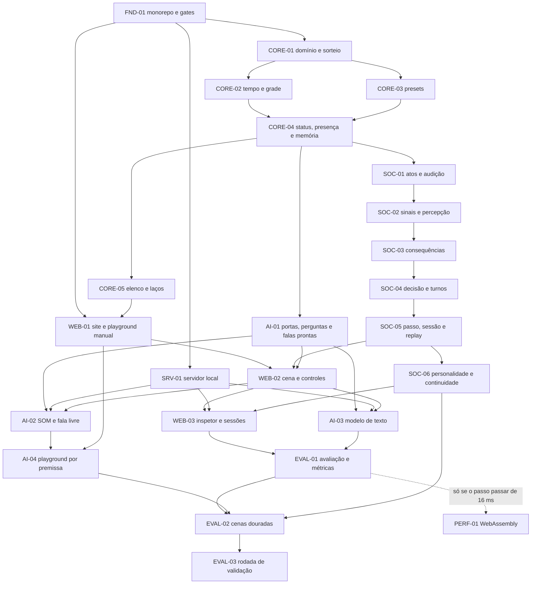

# ROADMAP — AI Fantasy

> **Plano único de execução**, refeito em 2026-11-09. O que o produto é está em
> [`docs/product.md`](<docs/product.md>); as regras do motor, no
> [modelo de simulação](<docs/architecture/simulation-model.md>); o porquê das decisões, em
> [decisões](<docs/planning/decisions.md>) e nos [ADRs](<docs/architecture/adr/README.md>). Cada
> tarefa tem um prompt em [`docs/planning/prompts/`](<docs/planning/prompts/README.md>).

## 1. Onde estamos

- **F0 — Fundação documental: concluída** (refeita em 2026-11-09). Produto redefinido, plano
  antigo descartado (D-09), especificações, ADRs 0013–0019, regras de engenharia, este roadmap e
  os prompts escritos.
- **Ainda não há código.** A próxima tarefa pronta é a **[FND-01](<docs/planning/prompts/FND-01.md>)**.
  Código só começa com pedido explícito do maintainer.
- O plano anterior (região procedural em Rust, 46 tarefas em ondas com juiz) está no histórico do
  git até o commit `05dea65` e não vale mais.

## 2. O que vamos entregar

Um **simulador web de conversas com NPCs que simulam pessoas**, rodando em `localhost`, com o
motor decidindo tudo por porcentagens e duas IAs via OpenRouter só traduzindo (D-09 a D-24). O
produto está pronto quando passar pelo pacote de métricas B e pelo teste cego
([avaliação](<docs/engineering/evaluation.md>)).

## 3. Fases e marcos

| Fase | Objetivo | Tarefas | Marco ao terminar |
| --- | --- | --- | --- |
| F1 — Base TypeScript | monorepo, gates de qualidade e CI | FND-01 | base pronta para receber código |
| F2 — Núcleo determinístico | domínio, sorteio, tempo, grade, presets, status e elenco | CORE-01 a CORE-05 | motor calcula estado e contexto |
| F3 — Comportamento social | atos, sinais, consequências, decisão, turnos, sessão, replay e personalidade | SOC-01 a SOC-06 | **motor completo, sem IA** |
| F4 — Servidor e site sem IA | servidor local, playground manual, cena, inspetor, sessões e a parte de IA sem rede (portas, perguntas, falas prontas) | SRV-01, WEB-01 a WEB-03, AI-01 | **simulador jogável com falas prontas** |
| F5 — IA via OpenRouter | SOM, modelo de texto e playground por premissa | AI-02 a AI-04 | **simulador com IA** |
| F6 — Validação | avaliação, cenas douradas e rodada com o maintainer | EVAL-01 a EVAL-03 | **produto validado** |
| F7 — Condicional | WebAssembly se o passo do motor passar de 16 ms | PERF-01 | só se a medição pedir |

O núcleo vem antes da IA (S-06): primeiro o motor dirige conversas com falas prontas; só depois os
modelos dão voz. Assim, problemas do motor nunca se confundem com problemas dos modelos.

## 4. Dependências

## 5. Ordem de execução e paralelismo

Cada linha é uma rodada: tudo o que está na mesma rodada pode correr em paralelo, cada tarefa na
sua worktree e branch (D-27).

| Rodada | Tarefas |
| --- | --- |
| 1 | FND-01 |
| 2 | CORE-01 · SRV-01 |
| 3 | CORE-02 · CORE-03 |
| 4 | CORE-04 |
| 5 | CORE-05 · SOC-01 · AI-01 |
| 6 | SOC-02 · WEB-01 |
| 7 | SOC-03 |
| 8 | SOC-04 |
| 9 | SOC-05 |
| 10 | SOC-06 · WEB-02 |
| 11 | WEB-03 · AI-02 · AI-03 |
| 12 | AI-04 · EVAL-01 |
| 13 | EVAL-02 |
| 14 | EVAL-03 (precisa do maintainer) · PERF-01 (só se a medição pedir) |

## 6. Tarefas

Estados: ⏳ pendente · 🚧 em andamento · ✅ concluída (com o PR) · ⏸️ condicional. Quem conclui
uma tarefa atualiza esta tabela no próprio PR.

| Id | Tarefa | Fase | Depende de | Estado |
| --- | --- | --- | --- | --- |
| [FND-01](<docs/planning/prompts/FND-01.md>) | Monorepo TypeScript, gates e CI | F1 | — | ⏳ pendente |
| [CORE-01](<docs/planning/prompts/CORE-01.md>) | Domínio, aritmética em bp, sorteio e registro | F2 | FND-01 | ⏳ pendente |
| [CORE-02](<docs/planning/prompts/CORE-02.md>) | Tempo, contexto e grade | F2 | CORE-01 | ⏳ pendente |
| [CORE-03](<docs/planning/prompts/CORE-03.md>) | Catálogos de presets v0 | F2 | CORE-01 | ⏳ pendente |
| [CORE-04](<docs/planning/prompts/CORE-04.md>) | Status em camadas, ameaça, presença e modelo de memória | F2 | CORE-02, CORE-03 | ⏳ pendente |
| [CORE-05](<docs/planning/prompts/CORE-05.md>) | Geração de elenco e laços | F2 | CORE-04 | ⏳ pendente |
| [SOC-01](<docs/planning/prompts/SOC-01.md>) | Atos: validação, custo, quem ouve e interpretação | F3 | CORE-04 | ⏳ pendente |
| [SOC-02](<docs/planning/prompts/SOC-02.md>) | Sinais e percepção do momento | F3 | SOC-01 | ⏳ pendente |
| [SOC-03](<docs/planning/prompts/SOC-03.md>) | Consequências: avaliação emocional, pedidos e mentiras | F3 | SOC-02 | ⏳ pendente |
| [SOC-04](<docs/planning/prompts/SOC-04.md>) | Decisão e turnos | F3 | SOC-03 | ⏳ pendente |
| [SOC-05](<docs/planning/prompts/SOC-05.md>) | Passo do motor, sessão e replay | F3 | SOC-04 | ⏳ pendente |
| [SOC-06](<docs/planning/prompts/SOC-06.md>) | Personalidade que muda e continuidade entre fatias | F3 | SOC-05 | ⏳ pendente |
| [SRV-01](<docs/planning/prompts/SRV-01.md>) | Servidor local | F4 | FND-01 | ⏳ pendente |
| [WEB-01](<docs/planning/prompts/WEB-01.md>) | Site base e playground manual | F4 | FND-01, CORE-05 | ⏳ pendente |
| [WEB-02](<docs/planning/prompts/WEB-02.md>) | Cena e controles (sem IA) | F4 | WEB-01, SOC-05, AI-01 | ⏳ pendente |
| [WEB-03](<docs/planning/prompts/WEB-03.md>) | Inspetor e sessões | F4 | WEB-02, SRV-01, SOC-06 | ⏳ pendente |
| [AI-01](<docs/planning/prompts/AI-01.md>) | Portas de IA, perguntas do SOM e falas prontas | F4 | CORE-04 | ⏳ pendente |
| [AI-02](<docs/planning/prompts/AI-02.md>) | SOM via OpenRouter e fala livre do jogador | F5 | AI-01, SRV-01, WEB-02 | ⏳ pendente |
| [AI-03](<docs/planning/prompts/AI-03.md>) | Modelo de texto via OpenRouter e encenação | F5 | AI-01, SRV-01, WEB-02 | ⏳ pendente |
| [AI-04](<docs/planning/prompts/AI-04.md>) | Playground por premissa | F5 | AI-02, WEB-01 | ⏳ pendente |
| [EVAL-01](<docs/planning/prompts/EVAL-01.md>) | Avaliação no site e painel de métricas | F6 | WEB-03, AI-03 | ⏳ pendente |
| [EVAL-02](<docs/planning/prompts/EVAL-02.md>) | Cenas douradas | F6 | EVAL-01, AI-04, SOC-06 | ⏳ pendente |
| [EVAL-03](<docs/planning/prompts/EVAL-03.md>) | Rodada de validação com o maintainer | F6 | EVAL-02 | ⏳ pendente |
| [PERF-01](<docs/planning/prompts/PERF-01.md>) | Núcleo em WebAssembly (só se a medição pedir) | F7 | EVAL-01 | ⏸️ condicional |

## 7. Como uma tarefa é executada

1. Pegue uma tarefa com todas as dependências ✅.
2. Siga o [guia dos agentes](<docs/planning/prompts/README.md>) e o prompt da tarefa.
3. Uma branch e um PR por tarefa; TDD; gates verdes; especificações e esta tabela atualizadas.
4. Revisão pelo maintainer ou por um agente revisor; squash merge.

A Definition of Done está nas [regras de desenvolvimento](<docs/engineering/development-rules.md>),
seção 10.

## 8. Fora deste roadmap

Tudo o que está em "fora do produto" ([`product.md`](<docs/product.md>), seção 6) só entra com
decisão nova. Depois da validação, candidatos naturais (cada um com decisão própria):

- modelos locais (LFM3-1.7B para texto e d1 para decisões) atrás das mesmas portas;
- publicar o site para outras pessoas;
- um mundo vivo em volta das fatias;
- um pacote para usar o motor em jogos e mods (D-24).
