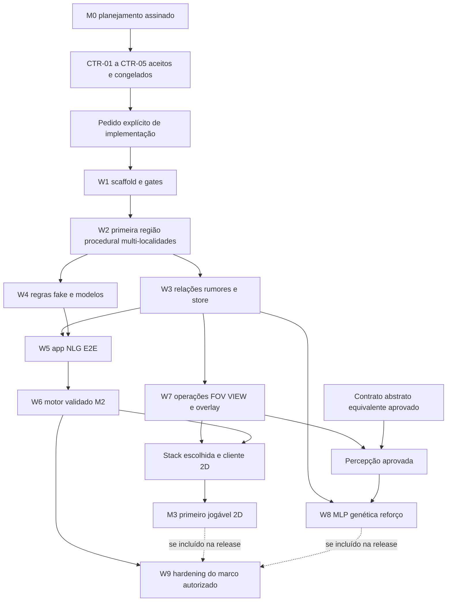

# ROADMAP — AI Fantasy: execução por ondas, barreiras e juiz de integração

> **PLANEJAMENTO APROVADO · 2026-11-08 · Respostas e orientação final incorporadas.**
> As oito decisões humanas, a nota de D-07 e os prompts/revisão/CoALA solicitados estão registrados.
> A aprovação foi recebida no Plannotator; implementação, contratos técnicos, scaffold e releases
> não estão concluídos ou autorizados. Estado real: **F0, fundação documental**.
> [Registro da aprovação](<docs/planning/approval.md>) · [Prompts dos subagents](<docs/planning/prompts/README.md>).

## 1. Objetivo, autoridade e estado

Este é o plano único de **execução** do AI Fantasy: atividades, dependências, procedimentos,
responsáveis, testes, critérios de aceite e integração. As definições do projeto continuam
canônicas no [roadmap de arquitetura](<docs/architecture/roadmap.md>), complementadas pela
[arquitetura de software](<docs/architecture/overview.md>), pelos [ADRs](<docs/architecture/adr/README.md>)
e pelos [contratos de engenharia](<docs/engineering/development-rules.md>).

- A [revisão de definições](<docs/planning/project-review.md>) e o [registro de decisões](<docs/planning/decisions.md>) dão a proveniência das respostas; recomendações antigas não prevalecem sobre as decisões humanas.
- Definição arquitetural e estado de atividade não serão mantidos em duas tabelas operacionais concorrentes. Índices e referências devem apontar para a fonte correspondente.
- ADR aceito não é reescrito. Decisões estruturais novas recebem ADR próprio e supersessão explícita quando necessária.
- O número da onda não é versão de release. SemVer continua calculado conforme a [governança](<GOVERNANCE.md#releases>); changelog não é escrito à mão.
- Aprovar o planejamento não conclui o congelamento técnico dos contratos nem autoriza implementação, commit, push, PR, merge ou release automaticamente.

**Pilares preservados:** execução offline com loopback somente para modelos locais; núcleo
determinístico; modelo propõe e núcleo dispõe; jogo funciona sem modelos; materiais estruturais
em cubos e itens normais fora da grelha; visualização final 2D isométrica, nunca 3D; percepção e
memória de ambientes na simulação; individualidade por MLP e evolução na trilha posterior.

### Estados das atividades

| Estado | Significado |
| --- | --- |
| Planejado | Escopo definido; implementação ainda não começou ou depende de autorização e contratos. |
| Em execução | Pacote atribuído a uma branch/worktree própria, com base e lista de testes registradas. |
| Em revisão | Resultado entregue; verificação independente ou integração ainda pendente. |
| Bloqueado | Condição concreta impede o pacote; responsável, impacto e próxima ação registrados. |
| Aceito tecnicamente | Revisão independente e gates compostos passaram; juiz registrou aceite da onda. |
| Aguardando decisão humana | Produto, contrato estrutural, golden ou operação de publicação exige decisão específica. |
| Adiado | Fora do marco atual por decisão explícita; permanece no backlog, sem falsa conclusão. |

DOC-01 recebeu **aceite do planejamento no Plannotator**, com a orientação de acrescentar os
prompts e gates CoALA/revisores, entregues como documentação. Os demais cartões são planejados;
nenhum aceite representa implementação, medição live, worktrees executadas ou ADR técnico aprovado.

## 2. Decisões humanas incorporadas

| ID | Decisão confirmada | Consequência operacional |
| --- | --- | --- |
| D-01 | Motor validado primeiro; depois primeiro jogável 2D. | M2 é marco técnico, não produto visual final; M3 vem depois. Render e MLP não bloqueiam o aceite de M2. |
| D-02 | Tempo avança conforme o personagem se move ou fala: simulação orientada por ações. | Comandos tipados têm custos em ticks; relógio, render, digitação e geração de NLG não fazem o mundo avançar. |
| D-03 | Relações sociais e rumores são a experiência central inicial. | DOC-02 e os cenários priorizam consequências sociais, mantendo a região e os subsistemas de suporte simulados. |
| D-04 | Todos os personagens atrás de construções aparecem como silhuetas, inclusive os não percebidos. | Exceção deliberada de apresentação ao fog; overlay privilegiado separado de percepção, memória, MLP e rumores. Não restringir a personagens já percebidos. |
| D-05 | Não limitar hardware agora; usar CPU/GPU da mesma máquina de desenvolvimento e teste em Windows/Linux. | Registrar configurações e resultados reais, sem mínimo de hardware ou teto numérico de desempenho escolhido por antecipação. |
| D-06 | Stack de render ainda não escolhida. | Definir contratos de leitura sem escolher engine; decisão específica de stack e ponte antes de RENDER-01. |
| D-07 | Região procedural com várias localidades desde o início. | GRID-01 e CP2 já integram múltiplas áreas, identidades e trajetos; não começar com uma vila como escopo de produto. |
| D-08 | Sem limite artificial de subagents de desenvolvimento. Todas as tarefas independentes em worktrees próprias; após a barreira, juiz integra, resolve, valida e agenda a próxima onda. | Disparar toda a fronteira pronta do DAG. Limites reais de ferramentas são capacidade reportada do ambiente, não teto do projeto. |

### Complemento de D-07: descobrir problemas antes de ampliarem

A região deve existir desde a primeira base simulável para encontrar comportamentos e bugs
entre áreas enquanto se trabalha em um subsistema. Focar uma localidade na UI ou no desenvolvimento
**não reduz a simulação a uma vila nem congela automaticamente as outras áreas**.

Testes usam fixtures pequenas e curadas para isolar falhas, mas isso não muda o escopo de produto.
A cada subsistema introduzido, acrescentar cenários entre localidades: trajetos e identidades,
passagem do tempo por ações, rumores, persistência e replay. Se forem necessários níveis de
atividade por área, serão contrato explícito com testes; viewport não será critério implícito.

### Semântica temporal a detalhar em contrato, sem reabrir D-02

- Mover-se e falar são ações simbólicas do personagem; cada comando resolvido tem custo lógico contratado em ticks.
- Fala é um ato simbólico, não contagem de palavras digitadas, tokens ou duração de voz/prosa gerada.
- Nos passos decorrentes dessas ações, o núcleo processa NPCs e sistemas da região conforme agenda determinística.
- Abrir histórico, mover câmera, aguardar modelo, renderizar, digitar ou medir um benchmark não avança o mundo.
- Custos por comando, desempates e tratamento de ações recusadas/canceladas serão especificados em DOC-02/CTR-02; não serão deduzidos da latência da máquina.
- Timeout de infraestrutura é entrada externa capturada para reprodução, não relógio de simulação.

### Silhuetas: exceção visual explícita, conhecimento preservado

A visualização do jogador tem um canal privilegiado de **silhuetas de todos os personagens
atrás de construções**, inclusive não percebidos. Esse canal não atualiza last-seen, não fornece
novos fatos a NPCs, não alimenta inputs percebidos da MLP e não propaga rumores.

O mundo observado continua com visão ativa, memória congelada e desconhecido. CTR-03 deve
especificar separadamente a elegibilidade geométrica do overlay: alcance, regiões nunca vistas,
limites de câmera e z-levels. Não escolher silenciosamente visibilidade global, todos os andares
ou uma restrição a apenas personagens percebidos. A decisão de mostrar não percebidos já está
confirmada; falta somente detalhar o alcance da exceção antes do cliente visual.

### Desempenho: diagnóstico agora, não teto de produto

Os valores históricos de 2,8 GB, latências e regressão de 20% são referências para comparação,
não gates bloqueantes neste momento. CPU, GPU, RAM/VRAM, versão, contexto e carga são registrados
na máquina usada para desenvolver e testar em Windows/Linux. Não definir um hardware mínimo,
limite de subagents ou teto de mundo a partir desses números.

Isso não remove gates de qualidade, offline, determinismo, recuperação e segurança. Limites
contratuais de payload, profundidade, quantidade de efeitos, IDs e entradas continuam aplicáveis;
eles não se confundem com metas de velocidade ou memória do benchmark. Novos SLOs ou tetos
exigirão decisão futura explícita, baseada em evidência.

## 3. Marcos e dependências

| Marco | Critério | Dependências |
| --- | --- | --- |
| M0 — Planejamento assinado | Decisões incorporadas, backlog e orquestração revisados; assinatura final do maintainer. | DOC-01 e revisão final; contratos de implementação permanecem futuros. |
| M1 — Fundação executável | Scaffold autorizado, gates verificáveis e primeira região simulável determinística. | CTR-01–CTR-05 congelados; W1–W2. |
| M2 — Motor validado | Região multi-localidades com nativas, relações, rumores, regras fake, IA opcional, save/replay, NLG lazy e TUI de apoio. | W3–W6; não requer cliente 2D ou MLP. |
| M3 — Primeiro jogável 2D | Gameplay social na região, construção/percepção, overlay de silhuetas e cliente 2D escolhido e integrado. | W7, contrato visual e decisão de stack. |
| M4 — Individualidade evolutiva | MLP individual, arquétipos, reforço, herança e experimento reproduzível de 100 gerações. | W8; percepção e persistência, não render. |
| M5 — Release autorizada | Gates do marco incluído, recuperação, medições diagnósticas, packaging, SBOM e autorização humana. | W9 sobre o marco selecionado para publicação. |

M2 vem antes de M3; a TUI não é a visualização final. M4 é trilha posterior e não bloqueia M2/M3
por padrão. A autorização de publicar M2, M3 ou M4 é decisão própria: D-01 definiu a ordem das
entregas, não concedeu publicação nem fixou versão.

### Grupos de trabalho e ondas executadas

W0–W9 organizam entregas. A **onda executada** é a fronteira de cartões prontos do DAG, que
pode atravessar grupos de trabalho. Um grupo pode exigir várias ondas porque seus cartões têm
dependências internas. A tabela resume marcos; não acrescenta bloqueios artificiais às dependências
específicas dos cartões. Nenhum dependente começa apenas porque outro implementador terminou:
a onda corrente termina na barreira e o juiz agenda a próxima após integração e gates.

| Grupo | Foco | Entrada | Saída | Independências que podem compor a mesma onda |
| --- | --- | --- | --- | --- |
| W0 | Definições, gameplay e contratos | Respostas humanas e fontes canônicas | CP0/M0; contratos técnicos têm freeze posterior próprio | Documentação de gameplay e contratos independentes com responsáveis distintos. |
| W1 | Scaffold e gates | CP0, contratos congelados e novo pedido de implementação | CP1 | Ferramentas, testes de caracterização e revisões independentes após dependências prontas. |
| W2 | Domínio, core, região, ações e replay | CP1 | CP2/M1: primeira região multi-localidades simulável | Módulos independentes após domínio/contratos; regiões fora de foco participam dos testes. |
| W3 | Relações, rumores e persistência | CP2 e formatos fechados | CP3 | Conversa e store; sistemas integrados pelo juiz após barreira. |
| W4 | Regras e adaptadores de modelos | Conforme cartão: domínio/gramática para parser, core/replay/store para aplicação integrada | CP4 | Parser e modelos podem avançar quando seus próprios predecessores estiverem aceitos, sem aguardar cartão independente. |
| W5 | App, NLG, diagnóstico e E2E | CP3/CP4, conforme dependências do cartão | CP5 | NLG, runner e diagnóstico quando suas bases estiverem aceitas. |
| W6 | TUI e motor validado | CP5 e contrato limitado de leitura | CP6/M2 | UI, revisão e cenários do motor, sem exigir render. |
| W7 | Ampliação de operações, percepção e apresentação 2D | Região já existente, store e contratos visuais | CP7/M3 | Dados espaciais e cliente após freeze; W7 não inaugura a região. |
| W8 | Comportamento neural | FSM, persistência e percepção aprovada | CP8/M4 | Experimentos de comportamento independentes de render. |
| W9 | Hardening e publicação do marco escolhido | Cartões incluídos aceitos | CP9/M5 | Diagnóstico, packaging e revisão; publicação permanece autorizada à parte. |

### DAG de marcos e fronteiras



VIEW-01 e percepção abstrata equivalente são alternativas de entrada de W8, não dois requisitos
obrigatórios. O overlay privilegiado das silhuetas não é uma fonte de percepção para MLP/NPCs.
Os dados espaciais de W7 podem avançar em paralelo a cartões independentes de W4/W5; M3 só é
aceito depois de M2. Para uma publicação técnica de M2, render e MLP não são dependências.

## 4. Orquestração de desenvolvimento: todas as prontas, barreira e juiz

D-08 refere-se a **subagents de desenvolvimento**, não a quantidade de NPCs, chamadas de
modelo ou concorrência de inferência no runtime. Não há teto artificial de dois, quatro ou
seis subagents neste plano. A execução usa todos os pacotes realmente independentes e prontos.

### Papéis e responsabilidade pelos artefatos

| Papel | Responsabilidade | Fronteira |
| --- | --- | --- |
| Orquestrador | Construir DAG, selecionar toda a fronteira pronta, distribuir bases/worktrees e acompanhar a barreira. | Agenda, lista de membros da onda e contratos de delegação. |
| Juiz/integrador | Analisar todas as entregas, integrar em ordem determinística, resolver conflitos, corrigir falhas e executar gates compostos. | Branch de integração, manifestações/configs compartilhadas, app/scenario e relatório da onda. |
| S-CONTRACT | Tipos, formatos e propostas de decisões estruturais. | Domínio, portas, schemas e ADRs atribuídos; alterações de contrato nunca improvisadas por consumidores. |
| S-CORE | ECS, ticks por ação, comandos, FSM, replay e invariantes. | Núcleo, exceto módulos delegados explicitamente. |
| S-GRID | Região, trajetos, operações, FOV, memória, DTO e contrato do overlay visual. | Módulos espaciais e testes de localidades, em worktree própria. |
| S-SOCIAL | Eventos, relações e propagação entre localidades. | Conversa e testes de fatos sociais; integração de sistemas após barreira. |
| S-STORE | SQLite, migrações, checkpoints e recuperação. | Store e fixtures de persistência regional. |
| S-RULES | Gramática atribuída, schema, validação, materializador e corpus adversarial. | Rules e parser no local único contratado. |
| S-MODELS | Supervisor, transporte, manifestos e adaptadores. | System One/LLM e infraestrutura local atribuída. |
| S-NLG | Âncoras, prompts, templates, cache e validação factual. | NLG; não gera fatos nem avança o tempo de simulação. |
| S-UI | TUI e, após decisão, cliente 2D. | Apresentação, leitura e overlay, sem escrita do conhecimento autoritativo. |
| S-BEHAVIOR | Inferência MLP, genomas, genética, reforço e experimentos. | Comportamento; nunca recebe o canal privilegiado como percepção do NPC. |
| S-QA/revisor independente | Conferir testes, casos negativos, contratos e correções do juiz. | Revisão distinta do implementador; nenhum autor aprova o próprio código. |
| Maintainer | Produto, decisões estruturais/ADRs, goldens e operações de PR/release quando necessárias. | Autoridade humana nas decisões exigidas pelo projeto; não precisa autorizar cada teste ou pacote técnico isolado. |

Papéis não são equipes GitHub novas nem um número fixo de agentes. Um papel pode atender
vários pacotes ou receber vários agentes, desde que cada delegação seja independente. Base,
contrato e responsáveis por artefatos compartilhados ficam explícitos antes do disparo.

### Preparar e disparar a onda

1. Construir o DAG de cartões e condições externas; validar IDs, dependências, contratos e ausência de ciclos.
2. Selecionar **todos** os cartões prontos: dependências tecnicamente aceitas, decisões obrigatórias tomadas, base identificada e autorizações de implementação existentes.
3. Separar pacotes que só parecem independentes, mas disputam uma decisão de schema ou pressupõem versões diferentes da mesma API. Resolver o contrato antes, não limitar arbitrariamente a quantidade de agentes.
4. Congelar a base de integração, as revisões dos contratos e a lista de membros da onda. Preparar branch válida e worktree própria para cada pacote; não escrever simultaneamente na árvore do integrador.
5. Delegar todos os prontos com objetivo, arquivos permitidos, interfaces, testes, critérios e evidências. Cada pacote executa lista de testes → Red → Green → Refactor e entrega documentação junto.
6. Se o ambiente real limitar concorrência, enfileirar a mesma fronteira e reportar capacidade, fila e estados observados. Não inventar execução paralela nem converter a capacidade da ferramenta em teto do projeto.

### Barreira de todas as entregas

- A barreira contém todos os membros registrados, inclusive os enfileirados pelo ambiente.
- Cada membro termina com resultado explícito: entregue, falhou, bloqueado ou interrompido, com base, revisão de contrato, diff e evidências. Timeout, teste pulado ou falta de relatório não contam como sucesso.
- O orquestrador não inicia dependentes da próxima onda antes da barreira e do aceite composto. Trabalho externo à onda só entra mediante agenda explícita e sem interferir na integração.
- Quando houver falha, a barreira permite iniciar o julgamento dos resultados; não permite ignorar a falha. O pacote afetado recebe correção/redelegação e suas dependências continuam bloqueadas.

### Julgamento, integração e correções

1. O juiz confere **todas** as entregas: base, contrato, escopo, Red/Green/Refactor, casos negativos, documentação e restrições de segurança/licença.
2. Obter revisão independente das implementações. Divergência de contrato volta ao responsável e ao maintainer quando estrutural; um merge textual não decide o produto.
3. Integrar todas as entregas da onda em branch de integração, por ordem topológica e desempate estável por ID, nunca pela ordem em que os agentes terminaram. Pacote com falha recebe correção antes do go; não liberar a próxima onda produtiva sobre uma entrega ignorada. Usar merge conforme política; nunca rebase, force-push ou bypass de gate.
4. Resolver conflitos de texto **e de comportamento**; verificar imports, schemas, migrações, consumo de RNG, eventos e interação entre áreas. Não escolher silenciosamente a versão do último agente.
5. Executar testes compostos, contrato/E2E relevantes, determinismo/replay, cobertura/mutação aplicáveis, qualidade, docs, segurança e verificação offline.
6. O juiz corrige ou redelega falhas com teste de regressão primeiro. **Código corrigido pelo juiz também recebe revisão independente**; juiz não se autoaprova por ter integrado ou reparado a onda.
7. Mudanças estruturais, ADRs e goldens seguem os checkpoints humanos específicos. Não fazer aprovação automática de golden ou aceitar uma nova política só porque os testes passaram.
8. Repetir correção, revisão e gates até o resultado da onda estar comprovado; registrar os pacotes não integrados e seu impacto, sem ocultá-los.

### Checklist go/no-go e próxima onda

- Todos os membros da barreira têm resultado e evidências, e todas as entregas da onda foram integradas e verificadas. Falha pendente implica no-go e ciclo de correção/revisão; adiamento de escopo somente por decisão explícita registrada, nunca pelo descarte silencioso de um pacote.
- Base e contratos continuam coerentes; conflitos semânticos resolvidos; revisões independentes incluem reparos do juiz.
- Gates obrigatórios e cenários compostos passaram; diagnósticos de desempenho estão registrados sem tetos artificiais.
- Decisões humanas específicas de produto/ADR/golden/PR/release foram obtidas quando necessárias.
- Não existe dependente liberado sobre pacote rejeitado, relatório ausente ou teste indevidamente ignorado.
- O juiz emite go/no-go técnico, atualiza estados e recomputa o DAG. Só então o orquestrador agenda e dispara **toda a próxima fronteira pronta**, com nova base registrada.
- Commit, push, PR, merge de publicação e release não são automáticos. O juiz prepara o resultado e evidencia o plano; não publica sem pedido e gates correspondentes.

### Envelope mínimo de cada delegação

ID e objetivo; base/revisão dos contratos; branch/worktree próprias; artefatos atribuídos e
proibidos; dependências; lista de testes; casos de erro/limite; critérios de aceite; comandos
realmente disponíveis; resultado de retorno; estado de execução; condição de parada; referências
para reprodução. Limitação do ambiente é relatada, nunca escondida nem usada para redefinir D-08.

### Planejamento transferível e especificação de cada tarefa futura

**Agora: somente plano Markdown.** O método do guia fornecido pelo maintainer é aplicado ao
planejamento, não à construção de uma skill, instalação de framework, scaffold, criação de
worktrees, codificação ou execução de testes da aplicação. As ações desta seção são contratos
para a futura execução autorizada.

O arquiteto entrega um plano autocontido; o executor não depende de histórico desta conversa.
Cada cartão despachado recebe um brief específico com somente decisões, fontes e contratos
relevantes. Manter contexto por pacote, sem copiar transcrições completas ou inventar capacidade
de contexto, economia de tokens, modelos disponíveis e ganhos de desempenho.

| Campo obrigatório do brief | Conteúdo concreto exigido antes do disparo |
| --- | --- |
| `task_id`, `goal`, `wave`, `depends_on` | ID do cartão, resultado observável, onda calculada e lista de IDs predecessores; condições externas separadas. |
| `baseline`, `branch`, `worktree`, `contract_revision` | Base exata, branch/worktree próprias, versão dos contratos e responsável pela integração. Nenhum campo representa artefato já criado agora. |
| `subagent_profile` | Perfil mecânico, implementador ou especialista; modelo exato apenas entre opções permitidas/disponíveis do ambiente, reportadas sem inventar provider. |
| `files_allowed` | Caminhos relativos exatos de cada arquivo a criar/editar; declarar código, testes, docs e configuração atribuídos, não uma autorização genérica sobre o repositório. |
| `files_forbidden` | Arquivos e diretórios compartilhados e de outros pacotes explicitamente proibidos; qualquer arquivo não listado como permitido permanece fora da delegação. |
| `interfaces_consumed`, `interfaces_produced` | ID, caminho, símbolo, assinatura/tipo e versão copiados do registro congelado; consumidores não renomeiam funções ou completam schema por conta própria. |
| `CONTAINS` por função/componente | Algoritmo ou regra, validações, limites contratuais, efeitos permitidos, unidades, ordenação e erros que deve conter. |
| `DOES NOT CONTAIN` por função/componente | I/O proibido, mutações, redes, dependências, dados privilegiados, features adiadas e artefatos que não pode alterar. |
| `acceptance` | IDs de critérios comportamentais e de escopo; sucesso, erro, limite, integração e prova de que o resultado serve ao objetivo, não apenas existe. |
| `red_command`, `green_command`, `regression_command` | Comandos exatos do target de teste planejado e disponível após scaffold; Red pelo motivo correto, Green com exit 0 e regressão após refactor. Ferramenta/target ausente bloqueia o disparo, não conta como teste passado. |
| `review_focus`, `evidence`, `status` | Falhas mais prováveis, dados/seed/hash/exit codes esperados, artefatos de reprodução e estado real; não marcar implementação ou commit realizado durante esta fase de plano. |

As listas de arquivos são auditadas antes da onda. Se dois pacotes pretendem editar o mesmo
arquivo, o plano deve unir a responsabilidade em uma fatia ou acrescentar dependência; worktrees
isolam gravações, mas não resolvem divergência semântica de contratos. Isso identifica tarefas
que não eram independentes, sem introduzir teto artificial de subagents. Conflito inesperado na
integração continua responsabilidade do juiz.

Preparar worktrees de forma controlada antes de disparar os workers: serializar somente a
operação de metadados de criação, ou usar exclusão mútua efetivamente suportada, para evitar
locks de configuração Git. Isso não serializa os workers nem limita a fronteira paralela.
Não substituir o isolamento confirmado por um diretório de escrita compartilhado. Não executar
esses comandos agora; este documento define o procedimento futuro.

### Registro bidirecional e especificação detalhada de handoff

O [suplemento de ondas e contratos](<docs/planning/wave-spec.md>) contém o manifesto dos
46 cartões, dependências, caminhos planejados, perfis, comandos futuros, ondas calculadas e
registro de interfaces `Consumes`/`Produces`, `CONTAINS`/`DOES NOT CONTAIN`. Ele detalha o
handoff deste roadmap; não é outra fonte concorrente de estados ou decisões de execução.

Suas assinaturas e tipos são **propostas de planejamento**, não código implementado nem freeze
concluído. CTR-01–CTR-05 devem registrar schemas/unidades/versões/invariantes, resolver codec,
custos de comandos, matemática genética e alcance visual necessários e obter o aceite técnico
ou humano específico antes de congelar contratos e liberar consumidores.

O juiz compara caminho, símbolo, parâmetros, retorno e versão de produtores e consumidores.
Uma mudança de proposta exige atualizar contratos, usuários, testes e DAG antes do disparo;
um componente criado sem ligação/importação/cenário não prova o objetivo. Este roadmap conserva
a narrativa e os critérios dos 46 cartões; a especificação detalhada reside no suplemento.

### Ondas calculadas e verificação rápida planejada

Para o DAG de briefs concretos: raiz recebe nível 1; tarefa não raiz recebe
`wave(task) = 1 + max(wave(dependency))`. Condições humanas/tooling são gates externos,
não predecessor fictício marcado como implementado. Worktree/branch/base e arquivos permitidos
compõem a matriz de cada onda; conflito de arquivo/contrato deve gerar dependência ou uma única
responsabilidade, sem cortar a fronteira pronta para caber numa cota artificial.

Cada brief planeja um target pequeno e comandos Red/Green exatos no [suplemento](<docs/planning/wave-spec.md>),
com estado **futuro e indisponível antes do scaffold/configuração correspondente**. SCI-01/SCI-03
confirmam runner, discovery e disponibilidade antes da execução autorizada. Não criar targets,
rodar comandos de aplicação ou marcar sua validação nesta fase exclusivamente documental.

O princípio de feedback rápido do guia orienta fixtures pequenas e verificação por mudança.
Tempo observado é diagnóstico, não promessa de qualquer máquina executar em 60 segundos.
Cobertura/mutação completas, live e soak de 12 h são etapas separadas; uma smoke rápida não as
substitui. Target ausente ou checagem genérica não prova todas as funções, e não produz green
automático. O manifesto do suplemento mantém a lista única de paths e comandos futuros.

### Ledger e auditoria do plano antes do handoff

O relatório futuro de cada pacote contém `STATUS` (`DONE`, `FAILED`, `BLOCKED` ou `INTERRUPTED`),
`TASK_ID`, base, revisão de contratos, worktree, `FILES_TOUCHED`, critérios por ID, comandos e
exit codes Red/Green/refactor, seed/hash/fixtures, limitações e revisão independente. Commit SHA
somente se a operação tiver sido autorizada e realmente feita; ausência de commit agora não é
falha deste plano. O juiz acrescenta ordem/resultado dos merges, conflitos, reparos, revisores,
gates da onda, go/no-go e base da próxima fronteira. Nenhum worker faz push ou atualiza o estado
de outro pacote por conta própria.

| Auditoria do planejador/juiz | Falha que impede handoff ou avanço |
| --- | --- |
| Cobertura de requisitos | Decisão D ou objetivo sem produtor, consumidor, atividade e critério observável. |
| Completude da tarefa | Brief sem paths exatos, escopo positivo/negativo, assinatura, critério ou verificação atribuída. |
| DAG correto | ID ausente, ciclo, predecessora falsa concluída, alternativa tratada como duas obrigações ou condição externa ocultada. |
| Ligações entre artefatos | Função/DTO criada sem integração/consumidor/cenário que prove seu uso. |
| Escopo controlado | Features adiadas incluídas, pacotes amplos sem decomposição ou texto genérico no lugar de regra concreta. |
| Derivação pelo objetivo | Teste apenas executa código, sem provar fato de região/tempo/segurança/conhecimento esperado. |
| Decisões e anti-scope | Recomendações antigas reaparecem, cap artificial de agentes/hardware, instalação/scaffold/execução não autorizada. |
| Verificação automatizada | Comando/target ausente anunciado como passado; sem Red válido, caso negativo ou evidência para cada critério. |
| Contratos entre planos | `Consumes`/`Produces` divergentes ou dados privilegiados entrando no conhecimento autoritativo. |

Não importar do guia cotas de 3–5 agentes, escrita no mesmo workspace, instalação de skills,
commits automáticos, bypass de permissões ou revert automático de arquivos alheios. D-08,
worktrees próprias, juiz, revisão independente e autorizações do projeto prevalecem. Se houver
arquivo fora de escopo, isolar e reportar o diff; não apagar trabalho do usuário para limpar a
onda. Esta seção permanece **especificação Markdown de ações futuras**.

### 4.8. Prompts e revisor como etapa após cada subagent

O [índice dos prompts](<docs/planning/prompts/README.md>) contém 46 trabalhadores e 46 revisores
individuais, além do orquestrador e juiz. Cada prompt declara sua task/worktree/branch, cartão,
interfaces, critérios, skill CoALA, atualização e teste de recuperação antes de entregar.
O [protocolo](<docs/planning/subagent-protocol.md>) é obrigatório e acompanha os prompts.

**Fluxo futuro obrigatório:** trabalhador → testes/aceite → sync/recuperação CoALA LOCAL →
revisor R1 → barreira/juiz integra e valida → revisor R2 comprova recuperação CANÔNICA,
preserva backup/evidências e remove apenas a worktree atribuída → aceite composto → próxima fronteira.

O revisor é uma etapa explícita após cada trabalhador; as tarefas independentes continuam
paralelas, sem teto artificial. Worker nunca se autoaprova, não declara DONE sobre sua própria
entrega e não remove worktree. Cleanup só ocorre após integração, memória recuperável, resultados
preservados, autorização/caminho absoluto/impacto verificados e status limpo; nunca force/rm/reset.
A memória canônica deve corresponder ao checkout integrado, não a uma branch antiga.

**Nesta sessão foram montados os prompts em Markdown, não executados.** Worktrees e comandos
indicados são futuros. Aprovação do plano não habilita execução, construção ou publicação.

## 5. Backlog executável — 46 cartões

Cada cartão herda a orquestração da seção 4 e os gates da seção 6. Os quatro campos abaixo
são obrigatórios. CP registra o aceite técnico composto emitido pelo juiz; quando envolver
produto, contrato estrutural, golden ou publicação, a decisão humana necessária é indicada.
Contratos técnicos futuros não estão congelados apenas porque o planejamento está refinado.

### W0 — Planejamento, gameplay e contratos

#### DOC-01 — Consolidar inventário e respostas

- **Objetivo/entrega:** decisões D-01–D-08 e complemento de D-07 incorporados, [revisão](<docs/planning/project-review.md>) rastreável e roadmap pronto para assinatura final.
- **Dependências/dono:** fontes atuais e respostas humanas confirmadas; coordenação documental com revisores independentes. Estado: **Planejamento aprovado no Plannotator; nenhum código executado**.
- **Como fazer:** cruzar memória com fontes conforme os contratos do projeto; distinguir decisões, desenhos e metas; reconciliar documentos/índices com a fonte única de execução. Substituir todas as recomendações antigas por decisões reais, sem tratar silêncio como aceite.
- **Aceite:** action-driven, região desde a base, silhuetas não percebidas, hardware aberto e orquestração sem teto artificial consistentes em todos os cartões; 46 IDs/campos/links conferidos; assinatura final registrada. Cenário negativo: recomendação antiga contraditória ou conclusão de implementação/ADR inventada bloqueia o fechamento documental.

#### DOC-02 — Especificar a primeira sessão de gameplay

- **Objetivo/entrega:** sessão social na região procedural multi-localidades, com ações, consequências e resultado observável para M2 e depois M3.
- **Dependências/dono:** D-01, D-02, D-03 e D-07 confirmados; S-CONTRACT com maintainer de produto.
- **Como fazer:** converter movimento, fala simbólica, negociação, mentira e rumores em comandos e cenários; definir custos lógicos em ticks, trajetos e atividade entre áreas. Fixtures curadas são testes, não escopo de uma campanha limitada a vila.
- **Aceite:** cada mecânica incluída tem sucesso, erro e limite; fala não custa tokens/palavras de NLG; UI focada numa área não congela outras. Ação recusada/cancelada e seus custos são explícitos; campanha, combate mínimo, construção e recursos têm recorte sem promessas não aprovadas.

#### CTR-01 — Identidade, unidades e eventos sem perda de fatos

- **Objetivo/entrega:** contrato de IDs geracionais, enums, unidades e layout de evento versionado para atores/itens/localidades da região.
- **Dependências/dono:** achado L-01 da [revisão](<docs/planning/project-review.md>); S-CONTRACT; revisão de S-CORE, S-SOCIAL e S-STORE.
- **Como fazer:** resolver `u32`/`u64`, offsets/endian/reservas/sentinelas e projeção compacta versus log completo. Os campos atuais somam 46 bytes; `i8` percentual não preserva 1 bp, e um campo de item/HP não representa até oito efeitos.
- **Aceite:** soma e layout reais; ID obsoleto, overflow, truncamento, versão/reserva inválida rejeitados. Compactação mantém tabela e limites provados; múltiplas localidades/transferências e deltas não perdem identidade ou fatos; novo ADR conforme processo, sem editar aceitos.

#### CTR-02 — Tempo por ações, fronteira determinística e durabilidade

- **Objetivo/entrega:** custos lógicos por comando, agenda regional, input log, snapshot/hash, RNG transacional e commit/checkpoint.
- **Dependências/dono:** CTR-01 e D-02 confirmada; S-CONTRACT; revisão de S-CORE e S-STORE.
- **Como fazer:** movimento/fala geram passos lógicos contratados; registrar respostas, timeout e cancelamento externos, ordem/tick/revisão; revalidar snapshot e promover estado/RNG juntos. Definir a autoridade SQLite/AIFS e qualquer política explícita de níveis de atividade das áreas.
- **Aceite:** render/NLG/relógio/viewport não avançam nem selecionam a simulação; ações e trajetos entre áreas reproduzem agenda/hash. Dry-run não gasta RNG definitivo; ação obsoleta/recusada tem resultado e custo definidos; crash preserva último estado durável; métricas voláteis fora do golden/hash.

#### CTR-03 — Região, percepção e overlay privilegiado de silhuetas

- **Objetivo/entrega:** contratos de célula/material/estrutura/item, região multi-localidades, leitura observada e canal visual de silhuetas separado.
- **Dependências/dono:** CTR-01 e D-04, D-06, D-07 confirmadas; S-CONTRACT; revisão de S-GRID e S-UI; detalhes visuais aprovados antes do cliente.
- **Como fazer:** definir ocupação/passagem/opacidade/chunks/rotas/níveis; DTO por observador com visão/memória/desconhecido. Overlay mostra todos atrás de construções, inclusive não percebidos; detalhar alcance, nunca-visto, câmera e z-level sem assumir regra global. Stack permanece decisão futura.
- **Aceite:** a exceção não se restringe a percebidos nem atualiza last-seen, conhecimento NPC, MLP ou rumores. Parede/telhado/andar/limites têm exemplos e negativos; câmera não pausa áreas nem muda hash. Região existe antes do render; percepção abstrata de W8 exclui overlay e tem contrato aprovado.

#### CTR-04 — Gramática e semântica de propostas

- **Objetivo/entrega:** gramática das chamadas, schema intermediário e rejeição versus clamp sem ambiguidade.
- **Dependências/dono:** CTR-01 e CTR-02; S-CONTRACT; revisão de S-RULES, S-MODELS e S-NLG.
- **Como fazer:** mapear nomes do exemplo ao schema, versão, duplicatas/cardinalidade/delimitadores; allowlist, IDs/posse/seletores, limites de segurança e proveniência. Elegibilidade mecânica não nasce da presença de silhueta no cliente.
- **Aceite:** não presumir XML convencional; desconhecido/ambíguo/truncado ou correção que esconda erro é rejeitado. Clamps autorizados explícitos; 200 válidas + 200 inválidas previstas; parser único e revisado; silhueta não concede automaticamente conhecimento, alcance ou permissão de ação.

#### CTR-05 — Evidências, versões e matriz de qualidade

- **Objetivo/entrega:** fixação de versões/licenças, registro CPU/GPU Windows/Linux e matriz requisito → medidor → job → prova negativa.
- **Dependências/dono:** CTR-01–CTR-04; D-05 e D-08 confirmadas; S-CONTRACT com juiz e S-QA.
- **Como fazer:** verificar compatibilidade/tooling/model cards/licenças; pin/MSRV só após evidência; descobrir configs e medidores de cobertura/ramo/diff/mutação/complexidade. Registrar a máquina real e capacidade do executor sem definir mínimo/teto de hardware ou quantidade de agentes.
- **Aceite:** alegação não vira medição; artefatos pesos/runtime/template/projector identificados; gates de qualidade não reduzidos. Escopo de medição no bootstrap aprovado explicitamente, sem N/A automático ou alegar pisos de af-core/af-rules cumpridos antes de código mensurável. Metas históricas de latência/memória são diagnóstico, não bloqueio; ferramentas ausentes e fila/capacidade reportadas; dados voláteis fora de goldens/hashes.

**CP0/M0:** assinatura final do planejamento, não do código. CTR-01–CTR-05 ainda precisam de
entrega, revisão e freeze técnico com versões/consumidores/casos registrados. SCI-01 requer
esse freeze e novo pedido explícito de implementação; nenhum deles é concedido por este documento.

### W1 — Scaffold autorizado e gates verificáveis

#### SCI-01 — Criar somente o scaffold mínimo

- **Objetivo/entrega:** workspace, manifestos, lockfile, toolchain/MSRV, perfil `ci` e aliases necessários.
- **Dependências/dono:** CP0, CTR-01–CTR-05 congelados e autorização de scaffold; pacote em worktree própria; juiz integra manifestos/configs após barreira; revisão S-QA.
- **Como fazer:** teste de compilação/contrato falha antes da estrutura mínima; dependências conforme [arquitetura](<docs/architecture/overview.md>), sem gameplay; licenças/features/FFI verificadas. Desenvolvimento/teste na máquina CPU/GPU Windows/Linux; portabilidade prevista pelos ADRs tratada separadamente.
- **Aceite:** compilação `--locked` e perfil realmente descoberto; compatibilidade Linux/Windows/macOS conforme contrato de portabilidade, sem impor hardware mínimo. Domínio sem I/O/tokio/core/adaptadores; lint/alias/config obrigatória ausente falha. Integração/publicação do scaffold exige processo de PR aprovado.

#### SCI-02 — Tornar o agregador de CI fail-closed

- **Objetivo/entrega:** preflight e suites obrigatórias agregadas, sem sucesso por execução pulada indevidamente.
- **Dependências/dono:** SCI-01 e CTR-05; implementador de CI em worktree própria; juiz integra; revisão S-QA.
- **Como fazer:** caracterizar F0/F1, preflight falho, Rust inesperadamente pulado, shard falho/cancelado e relatório ausente. Pular Rust só com ausência confirmada de workspace em F0; runtime/testes não dependem de rede.
- **Aceite:** casos negativos bloqueiam `build`; xtask ausente após scaffold não vira echo verde; documentação e regras Git presentes. Actions SHA/permissões/timeouts/bootstrap preservados; benchmark fora de referências históricas não vira falso gate de desempenho.

#### SCI-03 — Impor cobertura, mutação, documentação e complexidade

- **Objetivo/entrega:** configurações e relatórios que realmente impõem ADR 0006 e regras de qualidade.
- **Dependências/dono:** SCI-01, SCI-02 e CTR-05; pacote de tooling; juiz integra; revisão independente S-QA.
- **Como fazer:** fixtures vermelhas para linha/ramo/global/per-crate/diff, mutação e complexidade; nightly completa/PRs críticos; doc-tests além de nextest/`cargo doc`. Confirmar ajuda/discovery e comandos reais antes de documentar provas.
- **Aceite:** medidores demonstram contra fixtures que ramo 84%, core 94/89, rules 99%, diff 94%, mutação global 79% ou core/rules 89% bloqueiam. Isso prova os checkers, não que crates ainda inexistentes cumpriram os pisos. Escopo bootstrap explícito conforme CTR-05; relatório ausente/truncado/denominador indefinido ou N/A automático não passa. Exclusões/equivalentes justificados; aplicar medição real quando código mensurável existir, sem confundir qualidade com performance diagnóstica.

#### SCI-04 — Provar fronteiras offline e determinismo

- **Objetivo/entrega:** gates de arquitetura/transportes/inputs e teste hermético além da busca de strings.
- **Dependências/dono:** SCI-01, SCI-02, CTR-02 e CTR-03; pacotes independentes prontos de S-MODELS/S-CORE; juiz compõe; revisor distinto.
- **Como fazer:** imports/dependências, transports fakes adversariais e harness com egress negado. Preparação da plataforma CI é distinta do runtime; testar tempo lógico por ação e independência de câmera/NLG.
- **Aceite:** URL/redirect/proxy externo ou bind amplo recusado; `AF_OFFLINE=0` não habilita Internet; domínio/core sem ambiente/relógio. PR não precisa pesos/GPU/live/rede; atrasos de render/modelo não mudam ticks autoritativos.

**CP1:** juiz comprova scaffold, medidores/gates contra fixtures e revisão independente;
aprovações humanas específicas do scaffold/contratos/PR obtidas. Não declarar cobertura/mutação
de aplicação satisfeitas antes de haver código mensurável; escopo bootstrap de CTR-05 é explícito,
sem N/A automático. O aceite técnico da onda não exige aprovação humana de cada teste.

### W2 — Primeira região simulável, ações e replay

#### CORE-01 — Implementar tipos puros e RNG por stream

- **Objetivo/entrega:** IDs/unidades/ponto fixo/math/canonicalização, tipos compartilhados e declarações das portas congeladas em af-domain/af-ports, incluindo SaveStore/EventSink, modelos/transporte/supervisor e BaseReadView de M2; lógica pura de `RngSource` conforme CTR-01…CTR-05, sem implementar I/O dos adaptadores.
- **Dependências/dono:** CP1; S-CONTRACT em pacote de domínio/portas; revisão S-CORE; integração do juiz.
- **Como fazer:** testes de limite/round-trip/arredondamento/idempotência e contratos/compilação das declarações de af-ports; publicar as traits/tipos aceitos antes dos adaptadores. Derivar streams estáveis e persistir estados/contadores. BaseReadView é leitura limitada para M2, não FOV já implementado; localidades/atores não dependem do foco/apresentação.
- **Aceite:** sem I/O/float autoritativo; NaN/Inf/overflow/stale ID têm erro. Stream social não altera combate; identidades entre áreas não colidem; goldens/hashes Linux/Windows iguais; dados voláteis excluídos conforme contrato.

#### CORE-02 — Implementar ECS, ticks por ação e invariantes

- **Objetivo/entrega:** ECS, step e agenda regional determinísticos, acionados por comandos com custos lógicos.
- **Dependências/dono:** CORE-01 e CTR-02; S-CORE em worktree própria; revisão S-QA; juiz integra.
- **Como fazer:** Red para ordem de sistemas/queries e avanço por movimento/fala; processar NPCs da região nos passos contratados; isolar Flecs e RNG snapshot. Testar áreas fora do foco sem usar viewport como seletor de simulação.
- **Aceite:** 100 execuções/10 mil ticks lógicos hash igual; HP/relações/itens/status válidos; violação aborta sem parcial. Render/NLG/relógio/câmera não avançam ticks nem congelam outras áreas; core sem store/HTTP/app/UI.

#### GRID-01 — Implementar região procedural multi-localidades desde a base

- **Objetivo/entrega:** primeira região determinística com várias localidades, grelha x/y/z, chunks, identidades e conexões navegáveis, sem render.
- **Dependências/dono:** CORE-01, CORE-02, CTR-03 e D-07 confirmada; S-GRID; juiz integra módulos após barreira; revisão independente.
- **Como fazer:** seed e parâmetros geram região já multi-localidades; fixtures pequenas só isolam vazio/sólido/água/opacidade/ocupação. Incluir transições/rotas e cenários de comportamento entre áreas desde o primeiro incremento, mesmo focando em um subsistema.
- **Aceite:** múltiplas localidades presentes em CP2; IDs/rotas/coordenação reproduzíveis; bounds/z/overflow/ocupação ilegal rejeitados. Item normal não vira voxel; câmera/foco não seleciona mundo simulado. Limites de coordenadas/entradas são contratos, não teto artificial de hardware ou região limitada a vila.

#### GAME-01 — Implementar ações nativas e baseline FSM/Utility

- **Objetivo/entrega:** comandos do gameplay social e macroações de referência na região, sem inferência live no tick.
- **Dependências/dono:** CORE-02, GRID-01 e DOC-02; S-CORE; revisão S-SOCIAL/S-QA; juiz integra.
- **Como fazer:** um comportamento por ciclo TDD; mover/falar têm custos lógicos definidos; pré-condições/alvos/RNG explícitos; A* e empates estáveis; trajetos entre localidades. Fala simbólica é independente da prosa NLG.
- **Aceite:** nativa tipada sem LFM3/d1; alvo morto/inexistente/fora de alcance, recurso insuficiente e rota impossível têm resultado/custo. Efeitos atômicos; ação entre áreas processa agenda regional; espera/digitação/render não cria ticks nem congela localidades fora de foco.

#### REPLAY-01 — Registrar ações e reproduzir a região sem modelos

- **Objetivo/entrega:** input log versionado de comandos resolvidos, custos em ticks, entradas externas e ordem regional.
- **Dependências/dono:** CORE-02, GAME-01 e CTR-02; S-CORE; revisão S-STORE/S-QA; juiz integra.
- **Como fazer:** sucesso/timeout/cancelamento/abstenção/stale com fakes; registrar input normalizado, sem reinferência. Replay completo/parcial atravessa localidades e preserva agenda/streams; variar foco/câmera e tempo real entre execuções.
- **Aceite:** live fake e replay têm hashes/efeitos/RNG/ticks iguais; render/NLG/relógio/scheduling externo não mudam resultado. Versão inválida rejeitada; rejeição/dry-run não gastam RNG indevido; continuação em outra localidade reproduz sem alteração de identidade ou tempo.

**CP2/M1:** primeira região procedural **já multi-localidades**, com ações, trajetos e replay;
não um protótipo de vila a ampliar somente em W7. Juiz valida cenários entre áreas e evidências
seed/input/hash; bugs crosslocal são tratados cedo. Benchmarks iniciais são diagnóstico, separados
do golden/hash e sem teto de hardware escolhido antecipadamente.

### W3 — Relações sociais, rumores e durabilidade regional

#### SOC-01 — Implementar relações e consequências sociais

- **Objetivo/entrega:** eixos/labels e evolução de relações para o gameplay central, com atores de diferentes localidades.
- **Dependências/dono:** GAME-01, CTR-01 e DOC-02; S-SOCIAL; revisão independente; juiz integra sistemas.
- **Como fazer:** testes por interação/delta bp/labels incompatíveis e trajetórias entre áreas. Relações são fatos simbólicos; prosa ou overlay privilegiado não produzem conhecimento social para NPCs.
- **Aceite:** sucesso/falha delta exato, clamps autorizados distintos de rejeição; limites válidos. Mudança de foco/localidade não reinicializa relação; sem texto/LLM no tick; silhueta visual não altera empatia, medo, confiança ou testemunho.

#### SOC-02 — Implementar eventos compactos e fatos completos

- **Objetivo/entrega:** eventos e log factual lossless, incluindo identidade/localidade histórica.
- **Dependências/dono:** SOC-01, CTR-01 e REPLAY-01; S-SOCIAL; revisão S-STORE/S-NLG; juiz integra.
- **Como fazer:** encode/decode explícitos, offsets/endian/versão; distinguir projeção compacta de fatos autoritativos; âncoras do tick original. Corpus inclui transferências e interações entre áreas.
- **Aceite:** golden/tamanho/round-trip corretos; 1 bp, múltiplos itens/deltas/localidades não se perdem. Truncado/stale ID/enum/reserva inválidos rejeitados; sem strings de conversa no tick; visita/render posterior não reescreve o fato histórico.

#### SOC-03 — Implementar propagação e extinção entre localidades

- **Objetivo/entrega:** rumores com origem/fidelidade/portadores/meia-vida/escopo e propagação regional desde a introdução do subsistema.
- **Dependências/dono:** SOC-01, SOC-02 e GRID-01; S-SOCIAL; revisão S-CORE/S-QA; juiz integra.
- **Como fazer:** fixtures de portador viajando entre áreas, testemunha/morte/cognição/distância e tempo por ações; property monotonicidade; agenda/fórmula em ponto fixo. Limites mecânicos de propagação contratados, sem confundi-los com metas de latência.
- **Aceite:** origem conservada/fidelidade não cresce indevidamente; morto/baixa cognição não propaga; extinção no limiar. Região fora do foco continua conforme agenda; câmera/silhueta/NLG não cria portador ou testemunho; crosslocal replay idêntico.

#### STORE-01 — Implementar durabilidade e recuperação da região

- **Objetivo/entrega:** `SaveStore`/`EventSink` e checkpoints da região inteira conforme CTR-02.
- **Dependências/dono:** CORE-02, REPLAY-01 e formatos CTR-01/02; S-STORE; revisão S-CORE/S-QA; juiz integra.
- **Como fazer:** contratos memória/SQLite/tempdir; transação/checkpoint e fault injection entre commit/flush/export/backup; salvar localidades, conexões, atores e agenda fora do foco. Não renomear banco WAL aberto ingenuamente.
- **Aceite:** save/load hash regional igual; crash/permissão/concorrência/disk-full/truncamento preservam último durável. Nada salva só o viewport; IDs/rotas/tempo e fatos crosslocal consistentes; ACK conforme durabilidade; log ordenado/append-only.

#### STORE-02 — Implementar migrações, limites e segurança

- **Objetivo/entrega:** migrações forward-only, fixtures antigas e diagnóstico de saves regionais inválidos.
- **Dependências/dono:** STORE-01 e SOC-02; S-STORE; revisão S-QA; juiz integra.
- **Como fazer:** fixture antiga artificial revisada; checksum/tamanho/magic/endian/codec antes de decode; paths/links/escape. Migrações cobrem localidades/conexões/agendas, genomas quando presentes e estado de memória sem assumir uma única área ativa.
- **Aceite:** não perde IDs/fatos/região; schema futuro/corrupto/oversize/`..`/symlink externo não sobrescreve original. Backup/recovery acessíveis por plataforma; migração de área fora do foco preserva continuidade e hash esperado; overlay não contamina conhecimento salvo.

**CP3:** região com relações/rumores e durabilidade reproduzíveis entre localidades; juiz valida
composição e revisão independente. Visitar outra área ou trocar foco não revela perda de estado
que poderia ter sido encontrada quando o subsistema nasceu.

### W4 — Regras seguras e fronteira dos modelos

#### RULE-01 — Implementar parser e schema fechado

- **Objetivo/entrega:** framing/dialeto/parser/schema conforme CTR-04, com fronteira única.
- **Dependências/dono:** CTR-04 e CORE-01; S-RULES em pacote próprio; revisão S-MODELS/S-NLG; juiz integra.
- **Como fazer:** Red por token/delimitador/campo; corpus malformado antes de sucesso; tipos validados, limites de payload/profundidade e proteção contra trabalho excessivo por entrada. Não converter referências de benchmark em teto global de hardware.
- **Aceite:** desconhecido/duplicado ambíguo/versão ausente/XXE/entities/múltiplas calls ambíguas/>64 KiB rejeitados; mapping explícito; sem eval/shell/código gerado. Parsing não avança tempo por quantidade de palavras/tokens.

#### RULE-02 — Implementar materialização e aplicação transacional

- **Objetivo/entrega:** Rule → `EffectSet`, semântica/dry-run/commit/proveniência determinísticos na região.
- **Dependências/dono:** RULE-01, CORE-02, REPLAY-01 e STORE-01 para auditoria; S-RULES; revisão independente; juiz integra core/app.
- **Como fazer:** casos de efeitos/combinações, até oito efeitos/três labels/DC/deltas/status/duração; alvos/posse/seletores e escopo regional. Snapshot/revalidação/RNG atômico; conhecimento e permissão mecânica definidos pelo núcleo, não pelo overlay da UI.
- **Aceite:** IDs mortos/inexistentes, sem posse/transferência duplicada/overflow/status/proveniência forjada rejeitados; sem parcial. Efeito/custo de ação exatos em sucesso/falha; rejeição auditada não muda mundo indevidamente; silhueta de não percebido não concede alvo legal automaticamente.

#### RULE-03 — Validar corpus adversarial e gates de regras

- **Objetivo/entrega:** 200 propostas válidas + 200 inválidas distintas/revisadas e testes de propriedade.
- **Dependências/dono:** RULE-02 e SCI-03; S-RULES; revisão S-QA; juiz executa integração/gates.
- **Como fazer:** variar sintaxe/semântica/escala/orçamento lógico/injection/balanceamento/targets entre localidades; cenários/goldens pelo processo humano específico; testar gate de mutação vermelho.
- **Aceite:** zero inválida aplicada/zero panic; rules 100% linha/ramo e mutação ≥ 90%; `novel-rule`/`invalid-rule`/`prompt-injection` fakes passam. Não contar cópias como cobertura; viewport/overlay não contornam limites do núcleo; performance diagnóstica não relaxa qualidade.

#### AI-01 — Implementar manifesto, transporte e supervisor offline

- **Objetivo/entrega:** identidade/hash de pesos/runtime/template/projector e lifecycle dos sidecars locais.
- **Dependências/dono:** SCI-04, CTR-05 e CORE-01, que fornece os tipos e portas compartilhados; S-MODELS; revisão S-QA; juiz integra.
- **Como fazer:** contratos fake/real de transporte/supervisor, paths/hashes/bytes/bind/portas/health/retry manual/shutdown; manifesto sem pesos e com fontes/licenças. Registrar CPU/GPU/config da máquina real, sem mínimo de hardware escolhido por antecipação.
- **Aceite:** ausente/hash/bytes errados não carregam; sem modelo jogo continua; DNS/proxy/redirect remoto/`0.0.0.0` recusados. Shutdown encerra só processos sob seu controle; sem download/API keys; inicialização/espera não fazem tempo lógico avançar.

#### AI-02 — Implementar clientes, confiança e fallback

- **Objetivo/entrega:** `SystemOnePort`/`LlmPort`, bandas, respostas limitadas, fakes/cassettes e inputs de replay.
- **Dependências/dono:** AI-01, CTR-04 e REPLAY-01; S-MODELS; revisão S-RULES/S-QA; juiz integra.
- **Como fazer:** suite fake/real; `noul`/`choice`/`score`, até 16 perguntas, finitude/other/none; timeout externo capturado e estado revalidado. Não confundir D-08 com concorrência de modelos ou decisões de NPCs no runtime.
- **Aceite:** NaN/Inf/shape/oversize/timeout/confiança baixa têm resultado; nativa/fallback funciona; PR sem pesos/processos/live. Live explicitamente solicitado falha se ausente; ONNX exige ADR; qualidade medida, latência diagnosticada sem teto imposto; espera por IA não cria ticks.

**CP4:** juiz integra regras fakes e adaptadores após barreira, com contratos/revisão/gates.
Live em ambiente provisionado só quando solicitado para medir integração; PR não depende disso.
Dados de latência/configuração ficam fora do golden/hash e não decidem o aceite da lógica.

### W5 — Composição, NLG e cenários regionais E2E

#### APP-01 — Compor ações, regras, eventos e saves

- **Objetivo/entrega:** composition root único, ações com tempo lógico e transações através das portas.
- **Dependências/dono:** CP3, CP4, CTR-02 e NLG-01 para os contratos factuais e a fachada de narrativa; pacote de integração app/scenario; juiz integra todas as entregas relacionadas; revisor independente, inclusive dos reparos.
- **Como fazer:** integrar fluxo por fluxo com fakes; inputs/snapshot/ordem/revalidação/ACK durável; custos de comandos movem a agenda regional. Config, viewport, clock e NLG não viram entradas implícitas de tempo/conhecimento.
- **Aceite:** stale/timeout/cancelamento/falha de disco com resultado/custo definidos; não publica efeito perdido após restart; idempotência contratada. Movimento/fala entre áreas reproduz; UI focada não congela outras; erro tipado sem panic.

#### NLG-01 — Implementar âncoras e template determinístico

- **Objetivo/entrega:** snapshots factuais históricos, contexto e narrativa fallback em português para relações/rumores regionais.
- **Dependências/dono:** SOC-02, STORE-01 e CTR-04; S-NLG; revisão S-SOCIAL/S-RULES; juiz integra.
- **Como fazer:** 100 sequências distintas com tick/localidade/itens/HP/labels/mortes; claims estruturados separados da prosa; janela/paginação/resumo com proveniência e limites. Falas consumiram ticks como atos, não como palavras que a NLG escolherá.
- **Aceite:** fallback factual sem LLM; não reconta passado a partir do presente; não atualiza memória ou cria eventos/testemunhos. Overlay visual não entra como âncora percebida de NPC; histórias entre áreas preservam identidade e ordem; limites de contexto explícitos.

#### NLG-02 — Implementar geração sob demanda, validação e cache

- **Objetivo/entrega:** lazy NLG com verificação e cache por sequência/modelo/prompt/locale/âncoras.
- **Dependências/dono:** NLG-01, AI-02 e APP-01; S-NLG; revisão S-QA; juiz integra.
- **Como fazer:** Red para lazy/cancel/hit/miss/versão/locale; inválido → fallback; medição de qualidade separada; testar quantidades de tokens e atrasos diferentes com o mesmo log simbólico.
- **Aceite:** zero alucinação mecânica aceita no corpus 100; fallback seguro; não usar LLM para julgar lógica; cache invalida. Abrir/fechar/gerar prosa não avança tick/hash/conhecimento; diferenças de latência não mudam simulação; sem garantia universal para toda prosa.

#### E2E-01 — Implementar runner declarativo e catálogo crosslocal

- **Objetivo/entrega:** `af-scenario` com seed/fixtures/modes fake-cassette-live e artefatos regionais de erro.
- **Dependências/dono:** APP-01, NLG-02 e contrato de cenário; pacote de runner; revisão S-QA; juiz valida composição após barreira.
- **Como fazer:** testes CLI antes do runner, steps sem eval/schema fechado/tempdir/repro real; nativas/regras/rumores/save/replay entre áreas. Ações explícitas geram ticks; passos de UI/NLG/câmera não. Saída semântica separada de métricas wallclock.
- **Aceite:** `native-action`, `novel-rule`, `invalid-rule`, `prompt-injection`, `determinism-replay`, `save-load`, `model-unavailable`, `migration`, `soak-smoke` e variantes entre localidades; exits 0/1/2/3/4 conforme contrato. Ausente/versão/entrada inválida falham; artifacts seed/log/hash/fixture; sem bless automático; áreas fora de foco testadas desde seu subsistema.

#### CLI-01 — Implementar diagnóstico e provisionamento manual verificável

- **Objetivo/entrega:** verify/list/doctor/stats com nomes/contratos finais, sem downloads implícitos.
- **Dependências/dono:** AI-01, STORE-02 e APP-01; pacote CLI; revisão S-QA; juiz integra.
- **Como fazer:** contrato/help/exit/error acionável; verificar instalado/licença/paths/portas/saves regionais. Relatar configurações e medições observadas sem classificá-las por hardware mínimo imposto.
- **Aceite:** ausente/permissão/hash/save corrompido explicados sem segredos; sem download ou telemetria remota; ajuda corresponde a comandos. Diagnóstico não executa ação de mundo nem altera ticks; stats regionais não se limitam ao viewport.

**CP5:** juiz prova catálogo hermético e cruzamentos entre áreas; revisão independente inclui
correções de integração. Movimento/fala conduzem a simulação; narrativa e apresentação não.
Fixar uma localidade para observar um bug não suspende automaticamente o resto da região.

### W6 — TUI e motor validado primeiro

#### TUI-01 — Implementar fluxos e acessibilidade de texto

- **Objetivo/entrega:** input/movimento/fala/modal/histórico/save/settings/IA indisponível/cancelamento para apoiar M2.
- **Dependências/dono:** CP5 e contrato limitado CTR-03; S-UI; revisão independente; juiz integra. M2 não exige cliente 2D ou VIEW-01 completo de W7.
- **Como fazer:** `ratatui`/`TestBackend`/`KeyEvent`/snapshots; cada fluxo isolado; serviços/DTO sem core mutável. Mudar foco/câmera/histórico sem gerar tempo; só comando simbólico resolvido segue custo contratado.
- **Aceite:** teclado/escape/resize/terminal pequeno/IO/fallback; sem terminal real/GPU/rede no PR; acessibilidade não depende de cor. Mover/falar avança ticks; digitar/abrir histórico não; foco não congela região. TUI não é render final nem restringe a futura decisão de stack.

#### MOTOR-01 — Demonstrar M2 na região multi-localidades

- **Objetivo/entrega:** sessão técnica regional reproduzível: ação → consequência social/rumor/regra → save → replay → histórico.
- **Dependências/dono:** TUI-01, E2E-01 e gates vigentes; juiz integra e emite aceite técnico; revisão S-QA; maintainer valida o marco de produto.
- **Como fazer:** roteiro de teste curado exercita várias localidades desde a base; fake/fallback, Red/Green, hashes e evidências de agenda/percepção. Medições registradas como diagnóstico, sem reduzir simulação a vila nem impor 2,8 GB/latências como teto.
- **Aceite:** 400 propostas/corpus NLG/suites/gates passam; save/recovery crosslocal e replay consistentes; bugs fora de foco tratados; sem rede/LLM no tick. Demonstrar tempo por ação, não por relógio/prosa; aceite de motor não afirma primeiro jogável 2D pronto.

**CP6/M2:** juiz executa checklist técnico da onda e revisão independente; maintainer confirma o
marco motor validado. M3 permanece próximo marco planejado, não descartado nem condicionado à
MLP. Publicação de M2, se pedida, não exige render, mas exige W9 e autorização própria.

### W7 — Ampliação de operações, percepção e primeiro jogável 2D

#### GRID-02 — Ampliar construção, escavação e navegação na região existente

- **Objetivo/entrega:** operações de mundo do recorte social com estruturas cúbicas; ampliar a região que já existe desde GRID-01.
- **Dependências/dono:** GRID-01, STORE-02, CTR-03 e DOC-02; S-GRID; revisão independente; juiz integra.
- **Como fazer:** escavar/construir/cortar/tapar/escadas conforme escopo; custos lógicos, posse/ocupação/precondições e deltas atômicos; A* atualizado. Testar trajetos e mudanças que repercutem em áreas fora do foco.
- **Aceite:** bounds/sem recursos/ocupação ilegal rejeitados com custos definidos; seed+ações mesmo mapa/rotas; save/replay regional. Nenhum viewport vira fronteira da simulação; não inaugurar aqui multi-localidades; fluidos/crafting amplo não implícitos; referências de desempenho sem teto.

#### FOV-01 — Visão direcional e memória autoritativa, sem contaminação do overlay

- **Objetivo/entrega:** percepção determinística e last-seen por personagem em visão ativa/memória/desconhecido.
- **Dependências/dono:** CTR-03, GRID-02, CORE-01, CORE-02 e STORE-02; S-GRID; revisão S-QA; juiz integra.
- **Como fazer:** fixtures de direção/parede/sala/z/áreas; só percepção autoritativa atualiza snapshot. Testar em separado a exceção visual de D-04 e os fatos que NPC/MLP/rumores realmente conhecem.
- **Aceite:** mesma entrada → mesmo FOV/memória; criatura/parede oculta não renova last-seen; nova visão atualiza; replay regional igual. Silhueta de não percebido não altera conhecimento, inputs MLP ou testemunho; câmera/NLG não causa percepção. Escopo visual desconhecido/global/z será resolvido em CTR-03, não presumido aqui.

#### VIEW-01 — Expor leitura observada e canal privilegiado de silhuetas

- **Objetivo/entrega:** DTO/API imutáveis por tick/observador, camadas observadas e overlay visual separado, sem acesso de escrita.
- **Dependências/dono:** FOV-01 e CTR-03; S-GRID/S-CONTRACT em pacotes independentes conforme contrato; juiz integra; revisão S-QA. Stack não é necessária para definir DTO.
- **Como fazer:** separar projeção observada, last-seen e canal de silhuetas de todos atrás de construções, inclusive não percebidos. Aplicar somente elegibilidade geométrica aprovada; nenhuma restrição automática a percebidos. Consumidores de NPC/MLP só recebem percepção autoritativa.
- **Aceite:** observação histórica não vira live; overlay não contamina memória/rumores/MLP; API sem escrita; versão/consumidor/escopo inválidos rejeitados. Subir/descer Z/focar área não muda hash nem simulação regional; canal privilegiado não expõe dados extras ou alcance além do contrato.

#### RENDER-01 — Escolher e integrar cliente 2D com o maintainer

- **Objetivo/entrega:** cliente isométrico 2D com projeção/sprites/camadas/overlay/input, após decisão de stack e ponte.
- **Dependências/dono:** VIEW-01, M2, detalhes CTR-03, licença de assets e decisão futura de D-06; maintainer responsável pelo render; S-UI em pacotes próprios; juiz integra; revisão independente.
- **Como fazer:** apresentar opções compatíveis/offline e obter decisão antes de implementar, sem escolher engine silenciosamente. Culling/projeção/picking/z/oclusão/goldens e input separados do core; pintar todos os personagens elegíveis atrás de construções como silhuetas, mesmo não percebidos.
- **Aceite:** active/memória/escuro e exceção de silhueta obedecem contrato aprovado; sem 3D; não atualiza conhecimento/tempo/core. Falha do cliente não corrompe save; licença/compatibilidade/IO inválidos falham; diagnóstico CPU/GPU sem teto imposto; render não decide quais áreas são simuladas.

#### PLAY-01 — Aceitar o primeiro jogável 2D regional M3

- **Objetivo/entrega:** sessão social e rumores na região multi-localidades, controles completos, consequências legíveis e apresentação 2D.
- **Dependências/dono:** RENDER-01, GRID-02, FOV-01 e CP5/CP6; juiz compõe; S-QA independente; maintainer valida marco de produto.
- **Como fazer:** roteiro curado só para demonstração/teste de um produto regional procedural; visitar áreas, observar mudanças/rumores de regiões fora do foco, salvar/reabrir e testar sem modelos/com IA instalada. Variar NLG/render sem mudar avanço por ações.
- **Aceite:** jogador completa interação/viagem/consequência e usa silhuetas inclusive de não percebidos dentro da exceção aprovada; dados extras/alcance não autorizado não aparecem. Overlay não altera NPC/MLP; falta de IA não trava; save/replay/câmera corretos; bugs crosslocal/UX bloqueantes registrados; M3 somente depois de M2.

**CP7/M3:** juiz prova integração/gates e revisão; maintainer confirma produto e goldens visuais
necessários. Região não nasceu em W7: esta etapa amplia operações, percepção e apresentação.
A exceção visual não altera conhecimento autoritativo. Release de M3 continua autorizada à parte.

### W8 — Individualidade por MLP, genética e aprendizagem

#### BEH-01 — Inferência determinística e baseline

- **Objetivo/entrega:** mini-MLP pura por personagem com inputs percebidos/scores e explicação de ativação.
- **Dependências/dono:** CORE-01, GAME-01, CTR-03 e VIEW-01 **ou** percepção abstrata equivalente aprovada; S-BEHAVIOR; revisão independente; juiz integra. Render/PLAY-01 não são dependências.
- **Como fazer:** operações/ativação/arredondamento/saturação versionados; pesos fixos/goldens e baseline FSM/Utility. Inputs são percepção do personagem, nunca overlay privilegiado; comparar comportamentos em localidades e condições diferentes.
- **Aceite:** seed+inputs+pesos → scores/ações fixos; overflow/limites/ties definidos; ponto fixo sem float/RNG global/live/I/O. Rede não altera mundo nem recebe conhecimento por silhuetas; custo/memória medidos na máquina real como diagnóstico, sem teto escolhido antecipadamente.

#### BEH-02 — Genomas, individualidade e herança

- **Objetivo/entrega:** arquétipos de raça/espécie e genoma individual, variação/cruzamento/mutação reprodutíveis.
- **Dependências/dono:** BEH-01, STORE-02 e stream `behavior` de CTR-02; S-BEHAVIOR; formatos S-CONTRACT/S-STORE; juiz integra; revisão independente.
- **Como fazer:** Red para genes/hash/genética e relação aprendizado de vida/herança; RNG/ordem estáveis; personagens em áreas fora do foco continuam sob a mesma política de agenda, não ganham fatos do cliente.
- **Aceite:** fixture discriminante mostra diversidade da mesma raça; 100 runs seed/genoma reproduzem sequência; save/migração/hash mantêm pesos; extinção não apaga outras populações/replay. Variação por latência/UI/overlay e colisão de IDs regionais rejeitadas pelos testes.

#### BEH-03 — Reforço de vida e experimento de 100 gerações

- **Objetivo/entrega:** aprendizado, aptidão e evolução auditáveis com consequências sociais e regionais.
- **Dependências/dono:** BEH-02, DOC-02 e protocolo estrutural de recompensa aprovado; S-BEHAVIOR; revisão S-QA; juiz integra; maintainer decide mudanças de contrato/produto.
- **Como fazer:** recompensa/seleção/escala/limites/diversidade documentados; baseline/ablação; experiências entre localidades. Aprendizagem acompanha os passos por ações; distinguir mutação genética de mutação de código.
- **Aceite:** 100 gerações/golden/replay reproduzíveis; diferenças/aptidão reais, sem inventar ganho; mutação de código ≥ 90%. Overflow, homogeneização indevida, extinção/herança/save inconsistentes falham; overlay/performance da máquina não vira recompensa ou informação da MLP.

#### BEH-04 — Treino offline e curadoria de arquétipos

- **Objetivo/entrega:** ferramenta local explicitamente invocada e exportação de arquétipos versionados.
- **Dependências/dono:** BEH-03, CLI-01 e autorização da ferramenta de treino; S-BEHAVIOR; juiz integra; revisão independente; maintainer aprova arquétipos/ADRs/goldens específicos.
- **Como fazer:** seed/dados/versão/resumo/baseline/explicabilidade, CPU/GPU conforme ambiente sem requisito antecipado; sem rede. Ferramenta/xtask futura só documentada após implementação real; registrar capacidade efetiva sem cota artificial de subagents.
- **Aceite:** não treina no arranque nem promove regras por telemetria; arquétipos em vigor só após revisão humana específica; pesos/manifesto/migração reproduzíveis. Falhas de tool/entrada/licença relatadas; métricas separadas, sem mudar estado/time/conhecimento por render ou overlay.

**CP8/M4:** juiz valida inferência/genética/reforço e revisões independentes; decisões humanas
de arquétipos/estrutura/goldens nos pontos necessários. MLP não exige render e não consome o
canal privilegiado do jogador; região e agenda orientada por ações mantêm reprodução.

### W9 — Hardening, diagnóstico e publicação autorizada

#### PERF-01 — Medir CPU/GPU e referências diagnósticas, sem impor teto

- **Objetivo/entrega:** p50/p95/p99, RSS/RAM/VRAM/picos/configuração e fixtures de operações na máquina real de desenvolvimento/teste Windows/Linux.
- **Dependências/dono:** funcionalidades do marco avaliado e D-05 confirmada; pacotes diagnósticos independentes; juiz compõe relatórios; revisão S-QA. M2 não exige render; M3/M4 acrescentam seus dados.
- **Como fazer:** warm-up/amostras/build/versões/contexto/carga; tick 10 mil entidades, triagem 16, proposta/NLG/cache/save/load e região/MLP efetivos. Comparar 2,8 GB, latências e 20% históricos como referências; não fixar hardware mínimo ou budget bloqueante.
- **Aceite:** relatório reproduzível e completo, sem confundir CPU/GPU ou somar RAM compartilhada duas vezes; picos/regressões e limitações explicados. Referência ultrapassada não reprova por si só; bug funcional/leak/segurança vai ao juiz. Métrica nunca altera golden/hash/time; dados ausentes/fabricados falham.

#### SOAK-01 — Executar 12 horas e recuperação adversarial

- **Objetivo/entrega:** soak regional com agenda de ações/modelos/save e relatório de recovery/recursos.
- **Dependências/dono:** PERF-01, STORE-02, AI-02 e catálogo verde; S-QA em pacote/ambiente apropriados; juiz avalia. Render não é requisito de M2.
- **Como fazer:** smoke 10 mil ticks lógicos separado de 12 h reais de teste; gerar movimento/fala/viagens/regras/save/cancelamento por script de cenário. Relógio conduz a instrumentação, não o tempo do mundo; monitorar região fora do foco, processos/RSS/VRAM e injetar falhas.
- **Aceite:** sem corrupção, hang, processo residual ou crescimento indevido não explicado; save/replay regional recuperáveis; falha de modelo degrada. 12 h interrompidas não contam completas; latência/2,8 GB são diagnóstico, não teto; testes negativos de crash/timeout/cleanup passam; métricas fora do golden/hash.

#### REL-01 — Empacotamento, SBOM e licenciamento

- **Objetivo/entrega:** pacotes do marco aprovado, SBOM/reprodução, avisos de modelos/assets e instalação.
- **Dependências/dono:** marco tecnicamente aceito, PERF-01, SOAK-01 e CTR-05; pacotes release/documentação prontos; juiz integra/revisa resultado; maintainer decide publicação específica.
- **Como fazer:** builds `--locked`, versões/hashes/NOTICE/licenças; instalação sem pesos/fallback e paths/processos; scan de segredos/PII; documentar requisitos efetivamente observados sem inventar mínimo de hardware. M2 não leva render/MLP não incluídos.
- **Aceite:** sem pesos/download automático/rede no jogo/telemetria remota; instalar/fallback/desinstalar sem dano; SBOM/licenças/manifesto coerentes; região não vira só uma área no pacote; comandos inexistentes/segredos/artefatos inconsistentes falham. Desempenho fora de referência histórica não é bloqueio automático.

#### REL-02 — Go/no-go de publicação e autorização explícita

- **Objetivo/entrega:** registro de aceite, versão calculada, changelog gerado, PR/checks/release quando solicitados.
- **Dependências/dono:** REL-01 e todos os cartões incluídos aceitos; juiz prepara evidências; revisor independente cobre reparos; maintainer autoriza operações exigidas. D-01 não autorizou publicação.
- **Como fazer:** limitações/risco/resultados e decisão humana; gates/cálculo reais; Conventional Commits/PR/squash/tag anotada/licenças. Publicação de M2 precede M3 somente se solicitada; MLP é inclusão posterior específica.
- **Aceite:** PR/checks/processo aprovado; sem versão digitada/regravar tag/rebase/force/bypass. Juiz não autoaprova código reparado nem publica sem pedido; URLs/artefatos/hash/SBOM corretos; nenhuma atividade adiada aparece como entregue; diagnóstico não vira teto sem decisão futura.

**CP9/M5:** juiz emite o checklist técnico e prepara a decisão de publicação; maintainer faz
o go/no-go humano necessário. Segurança, qualidade, durabilidade e testes crosslocal começam
nos subsistemas, não somente no hardening. Aprovar roadmap não publica nada.

## 6. Gates globais e Definition of Done

| Área | Gate obrigatório |
| --- | --- |
| TDD | Test list → Red pelo motivo certo → Green mínimo → Refactor; regressão primeiro em bug fix. |
| Isolamento | Unit sem I/O; integração tempdir; E2E fake/cassette; PR não depende de pesos, GPU, rede ou relógio real. |
| Cobertura | Global ≥ 90% linha/85% ramo; rules 100/100; core ≥ 95/90; diff ≥ 95%. |
| Mutação | Global ≥ 80%; core/rules ≥ 90%; nightly completa e PRs críticos; exclusões justificadas. |
| Determinismo | Seed + entradas/ações/custos normalizados → mesmo estado/hash; 100 runs, 10 mil ticks e replay Linux/Windows sem modelos. |
| Tempo | Movimento/fala simbólica conduzem ticks; render/NLG/clock/digitação/câmera não avançam o mundo. |
| Região desde a base | Identidades/rotas/atividade crosslocal desde GRID-01/CP2; viewport não congela nem define a simulação. |
| Conhecimento | FOV/last-seen/NPC/MLP/rumores não recebem o overlay privilegiado; silhuetas não percebidas seguem contrato visual separado. |
| Complexidade | Ciclomática/cognitiva ≤ 10; função ≤ 40 linhas lógicas; parâmetros ≤ 5; aninhamento ≤ 3; match ≤ 12. |
| Arquitetura/docs | Domínio puro, core sem adaptadores/ciclos; APIs documentadas/exemplos compilam; ADR/docs no mesmo pacote/PR. |
| Segurança/offline | Payload/efeitos/IDs/paths limitados e validados; sem eval/SQL dinâmico/shell gerado; loopback só modelos; unsafe só FFI aprovada; sem panic em bibliotecas. |
| Durabilidade | Migração/checksum/versionamento; crash preserva último estado durável da região; replay/streams/agenda consistentes. |
| Integração | Toda a onda na barreira; juiz integra em ordem determinística, resolve semântica e valida; revisão independente inclui suas correções. |
| Governança/licenças | Branch/commit/PR/gates/squash; nunca rebase/force/no-verify; MIT/deps/assets/pesos separados; sem segredos/PII; publicação autorizada. |

**Diagnóstico, não gate numérico agora:** 2,8 GB, metas de latência, regressão de 20%, velocidade
ou número artificial de subagents. Registrar resultados CPU/GPU reais; qualquer teto futuro deve
ser aprovado explicitamente. Limites de segurança e metas de qualidade da tabela continuam gates.

**Separação de evidências:** wallclock, duração, latência, hardware e medições de ambiente ficam
em artefatos de performance/soak, nunca no golden determinístico ou hash. Estado de memória,
genomas e agenda que afetam decisões são autoritativos; medições do consumo deles não são.

### Provas mínimas para go/no-go da onda

- Base/contrato/worktree/ID de cada pacote identificados; nenhum membro da barreira sem resultado.
- Red/Green/Refactor e casos negativos/de limite específicos, sem relatório ausente tratado como sucesso.
- Diff e documentação completos; conflitos textuais/semânticos resolvidos; nenhum consumidor improvisou API.
- Revisão independente das implementações e de toda correção do juiz; goldens/ADRs humanos quando exigidos.
- Gates compostos e crosslocal passaram; diagnósticos e limitações presentes sem tetos fictícios.
- Juiz registra aceite/bloqueio por pacote e go/no-go da onda; orquestrador agenda toda a próxima fronteira pronta.
- Produto/contratos estruturais/goldens/PR/release recebem autoridade humana específica, sem obrigar aprovação humana de cada tarefa técnica e sem autoaprovação do juiz.

## 7. Comandos e validação: não confundir desenho com execução

A [revisão](<docs/planning/project-review.md>) registra evidências anteriores da fundação.
Governança/CoALA, Markdownlint e verificador local já usados em uma versão anterior não provam
que os contratos técnicos ou esta edição refinada foram implementados/validados. A validação
final dos documentos integrados deve conferir fontes, respostas, links, IDs e consistência.

### Documentação

Comando declarado nos contratos, com ferramenta disponível ou instalação explícita verificada:

```bash
npx markdownlint-cli2 "**/*.md"
```

Lint não substitui verificação de links, definições e respostas. A aprovação anterior de F0
não prova gates Rust; resultados da rodada atual devem ser relatados sem reutilizar contagens
antigas como se fossem novas medições.

### Somente após workspace e autorização de implementação

Comandos previstos nos contratos, não prova de aplicação existente agora:

```bash
cargo fmt --all -- --check
cargo clippy --workspace --all-targets --all-features -- -D warnings
cargo nextest run --workspace --profile ci
cargo llvm-cov nextest --workspace --fail-under-lines 90
cargo mutants --workspace --in-place --timeout 300
cargo deny check
cargo audit
cargo test --workspace --doc
cargo doc --workspace --no-deps
```

Linha 90% sozinha não impõe ramo/per-crate/diff; executar mutants sozinho não comprova score.
SCI-03 verifica instrumentação, discovery, sintaxe e comportamento fail-closed. Aliases de xtask
para offline/determinismo/complexidade/CI, `af-scenario run`, `af models verify/list`, `af doctor/stats`
e treino de comportamento só são disponíveis depois dos cartões correspondentes implementados.
Não inventar flags ou execução concluída. Capacidade real de orquestração e filas são relatadas,
sem uma cota artificial de subagents do projeto.

## 8. Riscos e decisões específicas restantes

| Risco ou condição | Responsável | Tratamento |
| --- | --- | --- |
| Assinatura final do planejamento ainda pendente. | Maintainer e coordenação documental | DOC-01/M0; oito decisões e complemento D-07 já incorporados, não reabrir o questionário. |
| Stack de render e ponte ainda não escolhidas. | Maintainer/S-UI/S-CONTRACT | Decisão específica antes de RENDER-01; DTO pode avançar sem escolher engine. |
| Alcance de silhuetas em nunca-visto/global/z-level ainda não detalhado. | Maintainer/S-CONTRACT/S-GRID/UI | CTR-03; todos atrás de construções, inclusive não percebidos, está confirmado; aprovar somente o alcance geométrico faltante. |
| Custos por comando/ação recusada e níveis de atividade regionais ainda precisam de contrato. | S-CONTRACT/CORE | DOC-02/CTR-02; action-driven e região desde a base já decididos; não usar clock/viewport para preencher lacunas. |
| Identidade/compactação perde fatos históricos. | S-CONTRACT | CTR-01; freeze/versionamento/negative cases antes de eventos/saves definitivos. |
| Replay/timeouts/stale/RNG ou durabilidade divergem entre áreas. | CORE/STORE/juiz | CTR-02/REPLAY/APP e testes crosslocal desde o início do subsistema. |
| Overlay contamina conhecimento de NPC/MLP/rumores. | GRID/UI/BEHAVIOR/SOCIAL | Canais separados em CTR-03/FOV/VIEW; casos negativos explícitos. |
| Model cards/licenças/runtime não revalidados localmente. | MODELS/maintainer | CTR-05/AI-01; evidência/pin; incompatibilidade exige decisão, não troca automática. |
| Flecs/FFI/build multiplataforma. | CORE/juiz | SCI-01; soundness/Miri onde aplicável, sem alegar prova de C não instrumentado. |
| NLG não garante toda prosa arbitrária. | NLG | Corpus/claims/fallback; zero erro aceito no corpus não é garantia universal. |
| Concorrência real da ferramenta insuficiente ou pacotes conflitantes. | Orquestrador/juiz | Reportar fila/capacidade, preservar toda fronteira; resolver contrato/semântica, não inventar cota do projeto. |
| Juiz corrige integração e se torna autor das correções. | Juiz/S-QA | Red de regressão, revisão independente das correções e novos gates; sem autoaprovação. |
| CI/preflight fail-open ou medidores ausentes. | Tooling/juiz/S-QA | SCI-02/03, provas negativas; relatório ausente não passa. |
| Diagnósticos CPU/GPU mostram lentidão ou consumo alto. | MODELS/GRID/BEHAVIOR/juiz | PERF/soak; medir e investigar bugs; referências antigas não são tetos bloqueantes agora. |
| Genética ilegível/desbalanceada, herança/extinção/save inconsistentes. | BEHAVIOR | Baseline/corpus/CP8; preservar replay e decisões humanas de arquétipos. |
| Assets/mobile/ONNX/download de conveniência fora do recorte. | Maintainer | ADR/pedido específicos; licença e escopo explícitos, não adoção preventiva. |
| Versão diverge do alvo histórico v0.1.0. | Maintainer/juiz | REL-02; cálculo e explicação, sem reset/tag regravada/changelog manual. |
| Avisos anteriores de Scorecard/plano GitHub. | Maintainer/coordenação | Relatar evidência e origem; não confundir status anterior com checagem atual nem alterar política silenciosamente. |

As lacunas técnicas acima têm donos e gates futuros. Não significam que D-01–D-08 ficaram
sem resposta. O planejamento pode ser assinado com essas atividades explícitas; código que
consome um contrato só começa depois de seu freeze/decisão necessários.

## 9. Assinatura final e condições de avanço

Este documento está **refinado com as respostas humanas**, mantendo **46 cartões e quatro
campos obrigatórios por cartão**. A assinatura final exige:

1. Conferir registro das respostas e complemento D-07, com recomendações antigas substituídas em todas as fontes afetadas.
2. Conferir região desde GRID-01/CP2, ação simbólica como tempo, silhuetas de não percebidos, hardware aberto e orquestração completa sem limite artificial.
3. Validar IDs, dependências, campos, links, Markdown e coerência entre definição canônica e fonte única de execução.
4. Confirmar gates futuros de contratos, stack/alcance visual e autorizações; nenhuma implementação, ADR técnico ou freeze dado como concluído.
5. Obter a assinatura final do maintainer sobre o planejamento refinado.

Após M0, o DAG de implementação continua planejado. O juiz executará aceite técnico por onda,
com revisão independente, e chamará autoridade humana nos pontos de produto, contratos/ADRs,
goldens e PR/release exigidos. Não pedirá aprovação humana redundante para cada tarefa técnica,
nem assumirá autorização de publicação a partir do aceite do plano.

**Planejamento aprovado:** decisão `approved` recebida no Plannotator, com a orientação de
acrescentar prompts, skill/atualização/teste de recuperação CoALA e revisor individual responsável
pelo cleanup seguro. Esses documentos estão no [índice dos prompts](<docs/planning/prompts/README.md>)
e no [registro da aprovação](<docs/planning/approval.md>).

**Trabalhos futuros, não iniciados:** freeze de CTR-01–CTR-05, stack do render, alcance das
silhuetas, implementação/testes da aplicação e execução de worktrees. D-01–D-08 e a nota D-07
estão incorporados; não há questionário pendente. Validar os prompts/documentação não executa a aplicação.

**Nenhuma implementação ou publicação está concluída ou autorizada automaticamente por este
roadmap.** Não executar operações de aplicação/release sem pedido e gates correspondentes.
A fonte canônica de definições permanece [roadmap de arquitetura](<docs/architecture/roadmap.md>);
este arquivo é a fonte singular do plano de execução, aprovado com complemento documental de prompts. Nenhuma construção foi iniciada.
