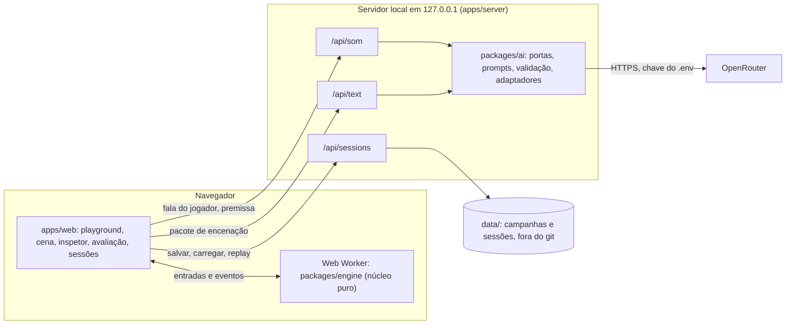

# Arquitetura

> **v1 — 2026-11-09.** Como o código do AI Fantasy se organiza. O que o produto faz está em
> [`docs/product.md`](<../product.md>); as regras do motor, no
> [modelo de simulação](<simulation-model.md>). Decisões estruturais nos ADRs 0013–0019.

## 1. Visão em uma tela



## 2. Pacotes e regras de dependência

O repositório é um monorepo TypeScript (workspaces do npm).

```text
ai-fantasy/
├── packages/
│   ├── engine/   núcleo puro e determinístico: domínio, presets, sorteio, regras, passo, replay
│   └── ai/       portas do SOM e do texto, prompts, validação, falas prontas (puro)
│                 + adaptadores do OpenRouter (só no servidor)
├── apps/
│   ├── server/   servidor local (Node 24): /api/som, /api/text, /api/sessions; guarda a chave
│   └── web/      site (React + Vite)
├── data/         campanhas e sessões gravadas (git-ignored)
└── docs/
```

| Pacote | Pode depender de | Não pode |
| --- | --- | --- |
| `packages/engine` | nada interno | I/O, DOM, APIs do Node, rede, relógio, `Math.random`, números quebrados no estado |
| `packages/ai` (parte pura) | `engine` (tipos e presets) | rede, DOM |
| `packages/ai` (adaptadores) | parte pura, `fetch` | ser importado pelo `web` |
| `apps/server` | `ai`, `engine` (tipos) | servir em outro endereço que não `127.0.0.1` |
| `apps/web` | `engine`, `ai` (parte pura) | chamar o OpenRouter, guardar a chave |

As regras são verificadas por lint (restrição de imports) e por um teste que falha se o motor
importar algo proibido.

## 3. O núcleo (`packages/engine`)

### 3.1 Módulos

| Módulo | Responsabilidade | Especificação |
| --- | --- | --- |
| `domain` | tipos, ids, aritmética em bp, versões | simulação §2 |
| `rng` | PRNG por stream, sorteio sem viés, registro, forçar caminho | simulação §15 |
| `time` | ticks, relógio, fases do dia, luz e alcance visual | simulação §2, §3.2 |
| `space` | grade, células cobertas e saídas, distância, linha de visão, audição, caminhos, movimento | simulação §3.1, §8.1, §8.2 |
| `presets` | catálogos e validação | [presets](<presets.md>) |
| `character` | camadas de status, traços, aptidões, associações | simulação §4, §5 |
| `context` | ameaça, presença, clima, horário | simulação §6 |
| `signals` | emissão, percepção e interpretação de sinais | simulação §7 |
| `acts` | catálogo, quem ouve, interpretação, avaliação, pedidos | [atos de conversa](<dialogue-acts.md>) |
| `decision` | utilidade, precedência de Maslow, escolha | simulação §10 |
| `turns` | vontade de agir, silêncio, interrupção, saída, fim | simulação §11 |
| `memory` | fatos, cópias, perspectiva, fidelidade, memórias marcantes | simulação §12 |
| `personality` | tendências e cristalização | simulação §13 |
| `generation` | elenco e laços a partir de presets | [presets](<presets.md>) |
| `scene` | o passo do motor e os eventos | simulação §16 |
| `session` | registro, hash, replay | simulação §15 |
| `continuity` | regras entre uma fatia e outra | simulação §14 |

### 3.2 API pública (esboço)

```ts
// primeira fatia: elenco gerado (seed do elenco) e cena (seed da cena)
createScene(setup: SceneSetup, seeds: { cast: number; scene: number }): SceneState;
// fatias seguintes: os mesmos personagens, com a história levada adiante
createSlice(campaign: CampaignState, setup: SliceSetup, sceneSeed: number): SceneState;
step(state: SceneState, input?: EngineInput): StepResult;
endSlice(state: SceneState, gap: TimeGap): CampaignState;
replay(log: SessionLog): ReplayResult;
hashState(state: SceneState): string;

type TimeGap = { hours: number; together: CharacterId[][] }; // horas inteiras; quem passou junto

type EngineInput =
  | { kind: "PLAYER_ACT"; act: ActLabel }          // ato confirmado do jogador
  | { kind: "TAKE_TURN"; characterId: CharacterId } // o jogador toma a vez
  | { kind: "SET_CONTROL"; characterId: CharacterId; mode: "MANUAL" | "AUTO" }
  | { kind: "FORCE_DRAW"; selector: DrawSelector; outcome: number }
  | { kind: "SET_DRAW_MODE"; mode: "NORMAL" | "MOST_LIKELY" };

interface StepResult {
  state: SceneState;
  events: EngineEvent[];   // ActResolved, SignalPerceived, StatusChanged, Silence, CharacterLeft, SceneEnded, RenderRequested
  awaiting?: { kind: "PLAYER_ACT"; characterId: CharacterId };
  ended: boolean;
}
```

`step` resolve um ponto de decisão por chamada, na ordem da simulação §16. Se o personagem do
jogador em `MANUAL` precisar agir, devolve `awaiting` e não avança mais até receber `PLAYER_ACT`
(o mundo espera). `SliceSetup` escolhe lugar, horário, clima, quem participa (entre os personagens
da campanha), posições e estados do dia.

## 4. Pacote de IA (`packages/ai`)

- **Portas:** `SystemOnePort` (`readPlayerLine`, `mapPremise`, `mapCharacter`, `mapBonds`) e
  `TextModelPort` (`renderLine`).
- **Parte pura:** construção das perguntas do SOM e do pacote de encenação, conversão de
  probabilidades para bp, validação das respostas, falas prontas por ato e tom, falsos
  determinísticos das duas portas.
- **Adaptadores:** cliente do OpenRouter para decisões e para chat, com tempo máximo, novas
  tentativas e telemetria. Só o servidor importa.

Contratos em [integração de IA](<ai-integration.md>).

## 5. Servidor local (`apps/server`)

| Rota | Faz |
| --- | --- |
| `POST /api/som/player-line` | lê a fala do jogador e devolve o ato provável com confiança |
| `POST /api/som/premise` | mapeia premissa e linhas de personagem para presets |
| `POST /api/text/render` | encena um pacote e devolve `{fala, gesto}` validado ou a fala pronta |
| `GET/POST /api/sessions…` | lista, grava e lê campanhas e fatias em `data/` |
| `GET /api/health` | estado e se há chave configurada (sem revelá-la) |

Escuta só em `127.0.0.1`. Em desenvolvimento, o Vite encaminha `/api` para o servidor (mesma
origem, sem CORS). Em uso normal, o servidor entrega o site já compilado.

## 6. Site (`apps/web`)

| Tela | Conteúdo |
| --- | --- |
| Playground | premissa e linhas de personagem → ficha montada pelo SOM → revisão e edição → começar; também criação manual |
| Cena | grade com os personagens, falas e gestos, entrada livre do jogador com a etiqueta "entendido como", controles (passo, automático, pausa, tomar a vez, modo de controle) |
| Inspetor | camadas de cada personagem, laços, percepção, vontades de agir, sorteios, efeitos, leitura do SOM e pacote enviado ao modelo de texto; seed, forçar caminho e modo "mais provável" |
| Avaliação | notas por fala e por cena, modo cego, painel de métricas |
| Sessões | campanhas, fatias, replay, ramificação, exportação da transcrição em Markdown |

O motor roda num **Web Worker** para o modo automático não travar a interface. Texto vindo dos
modelos é exibido como texto (nunca como HTML).

## 7. Fluxo de um turno

1. O motor chega a um ponto de decisão. Se o sorteado é o jogador em `MANUAL`, devolve
   `awaiting`.
2. O jogador escreve. O site manda a fala para `/api/som/player-line`.
3. Com confiança ≥ 7000 bp, o ato segue; abaixo disso, aparece a etiqueta para confirmar ou
   corrigir.
4. O site entrega `PLAYER_ACT` ao motor; o motor resolve o ato, avança os ticks e decide os
   próximos atos dos NPCs até precisar do jogador de novo.
5. Para cada `RenderRequested`, o site pede a fala a `/api/text/render` e a mostra quando chega.
   Enquanto isso, a cena espera.
6. Tudo (entradas, sorteios, respostas das IAs) entra no registro da sessão.

## 8. Dados e persistência

| Coisa | Formato | Onde |
| --- | --- | --- |
| Campanha | JSON: personagens persistentes, memórias, tempo entre fatias | `data/campaigns/<id>/campaign.json` |
| Fatia | JSONL: cabeçalho (versões, seeds, cena) + entradas, sorteios, eventos e chamadas de IA | `data/campaigns/<id>/slices/<n>.jsonl` |
| Avaliações | JSON por fatia | junto da fatia |
| Presets | dados tipados versionados | `packages/engine/src/presets/` |

Todo formato tem `formatVersion`. Ids de arquivo são validados contra `[a-z0-9-]` para evitar
acesso fora de `data/`.

## 9. Determinismo e fronteiras

- O estado autoritativo vive só no motor e só muda por `step`.
- Saídas de IA são **entradas** registradas, nunca estado direto.
- Texto livre (premissa, falas, nomes) fica no registro de apresentação, fora do hash.
- O replay reconstrói o estado a partir do registro e confere o hash a cada passo.

## 10. Segurança

- Chave do OpenRouter só no servidor, lida do `.env`; nunca em logs, respostas ou no git.
- Servidor só em `127.0.0.1`; limites de tamanho nos pedidos.
- Respostas de modelos são dados não confiáveis: validadas por esquema e exibidas como texto.
- Política de vulnerabilidades em [`SECURITY.md`](<../../SECURITY.md>).

## 11. Desempenho

Orçamento: um passo do motor com 8 personagens em até **16 ms** numa máquina de desenvolvimento
comum. Um benchmark do motor roda a cada PR que toca `packages/engine`. Se o orçamento estourar de
forma consistente, a tarefa condicional de WebAssembly (PERF-01) entra no roadmap (D-18).
