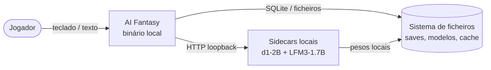
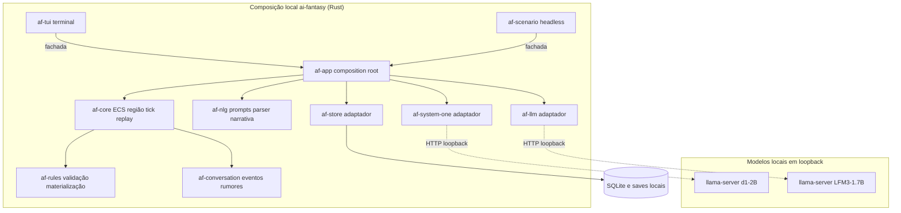
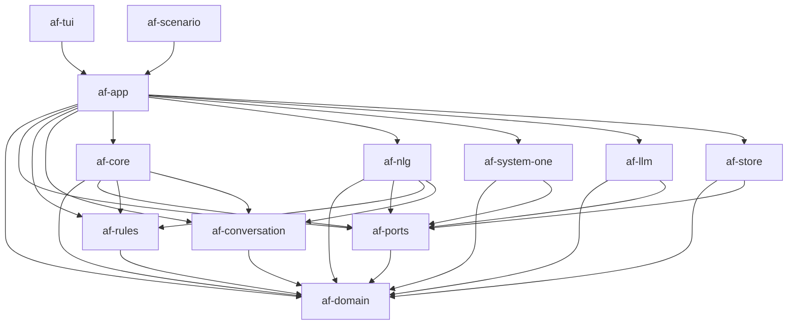
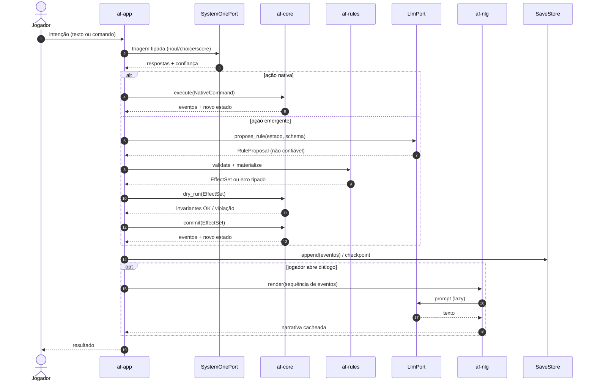
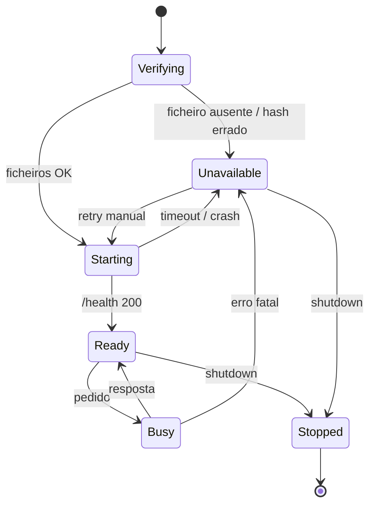

# Arquitetura de Software — Hermeneutic Core

> **Estado:** F0 — fundação, sem código executável. Revisão documental: **2026-11-08**.
> Este documento descreve fronteiras e contratos; decisões aceitas são preservadas e
> divergências estruturais exigem novo ADR. [ADRs](<adr/README.md>) e
> [roadmap canônico](<roadmap.md>) explicam a arquitetura; o
> [ROADMAP de execução](<../../ROADMAP.md>) concentra atividades, dependências e ondas.

## 1. Objetivo e atributos de qualidade

O Hermeneutic Core é o motor determinístico do AI Fantasy. Ele simula um mundo, resolve
interações sociais simbolicamente e só gera linguagem quando o jogador pede. A arquitetura
é otimizada, por esta ordem, para:

| Atributo | O que significa na prática |
| --- | --- |
| **Offline** | Nenhuma rede no runtime; só *loopback* para *sidecars* locais. |
| **Determinismo** | Mesmo seed + entradas ⇒ mesmo estado canónico e mesmo hash. |
| **Testabilidade** | Todo o comportamento é observável e controlável por portas públicas. |
| **Legibilidade** | Funções curtas, nomes claros, dependências explícitas, ADRs. |
| **Performance** | Medir trabalho por ação, região e inferência; LLMs/sidecars fora do tick, MLP pura determinística na trilha posterior. Sem teto de hardware nesta etapa. |
| **Portabilidade** | Desenvolvimento e testes na mesma máquina CPU/GPU em Windows/Linux; portabilidade desktop para macOS planejada, mobile posterior. |

A base simulável já é uma **região procedural com várias localidades**, não uma vila isolada.
Ações de movimento/fala avançam ticks lógicos e agendas regionais; câmera, NLG e relógio real
não avançam o mundo. Focar uma área não congela as outras nem retira suas entidades do hash.
Regras detalhadas de custo e atividade regional permanecem em revisão no
[ADR 0008 proposto](<adr/0008-action-driven-simulation-time.md>).

Subagents de desenvolvimento e o juiz de integração são papéis de execução do
[ROADMAP](<../../ROADMAP.md>), não componentes ou processos do jogo. Não confundem paralelismo
entre worktrees com paralelismo do tick, cuja regra do ADR 0005 permanece.

Não objetivos nesta fase: multiplayer, nuvem, editor visual, modding arbitrário,
render 3D e sincronização entre dispositivos. A stack do cliente 2D ainda está aberta.

## 2. Contexto (C4 — nível 1)



Não há utilizador remoto, serviço externo, conta ou telemetria. O diagrama não tem setas
para a Internet de propósito: a ausência é a decisão.

## 3. Contentores (C4 — nível 2)



**Legenda:** setas indicam composição/chamadas e fronteiras de I/O, não uma lista de
imports. Domínio e portas fornecem tipos/contratos; a tabela e o grafo da seção 4 são a
referência de dependências de código. O cliente 2D futuro não tem stack ou crate escolhida.

O núcleo não conhece HTTP, SQLite, relógio de parede ou `std::env`. Os adaptadores
implementam portas; o `af-app` injeta as implementações. Essa é a fronteira que permite
testar o jogo inteiro sem modelos reais.

## 4. Componentes e crates

| Crate | Responsabilidade | Depende de |
| --- | --- | --- |
| `af-domain` | IDs, `Tick`, `Seed`, ponto fixo, unidades, erros base, serialização canónica. | — |
| `af-ports` | Traits das dependências externas e tipos de transporte. | `af-domain` |
| `af-rules` | Schema de regras, validação, *clamps*, materializador, matemática de DC/efeitos. | `af-domain` |
| `af-conversation` | `ConversationEvent`, relação social, rumores, agregações. | `af-domain` |
| `af-core` | Mundo ECS, sistemas, tick, agenda, hash de estado, replay, aplicação de efeitos. | `af-domain`, `af-ports`, `af-rules`, `af-conversation` |
| `af-nlg` | Construção de *prompts*, parsing de *tool calls*, cache de narrativa, verificação factual. | `af-domain`, `af-conversation`, `af-rules`, `af-ports` |
| `af-system-one` | Adaptador d1-2B (llama.cpp `/v1/systemone`, ONNX futuro) + fake. | `af-domain`, `af-ports` |
| `af-llm` | Adaptador LFM3 (llama.cpp HTTP) + fake + cassettes. | `af-domain`, `af-ports` |
| `af-store` | SQLite, migrações, saves atómicos, eventos, cache de narrativa. | `af-domain`, `af-ports` |
| `af-app` | Composition root: configuração, injeção, ciclo de jogo, *sidecars*. | todos os anteriores |
| `af-tui` | UI de terminal (`ratatui`), input, modais. | `af-app` (fachada) |
| `af-scenario` | Runner headless de cenários E2E, golden output. | `af-app` |
| `xtask` | Automação de desenvolvimento (lints, métricas, offline check). | — (dev) |

### Regra de dependências



Regras:

1. Neste grafo, **A → B significa que A depende de B**; as setas reproduzem a coluna
   “Depende de” da tabela. Não indicam fluxo de eventos ou execução. Não há ciclos.
2. `af-core` nunca importa `af-app`, `af-tui`, `af-store`, `af-system-one`, `af-llm` ou
   `af-nlg`. `af-nlg` também não depende de `af-core`; recebe fatos/contratos de domínio,
   conversa, regras e portas, com composição feita no app.
3. `af-domain` não importa nada do workspace; é o vocabulário comum.
4. Adaptadores não vazam tipos de transporte (HTTP, SQLite) para o núcleo.
5. Toda a API pública tem `///` e exemplo compilável quando aplicável.

## 5. Portas e adaptadores

| Porta | Contrato | Fake (testes) | Real |
| --- | --- | --- | --- |
| `Clock` | Hora de parede apenas para logs/UI. | `FixedClock` | `SystemClock` |
| `RngSource` | *Streams* determinísticas por domínio. | `SeededTestRng` | `ChaChaRng` |
| `SystemOnePort` | `decide(state, questions) -> Answers`. | `ScriptedSystemOne` | `LlamaSystemOne` / `OnnxSystemOne` |
| `LlmPort` | `propose_rule(prompt)`, `render_narrative(prompt)`. | `FixtureLlm` | `LlamaLlm` |
| `SaveStore` | `load`, `save`, `list`, `delete`. | `InMemoryStore` | `SqliteStore` |
| `EventSink` | Registo append-only de eventos de domínio. | `VecSink` | `SqliteEventSink` |
| `ModelSupervisor` | `start`, `health`, `stop` de *sidecars*. | `FakeSupervisor` | `LlamaSupervisor` |
| `Transport` | POST loopback com timeout e limite de bytes. | `FakeTransport` | `LoopbackHttp` |
| `TelemetrySink` | Métricas locais, opt-in. | `NullSink` | `SqliteTelemetry` |

Contratos são testados contra fake **e** real (o real marcado `#[ignore]`, correndo na
nightly). O fake não pode ser mais permissivo do que o real: os testes de contrato usam a
mesma tabela de casos.

## 6. Fluxo de uma ação



Nenhum **LLM, System One ou sidecar live** participa das decisões internas do tick.
A mini-MLP pura em ponto fixo da trilha posterior pode modular a FSM/Utility AI
como função determinística; não recebe a camada privilegiada de silhuetas.
A NLG é lazy e somente leitura: seu resultado e sua demora não alteram estado ou tempo.

**Tempo por ação:** movimentar-se e falar simbolicamente consome o custo lógico contratado;
abrir histórico, gerar mais texto, esperar inferência ou navegar na câmera não acrescenta
simulação. A agenda regional processa os ticks devidos sem congelar áreas fora do foco.
Custos e ordem de processamento permanecem no [ADR 0008 proposto](<adr/0008-action-driven-simulation-time.md>).

**Limite do diagrama:** ele ilustra responsabilidades, não aprova a ordem durável de
commit, append, checkpoint e resposta ao jogador. Autoridade do save, revalidação de snapshot,
RNG transacional e protocolo de publicação precisam ser fechados em CTR-02 do
[ROADMAP](<../../ROADMAP.md>); não se aceita sucesso que depois se perca no log por falha de I/O.

## 7. Modelo de dados

### 7.1 IDs e unidades

- IDs são estáveis e geracionais; reutilizar um índice precisa distinguir sua nova geração.
  O desenho anterior declarou newtypes `u32` e, ao mesmo tempo, IDs embalados em `u64`.
  **A largura, o empacotamento e as referências históricas não estão aprovados**: CTR-01 do
  [ROADMAP](<../../ROADMAP.md>) deve fechar esse contrato sem perda de identidade.
- `Tick` e `Seed` usam a noção `u64` já documentada; relações e unidades usam inteiros/ponto
  fixo. `10_000` basis points equivale a 100%; conversões e limites precisam ser explícitos.
- Unidades no nome: `_bp` (basis points), `_ticks`, `_ms`, `_dc`. Milissegundos de diagnóstico
  não são ticks do mundo nem custos de ação.
- `f32`/`f64` não entram no estado autoritativo; probabilidades externas são normalizadas
  na fronteira com aritmética, rejeição e arredondamento a contratar.

### 7.2 Componentes do ator

| Componente | Conteúdo |
| --- | --- |
| `Attributes` | Força, agilidade, resiliência, perceção, inteligência, linguagem, memória, estabilidade emocional. |
| `Physiology` | HP atual/máximo, fadiga, fome, flags (`BLEEDING`, `BLINDED`, `BURNING`, `STARVING`, `FATIGUED`). |
| `Traits` | Vetor `[0, 1]` em ponto fixo: combatividade, empatia, medo, curiosidade, lealdade, ganância. |
| `Inventory` | Lista ordenada de `ItemId` + equipamento. |
| `Relationships` | Pares Flecs com eixos: confiança, medo, empatia, dependência, hostilidade. |
| `AiState` | FSM + última decisão de utilidade + *cooldowns*. |
| `Memory` | IDs de eventos/rumores e snapshots do ambiente autoritativamente percebido; sem prosa. Overlay de silhuetas não atualiza last-seen ou conhecimento. |

### 7.3 Registo de conversa (zero-string)

O desenho anterior de `ConversationEventRecord` indicava 48 bytes com 42 úteis + 6
reservados, mas a tabela publicada soma **46 bytes**. A tabela abaixo documenta esse desenho
inconsistente para revisão, **não um layout aprovado**. Não se escolhe automaticamente
46 + 2: IDs `u32`/geracionais `u64`, deltas percentuais `i8` sem precisão de 1 bp e um único
item/HP para até oito efeitos exigem contrato completo.

CTR-01 do [ROADMAP](<../../ROADMAP.md>) deve fechar identidade, offsets, ordem dos bytes,
reserva, precisão e preservação de todos os fatos. Serialização será explícita, sem
`#[repr(packed)]` ou dependência de layout de compilador.

| Campo | Tipo | Bytes | Semântica |
| --- | --- | --- | --- |
| `tick` | `u64` | 8 | Tick do evento. |
| `location` | `u32` | 4 | Tile/local empacotado. |
| `speaker` | `u32` | 4 | `ActorId`. |
| `listener` | `u32` | 4 | `ActorId`. |
| `intent` | `u16` | 2 | `GREETING`, `NEGOTIATE`, `EXTORTION`, `LIE`, `BRIBE`, `SHARE_RUMOR`, `APPEASE`. |
| `valence` | `i8` | 1 | −100…+100. |
| `outcome` | `u8` | 1 | Grau de sucesso 0…100. |
| `delta_empathy` | `i8` | 1 | Variação em pontos percentuais. |
| `delta_fear` | `i8` | 1 | Idem. |
| `delta_trust` | `i8` | 1 | Idem. |
| `delta_hostility` | `i8` | 1 | Idem. |
| `delta_hp` | `i16` | 2 | Dano/cura. |
| `item` | `u32` | 4 | Item trocado (0 = nenhum). |
| `labels` | `u32` | 4 | Bitmask: amizade, casamento, inimizade, família, aliança. |
| `statuses` | `u32` | 4 | Bitmask fisiológico. |
| `rumor` | `u32` | 4 | Rumor transmitido (0 = nenhum). |
| **Soma dos campos publicados** | | **46** | Observação aritmética; formato final, reservas, IDs e precisão pendentes de CTR-01. |

O registo não contém texto. A NLG reconstrói o diálogo a partir da sequência, dos rótulos e
dos estados anexados.

### 7.4 Proposta de regra (schema v1)

```json
{
  "schema_version": 1,
  "action_label": "PUBLIC_EXTORTION_BY_FORGED_DEBT",
  "attributes": {
    "actor_primary": "LANGUAGE",
    "actor_secondary": "INTELLIGENCE",
    "target_primary": "PERCEPTION",
    "target_secondary": "EMOTIONAL_STABILITY",
    "required_item": "FORGED_DEBT_LETTER"
  },
  "target_dc": 16,
  "on_success": {
    "effects": [
      { "kind": "transfer_item", "item": "WAREHOUSE_DEED", "from": "target", "to": "actor" },
      { "kind": "delta_relationship", "target": "target", "axis": "fear", "amount_bp": 3500 },
      { "kind": "delta_relationship", "target": "target", "axis": "empathy", "amount_bp": -2500 },
      { "kind": "attach_label", "target": "target", "label": "ENEMY" },
      { "kind": "apply_status", "target": "target", "status": "INTIMIDATED", "duration_ticks": 600 }
    ]
  },
  "on_failure": {
    "effects": [
      { "kind": "delta_relationship", "target": "target", "axis": "hostility", "amount_bp": 6000 },
      { "kind": "attach_label", "target": "target", "label": "EXPOSED_LIAR" }
    ]
  },
  "propagation": {
    "scope": "GROUP",
    "initial_fidelity_bp": 10000,
    "half_life_ticks": 2400,
    "requires_living_carrier": true,
    "min_cognition_bp": 4000
  }
}
```

Regras do schema:

- `deny_unknown_fields`; versão obrigatória; limites de tamanho (≤ 64 KiB).
- Efeitos são uma *allowlist* fechada; não há `eval`, SQL, shell ou código.
- IDs de item/actor têm de existir; `target` é um seletor restrito (`actor`, `target`,
  `bystanders`, `region`).
- `target_dc` ∈ [5, 25]; `amount_bp` ∈ [−10_000, 10_000]; `duration_ticks` ≤ 1 ano de jogo.
- O materializador aplica *clamps* e orçamento (máx. 8 efeitos por resultado).
- A proveniência é anexada pelo núcleo, nunca pelo modelo.

**Gramática ainda em revisão:** esse JSON é desenho de `RuleProposal`, não prova de parsing
real. O exemplo de tool call usa tokens `<function=...>`/`<parameter=...>`, não XML padrão,
e nomes `attributes_involved`/`on_success_changes`/`on_failure_changes`/`propagation_rules`
diferentes de `attributes`/`on_success`/`on_failure`/`propagation`; também precisa reconciliar
versão obrigatória. CTR-04 do [ROADMAP](<../../ROADMAP.md>) fecha enquadramento, mapeamento,
cardinalidade, duplicatas e sintaxe, sem ampliar a allowlist ou aplicar respostas diretamente.

### 7.5 Percepção regional e apresentação privilegiada

A primeira base é uma região procedural com várias localidades. FOV e memória são dados
simulados do observador; câmera/foco não congela outras áreas nem remove suas entidades do
estado canônico. Construção/percepção/render posterior amplia a base, não inaugura a região.

A API somente leitura precisa de **dois canais separados**, com contrato em CTR-03:

- **Percepção autoritativa:** visão atual, snapshot last-seen congelado e desconhecido por
  observador; abastece conhecimento, NPCs e inputs percebidos da MLP.
- **Overlay privilegiado de apresentação:** silhuetas de **todos** os personagens atrás de
  construções, inclusive não percebidos. Não atualiza last-seen, informação de rumores,
  memória do ambiente ou conhecimento/MLP dos NPCs.

O overlay revela presença ao jogador deliberadamente. Alcance, áreas nunca vistas, z-levels,
permissões e DTO concreto ainda não estão definidos; não se reintroduz “somente percebidos”
como resolução técnica. O [ADR 0009 proposto](<adr/0009-privileged-silhouette-overlay.md>)
registra a decisão e os testes futuros. Mover câmera/abrir NLG não muda tempo ou memória.

## 8. Determinismo

O contrato completo está no [ADR 0005](adr/0005-deterministic-simulation-contract.md).
Resumo operacional:

```text
step(world, command, ctx) -> (world', events, stats)
```

- `ctx` injeta `seed`, `RngSource`, `Tick` e portas; o núcleo não tem globais mutáveis.
- Sistemas correm numa ordem topológica fixa; queries que afetam resultado são ordenadas.
- Estado canónico: chaves ordenadas, coleções ordenadas, sem `HashMap`, sem `f32`, sem
  timestamps voláteis. Hash BLAKE3.
- Teste planejado: 100 execuções com a mesma seed e entradas autoritativas normalizadas
  produzem o mesmo hash; replay não consulta modelos ou relógio real. O formato dessas
  entradas, RNG transacional e autoridade durável permanecem em CTR-01/CTR-02.
- Tempo é dirigido por custo lógico das ações, não relógio real ou duração do texto NLG.
  A região completa, agendas, genomas e memória relevantes às decisões permanecem no hash;
  câmera, overlay de apresentação e medições voláteis ficam fora.

## 9. Runtime offline e *sidecars*



- **Bind** obrigatório em `127.0.0.1`; porta configurável/efémera.
- **Verificação:** SHA-256 do `.gguf`/`.onnx` no arranque; se falhar, não carregar.
- **Sem download automático.** O utilizador provisiona; `af models verify` valida.
- **Sem API keys.** Nenhum header de autenticação remota.
- **Timeout e limite de bytes** em cada pedido; `max_tokens` explícito.
- **Fallback:** se o System One não estiver pronto, o triage usa heurística nativa; se o
  LLM não estiver pronto, ações emergentes são recusadas com mensagem clara. O jogo nunca
  bloqueia no arranque por causa de um modelo.
- **Shutdown:** `kill` gracioso, *wait* com timeout, limpeza de portas e ficheiros temporários.

Configuração por ambiente (sem rede):

| Variável | Efeito |
| --- | --- |
| `AF_OFFLINE` | Offline é invariante, não opção para ligar nuvem; valor diferente não habilita sockets externos. |
| `AF_MODELS_DIR` | Diretório dos pesos e manifestos. |
| `AF_SAVE_DIR` | Diretório de saves e SQLite. |
| `AF_SEED` | Seed inicial (debug/testes). |
| `AF_LOG` | Nível/filtro de `tracing`. |

## 10. Persistência

- SQLite local, `rusqlite` com `bundled`, WAL, `foreign_keys=ON`.
- Tabelas: `schema_migrations`, `saves`, `events`, `narratives`, `rules`, `telemetry`
  (opt-in).
- **Requisito de durabilidade:** falha preserva o último save válido. A proposta de exportar
  snapshot com `tmp`/`fsync`/`rename` e backup não autoriza renomear um banco WAL aberto.
- **Formato em revisão:** AIFS, versão, seed, tick, hash, payload e checksum são desenho;
  codec, layout e limites precisam ser fechados, não escolhidos entre CBOR/Postcard por suposição.
- **CTR-02 pendente:** autoridade entre banco, log e snapshot, ordem durável de commit/append,
  recuperação após crash e momento de publicar sucesso; [ROADMAP](<../../ROADMAP.md>).
- **Migrações:** forward-only, versionadas, testadas com fixtures de saves antigos.
- **Event log:** append-only, ordenado por tick/sequência; permite replay e auditoria.
- **Cache de narrativa:** chave = hash da sequência + modelo + versão do *prompt* + locale;
  invalidado quando qualquer componente muda.

## 11. Erros e invariantes

- `af-domain` define `AfError` com código estável (`AF-CORE-0001`, `AF-RULE-0007`).
- Bibliotecas usam `thiserror`; `anyhow` só em `af-app`/binários.
- Proibido `unwrap`/`expect`/`panic!` em bibliotecas (lint); erros são valores.
- Invariantes verificados em cada tick:
  - `0 ≤ hp ≤ hp_max`; `0 ≤ fome/fadiga ≤ 100`; itens não negativos;
  - relações em `[-10_000, 10_000]` bp; labels/status válidos;
  - DC ∈ [5, 25]; nenhum efeito em entidade morta/inexistente.
- Violação de invariante é **bug**: aborta o tick, preserva o save anterior, regista hash,
  seed e comando; nunca “corrige silenciosamente”.

## 12. Observabilidade

- `tracing` estruturado, local; sem PII, sem rede.
- Métricas: duração do tick, entidades, eventos, fila de modelos, latência p50/p95,
  cache hit/miss, regras aceites/rejeitadas por motivo.
- `af stats` lê o SQLite e imprime um resumo; `af doctor` verifica modelos, saves e
  permissões.
- Telemetria de padrões é **opt-in**, local e apagável; nunca enviada.
- Logs de debug incluem `seed`, `tick`, `state_hash` para reprodução.

## 13. Segurança e privacidade

- Fronteira de confiança: tudo o que vem do modelo é **não confiável**.
- *Prompt injection*: eventos são dados; delimitadores explícitos; nenhuma instrução do
  estado é executada; validação pós-modelo.
- *Path traversal*: canonicalizar caminhos de saves/modelos; rejeitar `..`, links
  simbólicos e ficheiros fora de `AF_MODELS_DIR`/`AF_SAVE_DIR`.
- *Resource exhaustion*: limites de tamanho, timeout, `max_tokens`, profundidade de JSON,
  número de efeitos, entidades e rumores.
- Sem segredos no repositório; sem telemetria remota; sem código gerado em runtime.
- Detalhes em [`SECURITY.md`](../../SECURITY.md).

## 14. Orçamentos de performance (alvos, não garantias)

| Operação | Alvo | Onde medir |
| --- | --- | --- |
| Tick headless, 10k entidades | < 2 ms p50, < 5 ms p99 | `criterion` + cenário E2E |
| Triagem System One (batch 16) | < 100 ms p95 desktop; < 250 ms mobile | teste de contrato/latência |
| Proposta de regra LFM3 | < 2 s p95 (fora do tick) | teste `#[ignore]` live |
| NLG de 3 eventos | < 4 s p95, cache hit < 5 ms | teste live/cache |
| Memória combinada | < 2,8 GB | soak test 12 h |
| Save/load 10k entidades | < 250 ms p95 | benchmark |

**Revisão D-05:** os números desta tabela são referências diagnósticas históricas, não
limites aprovados de hardware ou gates de escopo nesta etapa. A CPU/GPU da mesma máquina do
maintainer será usada para desenvolver e testar em Windows/Linux. Não reduzir a região ou
adiar correções para obedecer artificialmente a 2,8 GB ou à latência de um perfil não escolhido.

Resultados futuros devem declarar hardware, sistema, build, contexto, população/localidades,
concorrência, aquecimento e amostras. Tempo de execução, uso de memória e percentis vão para
artefatos separados, fora do hash/golden determinístico. Os gates de correção, qualidade,
offline e determinismo continuam obrigatórios. Requisitos mínimos e política de regressão
serão decididos com evidência; nenhum benchmark ou model card foi revalidado neste pacote.

## 15. Decisões abertas

| ID | Questão | Estado |
| --- | --- | --- |
| O-01 | Versão estável de `flecs_ecs` e *soundness* do wrapper. | a validar no scaffold |
| O-02 | d1-2B via llama.cpp vs ONNX para `multiple`/`number`/`box`. | ADR futuro |
| O-03 | UX de provisionamento de modelos (manual vs comando explícito). | ADR futuro |
| O-04 | Licença dos assets (arte, fontes, áudio). | ADR futuro |
| O-05 | Suporte mobile (iOS/Android) e limites de memória. | ADR futuro |
| O-06 | Qualidade do NLG em português vs inglês. | Medição futura na trilha de NLG. |
| O-07 | Custos de ações, ordem de agendas e transação de tempo/replay. | CTR-02/DOC-02; [ADR 0008 proposto](<adr/0008-action-driven-simulation-time.md>). |
| O-08 | Alcance, áreas nunca vistas, z-levels, permissões e API do overlay de todos os personagens. | CTR-03; [ADR 0009 proposto](<adr/0009-privileged-silhouette-overlay.md>). Não restringir a apenas percebidos. |
| O-09 | IDs geracionais, evento compacto de soma 46 versus declaração 42/48, precisão e fatos completos. | CTR-01; formato não aprovado. |
| O-10 | Gramática de tool call, mapeamento ao schema e autoridade durável do save. | CTR-04 e CTR-02; não resolvidos por exemplos. |
| O-11 | Política de atividade e limites da região com várias localidades desde a base. | CTR-03/DOC-02; câmera/foco não congela áreas nem as exclui do hash. |
| O-12 | Stack e ponte concreta do cliente 2D, perfis mínimos de hardware do produto. | D-06 aberta; D-05 sem teto nesta etapa. |

Essas pendências têm trabalho e aceite no [ROADMAP de execução](<../../ROADMAP.md>).
Decisões de produto registradas não são aprovação de implementação matemática ou execução
imediata de contratos, código, testes ou releases.

## 16. Referências

- [Roadmap corrigido](roadmap.md)
- [ADRs](adr/)
- [Regras de desenvolvimento](../engineering/development-rules.md)
- [Estratégia de testes](../engineering/testing-strategy.md)
- [Qualidade de código](../engineering/code-quality.md)
- [IA offline](../engineering/offline-ai.md)
- [Glossário](../glossary.md)
