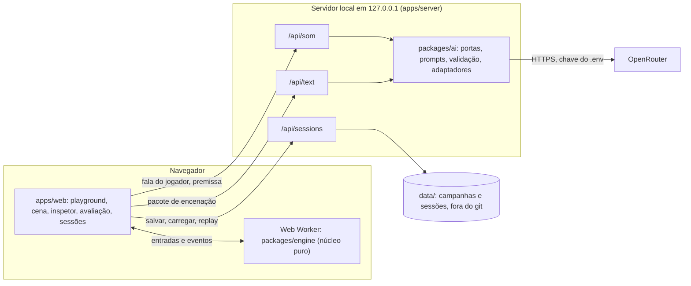

# Arquitetura

> **v1 — 2026-11-09.** Como o código do AI Fantasy se organiza. O que o produto faz está em
> [`docs/product.md`](<../product.md>); as regras do motor, no
> [modelo de simulação](<simulation-model.md>). Decisões estruturais nos ADRs 0013–0021.

## 1. Visão em uma tela



## 2. Pacotes e regras de dependência

O repositório é um monorepo TypeScript (workspaces do npm).

```text
ai-fantasy/
├── packages/
│   ├── engine/   núcleo puro e determinístico: domínio, presets, sorteio, regras, passo, replay
│   └── ai/       portas do SOM e do texto, prompts, validação, falas prontas (puro)
│                 + adaptadores do OpenRouter (só no servidor)
├── apps/
│   ├── server/   servidor local (Node 24): /api/som, /api/text, /api/sessions; guarda a chave
│   └── web/      site (React + Vite)
├── data/         campanhas e sessões gravadas (git-ignored)
└── docs/
```

| Pacote | Pode depender de | Não pode |
| --- | --- | --- |
| `packages/engine` | nada interno | I/O, DOM, APIs do Node, rede, relógio, `Math.random`, números quebrados no estado |
| `packages/ai` (parte pura) | `engine` (tipos e presets) | rede, DOM |
| `packages/ai` (adaptadores) | parte pura, `fetch` | ser importado pelo `web` |
| `apps/server` | `ai`, `engine` (tipos) | servir em outro endereço que não `127.0.0.1` |
| `apps/web` | `engine`, `ai` (parte pura) | chamar o OpenRouter, guardar a chave |

As regras são verificadas por lint (restrição de imports) e por um teste que falha se o motor
importar algo proibido.

## 3. O núcleo (`packages/engine`)

### 3.1 Módulos

| Módulo | Responsabilidade | Especificação |
| --- | --- | --- |
| `domain` | tipos, ids, aritmética em bp, versões | simulação §2 |
| `rng` | PRNG por stream, sorteio sem viés, registro, forçar caminho | simulação §15 |
| `time` | ticks, relógio, fases do dia, luz e alcance visual | simulação §2, §3.2 |
| `space` | grade, células cobertas e saídas, distância, linha de visão, audição, caminhos, movimento | simulação §3.1, §8.1, §8.2 |
| `presets` | catálogos e validação | [presets](<presets.md>) |
| `character` | camadas de status, traços, aptidões, associações | simulação §4, §5 |
| `context` | ameaça, presença, clima, horário | simulação §6 |
| `signals` | emissão, percepção e interpretação de sinais | simulação §7 |
| `acts` | catálogo, quem ouve, interpretação, avaliação, pedidos | [atos de conversa](<dialogue-acts.md>) |
| `decision` | utilidade, precedência de Maslow, escolha | simulação §10 |
| `turns` | vontade de agir, silêncio, interrupção, saída, fim | simulação §11 |
| `memory` | fatos, cópias, perspectiva, fidelidade, memórias marcantes | simulação §12 |
| `personality` | tendências e cristalização | simulação §13 |
| `generation` | elenco e laços a partir de presets | [presets](<presets.md>) |
| `scene` | o passo do motor e os eventos | simulação §16 |
| `session` | registro, hash, replay | simulação §15 |
| `continuity` | regras entre uma fatia e outra | simulação §14 |

### 3.2 API pública (esboço)

```ts
// primeira fatia: elenco gerado (seed do elenco) e cena (seed da cena)
createScene(setup: SceneSetup, seeds: { cast: number; scene: number }): SceneState;
// fatias seguintes: os mesmos personagens, com a história levada adiante
createSlice(campaign: CampaignState, setup: SliceSetup, sceneSeed: number): SceneState;
step(state: SceneState, input?: EngineInput): StepResult;
endSlice(state: SceneState, gap: TimeGap): CampaignState;
replay(log: SessionLog): ReplayResult;
hashState(state: SceneState): string;

type TimeGap = { hours: number; together: CharacterId[][] }; // horas inteiras; quem passou junto

type EngineInput =
  | { kind: "PLAYER_ACT"; act: ActLabel }          // ato confirmado do jogador
  | { kind: "TAKE_TURN"; characterId: CharacterId } // o jogador toma a vez
  | { kind: "SET_CONTROL"; characterId: CharacterId; mode: "MANUAL" | "AUTO" } // só o personagem do jogador; NPCs são sempre AUTO
  | { kind: "FORCE_DRAW"; selector: DrawSelector; outcome: number }
  | { kind: "SET_DRAW_MODE"; mode: "NORMAL" | "MOST_LIKELY" };

interface StepResult {
  state: SceneState;
  events: EngineEvent[];   // ActResolved, SignalPerceived, StatusChanged, Silence, CharacterLeft, SceneEnded, RenderRequested
  awaiting?: { kind: "PLAYER_ACT"; characterId: CharacterId };
  ended: boolean;
}
```

`step` resolve um ponto de decisão por chamada, na ordem da simulação §16. Se o personagem do
jogador em `MANUAL` precisar agir, devolve `awaiting` e não avança mais até receber `PLAYER_ACT`
(o mundo espera). `SliceSetup` escolhe lugar, horário, clima, quem participa (entre os personagens
da campanha), posições e estados do dia.

## 4. Pacote de IA (`packages/ai`)

- **Portas:** `SystemOnePort` (`readPlayerLine`, `mapPremise`, `mapCharacter`, `mapBonds`) e
  `TextModelPort` (`renderLine`).
- **Parte pura:** construção das perguntas do SOM e do pacote de encenação, conversão de
  probabilidades para bp, validação das respostas, falas prontas por ato e tom, falsos
  determinísticos das duas portas.
- **Adaptadores:** cliente do OpenRouter para decisões e para chat, com tempo máximo, novas
  tentativas e telemetria. Só o servidor importa.

Contratos em [integração de IA](<ai-integration.md>).

## 5. Servidor local (`apps/server`)

| Rota | Faz |
| --- | --- |
| `POST /api/som/player-line` | lê a fala do jogador e devolve o ato provável com confiança |
| `POST /api/som/premise` | mapeia premissa e linhas de personagem para presets |
| `POST /api/text/render` | encena um pacote e devolve `{fala, gesto}` validado ou a fala pronta |
| `GET /api/sessions/campaigns` | lista as campanhas gravadas e as fatias de cada uma |
| `GET`, `PUT /api/sessions/campaigns/:campaignId` | lê e grava a campanha (`campaign.json`) |
| `GET`, `PUT /api/sessions/campaigns/:campaignId/slices/:sliceId` | lê e grava uma fatia (JSONL) |
| `GET /api/health` | `{ "status": "ok", "aiKeyConfigured": boolean }`: diz se há chave, sem revelá-la |

Escuta só em `127.0.0.1` (constante, não configurável) e só atende o próprio site (seção 10). Em
desenvolvimento, o Vite (`127.0.0.1:5173`) encaminha `/api` para o servidor; em uso normal, o
servidor entrega o site já compilado (`apps/web/dist`). As rotas `/api/som/*` e `/api/text/*`
chegam com a AI-02 e a AI-03.

### 5.1 Sessões

Contrato da WEB-03 e da EVAL-01. Formatos, ids e gravação na seção 8.

| Pedido | Corpo | Resposta |
| --- | --- | --- |
| `GET /api/sessions/campaigns` | — | `200 { "campaigns": [{ "id": "…", "sliceIds": ["1", "2", "2-b"] }] }`, campanhas e fatias em ordem lexicográfica; só entram campanhas com `campaign.json` |
| `GET …/campaigns/:campaignId` | — | `200` com o `campaign.json` (`application/json; charset=utf-8`); `404` se não existe |
| `PUT …/campaigns/:campaignId` | `application/json`: objeto com `formatVersion` inteiro ≥ 1 | `204`; grava ou substitui a campanha |
| `GET …/campaigns/:campaignId/slices/:sliceId` | — | `200` com os bytes gravados (`application/x-ndjson; charset=utf-8`); `404` se não existe |
| `PUT …/campaigns/:campaignId/slices/:sliceId` | `application/x-ndjson` (seção 8) | `204`; grava exatamente o que recebeu; `404` se a campanha não existe (ela é gravada antes das fatias) |

Id fora do padrão dá `400` antes de tocar no disco; corpo inválido, `400`; outro tipo de conteúdo,
`415`. Não há `DELETE` por enquanto.

### 5.2 Erros

Todo erro é JSON, `{ "error": { "code": "…", "message": "…" } }`, com o código estável para o site
e a mensagem em português para pessoas. A mensagem nunca repete o conteúdo do pedido.

| Status | `code` | Quando |
| --- | --- | --- |
| 400 | `INVALID_ID` | `campaignId` ou `sliceId` fora do padrão da seção 8 |
| 400 | `INVALID_BODY` | campanha ou fatia inválida; JSON malformado ou vazio |
| 4xx | `REQUEST_REJECTED` | outro pedido recusado antes da rota (URL malformada, parâmetro longo demais…) |
| 403 | `FORBIDDEN_HOST`, `FORBIDDEN_ORIGIN` | pedido de fora do site local (seção 10) |
| 404 | `NOT_FOUND` | rota, campanha ou fatia inexistente |
| 413 | `BODY_TOO_LARGE` | corpo acima do limite da rota (seção 5.3) |
| 415 | `UNSUPPORTED_MEDIA_TYPE` | tipo de conteúdo que a rota não aceita |
| 500 | `INTERNAL_ERROR` | falha interna; a pilha vai para o log, nunca para a resposta |

### 5.3 Configuração

Um módulo tipado (`apps/server/src/config.ts`, validado com Zod, [ADR 0021](<adr/0021-zod-for-schema-validation.md>))
lê o ambiente depois de carregar o `.env` da raiz; variáveis já definidas no ambiente vencem.
Valor vazio conta como ausente (vale o padrão). Valor inválido impede o servidor de subir: ele
imprime uma linha `Erro: … — Solução: …` por variável. As variáveis de IA estão na
[integração de IA](<ai-integration.md>), seção 3; as do servidor são estas:

| Variável | Padrão | Aceita |
| --- | --- | --- |
| `PORT` | `4318` | inteiro de 0 a 65535 (0: o sistema escolhe uma porta livre) |
| `DATA_DIR` | `data/` na raiz do repositório | caminho; um relativo parte da raiz do repositório, nunca da pasta atual |
| `BODY_LIMIT_BYTES` | `1048576` (1 MiB) | inteiro maior que 0: corpo máximo de toda rota, menos as gravações de sessão |
| `SESSION_BODY_LIMIT_BYTES` | `33554432` (32 MiB) | inteiro maior que 0: corpo máximo de `PUT` de campanha e de fatia |
| `LOG_LEVEL` | `info` | `fatal`, `error`, `warn`, `info`, `debug`, `trace` ou `silent` |

### 5.4 Log

O log é o do Fastify (pino): uma linha JSON por evento no stdout, a partir de `LOG_LEVEL`. Entra
cada pedido (método, URL, host, status e tempo), as recusas 4xx só com o código do framework e as
falhas 500 com a pilha; nunca o corpo do pedido. `req.headers.authorization` e
`req.headers.cookie` saem como `[Redacted]`, e a chave vive num invólucro `Secret` que vira
`[redacted]` em texto, em JSON e no `inspect` do Node: nem um log acidental da configuração a
revela. Nos testes, sem destino de log, o servidor fica em silêncio.

### 5.5 Ponto de extensão

`buildApp({ config, webDistDir, plugins, logger })` monta o app sem escutar (os testes usam
`inject`); `startServer` faz o mesmo e escuta em `127.0.0.1:<PORT>`. Os `plugins` são plugins do
Fastify registrados depois das rotas centrais, com `{ config }` nas opções: as rotas de IA (AI-02 e
AI-03), o modo de teste com portas falsas e as rotas de avaliação (EVAL-01) entram por aí, e a
proteção da seção 10, os limites e os erros em JSON valem para elas.

## 6. Site (`apps/web`)

| Tela | Conteúdo |
| --- | --- |
| Playground | premissa e linhas de personagem → ficha montada pelo SOM → revisão e edição → começar; também criação manual |
| Cena | grade com os personagens, falas e gestos, entrada livre do jogador com a etiqueta "entendido como", controles (passo, automático, pausa, tomar a vez, modo de controle) |
| Inspetor | camadas de cada personagem, laços, percepção, vontades de agir, sorteios, efeitos, leitura do SOM e pacote enviado ao modelo de texto; seed, forçar caminho e modo "mais provável" |
| Avaliação | notas por fala e por cena, modo cego, painel de métricas |
| Sessões | campanhas, fatias, replay, ramificação, exportação da transcrição em Markdown |

O motor roda num **Web Worker** para o modo automático não travar a interface. Texto vindo dos
modelos é exibido como texto (nunca como HTML).

## 7. Fluxo de um turno

1. O motor chega a um ponto de decisão. Se o sorteado é o jogador em `MANUAL`, devolve
   `awaiting`.
2. O jogador escreve. O site manda a fala para `/api/som/player-line`.
3. Com confiança ≥ 7000 bp, o ato segue; abaixo disso, aparece a etiqueta para confirmar ou
   corrigir.
4. O site entrega `PLAYER_ACT` ao motor; o motor resolve o ato, avança os ticks e decide os
   próximos atos dos NPCs até precisar do jogador de novo.
5. Para cada `RenderRequested`, o site pede a fala a `/api/text/render` e a mostra quando chega.
   Enquanto isso, a cena espera.
6. Tudo (entradas, sorteios, respostas das IAs) entra no registro da sessão.

## 8. Dados e persistência

| Coisa | Formato | Onde |
| --- | --- | --- |
| Campanha | JSON: personagens persistentes, memórias, tempo entre fatias | `data/campaigns/<campaignId>/campaign.json` |
| Fatia | JSONL: cabeçalho (versões, seeds, cena) + entradas, sorteios, eventos e chamadas de IA | `data/campaigns/<campaignId>/slices/<sliceId>.jsonl` |
| Avaliações | JSON por fatia | junto da fatia |
| Presets | dados tipados versionados | `packages/engine/src/presets/` |

`data/` é a pasta `DATA_DIR` (seção 5.3), fora do git. Todo formato tem `formatVersion`, inteiro
≥ 1: no objeto da campanha e na primeira linha (o cabeçalho) da fatia.

- **Ids** (`campaignId` e `sliceId`): `^[a-z0-9][a-z0-9-]{0,63}$`, isto é, de 1 a 64 caracteres
  entre `a-z`, `0-9` e `-`, começando por letra ou número. As fatias se chamam `1`, `2`… e, numa
  ramificação, `2-b`. Sem ponto, barra ou contrabarra, um id nunca sai da sua pasta; um id
  inválido é recusado antes de tocar no disco e, por defesa em profundidade, todo caminho montado
  ainda precisa ficar dentro de `DATA_DIR`.
- **Fatia em JSONL:** texto UTF-8 que termina com `\n`, um objeto JSON por linha. O servidor grava
  e devolve os bytes recebidos, sem reescrever nada (`\r\n` e espaços incluídos).
- **Campanha:** o servidor regrava o objeto recebido como JSON com 2 espaços de indentação e `\n`
  no fim; os campos ficam como vieram.
- **Escrita atômica:** primeiro um arquivo temporário na mesma pasta (`.<nome>.<uuid>.tmp`, gravado
  em disco), depois `rename`; quem lê vê o arquivo antigo ou o novo, nunca a metade.
- **Listagem:** campanhas e fatias em ordem lexicográfica, comparando caracteres (`"1"`, `"10"`,
  `"2"`); entradas que não seguem o padrão (temporários, outros arquivos) ficam de fora.

## 9. Determinismo e fronteiras

- O estado autoritativo vive só no motor e só muda por `step`.
- Saídas de IA são **entradas** registradas, nunca estado direto.
- Texto livre (premissa, falas, nomes) fica no registro de apresentação, fora do hash.
- O replay reconstrói o estado a partir do registro e confere o hash a cada passo.

## 10. Segurança

- Chave do OpenRouter só no servidor, lida do `.env` para um invólucro `Secret` (seção 5.4); nunca
  em logs, respostas ou no git.
- Servidor só em `127.0.0.1`; limites de tamanho nos pedidos (seção 5.3).
- **Só o site local usa o servidor.** Escutar em `127.0.0.1` não basta: uma página de outro site
  aberta no mesmo navegador ainda consegue mandar pedidos para ele, e as rotas de IA gastam a
  chave. Por isso:
  - o cabeçalho `Host` precisa ser `127.0.0.1:<porta>` ou `localhost:<porta>` (a porta em que o
    pedido chegou) ou `127.0.0.1:5173`/`localhost:5173` (o Vite em desenvolvimento); senão,
    `403 FORBIDDEN_HOST`. Isso barra o *DNS rebinding*, em que um domínio estranho passa a
    resolver para `127.0.0.1`;
  - um pedido que pode mudar estado (todo método menos `GET`, `HEAD` e `OPTIONS`) e traz o
    cabeçalho `Origin` só passa se a origem for `http://` de um desses hosts; senão,
    `403 FORBIDDEN_ORIGIN`. Sem `Origin` (uma ferramenta local, não um navegador), passa;
  - não há CORS: nenhuma resposta traz `Access-Control-Allow-*`, então o navegador impede outros
    sites de ler as respostas.
- Respostas de modelos são dados não confiáveis: validadas por esquema e exibidas como texto.
- Política de vulnerabilidades em [`SECURITY.md`](<../../SECURITY.md>).

## 11. Desempenho

Orçamento: um passo do motor com 8 personagens em até **16 ms** numa máquina de desenvolvimento
comum. Um benchmark do motor roda a cada PR que toca `packages/engine`. Se o orçamento estourar de
forma consistente, a tarefa condicional de WebAssembly (PERF-01) entra no roadmap (D-18).
