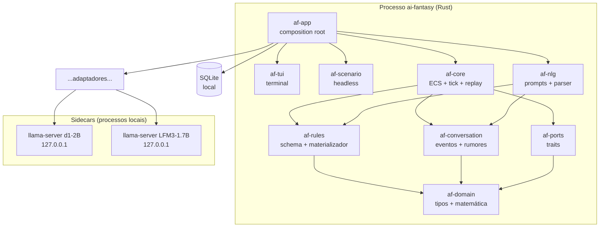
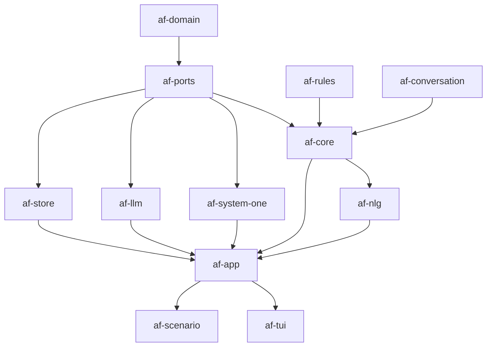
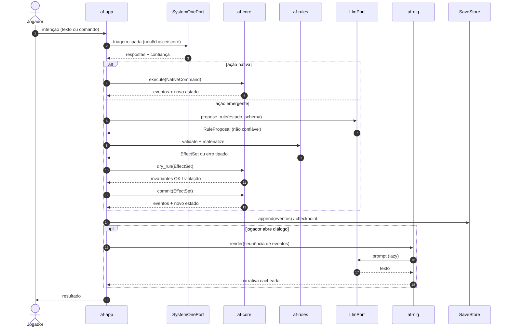
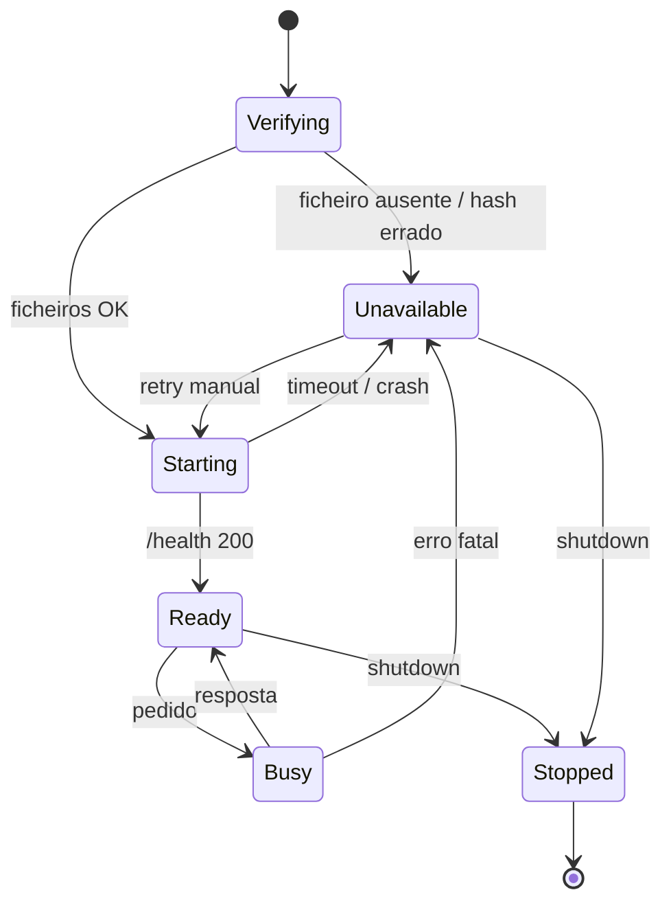

# Arquitetura de Software — Hermeneutic Core

> **Estado:** fundação. Este documento é normativo para a arquitetura; o código ainda não
> existe. Quando a implementação divergir, o ADR correspondente tem de ser atualizado ou
> superseded. Decisões: [`adr/`](adr/).

## 1. Objetivo e atributos de qualidade

O Hermeneutic Core é o motor determinístico do AI Fantasy. Ele simula um mundo, resolve
interações sociais simbolicamente e só gera linguagem quando o jogador pede. A arquitetura
é otimizada, por esta ordem, para:

| Atributo | O que significa na prática |
| --- | --- |
| **Offline** | Nenhuma rede no runtime; só *loopback* para *sidecars* locais. |
| **Determinismo** | Mesmo seed + entradas ⇒ mesmo estado canónico e mesmo hash. |
| **Testabilidade** | Todo o comportamento é observável e controlável por portas públicas. |
| **Legibilidade** | Funções curtas, nomes claros, dependências explícitas, ADRs. |
| **Performance** | Milhares de entidades e ticks baratos; IA fora do *game loop*. |
| **Portabilidade** | Windows, Linux e macOS primeiro; mobile depois. |

Não objetivos nesta fase: multiplayer, nuvem, editor visual, *modding* arbitrário,
render 3D, sincronização entre dispositivos.

## 2. Contexto (C4 — nível 1)


Não há utilizador remoto, serviço externo, conta ou telemetria. O diagrama não tem setas
para a Internet de propósito: a ausência é a decisão.

## 3. Contentores (C4 — nível 2)



O núcleo não conhece HTTP, SQLite, relógio de parede ou `std::env`. Os adaptadores
implementam portas; o `af-app` injeta as implementações. Essa é a fronteira que permite
testar o jogo inteiro sem modelos reais.

## 4. Componentes e crates

| Crate | Responsabilidade | Depende de |
| --- | --- | --- |
| `af-domain` | IDs, `Tick`, `Seed`, ponto fixo, unidades, erros base, serialização canónica. | — |
| `af-ports` | Traits das dependências externas e tipos de transporte. | `af-domain` |
| `af-rules` | Schema de regras, validação, *clamps*, materializador, matemática de DC/efeitos. | `af-domain` |
| `af-conversation` | `ConversationEvent`, relação social, rumores, agregações. | `af-domain` |
| `af-core` | Mundo ECS, sistemas, tick, agenda, hash de estado, replay, aplicação de efeitos. | `af-domain`, `af-ports`, `af-rules`, `af-conversation` |
| `af-nlg` | Construção de *prompts*, parsing de *tool calls*, cache de narrativa, verificação factual. | `af-domain`, `af-conversation`, `af-rules`, `af-ports` |
| `af-system-one` | Adaptador d1-2B (llama.cpp `/v1/systemone`, ONNX futuro) + fake. | `af-domain`, `af-ports` |
| `af-llm` | Adaptador LFM3 (llama.cpp HTTP) + fake + cassettes. | `af-domain`, `af-ports` |
| `af-store` | SQLite, migrações, saves atómicos, eventos, cache de narrativa. | `af-domain`, `af-ports` |
| `af-app` | Composition root: configuração, injeção, ciclo de jogo, *sidecars*. | todos os anteriores |
| `af-tui` | UI de terminal (`ratatui`), input, modais. | `af-app` (fachada) |
| `af-scenario` | Runner headless de cenários E2E, golden output. | `af-app` |
| `xtask` | Automação de desenvolvimento (lints, métricas, offline check). | — (dev) |

### Regra de dependências



Regras:

1. As setas apontam para **dentro** (direção de dependência: quem está em baixo depende de
   quem está em cima). Não há ciclos.
2. `af-core` nunca importa `af-app`, `af-tui`, `af-store`, `af-system-one` ou `af-llm`.
3. `af-domain` não importa nada do workspace; é o vocabulário comum.
4. Adaptadores não vazam tipos de transporte (HTTP, SQLite) para o núcleo.
5. Toda a API pública tem `///` e exemplo compilável quando aplicável.

## 5. Portas e adaptadores

| Porta | Contrato | Fake (testes) | Real |
| --- | --- | --- | --- |
| `Clock` | Hora de parede apenas para logs/UI. | `FixedClock` | `SystemClock` |
| `RngSource` | *Streams* determinísticas por domínio. | `SeededTestRng` | `ChaChaRng` |
| `SystemOnePort` | `decide(state, questions) -> Answers`. | `ScriptedSystemOne` | `LlamaSystemOne` / `OnnxSystemOne` |
| `LlmPort` | `propose_rule(prompt)`, `render_narrative(prompt)`. | `FixtureLlm` | `LlamaLlm` |
| `SaveStore` | `load`, `save`, `list`, `delete`. | `InMemoryStore` | `SqliteStore` |
| `EventSink` | Registo append-only de eventos de domínio. | `VecSink` | `SqliteEventSink` |
| `ModelSupervisor` | `start`, `health`, `stop` de *sidecars*. | `FakeSupervisor` | `LlamaSupervisor` |
| `Transport` | POST loopback com timeout e limite de bytes. | `FakeTransport` | `LoopbackHttp` |
| `TelemetrySink` | Métricas locais, opt-in. | `NullSink` | `SqliteTelemetry` |

Contratos são testados contra fake **e** real (o real marcado `#[ignore]`, correndo na
nightly). O fake não pode ser mais permissivo do que o real: os testes de contrato usam a
mesma tabela de casos.

## 6. Fluxo de uma ação



Nenhum modelo participa no tick. A NLG é sempre *lazy* e o seu resultado não altera estado.

## 7. Modelo de dados

### 7.1 IDs e unidades

```rust
pub struct ActorId(u32);
pub struct ItemId(u32);
pub struct LocationId(u32);
pub struct Tick(u64);
pub struct Seed(u64);
pub struct BasisPoints(i32); // 10_000 = 100%
pub struct Fixed(Q16_16);    // ponto fixo para atributos
```

- IDs são geracionais: `(index, generation)` embalados num `u64`; nunca reutilizar sem
  incrementar a geração.
- Unidades no nome: `_bp` (basis points), `_ticks`, `_ms`, `_dc`.
- `f32`/`f64` não entram no estado autoritativo.

### 7.2 Componentes do ator

| Componente | Conteúdo |
| --- | --- |
| `Attributes` | Força, agilidade, resiliência, perceção, inteligência, linguagem, memória, estabilidade emocional. |
| `Physiology` | HP atual/máximo, fadiga, fome, flags (`BLEEDING`, `BLINDED`, `BURNING`, `STARVING`, `FATIGUED`). |
| `Traits` | Vetor `[0, 1]` em ponto fixo: combatividade, empatia, medo, curiosidade, lealdade, ganância. |
| `Inventory` | Lista ordenada de `ItemId` + equipamento. |
| `Relationships` | Pares Flecs com eixos: confiança, medo, empatia, dependência, hostilidade. |
| `AiState` | FSM + última decisão de utilidade + *cooldowns*. |
| `Memory` | Referências a eventos/rumores relevantes (IDs, não texto). |

### 7.3 Registo de conversa (zero-string)

`ConversationEventRecord` é escrito num buffer fixo de **48 bytes** (42 de carga útil, 6 de
alinhamento/reserva). Não usar `#[repr(packed)]`; a serialização é explícita, campo a campo,
para não depender de layout de compilador.

| Campo | Tipo | Bytes | Semântica |
| --- | --- | --- | --- |
| `tick` | `u64` | 8 | Tick do evento. |
| `location` | `u32` | 4 | Tile/local empacotado. |
| `speaker` | `u32` | 4 | `ActorId`. |
| `listener` | `u32` | 4 | `ActorId`. |
| `intent` | `u16` | 2 | `GREETING`, `NEGOTIATE`, `EXTORTION`, `LIE`, `BRIBE`, `SHARE_RUMOR`, `APPEASE`. |
| `valence` | `i8` | 1 | −100…+100. |
| `outcome` | `u8` | 1 | Grau de sucesso 0…100. |
| `delta_empathy` | `i8` | 1 | Variação em pontos percentuais. |
| `delta_fear` | `i8` | 1 | Idem. |
| `delta_trust` | `i8` | 1 | Idem. |
| `delta_hostility` | `i8` | 1 | Idem. |
| `delta_hp` | `i16` | 2 | Dano/cura. |
| `item` | `u32` | 4 | Item trocado (0 = nenhum). |
| `labels` | `u32` | 4 | Bitmask: amizade, casamento, inimizade, família, aliança. |
| `statuses` | `u32` | 4 | Bitmask fisiológico. |
| `rumor` | `u32` | 4 | Rumor transmitido (0 = nenhum). |
| **Total** | | **48** | 42 úteis + 6 reservados. |

O registo não contém texto. A NLG reconstrói o diálogo a partir da sequência, dos rótulos e
dos estados anexados.

### 7.4 Proposta de regra (schema v1)

```json
{
  "schema_version": 1,
  "action_label": "PUBLIC_EXTORTION_BY_FORGED_DEBT",
  "attributes": {
    "actor_primary": "LANGUAGE",
    "actor_secondary": "INTELLIGENCE",
    "target_primary": "PERCEPTION",
    "target_secondary": "EMOTIONAL_STABILITY",
    "required_item": "FORGED_DEBT_LETTER"
  },
  "target_dc": 16,
  "on_success": {
    "effects": [
      { "kind": "transfer_item", "item": "WAREHOUSE_DEED", "from": "target", "to": "actor" },
      { "kind": "delta_relationship", "target": "target", "axis": "fear", "amount_bp": 3500 },
      { "kind": "delta_relationship", "target": "target", "axis": "empathy", "amount_bp": -2500 },
      { "kind": "attach_label", "target": "target", "label": "ENEMY" },
      { "kind": "apply_status", "target": "target", "status": "INTIMIDATED", "duration_ticks": 600 }
    ]
  },
  "on_failure": {
    "effects": [
      { "kind": "delta_relationship", "target": "target", "axis": "hostility", "amount_bp": 6000 },
      { "kind": "attach_label", "target": "target", "label": "EXPOSED_LIAR" }
    ]
  },
  "propagation": {
    "scope": "GROUP",
    "initial_fidelity_bp": 10000,
    "half_life_ticks": 2400,
    "requires_living_carrier": true,
    "min_cognition_bp": 4000
  }
}
```

Regras do schema:

- `deny_unknown_fields`; versão obrigatória; limites de tamanho (≤ 64 KiB).
- Efeitos são uma *allowlist* fechada; não há `eval`, SQL, shell ou código.
- IDs de item/actor têm de existir; `target` é um seletor restrito (`actor`, `target`,
  `bystanders`, `region`).
- `target_dc` ∈ [5, 25]; `amount_bp` ∈ [−10_000, 10_000]; `duration_ticks` ≤ 1 ano de jogo.
- O materializador aplica *clamps* e orçamento (máx. 8 efeitos por resultado).
- A proveniência é anexada pelo núcleo, nunca pelo modelo.

## 8. Determinismo

O contrato completo está no [ADR 0005](adr/0005-deterministic-simulation-contract.md).
Resumo operacional:

```text
step(world, command, ctx) -> (world', events, stats)
```

- `ctx` injeta `seed`, `RngSource`, `Tick` e portas; o núcleo não tem globais mutáveis.
- Sistemas correm numa ordem topológica fixa; queries que afetam resultado são ordenadas.
- Estado canónico: chaves ordenadas, coleções ordenadas, sem `HashMap`, sem `f32`, sem
  timestamps voláteis. Hash BLAKE3.
- Teste de prova: 100 execuções com o mesmo seed ⇒ mesmo hash; replay do log ⇒ mesmo hash.

## 9. Runtime offline e *sidecars*



- **Bind** obrigatório em `127.0.0.1`; porta configurável/efémera.
- **Verificação:** SHA-256 do `.gguf`/`.onnx` no arranque; se falhar, não carregar.
- **Sem download automático.** O utilizador provisiona; `af models verify` valida.
- **Sem API keys.** Nenhum header de autenticação remota.
- **Timeout e limite de bytes** em cada pedido; `max_tokens` explícito.
- **Fallback:** se o System One não estiver pronto, o triage usa heurística nativa; se o
  LLM não estiver pronto, ações emergentes são recusadas com mensagem clara. O jogo nunca
  bloqueia no arranque por causa de um modelo.
- **Shutdown:** `kill` gracioso, *wait* com timeout, limpeza de portas e ficheiros temporários.

Configuração por ambiente (sem rede):

| Variável | Efeito |
| --- | --- |
| `AF_OFFLINE` | `1` (default) proíbe qualquer socket não-loopback. |
| `AF_MODELS_DIR` | Diretório dos pesos e manifestos. |
| `AF_SAVE_DIR` | Diretório de saves e SQLite. |
| `AF_SEED` | Seed inicial (debug/testes). |
| `AF_LOG` | Nível/filtro de `tracing`. |

## 10. Persistência

- SQLite local, `rusqlite` com `bundled`, WAL, `foreign_keys=ON`.
- Tabelas: `schema_migrations`, `saves`, `events`, `narratives`, `rules`, `telemetry`
  (opt-in).
- **Save atómico:** escrever em `*.tmp`, `fsync`, `rename`; manter o anterior como
  `.bak`. Nunca sobrescrever em sítio.
- **Formato:** `AIFS` magic + versão + seed + tick + hash + payload (CBOR/Postcard) +
  checksum. Limite de tamanho e validação antes de desserializar.
- **Migrações:** forward-only, versionadas, testadas com fixtures de saves antigos.
- **Event log:** append-only, ordenado por tick/sequência; permite replay e auditoria.
- **Cache de narrativa:** chave = hash da sequência + modelo + versão do *prompt* + locale;
  invalidado quando qualquer componente muda.

## 11. Erros e invariantes

- `af-domain` define `AfError` com código estável (`AF-CORE-0001`, `AF-RULE-0007`).
- Bibliotecas usam `thiserror`; `anyhow` só em `af-app`/binários.
- Proibido `unwrap`/`expect`/`panic!` em bibliotecas (lint); erros são valores.
- Invariantes verificados em cada tick:
  - `0 ≤ hp ≤ hp_max`; `0 ≤ fome/fadiga ≤ 100`; itens não negativos;
  - relações em `[-10_000, 10_000]` bp; labels/status válidos;
  - DC ∈ [5, 25]; nenhum efeito em entidade morta/inexistente.
- Violação de invariante é **bug**: aborta o tick, preserva o save anterior, regista hash,
  seed e comando; nunca “corrige silenciosamente”.

## 12. Observabilidade

- `tracing` estruturado, local; sem PII, sem rede.
- Métricas: duração do tick, entidades, eventos, fila de modelos, latência p50/p95,
  cache hit/miss, regras aceites/rejeitadas por motivo.
- `af stats` lê o SQLite e imprime um resumo; `af doctor` verifica modelos, saves e
  permissões.
- Telemetria de padrões é **opt-in**, local e apagável; nunca enviada.
- Logs de debug incluem `seed`, `tick`, `state_hash` para reprodução.

## 13. Segurança e privacidade

- Fronteira de confiança: tudo o que vem do modelo é **não confiável**.
- *Prompt injection*: eventos são dados; delimitadores explícitos; nenhuma instrução do
  estado é executada; validação pós-modelo.
- *Path traversal*: canonicalizar caminhos de saves/modelos; rejeitar `..`, links
  simbólicos e ficheiros fora de `AF_MODELS_DIR`/`AF_SAVE_DIR`.
- *Resource exhaustion*: limites de tamanho, timeout, `max_tokens`, profundidade de JSON,
  número de efeitos, entidades e rumores.
- Sem segredos no repositório; sem telemetria remota; sem código gerado em runtime.
- Detalhes em [`SECURITY.md`](../../SECURITY.md).

## 14. Orçamentos de performance (alvos, não garantias)

| Operação | Alvo | Onde medir |
| --- | --- | --- |
| Tick headless, 10k entidades | < 2 ms p50, < 5 ms p99 | `criterion` + cenário E2E |
| Triagem System One (batch 16) | < 100 ms p95 desktop; < 250 ms mobile | teste de contrato/latência |
| Proposta de regra LFM3 | < 2 s p95 (fora do tick) | teste `#[ignore]` live |
| NLG de 3 eventos | < 4 s p95, cache hit < 5 ms | teste live/cache |
| Memória combinada | < 2,8 GB | soak test 12 h |
| Save/load 10k entidades | < 250 ms p95 | benchmark |

Números da fabricante (por exemplo, “5,7 ms numa H100”) são **referências externas**, não
metas do projeto; medimos no hardware suportado e publicamos os resultados.

## 15. Decisões abertas

| ID | Questão | Estado |
| --- | --- | --- |
| O-01 | Versão estável de `flecs_ecs` e *soundness* do wrapper. | a validar no scaffold |
| O-02 | d1-2B via llama.cpp vs ONNX para `multiple`/`number`/`box`. | ADR futuro |
| O-03 | UX de provisionamento de modelos (manual vs comando explícito). | ADR futuro |
| O-04 | Licença dos assets (arte, fontes, áudio). | ADR futuro |
| O-05 | Suporte mobile (iOS/Android) e limites de memória. | ADR futuro |
| O-06 | Qualidade do NLG em português vs inglês. | medir na fase 5 |

## 16. Referências

- [Roadmap corrigido](roadmap.md)
- [ADRs](adr/)
- [Regras de desenvolvimento](../engineering/development-rules.md)
- [Estratégia de testes](../engineering/testing-strategy.md)
- [Qualidade de código](../engineering/code-quality.md)
- [IA offline](../engineering/offline-ai.md)
- [Glossário](../glossary.md)
