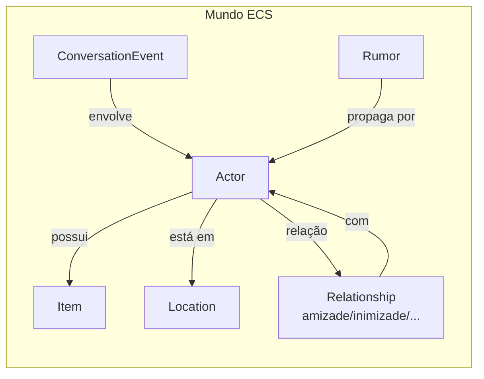
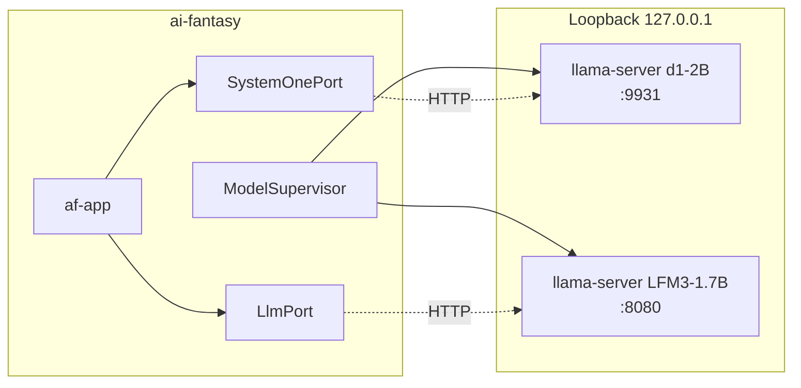
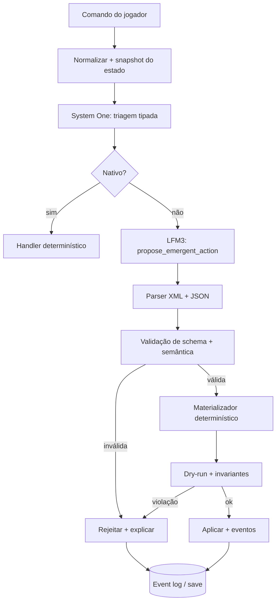
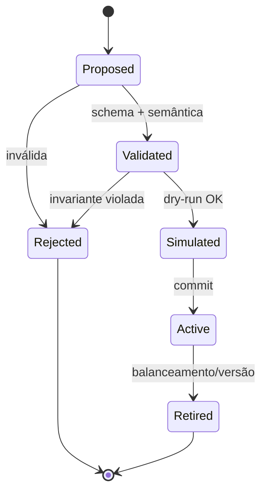
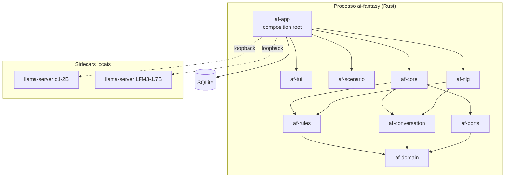
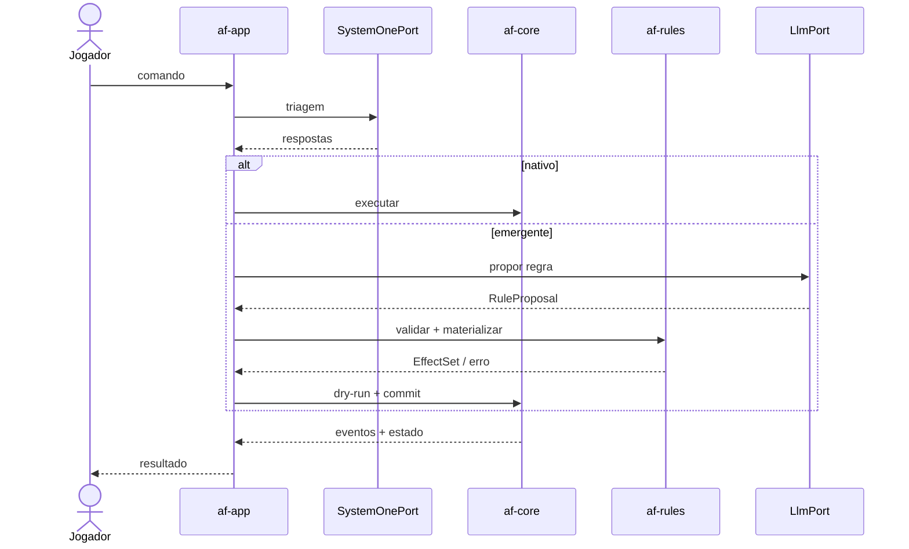

# AI Fantasy / Hermeneutic Core — Arquitetura e Roadmap de Engenharia

**Simulação procedural offline, diálogos simbólicos, System One local (d1-2B) e LFM3-1.7B.**

| | |
| --- | --- |
| **Versão do documento** | 2.1 (corrige e substitui o roadmap anterior; regista redes neurais por raça/espécie) |
| **Data** | 2026-11-08 |
| **Estado** | Fundação — arquitetura e regras; sem código executável |
| **Público** | maintainers, contribuidores, revisores de arquitetura |
| **Documentos normativos** | [`overview.md`](overview.md), [`../engineering/development-rules.md`](../engineering/development-rules.md), [`../engineering/testing-strategy.md`](../engineering/testing-strategy.md), [`../engineering/code-quality.md`](../engineering/code-quality.md) |

> **Leia a secção 0 primeiro.** Ela corrige o erro central do documento original:
> **nada roda no JEV — nem nunca rodou**. Nos rascunhos, “JEV” **apenas representava** o
> papel de **System One**, hoje materializado pelo **d1-2B local**; a razão é simples e
> não negociável: **tudo é offline**. Esta correção muda a arquitetura, o vocabulário e
> os testes.

---

## 0. Errata: JEV não é runtime

### 0.1 O erro do documento original

O documento anterior descrevia o **JEV** como uma “camada de regras dinâmicas” executada
pelo LFM3-1.7B, com *tool calls*, telemetria, propagação espaço-temporal e até *fallback*
de runtime. Isso confundia três coisas distintas:

1. **JEV** — um **modelo System One** da TypeSafe, servido por API (inclui OpenRouter).
2. **System One** — a **classe/função** de decisão rápida e tipada.
3. **Motor de regras** — o componente **determinístico** do jogo que valida e aplica
   regras.

O JEV não é o item 2 nem o item 3. É o item 1: um modelo de decisão, não um motor, e
muito menos um motor offline.

**A verdade curta: nada roda no JEV — nem nunca rodou.** Não existe, nem existirá,
processo, fila, base de dados, servidor ou execução “no JEV”. Nos rascunhos, “JEV”
**apenas representava** o papel de System One — exatamente o papel que, neste projeto,
é desempenhado pelo **d1-2B local**. E a razão é única: **tudo é offline**; qualquer
componente que exigisse JEV (um serviço remoto) estaria, por definição, fora do
projeto.

### 0.2 Afirmações corrigidas

| Afirmação original | Realidade | Consequência |
| --- | --- | --- |
| “O JEV é o motor de regras dinâmicas.” | JEV é um modelo System One da TypeSafe, acedido por API. | Não há “motor JEV”; as regras vivem no `af-rules` determinístico. |
| “Nada roda no JEV” (implícito no desenho) | **Nada** roda no JEV: não há processo, servidor, fila, base ou socket JEV. | Remover JEV de diagramas, código, config e deploy. |
| “O LFM3 aciona a ferramenta `jev_define_emergent_action`.” | O LFM3 local pode chamar `propose_emergent_action`; a proposta é validada pelo núcleo. | Ferramenta renomeada; schema fechado; sem execução direta. |
| “O JEV define atributos, DC, dano, itens e status.” | O **schema** define o que é permitido; o **modelo propõe**; o **materializador** aplica. | DC/valores têm *clamps* e validação semântica. |
| “O JEV propaga espaço-temporalmente.” | A propagação é um sistema do `af-core`/`af-conversation`, com RNG determinístico. | O modelo não simula propagação. |
| “O LFM3 deve manter `<think` ativo nas chamadas ao JEV.” | O `<think` é uma opção do LFM3 para a proposta; tem orçamento e é medido. | Não é um requisito de “JEV”; é uma política de *prompt*. |
| “A telemetria do JEV alimenta a conversão em código.” | A telemetria é local, opt-in e revista por humanos; não alimenta nada automaticamente. | Sem pipeline automático de “aprender regras”. |
| “JEV é offline.” | JEV é um serviço/modelo remoto; o projeto é offline e **não o usa**. | Zero dependência de JEV/OpenRouter no runtime. |

### 0.3 O que o JEV realmente é

No documento original, “JEV” era **só isso**: a *representação* do papel de System One,
sem qualquer runtime associado. O produto real da TypeSafe é este:

- É o primeiro modelo **System One** da TypeSafe: recebe um estado e perguntas tipadas e
  devolve respostas com probabilidades, **sem gerar texto** [^1].
- É servido por **API** (OpenRouter ou API própria) [^2]; não é um motor de jogo.
- A documentação descreve-o como um modelo de decisão (calibração, primitivas), não como
  um *runtime* de regras.

### 0.4 O que roda neste projeto

| Papel | Implementação | Onde | Offline? |
| --- | --- | --- | --- |
| Decisão rápida tipada (System One) | **LiquidAI/d1-2B** | llama.cpp `/v1/systemone` ou ONNX Runtime | ✅ local |
| NLU/NLG e proposta de regras | **LiquidAI/LFM3-1.7B** | llama.cpp HTTP local | ✅ local |
| Validação/materialização de regras | `af-rules` (Rust) | No processo | ✅ |
| Simulação, ECS, propagação | `af-core` | No processo | ✅ |
| Persistência | SQLite local | Ficheiro | ✅ |
| **JEV** | **Nenhum** | **Não existe** | — |

### 0.5 Vocabulário canónico

- No código e na arquitetura: **`system_one`**, `SystemOnePort`, `SystemOneAnswer`.
- No código: **nunca** `jev`, `jev_*`, `JevEngine`, `jev_server`, `jev.db`.
- Na documentação: “JEV” só aparece nesta errata, no glossário e em citações históricas
  explicitamente marcadas.
- O modelo concreto é sempre nomeado: `d1-2B`, não “JEV”.

### 0.6 Critérios de aceitação da correção

- [ ] `rg -i '\bjev\b' crates/` não devolve nada.
- [ ] `rg 'jev_' crates/` não devolve rotas, tabelas, funções ou variáveis.
- [ ] O diagrama de contentores tem “System One (d1-2B)”, não “JEV”.
- [ ] O teste de *offline* falha se o binário tentar contactar um *host* não-loopback.
- [ ] A tabela de modelos não atribui regras ao JEV.
- [ ] O README e o roadmap explicam a correção sem ambiguidade.

### 0.7 O que mudou face ao documento original

- O título e a secção 3 deixam de tratar JEV como motor.
- A ferramenta `jev_define_emergent_action` passa a `propose_emergent_action`.
- O diagrama “Entrada → System One → JEV” é substituído pelo fluxo
  “System One → núcleo determinístico → proposta validada”.
- A expressão “JEV Guard” passa a “Rule Guard”.
- As imagens base64 e as infografias de *marketing* foram removidas; os diagramas são
  Mermaid, versionáveis e revistos.
- Os números da fabricante passam a estar marcados como **alegação externa**; os nossos
  orçamentos são medições locais.

### 0.8 Decisões registadas nesta revisão (2026-11-08)

- **Nomenclatura do documento.** Este markdown passa a chamar-se apenas **`roadmap`**
  (`docs/architecture/roadmap.md`); o título histórico “Roadmap Jogo Procedural Com
  LFM3” e o sufixo “hermeneutic-core” deixam de fazer parte do nome. O ficheiro
  original mantém-se na raiz do repositório só como **fonte histórica**, sem valor
  normativo.
- **Mini-MLP por personagem (individualidade).** Cada personagem tem o **seu próprio
  perceptron de múltiplas camadas**, inicializado pelo arquétipo da raça/espécie e
  afiado pela experiência de vida; detalhe na **secção 2.8**. Fase **F8**.
- **Redes neurais por raça/espécie.** Ideia aprovada e registada na **secção 2.8**:
  pequenas redes neurais por raça/espécie para treinar comportamentos (trabalho,
  estilo de combate, dia a dia) com treino e **evolução darwiniana**. Execução
  prevista na fase **F8**; o MVP (F0–F7) não depende dela.
- **Mundo em blocos (estilo Dwarf Fortress/Minecraft).** Cada bloco da grelha pode ser
  casa, caverna, buraco, árvore, parede ou água; detalhe na **secção 2.9**.
- **Visualização 2D isométrica, sem 3D real.** O render final é 2D com visão isométrica;
  **não haverá qualquer visualização 3D real**; detalhe na **secção 2.10**.

---

## 1. Visão, pilares e não objetivos

### 1.1 Visão

Um RPG procedural inspirado no *Adventure Mode* de *Dwarf Fortress*, com o mundo numa
**grelha de blocos** (casas, cavernas, buracos, árvores — estilo *Dwarf
Fortress*/*Minecraft*) e visualização final **2D isométrica — nunca 3D real**, onde:

- o mundo é simulado por regras determinísticas, não por texto gerado;
- cada personagem é uma **individualidade**: o seu próprio mini perceptron (secção 2.8);
- cada interação social é um evento simbólico auditável;
- o diálogo é uma **interpretação sob procura** de eventos, não a fonte de verdade;
- a IA local acrescenta flexibilidade (ações inéditas, narrativa) sem comprometer
  determinismo, privacidade ou testabilidade.

### 1.2 Pilares

1. **Simulação primeiro.** O jogo funciona sem modelos.
2. **Offline.** Nenhuma rede no runtime.
3. **Determinismo.** Replay e testes são cidadãos de primeira classe.
4. **Modelo propõe, núcleo dispõe.** Nenhum modelo altera estado diretamente.
5. **Zero-string no loop.** Texto é renderizado depois, não simulado.
6. **Complexidade baixa.** Código que se lê e se refatora.

### 1.3 Não objetivos (nesta fase)

- Multiplayer, nuvem, contas, telemetria remota.
- **3D real em visualização** — excluído para sempre: o render final é 2D isométrico
  (secção 2.10). Animação rica e áudio em tempo real também não são objetivos.
- Editor visual de regras ou *modding* arbitrário.
- “Agente autónomo” que joga sozinho; o foco é a simulação e a experiência do jogador.
- Qualquer dependência de JEV, OpenRouter ou API paga.

---

## 2. Arquitetura de simulação

### 2.1 ECS com relacionamentos nativos

O núcleo usa **Flecs** (via `flecs_ecs`), escolhido pelos relacionamentos de entidade
nativos, *pairs*, queries com *joins* e armazenamento em arquétipos [^3]. Entidades são
IDs estáveis; componentes são dados puros; sistemas são funções determinísticas.



Componentes principais:

| Componente | Dados |
| --- | --- |
| `Attributes` | Força, agilidade, resiliência, perceção, inteligência, linguagem, memória, estabilidade emocional (ponto fixo). |
| `Physiology` | HP, fadiga, fome, flags de status. |
| `Traits` | Combatividade, empatia, medo, curiosidade, lealdade, ganância em `[0, 1]`. |
| `Inventory` | Lista ordenada de itens + equipamento. |
| `Relationships` | Eixos: confiança, medo, empatia, dependência, hostilidade (basis points). |
| `AiState` | FSM + utilidade + *cooldowns*. |
| `Memory` | IDs de eventos/rumores, não texto. |

### 2.2 Comportamento autónomo

FSM + *Utility AI* sobre cinco macroações:

| Ação | Gatilho | Efeito |
| --- | --- | --- |
| `FORM_PARTY` | afinidade de metas | aliança temporária |
| `NEGOTIATE` | recursos/informação | troca sem força |
| `INITIATE_COMBAT` | hostilidade/oportunidade | entra no loop tático |
| `FLEE` | medo/desvantagem | *pathfinding* A* |
| `APPEASE` | risco de dano | cessar-fogo/submissão |

Os traços evoluem por reforço: sucesso reforça o traço usado; dano grave inibe e aumenta
medo/fuga. Tudo em ponto fixo e com RNG determinístico; nada de “personalidade” gerada por
LLM no tick. A evolução darwiniana de comportamentos por raça/espécie, com pequenas
redes neurais treináveis, está desenhada na secção 2.8 — a FSM + Utility AI continua a
ser sempre a base.

### 2.3 Tick, tempo e determinismo

```text
step(world, command, ctx) -> (world', events, stats)
```

- `Tick(u64)` é a única noção de tempo do núcleo; 1 tick = passo lógico (alvo: 100 ms de
  simulação, render desacoplado).
- Sistemas ordenados topologicamente; queries ordenadas quando a ordem afeta o resultado.
- RNG ChaCha20 com *streams* por domínio (`social`, `combat`, `rumor`, `spawn`).
- Sem `HashMap`, `Instant::now`, `thread_rng` ou `f32` no estado autoritativo.
- Hash BLAKE3 do estado canónico; replay a partir de seed + log de comandos.

O contrato completo está no [ADR 0005](adr/0005-deterministic-simulation-contract.md).

### 2.4 Registo objetivo de conversa (zero-string)

Cada interação produz um `ConversationEventRecord` de **48 bytes** (42 úteis + 6 de
reserva/alinhamento). A serialização é explícita; não dependemos de `#[repr(packed)]`.

| Campo | Tipo | Bytes | Semântica |
| --- | --- | --- | --- |
| `tick` | `u64` | 8 | Tick do evento. |
| `location` | `u32` | 4 | Tile/local empacotado. |
| `speaker` | `u32` | 4 | `ActorId` que fala. |
| `listener` | `u32` | 4 | `ActorId` que ouve. |
| `intent` | `u16` | 2 | `GREETING`, `NEGOTIATE`, `EXTORTION`, `LIE`, `BRIBE`, `SHARE_RUMOR`, `APPEASE`. |
| `valence` | `i8` | 1 | −100…+100. |
| `outcome` | `u8` | 1 | 0…100. |
| `delta_empathy` | `i8` | 1 | Pontos percentuais. |
| `delta_fear` | `i8` | 1 | Pontos percentuais. |
| `delta_trust` | `i8` | 1 | Pontos percentuais. |
| `delta_hostility` | `i8` | 1 | Pontos percentuais. |
| `delta_hp` | `i16` | 2 | Dano/cura. |
| `item` | `u32` | 4 | Item trocado (0 = nenhum). |
| `labels` | `u32` | 4 | Bitmask: amizade, casamento, inimizade, família, aliança. |
| `statuses` | `u32` | 4 | Bitmask fisiológico. |
| `rumor` | `u32` | 4 | Rumor transmitido (0 = nenhum). |
| **Total** | | **48** | 42 úteis + 6 reservados. |

O registo **não contém palavras**. A NLG reconstrói o diálogo a partir da sequência, dos
rótulos e dos estados anexados.

### 2.5 Leitura hermenêutica (lazy NLG)

Quando o jogador abre uma conversa ou o histórico:

1. O core recolhe a sequência completa de eventos entre as entidades.
2. A sequência é serializada com rótulos/status e âncoras factuais.
3. O `af-nlg` constrói um *prompt* e chama o LFM3-1.7B local.
4. O texto é verificado contra um *checklist* (itens, HP, labels, mortes).
5. O resultado é cacheado por hash da sequência + modelo + *prompt* + locale.

Fora desse fluxo, **nenhum texto é gerado**. O *game loop* não espera pelo modelo.

### 2.6 Rumores e propagação

- Um rumor tem `fidelity_bp`, `half_life_ticks`, `scope`, `carriers` e `min_cognition_bp`.
- A propagação é um sistema do core, não do modelo: distância, testemunhas, portadores
  vivos e tempo degradam a fidelidade.
- A morte de portadores reduz o alcance; o rumor extingue-se quando a fidelidade cai abaixo
  do limiar.
- Testes de propriedade garantem monotonicidade da degradação e conservação de origem.

### 2.7 Persistência e replay

- SQLite local, WAL, migrações versionadas.
- Save atómico (`tmp` + `fsync` + `rename`), backup do anterior.
- Event log append-only; snapshots periódicos; replay reproduz o estado.
- Formato versionado, com hash e *checksum*; save antigo migra sem perda.

### 2.8 Mini-MLP por personagem e redes por raça/espécie (individualidade)

> **Estado:** ideia aprovada e desenhada; execução na fase **F8**. O MVP (F0–F7) não
> depende disto — a FSM + Utility AI da secção 2.2 continua a ser a base.

A ideia tem dois níveis:

1. **Mini-MLP por personagem** — cada personagem tem o **seu próprio perceptron de
   múltiplas camadas** (pequeno: centenas a poucos milhares de parâmetros). É a
   **individualidade**: ninguém pensa exatamente como ninguém. O mini-MLP nasce do
   arquétipo da raça/espécie com variação, é **afiado pela experiência de vida** (o que
   viveu, ganhou e perdeu) e é **transmitido aos descendentes**.
2. **Rede por raça/espécie** — o arquétipo de grupo que condiciona **trabalho**,
   **estilo de combate** e **dia a dia** da população.

Ambos são aprendidos por **treino** e afiados por **evolução darwiniana** ao longo das
gerações da simulação.

**Porquê mini redes por personagem/raça (e não LLM):**

- inferência determinística e barata dentro do *tick* (ponto fixo, sem `f32`);
- os pesos são **dados de simulação**: versionáveis no *save*, reproduzíveis por *seed*;
- comportamento emergente auditável — cada decisão é explicada pelo estado de ativação,
  sem texto gerado;
- testável como qualquer função pura: `decide(entradas, pesos) -> ação`.

**Mecânica (desenho):**

| Peça | Desenho |
| --- | --- |
| Arquitetura | MLP pequena (2–3 camadas ocultas); entradas = estado percebido (fome, risco, aliados, recursos); saída = *scores* das macroações + parâmetros de estilo (agressividade, cautela, preferência de trabalho). |
| Pesos | Dois níveis: **arquétipo por raça/espécie** (base) e **genoma por personagem** (o mini-MLP de cada um: arquétipo + mutação inicial + experiência). Quantizados em ponto fixo; SHA-256 do genoma no *save*. |
| Treino | (a) **reforço in-game**: sucesso/fracasso ajusta ligeiramente os pesos do indivíduo; (b) **treino offline** (`xtask train-behavior`): algoritmo genético / *evolution strategies* sobre cenários determinísticos, com arquétipos revistos por humanos antes de entrarem em vigor. |
| Evolução darwiniana | Os indivíduos reproduzem-se: o **genoma (mini-MLP) de cada personagem** desce por **cruzamento** (mistura) + **mutação** (RNG determinístico, *stream* `behavior`); a **aptidão** é o desempenho real medido pela simulação (sobrevivência, recursos, objetivos cumpridos). Populações extintas perdem o seu genoma. |
| Integração | A rede **modula** a FSM + Utility AI (secção 2.2): pondera macroações e estilos; nunca escreve estado diretamente — o núcleo continua a decidir e aplicar. |
| Persistência | Genomas no *save* (versionados, com migração); *replay* reproduz exatamente as decisões (mesmo *seed* + genoma ⇒ mesma ação). |

**Regras que não se quebram:**

1. **Determinismo:** inferência em ponto fixo (`i16`/`i32`), sem `f32`, sem `HashMap`,
   sem relógio; RNG próprio por *stream*.
2. **Offline:** treino e inferência são locais; nada de rede externa, GPU obrigatória ou
   API.
3. **Modelo propõe, núcleo dispõe:** também aqui — a rede propõe *scores*; o núcleo
   decide e aplica.
4. **100% testável:** *golden tests* de inferência (pesos fixos ⇒ saída fixa),
   *property tests* (saídas limitadas), testes de determinismo (100 execuções ⇒ mesmo
   hash) e um cenário E2E de **100 gerações** reproduzível.
5. **Legibilidade:** genomas pequenos, telemetria local e a *baseline* FSM sempre
   disponível como comparação — comportamentos ilegíveis são bug.

**Critérios de aceitação (F8):**

- [ ] Mesmo *seed* + genoma ⇒ mesma sequência de decisões (hash igual em 100 execuções).
- [ ] Dois personagens da mesma raça/espécie e *seed* de mundo divergem de comportamento
      (individualidade observável e reproduzível).
- [ ] Cenário E2E `evolution-100-generations` reproduzível e com *golden*.
- [ ] Um cenário de extinção perde o genoma da população extinta sem afetar as outras.
- [ ] Mutação de código do módulo ≥ 90%; complexidade dentro dos limites da secção 8.
- [ ] Formato do genoma documentado; saves antigos migram sem perda.

### 2.9 Mundo em blocos (estilo *Dwarf Fortress* / *Minecraft*)

O mundo é uma **grelha de blocos**, como no *Dwarf Fortress*: cada bloco é uma unidade
de construção que pode ser **casa, caverna, buraco, árvore, parede, água, rocha ou
chão**. Escavar, construir, cortar árvores e abrir buracos é a linguagem do mundo — e o
estado do mundo é 100% determinístico e serializável.

| Peça | Desenho |
| --- | --- |
| Bloco | Tipo + estado (ex.: `TREE`, `WALL`, `CAVE`, `HOLE`, `HOUSE`, `WATER`, `FLOOR`), com material e flags; identidade estável. |
| Grelha | Coordenadas inteiras `(x, y, z)` com níveis (como os *z-levels* do DF); sem geometria contínua — nada de malhas ou alturas flutuantes. |
| Operações | Escavar, construir, cortar árvores, abrir buracos, tapar cavernas — tudo como comandos determinísticos do núcleo. |
| Integração | Os blocos vivem no estado do `af-core` (ECS/dados indexados); *pathfinding*, linha de visão e propagação leem a grelha. |
| Persistência | Grelha no *save* (compressão por região), versionada; o *replay* reproduz exatamente a mesma grelha. |

Regras: grelha em inteiros (sem `f32`); mesmo *seed* + comandos ⇒ mesma grelha; e a
**simulação não conhece a câmara** — o render é apenas um consumidor de estado
(secção 2.10).

### 2.10 Visualização: 2D isométrico, sem 3D real

> **Decisão final de visualização:** o jogo é renderizado em **2D com visão isométrica**
> (blocos projetados em diamante, como os clássicos isométricos). **Não haverá qualquer
> visualização 3D real** — nem agora, nem ao final: sem câmara 3D, sem malhas, sem
> sombras volumétricas, sem *engine* 3D. A profundidade é ilusão de projeção isométrica
> **2D**.

- O núcleo não renderiza: expõe o estado do mundo (blocos, atores, eventos) por uma API
  de leitura estável; a **visualização 2D isométrica** é feita por um cliente dessa API
  (renderização assegurada pelo maintainer do projeto).
- A TUI/ASCII continua a existir como interface de depuração, testes E2E e *fallback* —
  nunca é a visualização final do jogo.
- Orçamentos de render (sprites por ecrã, camadas, *culling* isométrico) entram na fase
  do render (**F9**); a simulação nunca espera pelo render.

---

## 3. Stack de IA offline

### 3.1 LFM3-1.7B

| Propriedade | Valor | Estado |
| --- | --- | --- |
| Parâmetros | 1,73B | ✅ model card |
| Contexto | 256K tokens | ✅ model card |
| Arquitetura | 24 camadas: 13 conv. curtas, 5 SWA (256), 6 atenção global | ✅ model card |
| Vocabulário | 128.000 tokens, 16 línguas (inclui PT) | ✅ model card |
| Licença | LFM Open License v1.0 | ✅ model card |
| GGUF Q4_0 | ~1,05 GB | ✅ model card/benchmark |
| GGUF Q8_0 | ~1,85 GB | ✅ model card/benchmark |
| Tool calling | XML `<tool_call>` | ✅ model card |

**Para que usamos:** NLU de intenções livres, proposta de regras estruturadas, NLG lazy.
**Para que não usamos:** decidir o tick, alterar estado diretamente, simular propagação.

### 3.2 d1-2B (System One local)

| Propriedade | Valor | Estado |
| --- | --- | --- |
| Parâmetros | 1,92B | ✅ documentação/model card |
| Base | LFM3-VL-2B | ✅ |
| Modalidades | texto, imagem, vídeo | ✅ |
| Saída | decisões tipadas + probabilidades, 0 tokens | ✅ |
| Contexto | 128K (calibração fiável até ~64K) | ✅ documentação |
| Primitivas em llama.cpp | `noul`, `choice`, `score` | ✅ model card |
| Não suportado em llama.cpp | `multiple`, extração, estimativas, `box` | ✅ model card |
| Endpoint | `POST /v1/systemone` | ✅ |

**Para que usamos:** triagem rápida de comandos, classificação de intenção, escolha de
arquétipo, escopo de propagação, tier de dificuldade, reações em lote de NPCs.
**Para que não usamos:** gerar texto, decidir regras complexas, substituir o core.

### 3.3 Topologia de runtime



- `llama-server --host 127.0.0.1`; porta configurável/efémera.
- Verificação de SHA-256 no arranque; sem *download* automático.
- *Health check* com timeout; *fallback* se indisponível.
- Sem API keys, sem telemetria remota.
- `AF_OFFLINE=1` proíbe qualquer *host* não-loopback.

### 3.4 Mapeamento dos modelos para subsistemas

| Subsistema | Modelo | Entrada → saída | Onde corre | Observações |
| --- | --- | --- | --- | --- |
| Triagem de comando | d1-2B | estado + até 16 perguntas → probabilidades | local | 0 tokens; batch; < 64K |
| Reações de NPC em grupo | d1-2B | estado + perguntas por NPC → probabilidades | local | batch de 8–16 |
| Proposta de ação emergente | LFM3-1.7B | estado + schema → *tool call* | local | fora do tick |
| NLU de texto livre | LFM3-1.7B + d1-2B | texto → intenção estruturada | local | d1-2B valida a escolha |
| NLG de conversa | LFM3-1.7B | sequência de eventos → texto | local | lazy + cache |
| Visão/vídeo/áudio | LFM3-VL/Audio/Omni | multimodal → texto | local | **opcional, fora do MVP** |
| **JEV** | — | — | — | **não usado** |

### 3.5 Compatibilidade de runtimes

- **llama.cpp** (build com LFM3 + `/v1/systemone`): caminho principal para d1-2B e LFM3.
  Cobre `noul`, `choice` e `score`.
- **ONNX Runtime**: necessário para escolha múltipla, extração, `number` com intervalo ou
  `box`; ADR novo antes de adotar. Não é um requisito do MVP.
- **Transformers**: referência para validação, não para runtime de jogo.
- Fixar a versão do llama.cpp e o SHA dos pesos; documentar no manifesto.

### 3.6 Licenças (resumo)

- **Código:** MIT.
- **Pesos:** LFM Open License v1.0 (Liquid AI), baseada em Apache 2.0 com limite comercial:
  uso comercial gratuito para entidades com receita anual **< US$ 10 milhões**; acima,
  licença comercial da Liquid AI [^4].
- **Não distribuímos pesos.** O utilizador provisiona e verifica.
- Se houver *bundle*: incluir licença, avisos, NOTICE e marcar alterações.

---

## 4. Regras dinâmicas: proposta vs. execução

### 4.1 Pipeline



Nenhum passo depois do parser executa algo gerado pelo modelo. O materializador é código
Rust puro.

### 4.2 Triagem System One (exemplo)

```json
{
  "state": "Local: Taverna_Porto (Tile 104,88). Ator: Jogador_01 (Agilidade: 15, Linguagem: 17, Item: Carta_Divida_Falsa). Alvo: Mercador_15 (Perceção: 12, Medo: 0.25, Labels: [CONHECIDO]). Comando: 'Mostro a carta de dívida falsificada ao mercador na frente dos clientes da taverna e digo que ou ele me passa a escritura do armazém agora, ou espalho para toda a guilda que ele está falido.'",
  "questions": {
    "has_native_handler": {
      "type": "noul",
      "instructions": "Esta ação corresponde exatamente a um comando nativo, sem necessidade de arbitrar novas regras?"
    },
    "social_action_type": {
      "type": "choice",
      "instructions": "Qual o arquétipo dominante desta ação social?",
      "criteria": {
        "extortion": "Extorsão, coação ou chantagem",
        "lie_deception": "Mentira, fraude documental ou manipulação",
        "bribery": "Suborno direto com transferência de item",
        "environmental_hazard": "Uso físico de objetos para dano/terreno"
      }
    },
    "propagation_scope": {
      "type": "choice",
      "instructions": "Qual o escopo de propagação, dado o contexto e as testemunhas?",
      "criteria": {
        "singular": "Só orador e ouvinte",
        "group": "Grupo, facção, família ou clientes presentes",
        "regional": "Economia/política/reputação da cidade ou região"
      }
    },
    "base_difficulty_tier": {
      "type": "score",
      "instructions": "Qual o nível de dificuldade (DC) para o sucesso?",
      "criteria": [
        "Trivial (DC 5)",
        "Fácil (DC 10)",
        "Moderada (DC 15)",
        "Difícil (DC 20)",
        "Quase impossível (DC 25)"
      ]
    }
  }
}
```

Regras de uso:

- Até 16 perguntas por chamada; `noul`/`choice`/`score` apenas.
- `choice` inclui `other`/`none` quando o espaço pode não cobrir a entrada.
- `score` usa níveis descritivos; o código converte para DC e faz *clamp*.
- Estado abaixo de ~64K tokens; acima, resumir.
- Se `has_native_handler` ficar na banda de incerteza, o código decide por heurística ou
  pede confirmação — não “adivinha” com base num único limiar.

### 4.3 Proposta de regra (LFM3 local)

```xml
<think
O jogador executa uma extorsão pública combinada com mentira documental
(Carta_Divida_Falsa) contra o Mercador_15 numa taverna movimentada.
1. Atributos: Linguagem/Inteligência vs. Perceção/Estabilidade_Emocional.
2. Dificuldade: 16 na escala D20.
3. Sucesso: transferência da Escritura_Armazem, +Medo 35%, −Empatia 25%,
   label INIMIGO, status INTIMIDATED, sem dano.
4. Escopo: GRUPAL/REGIONAL, com degradação temporal.
</think
<tool_call>
<function=propose_emergent_action>
<parameter=action_label>
PUBLIC_EXTORTION_BY_FORGED_DEBT
</parameter=>
<parameter=attributes_involved>
{"actor_primary":"LANGUAGE","actor_secondary":"INTELLIGENCE","target_primary":"PERCEPTION","target_secondary":"EMOTIONAL_STABILITY","required_item":"FORGED_DEBT_LETTER"}
</parameter=>
<parameter=target_dc>
16
</parameter=>
<parameter=on_success_changes>
{"effects":[{"kind":"transfer_item","item":"WAREHOUSE_DEED","from":"target","to":"actor"},{"kind":"delta_relationship","target":"target","axis":"fear","amount_bp":3500},{"kind":"delta_relationship","target":"target","axis":"empathy","amount_bp":-2500},{"kind":"attach_label","target":"target","label":"ENEMY"},{"kind":"apply_status","target":"target","status":"INTIMIDATED","duration_ticks":600}]}
</parameter=>
<parameter=on_failure_changes>
{"effects":[{"kind":"delta_relationship","target":"target","axis":"hostility","amount_bp":6000},{"kind":"attach_label","target":"target","label":"EXPOSED_LIAR"}]}
</parameter=>
<parameter=propagation_rules>
{"scope":"GROUP","initial_fidelity_bp":10000,"half_life_ticks":2400,"requires_living_carrier":true,"min_cognition_bp":4000}
</parameter=>
</function=>
</tool_call>
```

Notas:

- A ferramenta chama-se **`propose_emergent_action`**, não `jev_*`.
- O `<think` é opcional e limitado (orçamento de tokens); melhora consistência, mas não é
  uma garantia. Medimos a mediana e o p95.
- O JSON é uma **proposta**. O parser valida o XML, o `serde` valida o schema, o
  materializador aplica *clamps* e o dry-run verifica invariantes.
- O modelo não recebe ferramentas capazes de alterar estado, ler ficheiros ou executar
  comandos.

### 4.4 Schema e efeitos

O schema é fechado (`deny_unknown_fields`) e versionado. Efeitos permitidos:

| Efeito | Campos | Limites |
| --- | --- | --- |
| `transfer_item` | `item`, `from`, `to` | item existe; ator tem posse; não duplicar |
| `delta_relationship` | `target`, `axis`, `amount_bp` | eixo válido; `[-10000, 10000]` |
| `attach_label` | `target`, `label` | labels conhecidas; máx. 3 por regra |
| `apply_status` | `target`, `status`, `duration_ticks` | status conhecido; duração ≤ 1 ano |
| `spawn_rumor` | `scope`, `fidelity_bp`, `half_life_ticks` | limites de propagação |
| `damage` | `target`, `amount` | dano ≤ HP máximo; sem morte instantânea arbitrária |
| `heal` | `target`, `amount` | não exceder HP máximo |

O materializador impõe:

- máximo de **8 efeitos** por resultado;
- DC ∈ [5, 25]; deltas em basis points; durações limitadas;
- alvos existentes e vivos; itens existentes; sem auto-transferência inválida;
- orçamento de propagação (scope, portadores, meia-vida);
- proveniência anexada pelo núcleo (modelo, versão, *prompt hash*, tick, cassette).

### 4.5 Validação, segurança e balanceamento

1. **Sintaxe:** XML bem formado, sem *entities*, tamanho ≤ 64 KiB.
2. **Schema:** JSON válido, versão, campos obrigatórios, sem desconhecidos.
3. **Semântica:** IDs, atributos, labels, status, itens, alvos.
4. **Escala:** *clamps* de DC/deltas/durações.
5. **Invariantes:** dry-run no estado; HP, relações, inventário, propagação.
6. **Orçamento:** número de efeitos, alcance, custo de simulação.
7. **Auditoria:** regra + proveniência no SQLite; rejeições também.
8. **Reputação:** regras repetidas podem ser promovidas a nativas por um humano — nunca
   automaticamente por telemetria.

### 4.6 Ciclo de vida de uma regra



- Regras ativas são versionadas; mudanças de schema exigem migração.
- Regras rejeitadas não são “aprendidas” automaticamente.
- Telemetria é local e opt-in; agrega padrões para revisão humana.

### 4.7 O que o modelo **não** faz

- Não altera HP, itens, relações ou status diretamente.
- Não escolhe o tick, a ordem dos sistemas ou o RNG.
- Não propaga rumores.
- Não escreve no SQLite.
- Não executa código, SQL, shell ou *prompts* de terceiros.
- Não decide se uma regra é válida; isso é do código.

---

## 5. Arquitetura de software

### 5.1 Princípios

1. **Portas e adaptadores.** O núcleo depende de traits, não de HTTP/SQLite.
2. **Direção de dependência.** `af-domain` ← `af-ports` ← `af-core` ← `af-app`.
3. **Sem globais mutáveis.** Tudo entra por `SimContext`.
4. **Erros são valores.** `thiserror` nas bibliotecas; `anyhow` só no binário.
5. **Sem `unsafe`.** Exceto a fronteira FFI, com `// SAFETY:` e Miri.
6. **Testabilidade por construção.** Cada dependência externa tem fake.

### 5.2 C4 — contentores



### 5.3 Crates e dependências

| Crate | Responsabilidade |
| --- | --- |
| `af-domain` | IDs, unidades, ponto fixo, erros, serialização canónica. |
| `af-ports` | `Clock`, `RngSource`, `SystemOnePort`, `LlmPort`, `SaveStore`, `Transport`, `ModelSupervisor`. |
| `af-rules` | Schema, validação, *clamps*, materializador, DC/efeitos. |
| `af-conversation` | Eventos, relações, rumores, agregações. |
| `af-core` | ECS, sistemas, tick, hash, replay, aplicação de efeitos. |
| `af-nlg` | Prompts, parser de *tool calls*, cache, verificação factual. |
| `af-system-one` | d1-2B (llama.cpp/ONNX) + fake. |
| `af-llm` | LFM3 (llama.cpp) + fake + cassettes. |
| `af-store` | SQLite, migrações, saves, eventos, cache. |
| `af-app` | Configuração, injeção, ciclo de jogo, *sidecars*. |
| `af-tui` | UI de terminal. |
| `af-scenario` | Runner E2E headless. |
| `xtask` | Automação de desenvolvimento. |

Regra: setas apontam para dentro; sem ciclos; adaptadores não vazam tipos de transporte.

### 5.4 Portas

| Porta | Fake | Real |
| --- | --- | --- |
| `Clock` | `FixedClock` | `SystemClock` |
| `RngSource` | `SeededTestRng` | `ChaChaRng` |
| `SystemOnePort` | `ScriptedSystemOne` | `LlamaSystemOne` / `OnnxSystemOne` |
| `LlmPort` | `FixtureLlm` | `LlamaLlm` |
| `SaveStore` | `InMemoryStore` | `SqliteStore` |
| `EventSink` | `VecSink` | `SqliteEventSink` |
| `ModelSupervisor` | `FakeSupervisor` | `LlamaSupervisor` |
| `Transport` | `FakeTransport` | `LoopbackHttp` |
| `TelemetrySink` | `NullSink` | `SqliteTelemetry` |

### 5.5 Fluxo de uma ação



### 5.6 Persistência

- SQLite WAL, `rusqlite` bundled.
- Tabelas: `schema_migrations`, `saves`, `events`, `narratives`, `rules`, `telemetry`.
- Save atómico; migrações forward-only; testes com saves antigos.
- Event log append-only; snapshots periódicos; cache de narrativa por hash.

### 5.7 Erros, invariantes e observabilidade

- `AfError` com códigos estáveis; sem `panic` em bibliotecas.
- Invariantes: HP, relações, inventário, DC, alvos vivos.
- Violação = bug: aborta tick, preserva save, regista seed/hash/comando.
- `tracing` local; métricas de tick/modelo/cache; sem PII.
- `af doctor` e `af stats` para diagnóstico local.

### 5.8 Segurança

- Modelo é não confiável; validação pós-modelo.
- *Prompt injection*: estado é dado; sem instruções executáveis.
- *Path traversal*: canonicalização de saves/modelos.
- Limites de tamanho/tempo/bytes; sem `eval`/shell/SQL dinâmico.
- Detalhes em [`SECURITY.md`](../../SECURITY.md).

### 5.9 Orçamentos

| Operação | Alvo |
| --- | --- |
| Tick 10k entidades | < 2 ms p50, < 5 ms p99 |
| Triagem 16 questões | < 100 ms p95 desktop |
| Proposta LFM3 | < 2 s p95 |
| NLG 3 eventos | < 4 s p95; cache < 5 ms |
| Memória combinada | < 2,8 GB |
| Save/load 10k | < 250 ms p95 |

Números da fabricante são referências, não garantias. Medimos no hardware suportado.

---

## 6. Metodologia TDD e “100% testável”

### 6.1 Definição

“100% testável” é uma propriedade arquitetural, não uma percentagem de linhas:

- **observabilidade** — todo o comportamento tem saída observável;
- **controlabilidade** — tempo, RNG, modelo, store e rede são injetáveis;
- **isolamento** — unitário sem I/O; integração com *tempdir*; E2E com fakes;
- **determinismo** — mesmo seed/entradas ⇒ mesma saída canónica;
- **contrato** — cada porta tem testes contra fake e real;
- **regressão** — todo bug tem teste que falha antes;
- **força** — mutação acima do limiar.

### 6.2 Ciclo

```text
Test list → Red → Green → Refactor → commit
```

- Teste primeiro; um comportamento por teste.
- Nome `given_<contexto>_when_<ação>_then_<resultado>`.
- Sem lógica no teste; sem `sleep`; sem ordem implícita.
- Bug fix = teste de regressão primeiro.

### 6.3 Pirâmide

| Nível | Peso | Exemplo |
| --- | --- | --- |
| Unitário | 60–70% | validação de DC, materializador, parser |
| Property | 5–10% | invariantes de HP/relações, round-trip |
| Integração | 15% | core + rules + store em memória |
| Contrato | 5% | porta System One vs fake/real |
| E2E | 5–10% | `af-scenario` com cenário/golden |
| Performance | à parte | criterion, soak |

### 6.4 Seams e doubles

- `FixedClock`, `SeededTestRng`, `InMemoryStore`, `ScriptedSystemOne`, `FixtureLlm`.
- Nenhum teste de PR depende de rede, GPU ou pesos.
- Cassettes para replay de modelo; live só nightly/manual.

### 6.5 Gates

| Gate | Limiar |
| --- | --- |
| Linha global | ≥ 90% |
| Ramo global | ≥ 85% |
| `af-rules` | 100% linha/ramo |
| `af-core` | ≥ 95% / ≥ 90% |
| Diff | ≥ 95% |
| Mutação global | ≥ 80% |
| Mutação core/rules | ≥ 90% |

### 6.6 Checklist de testabilidade no review

- [ ] Consigo testar isto sem rede/modelo/ficheiro?
- [ ] O erro é observável e tipado?
- [ ] O teste falharia sem a mudança?
- [ ] Há caso limite e caso de erro?
- [ ] O fake é tão restritivo quanto o real?
- [ ] O golden é estável entre SOs?
- [ ] A mudança mantém o determinismo?

Detalhes: [`../engineering/testing-strategy.md`](../engineering/testing-strategy.md).

---

## 7. Testes E2E

### 7.1 Runner

```bash
af-scenario run tests/e2e/scenarios/forged-debt.json \
  --seed 42 --out .work/e2e/forged-debt --format json
```

- Exit `0` sucesso; `1` asserção; `2` cenário inválido; `3` ambiente; `4` timeout.
- Modelos falsos por padrão; `live` só nightly/manual.
- `AF_HOME`/`AF_SAVE_DIR` temporários; `AF_OFFLINE=1`; sem *sidecars*.

### 7.2 Cenário

```json
{
  "schema_version": 1,
  "name": "forged-debt-extortion",
  "seed": 42,
  "world": { "fixture": "tavern-small" },
  "models": {
    "mode": "fake",
    "system_one": "tests/fixtures/system-one/extortion.json",
    "llm": "tests/fixtures/llm/extortion-rule.json"
  },
  "steps": [
    { "kind": "spawn", "actor": "player", "at": "tavern" },
    { "kind": "spawn", "actor": "merchant_15", "at": "tavern" },
    { "kind": "command", "text": "Mostro a carta de dívida falsificada..." },
    { "kind": "tick", "count": 10 },
    { "kind": "expect_event", "type": "RULE_APPLIED", "count": 1 },
    { "kind": "expect_state", "path": "actors.merchant_15.fear_bp", "equals": 3500 },
    { "kind": "expect_state", "path": "actors.merchant_15.hp", "equals": 100 },
    { "kind": "snapshot", "name": "after-extortion" }
  ]
}
```

### 7.3 Saída e golden

- JSON canónico com `events`, `final_state_hash`, `assertions`, `metrics`.
- Golden em `tests/e2e/golden/<scenario>/<seed>.json` via `insta`.
- `cargo insta review` para aprovar; CI nunca faz *bless* automático.
- Artifacts de falha: cenário, seed, output, logs, `repro.sh`, cassette.

### 7.4 Catálogo mínimo

| Cenário | Prova |
| --- | --- |
| `native-action` | não chama LFM3; estado muda |
| `novel-rule` | proposta válida aplicada |
| `invalid-rule` | rejeição; estado intacto |
| `prompt-injection` | nada fora do schema |
| `determinism-replay` | hash igual |
| `save-load` | estado/hash preservados |
| `model-unavailable` | fallback |
| `migration` | save antigo carrega |
| `soak-smoke` | 10k ticks sem panic/leak |

### 7.5 CI

- E2E em cada PR com fakes; artifacts em falha.
- Live models + soak na nightly.
- TUI E2E (fase 6) com `ratatui` `TestBackend` + snapshots de texto.

Detalhes: [`../engineering/testing-strategy.md`](../engineering/testing-strategy.md).

---

## 8. Complexidade, documentação e refatoração

### 8.1 Limites

| Métrica | Limite |
| --- | --- |
| Ciclomática | 10 |
| Cognitiva | 10 |
| Linhas lógicas/função | 40 |
| Parâmetros | 5 |
| Aninhamento | 3 |
| Braços de `match` | 12 |
| Ficheiro | 400 (soft) |
| Módulo | 800 (soft) |
| Booleanos/condição | 3 |

### 8.2 Imposição

- `clippy.toml` com thresholds.
- `[workspace.lints]` com `unsafe_code = forbid`, `missing_docs = deny`,
  `unwrap_used = deny`, `panic = deny`, `print_stdout = deny`.
- `cargo fmt --check`, `cargo clippy -D warnings`, `cargo xtask complexity`.
- Relatório de complexidade no PR; bloqueio nos limites duros.

### 8.3 Documentação

- `#![deny(missing_docs)]`; `///` com exemplo, erros, pânicos, invariantes.
- `//!` por crate: propósito, invariantes, exemplo, complexidade.
- Comentários explicam **porquê**; `TODO(#issue)`; `// SAFETY:` em `unsafe`.
- ADR para decisões; Mermaid para diagramas; links relativos válidos.

### 8.4 Refatoração

- Refactor não muda comportamento; testes verdes antes/depois.
- Passos pequenos; um commit por passo; sem misturar feature.
- Playbook: guard clauses, predicados nomeados, enum em vez de bool, newtype, tabela em
  vez de `match` gigante, separar por razão de mudança.
- API pública: deprecar, migrar, MAJOR quando quebra.

### 8.5 Legibilidade

- Nomes completos; unidades no nome; simetria; sem negação dupla.
- Sem `data`, `info`, `manager`, `util`, `helper`.
- Erros acionáveis; docs em português, código em inglês.

Detalhes: [`../engineering/code-quality.md`](../engineering/code-quality.md).

---

## 9. Regras de desenvolvimento e governança

Resumo; o contrato completo está em
[`../engineering/development-rules.md`](../engineering/development-rules.md) e em
[`CLAUDE.md`](../../CLAUDE.md)/[`AGENTS.md`](../../AGENTS.md).

- **Branches:** `<tipo>/<slug>`; tipos fechados; validado por hook e ruleset.
- **Commits:** Conventional Commits; ≤ 72 chars; `!`/`BREAKING CHANGE` para MAJOR.
- **PR:** revisão conforme o número de maintainers (bootstrap: 0; 2: 1; 3+: 2 + code
  owner); título = squash; test plan; issue linkada.
- **Merge:** squash; **nunca rebase**; sync por merge; sem force-push.
- **Versão:** calculada dos commits (SemVer); changelog gerado; tag anotada.
- **Segurança:** sem segredos; sem rede; modelo não confiável; `cargo deny`/`audit`.
- **Licença:** código MIT; pesos não distribuídos; LFM Open License.
- **IA:** divulgar assistência; humano responsável; testes e licença.
- **Definition of Done:** testes, docs, complexidade, offline, segurança, licença.

---

## 10. Roadmap por fases

| Fase | Entrega | Critério de saída |
| --- | --- | --- |
| **F0 — Fundação** (atual) | Docs, ADRs, regras, governança, CoALA | `oss-doctor` sem faltas; docs revistos; CI documental verde |
| **F1 — Core** | Workspace Rust, domínio, RNG, clock, ECS, tick, hash, replay | 10k ticks determinísticos; hash igual em 100 runs; benchmarks no orçamento |
| **F2 — Conversa e rumores** | `ConversationEvent`, relações, propagação, SQLite, save/load | property tests; migração; save atómico |
| **F3 — IA offline** | d1-2B/LFM3 clients, supervisor, fakes, cassettes, verificação | contract tests; fallback; latência medida |
| **F4 — Regras** | Schema, validador, materializador, clamps, proveniência | 200 propostas válidas/inválidas; 0 inválidas aplicadas; mutação ≥ 90% |
| **F5 — NLG** | Prompts, parser, cache, checklist factual | 100 sequências sem alucinação mecânica; latência |
| **F6 — UI** | TUI, input, modal de conversa, saves, settings | E2E de UI; acessibilidade texto |
| **F7 — Hardening** | Soak 12 h, performance, packaging, SBOM, release | memória < 2,8 GB; release `v0.1.0` |
| **F8 — Comportamento neural** | Mini-MLP por personagem (individualidade) + arquétipos por raça/espécie, treino por reforço, evolução darwiniana (secção 2.8) | genomas determinísticos; individualidade observável; cenário E2E de 100 gerações; mutação ≥ 90% |
| **F9 — Mundo em blocos e render 2D** | Grelha de blocos (casas, cavernas, buracos, árvores — secção 2.9) e visualização isométrica 2D, sem 3D (secção 2.10) | grelha determinística e reproduzível; render consome estado sem tocar na simulação; cenário E2E de construção/escavação |

Cada fase só começa quando a anterior tem os testes e a documentação verdes. Não se
“avança para a UI” com o core instável.

---

## 11. Riscos e questões abertas

| Risco | Impacto | Mitigação |
| --- | --- | --- |
| Licença dos modelos (limite US$ 10M) | distribuição/comercial | não distribuir pesos; avisar; rever por release |
| Qualidade do d1-2B local | decisões erradas | medir no hardware; bandas de confiança; fallback |
| Complexidade do Flecs/wrapper | bugs/unsafe | isolar em `af-core`; Miri; versão pinada |
| *Context rot* / *prompt injection* | regras inválidas | estado curto; schema; validação; dry-run |
| Performance single-thread | tick lento | perfil; paralelismo read-only; orçamentos |
| Deriva de modelos/versões | reprodutibilidade | SHA-256; manifesto; cassettes |
| Bus factor (1 maintainer) | continuidade | governança; docs; convite a maintainers |
| Escopo | atraso | fases com critérios; não objetivos explícitos |
| Comportamentos neurais ilegíveis/desbalanceados (F8) | debug, UX | genomas pequenos; telemetria local; *baseline* FSM; revisão humana de arquétipos |

Questões abertas: ver [`overview.md`](overview.md#15-decisões-abertas).

---

## 12. Confiança e verificação

| Afirmação | Estado | Nota |
| --- | --- | --- |
| JEV é um modelo System One, não um motor | ✅ verificado | Docs TypeSafe/OpenRouter; decisão do projeto |
| d1-2B é local e devolve 0 tokens | ✅ verificado | Model card/GGUF |
| llama.cpp suporta só `noul`/`choice`/`score` | ✅ verificado | Model card d1-2B-GGUF |
| LFM3-1.7B: 1,73B, 256K, 24 camadas | ✅ verificado | Model card |
| Licença LFM: limite US$ 10M | ✅ verificado | Guia oficial |
| Números de latência/memória da fabricante | ⚠️ alegação externa | medir localmente |
| “Mediana de 56 tokens no `<think`” | ⚠️ alegação | medir; não é garantia |
| “Zero alucinações” | 🎯 meta | verificação factual + testes |
| “100% testável” | 🎯 meta arquitetural | definição + gates |
| Visualização final é 2D isométrica, sem 3D real | ✅ decisão | secção 2.10; reforçada no README |

O documento original citava fontes secundárias e imagens de *marketing*. Aqui, cada número
tem um estado: verificado, alegação ou meta. Nenhum número de fabricante é tratado como
contrato.

---

## 13. Referências

**Modelos e runtime**

- [TypeSafe — System One](https://docs.typesafe.ai/concepts/system-one) — JEV como modelo
  System One, não motor. Acesso: 2026-11-08.
- [OpenRouter — Jev](https://openrouter.ai/docs/guides/community/jev) — JEV servido por
  API. Acesso: 2026-11-08.
- [LiquidAI/d1-2B-GGUF](https://huggingface.co/LiquidAI/d1-2B-GGUF) — llama.cpp,
  `/v1/systemone`, primitivas. Acesso: 2026-11-08.
- [LiquidAI/LFM3-1.7B](https://huggingface.co/LiquidAI/LFM3-1.7B) — 1,73B, 256K, tool
  calling. Acesso: 2026-11-08.
- [LFM Open License — guia](https://docs.liquid.ai/lfm/help/model-license) e
  [texto](https://www.liquid.ai/lfm-license). Acesso: 2026-11-08.

**ECS e Rust**

- [Flecs](https://github.com/SanderMertens/flecs) — ECS com relacionamentos.
- [`flecs_ecs`](https://crates.io/crates/flecs_ecs) — wrapper Rust.
- [Rust 2024 edition](https://doc.rust-lang.org/edition-guide/rust-2024/index.html).

**Testes e qualidade**

- [cargo-nextest](https://nexte.st/), [cargo-llvm-cov](https://github.com/taiki-e/cargo-llvm-cov),
  [cargo-mutants](https://mutants.rs/), [proptest](https://proptest-rs.github.io/proptest/),
  [insta](https://insta.rs/).
- [Clippy — cognitive_complexity](https://rust-lang.github.io/rust-clippy/master/index.html#cognitive_complexity).
- [McCabe — A Complexity Measure](https://www.literateprogramming.com/mccabe.pdf).

**Governança**

- [Conventional Commits](https://www.conventionalcommits.org/),
  [SemVer](https://semver.org/), [Keep a Changelog](https://keepachangelog.com/).
- [GitHub Rulesets](https://docs.github.com/en/repositories/configuring-branches-and-merges-in-your-repository/managing-rulesets/about-rulesets).
- [OpenSSF Scorecard](https://securityscorecards.dev/).

---

## Apêndice A — Checklist de revisão do roadmap

- [ ] A secção 0 corrige JEV e não reintroduz “motor JEV”.
- [ ] Nenhum diagrama tem caixa JEV.
- [ ] O d1-2B é descrito como System One local, com limites de primitivas.
- [ ] O LFM3 propõe, não aplica.
- [ ] A arquitetura, TDD, E2E e complexidade estão ligados aos docs normativos.
- [ ] As redes neurais da secção 2.8 mantêm determinismo e testabilidade.
- [ ] O nome do documento é apenas `roadmap` e a decisão está registada na secção 0.8.
- [ ] O mundo é grelha de blocos e a visualização final é 2D isométrica (sem 3D real).
- [ ] Os números externos estão marcados como alegação/meta.
- [ ] As licenças estão corretas e os pesos não são distribuídos.
- [ ] O roadmap tem fases com critérios de saída testáveis.

## Apêndice B — Glossário rápido

Ver [`../glossary.md`](../glossary.md). Em caso de dúvida: **System One** é o papel;
**d1-2B** é o modelo; **JEV** é história; **regra** é código validado, não texto de modelo.

[^1]: <https://docs.typesafe.ai/concepts/system-one>
[^2]: <https://openrouter.ai/docs/guides/community/jev>
[^3]: <https://github.com/SanderMertens/flecs>
[^4]: <https://docs.liquid.ai/lfm/help/model-license>
