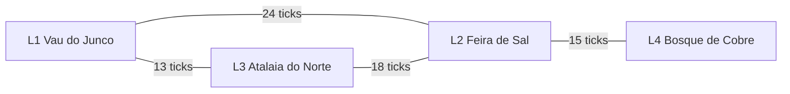

# Especificação da primeira sessão de gameplay social regional

> **PROPOSTA DE PRODUTO PARA APROVAÇÃO — pendente de revisão independente e decisão do maintainer; nenhum código foi criado.**

| Campo | Valor |
| --- | --- |
| Tarefa | `DOC-02` — Especificar a primeira sessão de gameplay |
| Perfil e fronteira | `planner-specialist`, fronteira de referência `02` |
| Dono | S-CONTRACT com maintainer de produto |
| Data | 2026-11-08 |
| Base SHA | `c412cd4c0da291d3797e3cc4dd4429199ac979b3` |
| Branch e worktree | `docs/doc-02` em `../ai-fantasy-worktrees/doc-02`, ancorado na raiz original |
| Revisão do manifesto | sha256 `328a8c7e121c9e4411bf0c105c3845c636e37bf208770fbc675f2cff4a360769` de [wave-spec](<wave-spec.md>) |
| Contrato de identidade | `CTR-01` rev 3, commit `563c521645c05b2ec1b2ad90d0801994e9610fcc`; layout e IDs em `docs/planning/contracts/identity-events.md` (fonte externa a esta worktree) |
| Interface produzida | `INT-04` — Ação nativa e tempo lógico |
| Consome | nenhuma interface de aplicação |
| Revisão obrigatória | `REVIEW-DOC-02` |
| Estado | proposta não aprovada; sem código, teste executado, medição ou publicação |

## 1. Propósito, leitura e autoridade

Este documento converte as decisões humanas D-01 a D-08, o [ADR 0008](<../architecture/adr/0008-action-driven-simulation-time.md>), a interface `INT-04` e os cartões consumidores do [ROADMAP](<../../ROADMAP.md>) em **uma especificação de produto executável** para a primeira sessão de gameplay social na região procedural multi-localidades. Ela deve permitir que GAME-01, SOC-01, SOC-03, TUI-01 e E2E-01 derivem contratos e testes sem inventar regras divergentes.

O documento **não** implementa, não congela formato binário, não escolhe stack de render, não mede desempenho e não aprova nada por si só. Valores numéricos de custo, faixas, intervalos e deltas são **propostas de produto**; a aprovação pertence ao maintainer após a revisão `REVIEW-DOC-02` e o freeze técnico de `CTR-01`, `CTR-02` e `CTR-03`.

Convenções de leitura:

- **Proposta** e **pendente de aprovação** marcam escolhas de produto desta especificação; o identificador `PD-xx` aponta para a seção 15, onde cada escolha tem recomendação, justificativa e consequência se rejeitada.
- Caminhos como `crates/af-core/src/actions.rs` são **destinos futuros** e aparecem em code spans, nunca como links, porque não existem na base.
- `tick` é sempre unidade lógica `Tick(u64)`; `bp` é basis point inteiro, `10_000 bp = 100%`.
- Nenhum número deste documento é medição, benchmark ou promessa de latência. Nenhum teste descrito aqui foi executado.

### 1.1 O que este documento decide e o que não decide

Decide, como proposta: a forma da região inicial e seus custos de trajeto; o catálogo de comandos sociais e de movimento; a tabela de custos em ticks; a ordem da agenda regional; os eixos e deltas de relação; os parâmetros de rumor; o roteiro curado; o recorte de escopo; os critérios de aceite e a lista de testes futuros.

Não decide: representação binária, largura de IDs, layout de evento, autoridade durável de save, algoritmo exato de percepção, stack do cliente 2D, alcance do overlay de silhuetas, genética/MLP, política de hardware ou qualquer mudança nas oito decisões humanas. Esses assuntos continuam nos cartões e contratos indicados na seção 16.

## 2. Decisões preservadas e anti-escopo

As decisões abaixo são **aplicadas**, não reabertas. O detalhamento desta spec não altera o mérito de nenhuma delas.

| Decisão | Como esta especificação a aplica |
| --- | --- |
| D-01 | A sessão é demonstrável em M2 (TUI/headless), sem exigir render; M3 acrescenta o cliente 2D depois. Nada aqui chama a TUI de produto visual final. |
| D-02 | O mundo avança apenas pelo custo lógico de ações autoritativas; UI, câmera, NLG, modelos e relógio real não criam ticks. |
| D-03 | O eixo central é social: relações, mentira, negociação e rumores; exploração, combate e construção entram só no recorte mínimo declarado. |
| D-04 | Nenhuma informação de overlay privilegiado vira conhecimento de NPC, MLP, testemunho ou rumor; a camada de silhuetas é só apresentação. |
| D-05 | Não há teto de hardware, meta de desempenho ou medição nesta spec; limites numéricos são guardrails lógicos, não desempenho. |
| D-06 | A stack de render permanece aberta; o roteiro M3 não escolhe engine, linguagem ou ponte. |
| D-07 | A primeira base é regional com várias localidades; foco, câmera e viewport não congelam nem removem áreas do estado, do save ou do hash. |
| D-08 | Esta especificação é entregue em worktree isolada, com revisão independente e juiz; não altera o fluxo multi-agente. |

O anti-escopo do [wave-spec](<wave-spec.md>) é respeitado: nada de rede no runtime, pesos, API keys, telemetria remota, NLG no tick, texto como autoridade, `f32`, relógio, `HashMap` ou RNG global no estado autoritativo, vila isolada como produto, congelamento por viewport, 3D real, multiplayer, nuvem, voz/multimodalidade preventiva ou campanha extensa.

## 3. A região desde a base (D-07)

### 3.1 Forma, identidades e nomes

A região é uma grelha inteira com várias localidades, gerada de forma determinística a partir de `RegionSpec` e `Seed`; o contrato formal de geração pertence a `GRID-01` e `CTR-03` (`crates/af-core/src/region.rs`). Esta spec fixa apenas o que a sessão social exige:

- No mínimo **três localidades** interligadas por trajetos; a fixture da sessão usa **quatro** para exercitar rota direta, rota alternativa e uma localidade alcançável apenas por uma aresta.
- Cada localidade tem identidade geracional estável (`LocalityId`), portões (`GateId`) e células de grelha `(x, y, z)` inteiras. Não há geometria contínua nem altura flutuante.
- Atores têm `ActorId` geracional; a mesma seed e as mesmas entradas normalizadas produzem a mesma região, os mesmos IDs e as mesmas rotas.
- Nomes, papéis e posições da fixture são **ilustrativos e não canônicos**. O gerador atribui nomes procedurais; os testes fixam a fixture por seed e registram os nomes efetivos. Nenhum nome desta seção vira cânone do produto.

| `LocalityId` | Nome ilustrativo (não canônico) | Papel na sessão | Portões | Agentes da fixture |
| --- | --- | --- | --- | --- |
| `L1` | Vau do Junco | aldeia de passagem, origem do jogador | `G1a` (estrada), `G1b` (trilha) | Iara (mercadora), Tomé (guarda) |
| `L2` | Feira de Sal | mercado regional | `G2a` (estrada), `G2b` (trilha) | Bruna (escriba), Caio (carroceiro) |
| `L3` | Atalaia do Norte | posto de vigia | `G3a` (estrada), `G3b` (trilha) | Dara (vigia), Elias (mensageiro) |
| `L4` | Bosque de Cobre | aldeia de lenhadores | `G4a` (estrada) | Fábio (lenhador), Gaia (curandeira) |

Os oito agentes não jogadores existem para demonstrar agenda regional, testemunho e portabilidade de rumor; não são uma promessa de população, campanha ou densidade final. A população, o número de localidades e o tamanho da grelha permanecem parâmetros de geração; os guardrails estão na seção 11.

`LocalityId` é **alias explícito** de `LocationId` (CTR-01 §2.9): o wire canônico usa `LocationId`, e esta spec usa `LocalityId` de forma uniforme. `GateId` é `EntityId` kind `GATE` = 6 e `EdgeId` é kind `EDGE` = 7; a semântica de portão/aresta pertence a `CTR-03`/`GRID-01`, não a esta spec. `Cell` é alias explícito de `GridPoint` (CTR-01 §3.2); esta spec usa `GridPoint` como nome canônico na intenção, nos tipos e nos fatos.

### 3.2 Grafo de conexões e estado das arestas

As arestas são trajetos entre portões, com custo simétrico nesta proposta. Cada aresta tem estado `PASSÁVEL` ou `BLOQUEADA`; o estado entra no estado canônico e no hash. Uma aresta bloqueada é ignorada pelo cálculo de rota; se não restar rota, a viagem é recusada.

| Aresta | Portões | Células por terreno | Soma das células | Sobrecarga fixa | Custo total (ticks) |
| --- | --- | --- | --- | --- | --- |
| `E12` Vau–Feira | `G1a`–`G2a` | 6 estrada (1 cada) + 4 água rasa (4 cada) | 6 + 16 = 22 | 2 | 24 |
| `E13` Vau–Atalaia | `G1b`–`G3b` | 5 estrada (1 cada) + 3 vegetação rasteira (2 cada) | 5 + 6 = 11 | 2 | 13 |
| `E23` Atalaia–Feira | `G3a`–`G2b` | 4 estrada (1 cada) + 4 rocha (3 cada) | 4 + 12 = 16 | 2 | 18 |
| `E24` Feira–Bosque | `G2a`–`G4a` | 5 terra batida (1 cada) + 4 vegetação rasteira (2 cada) | 5 + 8 = 13 | 2 | 15 |

A sobrecarga fixa de 2 ticks representa o embarque (incluindo a caminhada abstrata até o portão de partida) e o desembarque no portão de chegada; ela é paga uma vez por **aresta percorrida**, não uma vez por comando. O custo de uma viagem multiaresta é a soma das arestas da rota mais nenhuma sobrecarga adicional.

Rotas de referência da fixture, com desempate determinístico:

- `L1` para `L2`: rota direta `E12` = 24 ticks; rota alternativa `E13` + `E23` = 31 ticks. A direta vence por custo.
- `L3` para `L4`: `E23` + `E24` = 33 ticks; a rota por `L1` custa 52 ticks. A primeira vence.
- Com `E12` bloqueada, `L1` para `L2` passa a 31 ticks; com `E24` bloqueada, `L4` fica inalcançável e a viagem é recusada com `ROTA_IMPOSSIVEL`.

Empates de rota são resolvidos pela sequência lexicográfica de `LocalityId` visitados; se ainda empatarem, pela ordem crescente de `EdgeId`. Nenhuma ordem de `HashMap` participa da decisão.

### 3.3 Custo de viagem por aresta e por terreno

O custo de deslocamento dentro de uma localidade é a soma do custo de entrada de cada célula do caminho. O custo de viagem entre localidades é a soma do custo de cada célula do corredor da aresta, mais a sobrecarga fixa da aresta.

| Terreno da célula de destino | Custo de entrada (ticks) |
| --- | --- |
| Pavimento, estrada, terra batida | 1 |
| Vegetação rasteira, entulho | 2 |
| Vegetação densa, rocha | 3 |
| Água rasa (vau) | 4 |
| Escada ou rampa, por nível de `z` alterado | +1 sobre o custo da célula de destino |

Regras adicionais de movimento:

- Vizinhança **cardinal apenas** (norte, leste, sul, oeste); diagonais são recusadas com `INTENCAO_INVALIDA`. Isso elimina ambiguidade de custo e de ordem de caminho.
- Uma célula ocupada por outro ator é intransponível; não há sobreposição de atores no mesmo tick.
- A mudança de `z` só ocorre por escada ou rampa; queda, voo e teleporte não existem nesta sessão.
- O caminho de uma ação `mover` é único por contrato: menor custo total; empate resolvido pela sequência lexicográfica de células `(z, y, x)` e, se necessário, pela ordem dos vizinhos `N, L, S, O`. O caminho resolvido é registrado no recibo para auditoria.
- A linha de alcance social é uma checagem geométrica sobre a ocupação estrutural, definida em `crates/af-core/src/region.rs`; ela não é campo de visão, não gera memória e não depende de câmera ou overlay.

### 3.4 Foco, câmera e viewport não congelam a região

Regra normativa desta proposta, derivada de D-07 e do [ADR 0008](<../architecture/adr/0008-action-driven-simulation-time.md>):

- O estado canônico contém **todas** as localidades, todos os atores (inclusive em trânsito), todas as agendas, todas as relações e todos os rumores em todos os ticks. Foco, câmera, viewport, z-level exibido, painel aberto ou histórico não selecionam o que existe.
- A agenda de cada localidade processa os ticks devidos de qualquer ação do jogador, independentemente de onde a TUI ou o cliente 2D estão focados.
- Trocar de foco, mover a câmera, abrir outro painel ou redimensionar a TUI custa **0 ticks** e não altera estado, RNG, memória, relações ou rumores.
- Recibos e testes comparam o hash e o resumo regional antes e depois de trocar o foco; a igualdade é obrigatória. Nenhum LOD, suspensão por distância ou congelamento implícito é autorizado nesta sessão.
- Em M2, a TUI pode exibir uma localidade por vez e um resumo regional somente leitura; em M3, o cliente isométrico pode navegar livremente. Nos dois casos, o canal de apresentação não escreve no estado.

### 3.5 Fixtures curadas versus escopo do produto

A fixture de quatro localidades e oito NPCs é **instrumento de teste**, não o escopo do produto. Ela existe para que GAME-01, SOC-01, SOC-03 e E2E-01 tenham um cenário pequeno, determinístico e reproduzível, com custos e resultados pinados.

O escopo aprovado continua sendo uma região procedural com várias localidades. O aceite regional exige, no mínimo:

- duas configurações de seed ou fixture com pelo menos três localidades e rotas distintas;
- uma ação do jogador em `L1` que produza mudança observável em `L2` ou `L3` no mesmo intervalo lógico;
- save, reabertura e replay preservando a região inteira, inclusive localidades fora do foco;
- nenhuma fixture unitária menor usada como justificativa para rebaixar o produto a uma vila.

## 4. Tempo lógico (D-02)

### 4.1 Unidade e contrato

- `Tick(u64)` é a única noção de tempo do núcleo. Um tick é o menor instante lógico do mundo; não é milissegundo, frame, amostra de áudio ou unidade de relógio real.
- Cada ação autoritativa do jogador tem um custo inteiro positivo em ticks. Ao resolvê-la, o mundo avança exatamente esse número de ticks, processando agendas e rumores dos ticks cobertos.
- Sem ação autoritativa, não há ticks. Esperar, ler, pensar, digitar, gerar prosa, abrir menu, mover a câmera ou aguardar modelo não avança o mundo.
- O custo pertence ao comando tipado, não à duração da geração de texto, à latência do modelo, ao tamanho da prosa, ao áudio ou ao tempo de leitura.
- O intervalo de uma ação é `(t0, t0 + custo]`: os ticks `t0 + 1` até `t0 + custo` são processados em ordem crescente. O tick `t0` é o tick da resolução da intenção e da âncora dos fatos sociais.

Ordem normativa de uma ação bem-sucedida ou de uma falha resolvida:

1. Validar intenção e fatos contra a revisão corrente, sem mutar estado e sem consumir RNG definitivo.
2. Sortear os valores da ação (quando a ação sorteia), em cópia do estado de RNG.
3. Calcular e aplicar efeitos em estado de preparação (staging), de forma atômica.
4. Avançar os ticks `t0 + 1` a `t0 + custo`, processando chegadas, agendas e pulsos de rumor na ordem da seção 7.
5. Verificar invariantes e calcular o hash do estado candidato.
6. Confirmar o commit: estado, cursores de RNG, fatos, eventos, recibo e log de replay juntos.

Se qualquer etapa anterior ao commit falhar, nada é publicado: nem tick, nem RNG, nem efeito parcial. A seção 6 detalha rejeição, cancelamento, obsolescência e dry-run.

### 4.2 Tabela de custos proposta

Todos os valores são inteiros e determinísticos. A tabela é a **fonte única** dos custos desta sessão; testes pinam os valores. Alterá-los depois da aprovação exige nova revisão desta spec e dos contratos consumidores.

| Operação | Custo (ticks) | Unidade de cobrança | Justificativa de produto |
| --- | --- | --- | --- |
| `mover` em pavimento, estrada ou terra batida | 1 | por célula de destino | um passo deliberado em terreno preparado |
| `mover` em vegetação rasteira ou entulho | 2 | por célula de destino | terreno que exige atenção e desvio |
| `mover` em vegetação densa ou rocha | 3 | por célula de destino | progresso lento e esforço físico |
| `mover` em água rasa | 4 | por célula de destino | travessia cuidadosa, sem natação |
| `mover` com mudança de `z` por escada ou rampa | +1 | por nível alterado, além do custo da célula | subir/descer interrompe o passo |
| `viajar` | 2 + soma das células da rota | por aresta percorrida e por célula | deslocamento regional com embarque e desembarque; para NPC é plano multi-pulso (7.3), não gasto de um único pulso |
| `falar` | 2 | por ato simbólico | dizer e ser ouvido, sem depender do texto gerado |
| `perguntar_rumor` | 3 | por pergunta | recordar, avaliar e responder sobre informação |
| `contar_rumor` (inclui semear) | 3 | por relato | reconstruir o relato e entregá-lo |
| `mentir` | 4 | por afirmação | construir a mentira e observar a reação |
| `ameaçar` | 4 | por exigência | formular a ameaça e sustentar a espera |
| `negociar` | 6 | por rodada de oferta e resposta | proposta, contraproposta e fechamento |

Custos de sistema, também inteiros:

| Constante | Valor | Unidade | Papel |
| --- | --- | --- | --- |
| `AGENDA_INTERVAL_TICKS` | 10 | ticks | cadência de uma entrada de agenda por ator por pulso |
| `AGENDA_LOCAL_ACTION_MAX_TICKS` | 10 | ticks | teto de uma ação **local** de NPC dentro de um pulso; viagem é plano multi-pulso e não usa este teto |
| `RUMOR_INTERVAL_TICKS` | 60 | ticks | cadência do pulso de propagação de rumores |
| `HALF_LIFE_TICKS` | 1200 | ticks | intervalo de redução da fidelidade de um rumor pela metade |
| `TRANSFER_LOSS_BP` | 1000 | bp | perda de fidelidade em cada transferência de rumor |
| `MIN_COGNITION_BP` | 4000 | bp | fidelidade mínima para o ouvinte compreender e retransmitir |
| `GREETING_COOLDOWN_TICKS` | 120 | ticks | janela em que nova saudação ao mesmo par não rende delta |

### 4.3 O que não custa tempo

As operações abaixo custam **0 ticks**, não entram no log de replay como ação de mundo e não alteram hash, RNG, relações, conhecimento ou rumores. Elas podem produzir recibos de apresentação, cache e telemetria local, que ficam fora do estado autoritativo.

| Operação | Efeito no mundo | Observação |
| --- | --- | --- |
| Abrir, fechar ou rolar histórico e diário | nenhum | leitura de fatos já produzidos |
| Gerar, regenerar, reexibir ou traduzir prosa | nenhum | NLG é lazy e somente leitura |
| Reproduzir áudio, mudar volume ou legendas | nenhum | áudio é apresentação |
| Digitar, apagar, corrigir ou cancelar texto antes de enviar | nenhum | a intenção só existe quando submetida |
| Trocar foco, mover câmera, subir/descer `z` exibido | nenhum | apresentação pura |
| Redimensionar terminal, abrir painel, trocar tema | nenhum | UI pura |
| Abrir mapa, memória de ambiente ou overlay de silhuetas | nenhum | leitura privilegiada não é percepção |
| Salvar, reabrir, listar ou verificar saves | nenhum | persistência não é tempo do mundo |
| Reproduzir replay, pausar, avançar ou retroceder gravação | nenhum | replay não simula o presente |
| Aguardar modelo, receber timeout ou abstenção | nenhum | modelo não participa do tick |
| Exibir erro, confirmação ou recibo | nenhum | mensagens não são ações |

### 4.4 Justificativa dos valores

Os valores acima são uma **proposta de ritmo**, não uma medição. A escala foi escolhida para que:

- um passo em terreno preparado custe 1 tick e uma travessia por aresta custe entre 13 e 24 ticks, tornando a viagem uma decisão de sessão, não um detalhe;
- um ato social curto custe 2 ticks e uma negociação completa custe 6, de modo que cinco falas curtas caibam em um pulso de agenda de 10 ticks;
- a agenda de NPCs tenha uma oportunidade por ator a cada 10 ticks, sem depender de frame ou de relógio;
- um rumor leve 60 ticks para uma rodada de propagação, ou seja, seis pulsos de agenda, e 1200 ticks para perder metade da fidelidade, o que permite observar propagação e degradação na mesma sessão longa de teste sem torná-las instantâneas;
- a sessão curada da seção 10 ocupe 100 ticks, com dez pulsos de agenda e um pulso de rumor, um tamanho que cabe em teste rápido e ainda atravessa localidades.

Se o maintainer preferir outra escala, os valores podem mudar, mas precisam ser re-aprovados e re-pinados nos testes; não podem ser ajustados silenciosamente por implementação. A escala não implica meta de latência: 100 ticks podem levar qualquer tempo de CPU.

## 5. Catálogo de comandos e ações

### 5.1 Envelope comum e pipeline de resolução

Toda ação do jogador chega como intenção tipada. A assinatura proposta permanece a de `INT-04`, em `crates/af-core/src/actions.rs`:

- `resolve_native(intent: NativeIntent, facts: &ActionFacts) -> Result<ResolvedCommand, CommandError>`.

Campos comuns propostos de `NativeIntent`:

| Campo | Tipo lógico | Obrigatório | Papel |
| --- | --- | --- | --- |
| `intent_id` | sequência monotônica da sessão | sim | idempotência e log |
| `actor` | `ActorId` | sim | ator que age; nesta sessão, o jogador |
| `kind` | enum fechado | sim | ação nativa: `MOVER`, `VIAJAR`, `FALAR`, `NEGOCIAR`, `MENTIR`, `PERGUNTAR_RUMOR`, `CONTAR_RUMOR`, `AMEACAR`; o `intent` CTR-01 é derivado pela tabela 5.1.1 |
| `target` | `Option<ActorId>` | conforme ação | alvo social |
| `destination` | `Option<Destination>` | conforme ação | `GridPoint` `(x, y, z)` ou `LocalityId` |
| `topic` | `Option<TopicId>` | conforme ação | referência tipada: `TopicKind` + `FactId`/`RumorId` |
| `offer_moeda` | `Option<u32>` | negociar | oferta inteira de moedas; vira `TRANSFER_CURRENCY` (kind 7) |
| `meeting_tick` | `Option<Tick>` | `ENCONTRO_FUTURO` | tick absoluto do encontro; precisa ser maior que `t0` |
| `meeting_locality` | `Option<LocalityId>` | `ENCONTRO_FUTURO` | localidade do encontro; precisa existir e ser alcançável pelo alvo |
| `gate_id` | `Option<GateId>` | `PASSAGEM` | portão concedido; precisa pertencer à localidade do alvo ou a uma localidade adjacente |
| `validity_ticks` | `Option<u32>` | `PASSAGEM` | validade da passagem em ticks, de 1 a `PASS_VALIDITY_TICKS` |
| `away_destination` | `Option<GridPoint>` | `AFASTAR_SE` | célula de destino do alvo; passável, livre e a pelo menos `AWAY_MIN_DISTANCE_CELLS` do ator |
| `registro` | `Option<enum>` | `FALAR` | `SAUDACAO`, `AGRADECIMENTO`, `DESPEDIDA`, `COMENTARIO_NEUTRO`; wire `1..4` |
| `pedido` | `Option<enum>` | `NEGOCIAR` | `REVELAR_RUMOR=1`, `ENCONTRO_FUTURO=2`, `PASSAGEM=3`, `INFORMAR_CAMINHO=4`; `INFORM_PATH` usa 4 |
| `exigencia` | `Option<enum>` | `AMEACAR` | `REVELAR_RUMOR=1`, `PASSAGEM=2`, `AFASTAR_SE=3` |
| `claim_value` | `Option<u16>` | `MENTIR` | código 1..N do enum fechado; os valores semânticos pertencem a SOC-01/CTR-04 e não são inventados aqui |
| `seed_rumor` | `bool` | contar | cria rumor a partir de fato testemunhado |
| `client_revision` | `u64` | sim | revalidação contra estado obsoleto |
| `mode` | `DryRun` ou `Commit` | sim | execução de ensaio ou aplicação |

Campos sem valor para a ação ficam `None`. Combinação inválida, campo obrigatório ausente ou valor fora da faixa é `INTENCAO_INVALIDA` e não produz efeito; a fixture fixa os valores explicitamente, e nenhum default é inventado pela implementação.

#### 5.1.1 Mapeamento ação → intent → payload (CTR-01 rev 3)

`NativeIntent.kind` é a ação nativa desta spec; o `ConversationFact` do CTR-01 usa o campo `intent` com os códigos abaixo. `MOVER` e `VIAJAR` não viram `ConversationFact`: são eventos de domínio INT-05.

| Ação (`kind`) | `intent` CTR-01 | Código | Payload usado | Fato resultante |
| --- | --- | --- | --- | --- |
| `MOVER` | — (evento INT-05) | — | `GridPoint` de destino e caminho | `ActorMovedFact` |
| `VIAJAR` | — (evento INT-05) | — | `LocalityId` de destino, rota e portões | `TravelFact` |
| `FALAR` | `SOCIAL_TALK` | 10 | `registro` 1..4, `topic` opcional | `FalaFact` |
| `NEGOCIAR` (`REVELAR_RUMOR`, `ENCONTRO_FUTURO`, `PASSAGEM`) | `NEGOTIATE` | 2 | `pedido` 1..3, `offer_moeda`, `meeting_tick`, `meeting_locality`, `gate_id`, `validity_ticks` | `AcordoFact`/`AcordoRecusadoFact` |
| `NEGOCIAR` (`INFORMAR_CAMINHO`) | `INFORM_PATH` | 9 | `pedido=4`, `destination` | `AcordoFact` + `CaminhoReveladoFact` (INT-05) |
| `MENTIR` | `LIE` | 4 | `topic`, `claim_value` | `MentiraDetectadaFact`/`MentiraRejeitadaFact`; `MENTIRA_ACEITA` |
| `PERGUNTAR_RUMOR` | `ASK_RUMOR` | 8 | `topic` opcional, `fidelity_offered_bp`, `fidelity_received_bp` | `RumorPerguntadoFact` |
| `CONTAR_RUMOR` | `SHARE_RUMOR` | 6 | `rumor_id` ou `topic`, `seed_rumor`, fidelidades | `RumorContadoFact` |
| `AMEACAR` | `EXTORTION` | 3 | `exigencia` 1..3, `topic`, `gate_id`, `validity_ticks`, `away_destination`, `scheduled_tick` | `AmeacaFact`/`AmeacaResistidaFact` |

`GREETING`, `BRIBE` e `APPEASE` são legados e não são usados nesta sessão; `SOCIAL_TALK` cobre os quatro `registro` de `falar` (CTR-01 §4.5.2). Os nomes de ação em português são aliases de produto; o `intent` canónico é o da coluna 2. O `intent_payload` v2 tem 99 bytes e usa exatamente os campos do CTR-01 §4.5.2; ausência é codificada como 0/`None` e esta spec não acrescenta bytes. `result_class` é 1 sucesso, 2 falha resolvida, 3 limite e 4 sem efeito/cooldown; `reason` usa a tabela do CTR-01 §4.5.1.

IDs usados no payload e no log: `TopicId` é `TopicKind` + `u64` (`1` = `FactId`, `2` = `RumorId`; `0` inválido); `FactId` é exatamente o `fact_seq` regional (`u64 >= 1`, monotônico, não `EntityId`); `RumorId` é `EntityId` kind `RUMOR` = 5; `GateId` é kind `GATE` = 6; `EdgeId` é kind `EDGE` = 7; `LocalityId` é alias de `LocationId` (kind `LOCATION` = 3). Nenhum desses IDs é um “sequencial” reutilizável; a ordem é o valor numérico crescente.

Pipeline obrigatório, nesta ordem:

1. Validar o schema do intent, o enum `kind`, campos obrigatórios e se a ação pertence ao recorte. Falha aqui é `INTENCAO_INVALIDA` ou `ACAO_FORA_DO_RECORTE`.
2. Verificar que o ator existe, está vivo, não está em trânsito e está na localidade esperada.
3. Verificar alvo, destino, tópico, alcance, linha estrutural, ocupação e recursos, conforme a ação.
4. Verificar limites quantitativos da seção 11.
5. Sortear os valores da ação, em cópia do estado de RNG, na ordem declarada pela ação.
6. Resolver o resultado e montar os efeitos em staging.
7. Avançar ticks e processar agenda e rumores.
8. Verificar invariantes, calcular hash e confirmar o commit.

Falhas nas etapas 1 a 4 são **rejeições**: 0 ticks, 0 RNG definitivo, nenhum efeito, nenhum fato de mundo, apenas um recibo de recusa e uma entrada de replay. Falhas nas etapas 5 a 7, depois de a ação ter sido validada, ainda não publicam estado parcial; o resultado é erro tipado e o estado original permanece. A etapa 8 é a única que publica.

Sorteios: toda aleatoriedade usa `draw(state, request)`, de `INT-02`, em `crates/af-ports/src/lib.rs` e `crates/af-domain/src/lib.rs`, com stream de domínio explícito. Nesta sessão usam-se `social` (ações sociais e agenda social) e `rumor` (propagação). Nunca há RNG global, `thread_rng`, entropia de relógio ou sorteio invisível ao replay. Cada sorteio registra stream, índice, faixa, valor e resultado.

Empates e somas: ordenar sempre por `LocalityId`, `ActorId`, `RumorId`, `FactId` ou `EdgeId` crescente; nunca por ordem de `HashMap`. Fórmulas usam aritmética inteira, divisão truncada em direção a zero e um único clamp final na faixa indicada. Atributos usados nas fórmulas (`linguagem_bp`, `inteligencia_bp`, `percepcao_bp`) chegam normalizados em `0..=10000` por `CTR-01`; esta spec não define a codificação física.

Log de replay comum a todas as ações:

- entram: `intent_id`, `kind`, campos normalizados do intent, revisão de fatos, tick inicial, hash inicial, cursores de RNG por stream antes da ação, sorteios com índice/faixa/valor, resultado tipado, efeitos canônicos, fatos gerados, tick final, hash final, motivo de recusa/cancelamento quando houver, e entradas externas normalizadas (modelo, timeout, abstenção) quando a ação não for nativa;
- não entram: prosa, tokens, palavras, latência, caminho de áudio, estado de UI, foco, câmera, zoom, cache de NLG, métricas de relógio real ou qualquer dado de overlay privilegiado.

### 5.2 `mover` — deslocamento dentro da localidade

**Intenção.** `kind = MOVER`; `destination = GridPoint { x, y, z }`; sem `target`, `topic`, `offer_moeda` ou `seed_rumor`.

**Pré-condições e alvos.** Ator vivo, presente na localidade, destino dentro dos limites da grelha, mesma localidade, célula passável, desocupada, caminho cardinal existente, comprimento do caminho menor ou igual a `MAX_MOVE_CELLS`. Destino igual à origem é recusado.

**Resolução.** Busca de caminho determinística com custo por terreno, conforme 3.3. Não há sorteio. O custo é a soma dos custos de entrada das células do caminho; a mudança de `z` soma +1 por nível.

**Sucesso.** Ator na célula de destino; custo integral; evento de domínio INT-05 `ActorMovedFact` com origem, destino, caminho resolvido, custo e tick; evento de movimento; recibo com hash final. Este fato **não** é `ConversationFact`; ver 5.11.

**Erro.** Célula fora dos limites, bloqueada, ocupada, diagonal, caminho inexistente ou maior que o limite: rejeição `DESTINO_INVALIDO`, `DESTINO_OCUPADO`, `SEM_CAMINHO` ou `CAMINHO_LONGO`, com 0 tick e 0 RNG.

**Limite.** Destino igual à origem: `DESTINO_IGUAL_ORIGEM`, 0 tick. Caminho que atravessa outro ator em movimento no mesmo intervalo é recusado por ocupação no tick inicial; não há desvio automático nem movimento parcial. Se o caminho exceder `MAX_MOVE_CELLS`, a ação é recusada; o jogador deve dividir o percurso em comandos menores.

**Efeitos, fatos e replay.** Nenhuma relação muda. O replay registra destino e caminho resolvido; não registra cliques, passos de animação, câmera ou tempo de render.

**Custo.** Soma das células do caminho; zero em rejeição.

**Fora do custo.** Animação do passo, interpolação de sprite, câmera, sombra e tempo de render não entram no custo nem no log de replay.

### 5.3 `viajar` — deslocamento entre localidades

**Intenção.** `kind = VIAJAR`; `destination = Locality { id }`; sem alvo social.

**Pré-condições e alvos.** Ator vivo, não em trânsito, presente na localidade de origem; localidade de destino existente e diferente da atual; arestas necessárias passáveis; rota com no máximo `MAX_TRAVEL_EDGES` arestas e custo total menor ou igual a `MAX_TRAVEL_TICKS`; portão de destino livre ou reservável. **Não é exigido que o ator esteja sobre o portão:** a sobrecarga fixa de 2 ticks cobre o deslocamento abstrato até o portão de embarque da primeira aresta da rota, e esse deslocamento não gera fato, célula intermediária ou ação separada.

**Resolução.** Rota de menor custo no grafo de localidades, com desempate de 3.2; custo é a soma das arestas. Não há sorteio. A viagem é **atômica e abstrata**: o ator fica em trânsito durante o intervalo, não está presente em nenhuma localidade intermediária, não interage e não propaga rumor enquanto viaja. O portão de destino é reservado no início; a reserva é liberada na chegada ou no cancelamento.

**Sucesso.** Ator no portão de destino ao fim do custo; evento de domínio INT-05 `TravelFact` com rota, arestas, portão de embarque da primeira aresta, portão de chegada, custo e ticks; o ator deixa de estar em trânsito; agenda regional processa todos os ticks cobertos. Este fato **não** é `ConversationFact`; ver 5.11.

**Erro.** Ator fora da localidade de origem, destino inexistente, destino igual à origem, rota impossível, portão ocupado, limite de arestas ou de ticks: rejeição `ORIGEM_INVALIDA`, `ROTA_IMPOSSIVEL`, `DESTINO_OCUPADO` ou `ROTA_EXCEDE_LIMITE`, com 0 tick e 0 RNG.

**Limite.** Destino inalcançável após bloqueio de aresta: `ROTA_IMPOSSIVEL`, 0 tick. Destino igual ao atual: `DESTINO_IGUAL_ORIGEM`, 0 tick. Rota acima do limite: `ROTA_EXCEDE_LIMITE`, 0 tick; a sessão não cria transporte alternativo nem teletransporte.

**Efeitos, fatos e replay.** Nenhuma relação muda pela viagem em si. O replay registra rota, arestas, reserva de portão, custo e ticks; não registra animação, encontros de estrada ou tempo real. Encontros, emboscadas e eventos de trânsito ficam fora desta sessão (PD-03).

**Custo.** Soma das arestas da rota; zero em rejeição.

**Fora do custo.** Animação de estrada, transição de tela, encontros de estrada e tempo real de carregamento não entram no custo nem no log de replay.

### 5.4 `falar` — ato simbólico

**Intenção.** `kind = FALAR`; `intent = SOCIAL_TALK` (código 10); `target` obrigatório; `topic` opcional; `registro` em enum fechado: `SAUDACAO`, `AGRADECIMENTO`, `DESPEDIDA`, `COMENTARIO_NEUTRO` (wire 1..4). Nenhum texto do jogador entra no intent.

**Pré-condições e alvos.** Ator e alvo vivos, na mesma localidade, mesmo `z`, distância de Manhattan menor ou igual a `SOCIAL_REACH_CELLS`, linha estrutural livre, alvo não em trânsito.

**Resolução.** Sem sorteio. O ato é sempre resolvido quando as pré-condições valem; o efeito é simbólico e não depende de NLG. Se o mesmo par repetir o mesmo `registro` dentro de `GREETING_COOLDOWN_TICKS`, o resultado é `SEM_EFEITO_COOLDOWN`.

**Sucesso.** Empatia do alvo em relação ao ator +100 bp; confiança do alvo em relação ao ator +50 bp; `ConversationFact` v2 `FalaFact` (`intent = SOCIAL_TALK`, `result_class = 1`) com `registro`, `topic` e tick; nenhum rumor criado.

**Erro.** Alvo morto, inexistente, fora de alcance, em trânsito, outra localidade ou sem linha estrutural: rejeição `ALVO_MORTO`, `ALVO_INEXISTENTE`, `FORA_DE_ALCANCE` ou `SEM_LINHA_ESTRUTURAL`, com 0 tick e 0 RNG.

**Limite.** Cooldown ativo: `SEM_EFEITO_COOLDOWN`, custo 2 ticks, 0 RNG, deltas 0; o fato registra que a fala ocorreu sem efeito mecânico.

**Efeitos, fatos e replay.** Deltas exatos da tabela 8.2, aplicados ao par direcional alvo para ator. O replay registra `registro`, `topic`, alvo e tick; não registra palavras, tokens, áudio, latência, texto renderizado ou cache de NLG.

**Custo.** 2 ticks; zero em rejeição.

**Fora do custo.** Texto gerado, número de palavras, áudio, tempo de leitura, latência do modelo e cache de NLG não entram no custo nem no log de replay.

### 5.5 `negociar` — oferta e pedido

**Intenção.** `kind = NEGOCIAR`; `intent = NEGOTIATE` (código 2) para `REVELAR_RUMOR`/`ENCONTRO_FUTURO`/`PASSAGEM`, ou `INFORM_PATH` (código 9) para `INFORMAR_CAMINHO`; `target` obrigatório; `pedido` em enum fechado com códigos 1..4 (`REVELAR_RUMOR=1`, `ENCONTRO_FUTURO=2`, `PASSAGEM=3`, `INFORMAR_CAMINHO=4`); `offer_moeda` inteiro entre 0 e 10000; `topic` opcional para `REVELAR_RUMOR`; `destination = LocalityId` obrigatório para `INFORMAR_CAMINHO`; `meeting_tick` e `meeting_locality` obrigatórios para `ENCONTRO_FUTURO`; `gate_id` e `validity_ticks` obrigatórios para `PASSAGEM`. Campos de outro pedido ficam `None`.

**Pré-condições e alvos.** Ator e alvo vivos, mesma localidade, mesmo `z`, alcance social, linha estrutural livre; ator com `moeda` maior ou igual à oferta; alvo capaz de conceder o pedido em princípio (vivo, presente, não em trânsito). Além disso: `meeting_tick` precisa ser maior que `t0` e menor ou igual a `t0 + MAX_MEETING_HORIZON_TICKS`; `meeting_locality` precisa existir e ter rota passável a partir da localidade do alvo; `gate_id` precisa pertencer à localidade do alvo ou a uma adjacente; `validity_ticks` precisa estar em `1..=PASS_VALIDITY_TICKS`; `destination` de `INFORMAR_CAMINHO` precisa existir e ter rota passável. Para `REVELAR_RUMOR`: `TopicId` inexistente no estado é rejeição `INTENCAO_INVALIDA`; `TopicId` existente sem cópia ativa no alvo é o limite `SEM_CONDICAO`. Ausência do conteúdo específico, como nenhum rumor elegível, é limite resolvido, não rejeição.

**Resolução.** Um sorteio no stream `social`, uniforme em `0..=9999`. Chance de sucesso, em bp:

- `chance = clamp(5000 + trust/5 + min(offer_moeda * 50, 2000) + empatia/10, 1000, 9500)`.

Onde `trust` e `empatia` são os eixos do alvo em relação ao ator. Sucesso se o valor sorteado for **menor** que `chance`.

**Sucesso.** Emite o efeito `TRANSFER_CURRENCY` (kind 7) com `source=speaker`, `target=listener` e `amount=offer_moeda` quando `offer_moeda > 0`; `offer_moeda=0` não emite efeito de moeda. Confiança +300 bp; empatia +150 bp; concede o pedido com os campos explícitos: `REVELAR_RUMOR` compartilha a cópia ativa do rumor indicado por `topic`; se `topic` estiver ausente, compartilha a cópia ativa de maior fidelidade do alvo, com empate pelo menor `RumorId`, aplicando 9.2 (se a cópia resultante não superar a do jogador, não há substituição e o fato registra `RUMOR_JA_CONHECIDO` como sub-resultado, sem anular o acordo); `ENCONTRO_FUTURO` cria `ConversationFact` v2 `AcordoFact` com `meeting_tick` e `meeting_locality` exatamente como recebidos; `PASSAGEM` cria `PassagemFact` (evento INT-05) com `gate_id` e `validity_ticks` do payload — a janela materializada `[t0, t0 + validity_ticks]` é pendência de layout INT-05/CORE-02, não inventada aqui; `INFORMAR_CAMINHO` cria `ConversationFact` v2 `AcordoFact` com `destination` e o evento INT-05 `CaminhoReveladoFact` com rota e custo. O `AcordoFact` é `ConversationFact` v2 (`intent = NEGOTIATE` ou `INFORM_PATH`); `PassagemFact` e `CaminhoReveladoFact` não são `ConversationFact` (5.11).

**Falha resolvida.** Sorteio desfavorável com pré-condições válidas: custo integral de 6 ticks, 1 sorteio consumido, sem transferência de moedas e sem concessão; confiança -100 bp, empatia -50 bp; fato `AcordoRecusadoFact`. Nada é aplicado parcialmente.

**Erro.** Moedas insuficientes, alvo morto/inexistente/em trânsito, fora de alcance, pedido inválido, campo obrigatório ausente, tópico inexistente, tick/localidade/portão/validade inválidos ou fora do recorte: rejeição `RECURSO_INSUFICIENTE`, `ALVO_MORTO`, `ALVO_INEXISTENTE`, `FORA_DE_ALCANCE`, `PEDIDO_INVALIDO` ou `INTENCAO_INVALIDA`, com 0 tick e 0 RNG.

**Limite.** `TopicId` existente sem cópia ativa no alvo, ou ausência de outro conteúdo do pedido: `SEM_CONDICAO`, custo 6 ticks, 1 sorteio, sem transferência de moedas, confiança -50 bp, fato `AcordoRecusadoFact`. Oferta 0 é permitida, apenas reduz a chance. Pedido já acordado e ainda vigente com os mesmos campos: `ACORDO_VIGENTE`, custo 6 ticks, deltas 0, sem novo sorteio; campos diferentes formam novo acordo.

**Efeitos, fatos e replay.** Deltas de 8.2; transferência de moedas e criação do fato do pedido são atômicas com o acordo. O replay registra pedido, `topic` quando aplicável, oferta, sorteio, `meeting_tick`, `meeting_locality`, `gate_id`, `validity_ticks`, `destination` quando aplicável, e concessão; não registra a prosa da proposta nem a negociação em linguagem natural.

**Custo.** 6 ticks; zero em rejeição.

**Fora do custo.** Prosa da proposta, animação de mercado, UI de negociação e tempo de geração de texto não entram no custo nem no log de replay.

### 5.6 `mentir` — afirmação falsa e detecção

**Intenção.** `kind = MENTIR`; `intent = LIE` (código 4); `target` obrigatório; `topic` obrigatório (`TopicId`); `claim_value` inteiro 1..N do enum fechado, compatível com o tópico; sem `offer_moeda`. Os valores semânticos de `claim_value` pertencem a SOC-01/CTR-04 e não são inventados aqui.

**Pré-condições e alvos.** Ator e alvo vivos, mesma localidade, mesmo `z`, alcance social, linha estrutural livre; tópico válido. Se o alvo **testemunhou** o fato contraditório, a mentira não é recusada: ela é resolvida com detecção forçada, para que o jogador observe a consequência.

**Resolução.** Dois sorteios no stream `social`, sempre nesta ordem, mesmo quando a detecção for forçada:

- crença: `chance_crenca = clamp(5500 + (linguagem_ator - 5000)/2 - (inteligencia_alvo - 5000)/2 + trust/5, 1500, 9500)`; acreditada se o valor for menor que a chance;
- detecção: `chance_deteccao = clamp(1500 + (percepcao_alvo - 5000)/2 + (5000 - trust)/2, 500, 9000)`; detectada se o valor for menor que a chance, ou se houver testemunho autoritativo do alvo.

**Sucesso.** `MENTIRA_ACEITA` quando acreditada e não detectada: empatia +50 bp, confiança +100 bp; o alvo recebe o evento de domínio INT-05 `CrencaFalsaFact` com tópico, `claim_value` e origem; nenhum rumor é criado automaticamente. O ato social é `ConversationFact` v2 (`intent = LIE`, `result_class = 1`, `reason = 9`).

**Falha resolvida.** `MENTIRA_DETECTADA`: custo integral de 4 ticks, dois sorteios consumidos, empatia -800 bp, medo +300 bp, confiança -1500 bp; efeito `ATTACH_LABEL` com label **`LIAR` = 6** no par `(listener, speaker)` — `source` é o alvo que rotula, `target` é o ator rotulado; `ConversationFact` v2 `MentiraDetectadaFact` (`intent = LIE`, `result_class = 2`, `reason = 10`). Se houver testemunha, ela recebe o evento INT-05 `TestemunhoFact` e o rumor `MENTIRA` é semeado com escopo `LOCAL`, origem no alvo e fidelidade 10000. `MENTIRA_REJEITADA` quando não acreditada e não detectada: empatia -100 bp, confiança -200 bp, `ConversationFact` v2 `MentiraRejeitadaFact` (`intent = LIE`, `result_class = 2`, `reason = 11`).

**Erro.** Alvo morto, inexistente, em trânsito, fora de alcance, `topic` inexistente ou `claim_value` incompatível: rejeição, 0 tick, 0 RNG. Mentira detectada não é erro de resolução: é falha resolvida, com custo integral.

**Limite.** `CRENCA_JA_PRESENTE` quando o alvo já tem a mesma crença: custo 4 ticks, dois sorteios consumidos, deltas 0, fato registrado. Nenhum efeito parcial é aplicado.

**Efeitos, fatos e replay.** Deltas de 8.2, na direção alvo para ator. O replay registra os dois sorteios, o resultado, o tópico e a crença; não registra o texto da mentira, o prompt de NLG ou a reação narrada.

**Custo.** 4 ticks; zero em rejeição.

**Fora do custo.** Texto da mentira, reação narrada, áudio e tempo de inferência de NLG não entram no custo nem no log de replay.

### 5.7 `perguntar_rumor` — consultar informação

**Intenção.** `kind = PERGUNTAR_RUMOR`; `intent = ASK_RUMOR` (código 8); `target` obrigatório; `topic` opcional (`TopicId`); sem `offer_moeda`. O payload registra `topic`, `fidelity_offered_bp` e `fidelity_received_bp`.

**Pré-condições e alvos.** Ator e alvo vivos, mesma localidade, mesmo `z`, alcance social, linha estrutural livre; alvo não em trânsito. `topic`, se presente, precisa existir no estado; `TopicId` inexistente é rejeição `INTENCAO_INVALIDA`; `TopicId` existente sem cópia ativa no alvo é o limite `SEM_INFORMACAO`.

**Resolução.** Um sorteio no stream `social`, uniforme em `0..=9999`. Chance, em bp:

- `chance = clamp(5000 + trust/4 + empatia/8, 1000, 9500)`.

Sucesso se o valor for menor que a chance.

**Sucesso.** O alvo compartilha a cópia **ativa** de maior fidelidade: se `topic` foi indicado, a daquele rumor; caso contrário, a de maior fidelidade entre as elegíveis, com empate pelo menor `RumorId`. A cópia oferecida perde `TRANSFER_LOSS_BP`. Se a fidelidade resultante for menor que `MIN_COGNITION_BP`, a **cópia do destinatário** não é criada nem substitui cópia existente, e o resultado é `OFERTA_ABAIXO_DO_LIMIAR`; a cópia-fonte e o rumor permanecem inalterados, e o rumor só é `EXTINTO` quando nenhuma cópia ativa resta (9.4). Se o jogador não tem cópia ativa ou a cópia oferecida é maior que a sua, ele adquire/substitui a cópia e recebe confiança +100 bp e empatia +50 bp; caso contrário, o resultado é o limite `RUMOR_JA_CONHECIDO`, com deltas 0. `ConversationFact` v2 `RumorPerguntadoFact` (`intent = ASK_RUMOR`, `result_class` 1/2/3) com `topic`, `fidelidade_alvo_bp`, `fidelidade_recebida_bp` (0 se não houve substituição) e tick.

**Falha resolvida.** Sorteio desfavorável com pré-condições válidas: custo integral de 3 ticks, 1 sorteio consumido, nenhuma cópia transferida, confiança -50 bp; fato `RumorPerguntadoFact` com resultado de recusa.

**Erro.** Alvo morto, inexistente, em trânsito, fora de alcance, ou `TopicId` inexistente: rejeição `ALVO_MORTO`, `ALVO_INEXISTENTE`, `FORA_DE_ALCANCE` ou `INTENCAO_INVALIDA`, com 0 tick e 0 RNG.

**Limite.** `TopicId` existente sem cópia ativa no alvo, ou alvo sem cópia ativa/elegível: `SEM_INFORMACAO`, custo 3 ticks, 1 sorteio, deltas 0, fato registrado. Cópia oferecida abaixo do limiar: `OFERTA_ABAIXO_DO_LIMIAR`, sem transferência e sem deltas. Cópia oferecida menor ou igual à do jogador: `RUMOR_JA_CONHECIDO`, custo 3 ticks, 1 sorteio, deltas 0, sem substituição; não há informação nova, portanto não há ganho de relação. O jogador não pode "forçar" informação por repetição no mesmo tick; repetir é uma nova ação paga.

**Efeitos, fatos e replay.** O conhecimento do jogador é estado autoritativo do personagem, não cache de UI. O replay registra alvo, tópico, sorteio, rumor e fidelidades; não registra a prosa da resposta.

**Custo.** 3 ticks; zero em rejeição.

**Fora do custo.** Prosa da resposta, áudio, cache e tempo de leitura não entram no custo nem no log de replay.

### 5.8 `contar_rumor` — semear e relatar

**Intenção.** `kind = CONTAR_RUMOR`; `intent = SHARE_RUMOR` (código 6); `target` obrigatório; `rumor_id` (`RumorId` kind 5) ou `topic` (`TopicId`); `seed_rumor` booleano; sem `offer_moeda`. O payload registra `rumor_id`, `topic`, `seed_rumor`, `fidelity_offered_bp` e `fidelity_received_bp`.

**Pré-condições e alvos.** Ator e alvo vivos, mesma localidade, mesmo `z`, alcance social, linha estrutural livre; ator em posse do rumor, **ou** `seed_rumor = true` com um `TestemunhoFact` elegível do ator para o tópico.

**Resolução.** Se `seed_rumor = true` e ainda não existir rumor para o tópico, cria o rumor com origem no ator, fidelidade inicial 10000, meia-vida e escopo definidos pelo tipo do fato (fatos regionais, como interdição de ponte ou rota, usam `REGIONAL`; fatos pessoais usam `LOCAL`). Em seguida, um sorteio no stream `social` para a transferência:

- `chance = clamp(5000 + trust/4, 1000, 9500)`.

Sucesso se o valor for menor que a chance e a fidelidade for maior ou igual a `MIN_COGNITION_BP`.

**Sucesso.** Se o ouvinte não tem cópia ativa ou a cópia oferecida (fidelidade da fonte menos `TRANSFER_LOSS_BP`) é maior que a existente, ele adquire ou substitui a cópia, mantendo a origem original; confiança +100 bp, empatia +50 bp; `ConversationFact` v2 `RumorContadoFact` (`intent = SHARE_RUMOR`, `result_class` 1/2/3) com rumor, origem, `fidelidade_oferecida_bp` e tick.

**Falha resolvida.** Sorteio desfavorável com pré-condições válidas: custo integral de 3 ticks, 1 sorteio consumido, sem transferência, confiança -50 bp; fato `RumorContadoFact` com resultado de recusa.

**Erro.** Ator sem o rumor e sem fato para semear, alvo morto/inexistente/em trânsito, fora de alcance: rejeição `RUMOR_DESCONHECIDO`, `SEM_FATO_PARA_SEMEAR`, `ALVO_MORTO`, `ALVO_INEXISTENTE`, `FORA_DE_ALCANCE`, com 0 tick e 0 RNG.

**Limite.** Ouvinte já tem cópia ativa com fidelidade igual ou maior: `RUMOR_JA_CONHECIDO`, custo 3 ticks, 1 sorteio, sem transferência. Cópia oferecida abaixo do limiar: `OFERTA_ABAIXO_DO_LIMIAR`, sem transferência. O mesmo par pode repetir o relato em ticks diferentes, pagando o custo de novo; repetir no mesmo tick não é permitido.

**Efeitos, fatos e replay.** A origem nunca é reescrita; o portador que viaja leva o rumor consigo, sem reinicializar história. O replay registra rumor, origem, fidelidades, sorteio e tick; não registra a prosa do relato.

**Custo.** 3 ticks; zero em rejeição.

**Fora do custo.** Prosa do relato, áudio, cache e tempo de leitura não entram no custo nem no log de replay.

### 5.9 `ameaçar` — coerção social mínima

**Intenção.** `kind = AMEACAR`; `intent = EXTORTION` (código 3); `target` obrigatório; `exigencia` em enum fechado com códigos 1..3 (`REVELAR_RUMOR=1`, `PASSAGEM=2`, `AFASTAR_SE=3`); `topic` opcional para `REVELAR_RUMOR`; `gate_id` e `validity_ticks` obrigatórios para `PASSAGEM`; `away_destination` (`GridPoint`) e `scheduled_tick` obrigatórios para `AFASTAR_SE`; `offer_moeda` MUST ser 0 (EXTORTION não transfere moeda).

**Pré-condições e alvos.** Ator e alvo vivos, mesma localidade, mesmo `z`, alcance social, linha estrutural livre; alvo não em trânsito. Para `REVELAR_RUMOR`: `TopicId` inexistente no estado é rejeição `INTENCAO_INVALIDA`; `TopicId` existente sem cópia ativa no alvo é o limite `SEM_CONCESSAO`. Para `PASSAGEM`, `gate_id` precisa pertencer à localidade do alvo ou a uma adjacente e `validity_ticks` precisa estar em `1..=PASS_VALIDITY_TICKS`. Para `AFASTAR_SE`, `away_destination` precisa ser célula passável e livre na mesma localidade e no mesmo `z`, a pelo menos `AWAY_MIN_DISTANCE_CELLS` do ator, com caminho de custo menor ou igual a `AGENDA_LOCAL_ACTION_MAX_TICKS`; caso contrário é rejeição, não limite.

**Resolução.** Um sorteio no stream `social`. Chance, em bp:

- `chance = clamp(4000 + medo/3 - trust/5, 1000, 9000)`.

Sucesso se o valor for menor que a chance. Não há dano, HP, iniciativa ou morte nesta ação; o confronto físico letal está fora do recorte (PD-04).

**Sucesso.** O alvo cumpre a exigência quando possível: `REVELAR_RUMOR` compartilha a cópia ativa do rumor indicado por `topic`; se `topic` estiver ausente, compartilha a cópia ativa de maior fidelidade do alvo, com empate pelo menor `RumorId`, aplicando 9.2 (sub-resultado `RUMOR_JA_CONHECIDO` se não superar a cópia do ator, sem anular a concessão); `PASSAGEM` cria `PassagemFact` (evento INT-05) com `gate_id` e `validity_ticks` do payload — a janela materializada `[t0, t0 + validity_ticks]` é pendência de layout INT-05/CORE-02, não inventada aqui; `AFASTAR_SE` cria o evento INT-05 `AfastamentoFact` com `away_destination` e `scheduled_tick` igual ao menor múltiplo de `AGENDA_INTERVAL_TICKS` estritamente maior que `t0`; o alvo executa um `MoverPlan` para essa célula na entrada de agenda desse tick, com o custo de caminho válido cobrado dentro do pulso. A célula é reservada para o alvo até a execução; a reserva entra no estado e no hash e impede que outro ator a ocupe antes do movimento. Efeitos: empatia -1000 bp, medo +2500 bp, confiança -1500 bp; `ConversationFact` v2 `AmeacaFact` (`intent = EXTORTION`, `result_class` 1/2/3). `PassagemFact` e `AfastamentoFact` não são `ConversationFact` (5.11).

**Falha resolvida.** Sorteio desfavorável com pré-condições válidas: custo integral de 4 ticks, 1 sorteio consumido, sem concessão; empatia -500 bp, medo +500 bp, confiança -800 bp; fato `AmeacaResistidaFact`.

**Erro.** Alvo morto, inexistente, em trânsito, fora de alcance, `TopicId` inexistente, portão/validade/destino inválidos: rejeição `ALVO_MORTO`, `ALVO_INEXISTENTE`, `FORA_DE_ALCANCE`, `INTENCAO_INVALIDA` ou `DESTINO_INVALIDO`, com 0 tick e 0 RNG.

**Limite.** `TopicId` existente sem cópia ativa no alvo, ou alvo sem concessão possível: `SEM_CONCESSAO`, custo 4 ticks, 1 sorteio; empatia -500 bp, medo +1000 bp, confiança -800 bp; fato registrado. Alvo com medo máximo e confiança mínima continua sujeito ao limite inferior de chance de 1000 bp; o clamp é autorizado e não é rejeição.

**Efeitos, fatos e replay.** Deltas de 8.2, na direção alvo para ator. Até `MAX_WITNESSES` testemunhas na mesma localidade, dentro de `WITNESS_REACH_CELLS` e com linha estrutural, recebem `TestemunhoFact`; se houver ao menos uma testemunha, o rumor `AMEACA` é semeado com escopo `LOCAL`, origem no alvo, fidelidade 10000 e portadores iniciais iguais a alvo e testemunhas. O replay registra exigência, `topic`, `gate_id`, `validity_ticks`, `away_destination`, `scheduled_tick`, sorteio e testemunhas; não registra ameaça narrada, overlay ou áudio.

**Custo.** 4 ticks; zero em rejeição.

**Fora do custo.** Ameaça narrada, áudio, overlay e tempo de render não entram no custo nem no log de replay.

### 5.10 Matriz-resumo das ações

| Ação | Alvo | Custo | Sorteios | Sucesso | Falha resolvida | Limite principal | Rejeição típica |
| --- | --- | --- | --- | --- | --- | --- | --- |
| `mover` | célula | soma do caminho | 0 | chegada | não se aplica | origem igual | bloqueado/ocupado/sem rota |
| `viajar` | localidade | soma das arestas | 0 | chegada ao portão | não se aplica | rota acima do limite | rota impossível/portão ocupado |
| `falar` | ator | 2 | 0 | deltas +100/+50 | não se aplica | cooldown sem efeito | morto/fora de alcance |
| `negociar` | ator | 6 | 1 `social` | acordo + moedas | recusa -50/-100 | `SEM_CONDICAO` | sem moedas/alvo inválido |
| `mentir` | ator | 4 | 2 `social` | crença falsa | detectada/rejeitada | crença já presente | morto/fora de alcance |
| `perguntar_rumor` | ator | 3 | 1 `social` | rumor recebido | recusa -50 | sem informação/já conhecido/abaixo do limiar | morto/fora de alcance |
| `contar_rumor` | ator | 3 | 1 `social` | rumor transmitido | recusa -50 | já conhecido/abaixo do limiar | sem rumor/fato |
| `ameaçar` | ator | 4 | 1 `social` | concessão + medo | resistência | sem concessão | morto/fora de alcance |

`FALHA_RESOLVIDA` é sempre uma ação que aconteceu: paga o custo integral, consome os sorteios indicados e aplica apenas os efeitos de falha da tabela 8.2. Rejeição é o único resultado com 0 tick e 0 RNG; a matriz não mistura os dois.

### 5.11 Fatos e eventos no CTR-01 rev 3

Nenhum `*Fact` nomeado nesta spec é automaticamente um `ConversationFact`. A classificação normativa segue o mapa do CTR-01 §4.5.2:

| Fato DOC-02 | Representação | `intent`/evento | Campos e observação |
| --- | --- | --- | --- |
| `FalaFact` | `CONVERSATION_FACT` v2 | `SOCIAL_TALK` = 10 | `registro` 1..4, `topic` opcional; `result_class` 1 ou 4; `reason=8` no cooldown. |
| `AcordoFact` / `AcordoRecusadoFact` | `CONVERSATION_FACT` v2 | `NEGOTIATE` = 2 (`pedido` 1..3) ou `INFORM_PATH` = 9 (`pedido=4`) | `pedido`, `offer_moeda`, `meeting_tick`, `meeting_locality`, `gate_id`, `validity_ticks`, `destination`; `result_class` 1/2/3. |
| `MentiraDetectadaFact` / `MentiraRejeitadaFact` | `CONVERSATION_FACT` v2 | `LIE` = 4 | `topic`, `claim_value`; `result_class=2`, `reason=10/11`; `MENTIRA_ACEITA` usa `result_class=1` e `reason=9`. |
| `RumorPerguntadoFact` | `CONVERSATION_FACT` v2 | `ASK_RUMOR` = 8 | `topic` opcional, `fidelity_offered_bp`, `fidelity_received_bp`; `result_class` 1/2/3. |
| `RumorContadoFact` | `CONVERSATION_FACT` v2 | `SHARE_RUMOR` = 6 | `rumor_id` ou `topic`, `seed_rumor`, fidelidades; `result_class` 1/2/3. |
| `AmeacaFact` / `AmeacaResistidaFact` | `CONVERSATION_FACT` v2 | `EXTORTION` = 3 | `exigencia` 1..3, `topic`, `gate_id`, `validity_ticks`, `away_destination`, `scheduled_tick`; `result_class` 1/2/3. |
| `ActorMovedFact`, `TravelFact` | Evento de domínio INT-05 | — | Movimento/viagem pertencem a GAME-01/CORE-02; layout em CTR-02, não `ConversationFact`. |
| `PassagemFact`, `AfastamentoFact` | Evento de domínio INT-05 | — | O fato social v2 regista o pedido/exigência e os campos; o evento materializa concessão/reserva; a janela `[t0, t0 + validity_ticks]` e a reserva são pendência de INT-05/CORE-02. |
| `CaminhoReveladoFact` | Evento de domínio INT-05 | — | Rota/custo/`EdgeId`; layout em CTR-02/CTR-03, não inventado aqui. |
| `CrencaFalsaFact`, `TestemunhoFact` | Evento de domínio INT-05 | — | Crença/testemunho são estado/consequência de domínio; o fato social não os duplica. |
| Estado de rumor (`copies`, fidelidade, escopo) | Secção canónica `RUMORS` (tag 8) | — | Layout/canonicalização: CTR-01 §5.2; semântica: SOC-02/SOC-03. |
| `offer_moeda` | Efeito `TRANSFER_CURRENCY` (kind 7) | `NEGOTIATE`/`INFORM_PATH` | `source=speaker`, `target=listener`, `amount=offer_moeda`; `offer_moeda=0` não emite efeito; só em `result_class=1`. |

**Pendências de layout (não liberam consumidores):** os campos de materialização de `ActorMovedFact`/`TravelFact` (caminho, rota, portões), `PassagemFact`/`AfastamentoFact` (validade, reserva, `scheduled_tick`), `CaminhoReveladoFact` (rota/custo/`EdgeId`), `CrencaFalsaFact` e `TestemunhoFact` pertencem a INT-05/CORE-02 (layout em CTR-02/CTR-03). Esta spec **não inventa** esses campos nem declara o layout congelado; GAME-01, REPLAY-01, SOC-02/SOC-03 e STORE-02 permanecem bloqueados até o contrato correspondente fixar o evento. O `ConversationFact` v2 cobre o ato social e o payload; não substitui o evento de domínio.

## 6. Rejeição, cancelamento, obsolescência e dry-run

### 6.1 Resultados possíveis

| Resultado | Quando ocorre | Ticks | RNG definitivo | Efeito no estado | Registro |
| --- | --- | --- | --- | --- | --- |
| `SUCESSO` | ação válida e resultado favorável | custo integral | sorteios consumidos | aplicado atomicamente | recibo + replay |
| `FALHA_RESOLVIDA` | ação válida e resultado desfavorável com efeitos previstos | custo integral | sorteios consumidos | aplicado atomicamente | recibo + replay |
| `REJEITADA` | pré-condição inválida nas etapas 1–4 | 0 | 0 | inalterado | recibo de recusa + replay |
| `CANCELADA_PELO_JOGADOR` | jogador cancela antes do commit | 0 | 0 | inalterado | entrada de cancelamento |
| `OBSOLETA` | `client_revision` diverge da revisão do núcleo | 0 | 0 | inalterado | recibo `REVISAO_OBSOLETA` |
| `RESPOSTA_TARDIA` | timeout/abstenção de modelo em ação não nativa | 0 | 0 | inalterado | entrada externa normalizada |
| `FALHA_DE_DURABILIDADE` | commit do núcleo OK, ACK durável falhou | 0 adicionais | 0 adicionais | não publicado como durável | erro tipado + retry idempotente |
| `DRY_RUN` | ensaio explícito | 0 aplicados | descartados | inalterado | prévia com custo e sorteios |

Regras:

- **Atomicidade:** não existe efeito parcial. Se qualquer parte da resolução falhar antes do commit, o estado, os fatos, os ticks e os cursores de RNG permanecem exatamente como estavam.
- **Rejeição não cobra tempo:** uma ação inválida não faz o mundo avançar. O jogador pode corrigir e tentar de novo; a nova tentativa é uma nova intenção.
- **Falha resolvida cobra tempo:** uma negociação recusada, uma mentira detectada ou uma ameaça resistida são ações que aconteceram no mundo; custam os ticks integrais e consomem os sorteios. As seções 5.5 a 5.9 rotulam explicitamente **Falha resolvida** quando o sorteio desfavorável produz os efeitos da tabela 8.2; esses casos usam a linha `FALHA_RESOLVIDA` desta tabela e nunca a linha `REJEITADA`.
- **Cancelamento:** só é possível antes do commit. Depois do commit, a ação é um fato e não pode ser desfeita por cancelamento; apenas uma nova ação pode reagir.
- **Obsolescência:** o app revalida a revisão e pode reexecutar a intenção **uma vez** com fatos atualizados; se a revisão mudar de novo, a ação é recusada com `REVISAO_OBSOLETA`.
- **Resposta tardia de modelo:** não há tick, nem RNG, nem efeito; a abstenção/timeout é registrada no log como entrada externa normalizada. A ação nativa correspondente continua disponível sem modelo.
- **Dry-run:** usa uma cópia do estado e do RNG; devolve custo, sorteios e efeitos previstos, mas não os aplica, não avança ticks e não grava fatos. Nenhum cursor é promovido. O dry-run nunca é usado para "reservar" uma ação; o commit revalida tudo.
- **Falha de durabilidade:** a fronteira entre commit do núcleo e ACK de save pertence a `CTR-02` e a `INT-17`; esta spec exige que o retry seja idempotente e que nenhum tick/RNG adicional seja cobrado por repetir a confirmação.

### 6.2 Consumo de RNG por resultado

| Situação | Sorteios consumidos | Cursor após a operação |
| --- | --- | --- |
| Rejeição antes de sortear | 0 | inalterado |
| Cancelamento antes de sortear | 0 | inalterado |
| Obsolescência | 0 | inalterado |
| Resposta tardia de modelo | 0 | inalterado |
| Ação resolvida com sucesso | conforme a ação | avançado e gravado no hash |
| Ação resolvida com falha | conforme a ação | avançado e gravado no hash |
| Dry-run | nenhum definitivo | inalterado |

O log de replay precisa provar que rejeições e dry-runs não moveram o cursor: o mesmo checkpoint e a mesma sequência de intenções reproduzem os mesmos cursores e o mesmo hash.

### 6.3 Motivos de rejeição e custo associado

| Motivo | Exemplo na sessão | Ticks | RNG | Estado |
| --- | --- | --- | --- | --- |
| pré-condição inválida | enum desconhecido, campo obrigatório ausente | 0 | 0 | inalterado |
| alvo morto | falar ou negociar com ator morto | 0 | 0 | inalterado |
| alvo inexistente | `ActorId` que não existe na região | 0 | 0 | inalterado |
| fora de alcance | alvo a mais de 2 células ou em outra localidade | 0 | 0 | inalterado |
| recurso insuficiente | oferta de moedas maior que a carteira | 0 | 0 | inalterado |
| rota impossível | aresta bloqueada sem alternativa | 0 | 0 | inalterado |
| origem inválida | ator fora da localidade de origem da viagem | 0 | 0 | inalterado |
| plano inválido | NPC tenta iniciar viagem com plano ativo ou rota inválida | 0 | 0 | inalterado |
| destino ocupado | portão ou célula com outro ator | 0 | 0 | inalterado |
| ação fora do recorte | construir, combater, negociar item, modding | 0 | 0 | inalterado |
| cancelamento do jogador | cancelar antes do commit | 0 | 0 | inalterado |
| resposta tardia de modelo | timeout ou abstenção em ação não nativa | 0 | 0 | inalterado |
| obsolescência | revisão divergente após uma revalidação | 0 | 0 | inalterado |
| dry-run | ensaio de intenção válida | 0 aplicados | descartado | inalterado |

Nenhum desses motivos produz efeito parcial, fato de mundo ou avanço de agenda. O recibo de recusa registra o motivo tipado e a intenção normalizada; o replay o consome sem reexecutar a ação.

## 7. Agenda regional e NPCs

### 7.1 Ordem determinística de processamento

Durante o intervalo `(t0, t0 + custo]`, cada tick é processado nesta ordem fixa:

1. **Chegadas:** atores em trânsito cujo `arrival_tick` é este tick chegam ao portão reservado; a reserva vira ocupação e o ator passa a estar presente na localidade.
2. **Agenda:** se `tick % AGENDA_INTERVAL_TICKS == 0`, processar as localidades em `LocalityId` crescente; dentro de cada localidade, atores em `ActorId` crescente; cada ator recebe no máximo uma entrada por pulso; no máximo `MAX_AGENDA_ENTRIES_PER_PULSE` entradas por localidade por pulso.
3. **Rumores:** se `tick % RUMOR_INTERVAL_TICKS == 0`, processar a propagação da seção 9.3, depois da agenda do mesmo tick.

A resolução da intenção do jogador acontece no tick `t0`, **antes** de qualquer tick do intervalo; os sorteios do jogador usam o cursor imediatamente anterior à agenda. Uma ação de 6 ticks, portanto, resolve a interação em `t0` e processa seis ticks de mundo; o fato social fica ancorado em `t0`.

Nenhuma agenda lê prosa, overlay, câmera, viewport, cache de NLG ou relógio real. Nenhuma inferência de modelo ocorre no tick. A decisão de NPC é FSM/utilidade determinística sobre fatos autoritativos e usa sorteios dos streams contratados quando a ação escolhida sorteia.

### 7.2 Atividade das outras localidades

- Todas as localidades processam agenda em todos os pulsos, independentemente do foco da TUI ou da câmera do cliente.
- Um NPC em trânsito não está presente em localidade alguma, não ocupa célula, não interage, não testemunha e não propaga rumor; seu `TravelPlan` com `arrival_tick` faz parte do estado e do hash.
- A agenda de uma localidade pode mover NPCs, gerar fatos sociais, alterar relações entre NPCs, criar rumores por testemunho e consumir RNG; tudo é reproduzível pelo replay.
- A ausência de jogador em uma localidade não reduz a taxa de agenda nem suspende sistemas. Não há LOD, hibernação ou congelamento por distância nesta sessão.
- O jogador pode observar consequências de outra localidade por fatos que o personagem testemunhou, por relatos recebidos e por resumos de apresentação; o resumo de apresentação não vira conhecimento do personagem.

### 7.3 Subconjunto de macroações de NPC nesta sessão

A base de FSM/utilidade do [roadmap de arquitetura](<../architecture/roadmap.md>) permanece a referência de longo prazo. Para esta sessão, o subconjunto habilitado é:

| Macroação | Uso nesta sessão | Observação |
| --- | --- | --- |
| `OCIOSO` | nenhum efeito | ocupa a entrada de agenda |
| `MOVER` | deslocamento local com custo até `AGENDA_LOCAL_ACTION_MAX_TICKS` | mesmo terreno e ocupação do jogador; caminho atômico |
| `FALAR` | ato simbólico entre NPCs | mesmos deltas e alcance |
| `NEGOCIAR` | acordo entre NPCs | mesmos custos e sorteios |
| `VIAJAR` | plano multi-pulso entre localidades | inicia o `TravelPlan`; não é ação local de um pulso |

`FUGIR`, `APAZIGUAR` e `INITIATE_COMBAT` ficam **desabilitadas** nesta sessão: não entram no cálculo de utilidade, não entram no desempate e qualquer tentativa explícita retorna `ACAO_FORA_DO_RECORTE`. Elas permanecem nos cartões `BEH-01`/`SOC-01` para contrato próprio, sem efeito não definido aqui.

Desempate da escolha de macroação: maior pontuação de utilidade; empate pela ordem fixa `MOVER`, `FALAR`, `NEGOCIAR`, `VIAJAR`, `OCIOSO`; persistindo empate, pelo menor `ActorId`. Nenhuma decisão usa `HashMap` ou ordem de iteração não especificada.

**Teto da ação local.** `MOVER`, `FALAR` e `NEGOCIAR` de NPC precisam caber em `AGENDA_LOCAL_ACTION_MAX_TICKS = 10` ticks. Se o custo calculado exceder 10, a macroação é inelegível naquele pulso e o NPC escolhe a próxima opção elegível; não há ação parcial, empréstimo de ticks nem cobrança no pulso seguinte. Uma ação local nunca atravessa dois pulsos.

**Viagem de NPC — exceção explícita e multi-pulso.** `VIAJAR` não é cobrada do orçamento de 10 ticks do pulso. A entrada de agenda apenas **inicia** o `TravelPlan`: o NPC entra em trânsito no tick do pulso, paga o custo total da rota no intervalo de trânsito `[departure_tick + 1, arrival_tick]`, com `arrival_tick = departure_tick + custo_da_viagem`, e não recebe novas entradas de agenda enquanto estiver em trânsito. A chegada é processada no início do tick `arrival_tick`, conforme 7.1; se esse tick for um pulso, o NPC é elegível na agenda do mesmo tick, porque a chegada vem antes da agenda; caso contrário, volta a ser elegível no pulso seguinte. O custo e os limites são os mesmos do jogador (`MAX_TRAVEL_EDGES`, `MAX_TRAVEL_TICKS`); a diferença é apenas o agendamento em múltiplos pulsos, não o preço. Assim, uma viagem de 24 ticks não contradiz o teto de 10 ticks: ela não é uma ação local e não "empresta" ticks de um pulso, apenas ocupa o intervalo de trânsito do próprio NPC.

Cada NPC tem no máximo um `TravelPlan` ativo. Iniciar viagem com plano ativo, destino inválido ou rota acima dos limites é rejeitado na seleção da macroação e registrado como `PLANO_INVALIDO`, sem efeito parcial. A mudança de estado de uma macroação, inclusive a entrada em trânsito, vale a partir do ponto em que aquele ator é processado no pulso: atores processados antes não veem a mudança; atores processados depois veem o novo estado. A ordem crescente de `ActorId` em 7.1 torna essa visibilidade determinística.

### 7.4 Propagação de rumores por intervalo

O pulso de rumor ocorre a cada `RUMOR_INTERVAL_TICKS` ticks, depois da agenda do mesmo tick. **O tick 0 apenas ancora a cadência:** não há pulso no tick 0, porque o primeiro intervalo processado começa em `t0 + 1`; o primeiro pulso possível é o tick 60. Para cada rumor com ao menos uma cópia ativa, em `RumorId` crescente:

1. Listar pares (portador, ouvinte) elegíveis na mesma localidade e dentro de `RUMOR_REACH_CELLS`, ambos presentes e vivos, com linha estrutural livre; o ouvinte é elegível apenas se não tem cópia ativa ou se a cópia oferecida (fidelidade do portador menos `TRANSFER_LOSS_BP`) é maior que a cópia ativa dele e maior ou igual a `MIN_COGNITION_BP`.
2. Ordenar por `ActorId` do portador e, depois, por `ActorId` do ouvinte.
3. Para os pares em ordem, até `MAX_RUMOR_ATTEMPTS_PER_PULSE = 16` **sorteios** por rumor por pulso, um por par elegível: sortear no stream `rumor` e propagar se o valor for menor que `chance = clamp(5000 + trust/5, 1000, 9000)`. Ao atingir 16 sorteios, os pares restantes são omitidos com `LIMITE_ATINGIDO`; o limite conta sorteios, não transferências.
4. Aplicar a perda de transferência e o limiar de cognição à cópia do ouvinte; registrar o fato.

O portador original não perde fidelidade ao repassar; cada cópia é independente e tem fidelidade não crescente. Se a cópia oferecida não superar a cópia ativa do ouvinte, não há substituição nem novo portador. A propagação não usa prosa, modelo, overlay ou conhecimento privilegiado.

### 7.5 Limites e falhas da agenda

Limites declarados, não medições: `MAX_AGENDA_ENTRIES_PER_PULSE = 64` entradas por localidade por pulso; `AGENDA_LOCAL_ACTION_MAX_TICKS = 10` por ação local; `MAX_RUMOR_ATTEMPTS_PER_PULSE = 16` sorteios por rumor por pulso; `MAX_RUMOR_CARRIERS = 128` cópias ativas por rumor; `MAX_RUMORS_PER_ACTOR = 32` rumores por ator; `MAX_ACTORS_PER_LOCALITY = 64`. Ao atingir um limite, a entrada ou transferência é omitida com resultado `LIMITE_ATINGIDO`, registrado no log; a ordem de omissão é a ordem determinística de processamento (atores de maior `ActorId` na agenda; pares restantes na ordem de 7.4 nos rumores). O estado não é corrompido e a agenda continua no tick seguinte. Não há expansão dinâmica silenciosa, fila ilimitada ou descarte sem registro.

## 8. Relações sociais e testemunho (D-03)

### 8.1 Eixos, faixa e rótulos derivados

As relações são direcionais: o par `(observador, alvo)` guarda como o observador vê o alvo. Nesta sessão, os eixos autoritativos são **empatia**, **medo** e **confiança**, todos inteiros com sinal em `[-10000, 10000]` bp. O estado guarda o valor em `RelationBp(i16)`; os fatos guardam o delta exato em `BasisPoints` e nunca reescrevem o valor com `UnitBp`. Os eixos dependência e hostilidade citados na arquitetura não são usados por esta sessão; se `SOC-01` os introduzir, precisam de contrato próprio e não podem alterar os três eixos pinados aqui.

| Eixo | Faixa | Rótulo derivado (apresentação) | Limiar |
| --- | --- | --- | --- |
| Empatia | -10000 a 10000 | `FRIA` | menor ou igual a -3000 |
| Empatia | -10000 a 10000 | `NEUTRA` | -2999 a 2999 |
| Empatia | -10000 a 10000 | `CALOROSA` | maior ou igual a 3000 |
| Medo | -10000 a 10000 | `BAIXO` | menor ou igual a 1999 |
| Medo | -10000 a 10000 | `ALTO` | 2000 a 5999 |
| Medo | -10000 a 10000 | `PANICO` | maior ou igual a 6000 |
| Confiança | -10000 a 10000 | `DESCONFIANCA` | menor ou igual a -3000 |
| Confiança | -10000 a 10000 | `NEUTRA` | -2999 a 2999 |
| Confiança | -10000 a 10000 | `CONFIANCA` | maior ou igual a 3000 |

Os rótulos de faixa são **derivados** dos valores e nunca armazenados como autoridade paralela; um único par de faixas decide o rótulo. `LIAR` (label 6, CTR-01 §5.2) é um **label anexado** persistente, distinto desses rótulos derivados; ele é armazenado na secção canónica `LABELS` do estado, no par `(source, target, label) = (listener, speaker, 6)`, e não é recalculado a partir dos três eixos. Os únicos labels canónicos persistidos são os do enum 1..6 do CTR-01; `FRIA`, `NEUTRA`, `CALOROSA`, `BAIXO`, `ALTO`, `PANICO`, `DESCONFIANCA` e `CONFIANCA` são rótulos de apresentação derivados, não labels do estado nem valores do enum de labels. Um rótulo não concede ação, alvo, alcance ou permissão.

### 8.2 Deltas exatos por ação e resultado

Os deltas abaixo são **solicitados** ao par alvo para ator em `BasisPoints`; o estado aplica sobre `RelationBp(i16)`. `LIAR` é o label 6 (`ATTACH_LABEL`) do par `(listener, speaker)` e não um delta de eixo. O fato guarda o delta efetivo e o flag de saturação quando autorizado, preservando 1 bp.

| Ação | Resultado | Empatia | Medo | Confiança | Observação |
| --- | --- | --- | --- | --- | --- |
| `falar` | sucesso | +100 | 0 | +50 | cooldown zera os deltas |
| `negociar` | sucesso | +150 | 0 | +300 | efeito `TRANSFER_CURRENCY` kind 7 |
| `negociar` | falha | -50 | 0 | -100 | sem transferência |
| `negociar` | `SEM_CONDICAO` | 0 | 0 | -50 | sem transferência |
| `mentir` | `MENTIRA_ACEITA` | +50 | 0 | +100 | cria crença falsa |
| `mentir` | `MENTIRA_DETECTADA` | -800 | +300 | -1500 | aplica label `LIAR` = 6 |
| `mentir` | `MENTIRA_REJEITADA` | -100 | 0 | -200 | sem crença |
| `perguntar_rumor` | sucesso | +50 | 0 | +100 | rumor com perda de 1000 bp |
| `perguntar_rumor` | falha | 0 | 0 | -50 | sem informação |
| `perguntar_rumor` | `SEM_INFORMACAO` | 0 | 0 | 0 | limite |
| `perguntar_rumor` | `RUMOR_JA_CONHECIDO` | 0 | 0 | 0 | limite |
| `perguntar_rumor` | `OFERTA_ABAIXO_DO_LIMIAR` | 0 | 0 | 0 | limite |
| `contar_rumor` | sucesso | +50 | 0 | +100 | rumor com perda de 1000 bp |
| `contar_rumor` | falha | 0 | 0 | -50 | sem transferência |
| `contar_rumor` | `RUMOR_JA_CONHECIDO` | 0 | 0 | 0 | limite |
| `contar_rumor` | `OFERTA_ABAIXO_DO_LIMIAR` | 0 | 0 | 0 | limite |
| `ameaçar` | sucesso | -1000 | +2500 | -1500 | concessão |
| `ameaçar` | `SEM_CONCESSAO` | -500 | +1000 | -800 | limite |
| `ameaçar` | falha | -500 | +500 | -800 | resistência |

`mover` e `viajar` não alteram relações por si sós. Testemunhar uma ação social não altera automaticamente os eixos do par principal; testemunhas recebem fatos e podem semear rumors, mas seus próprios eixos só mudam por ações dirigidas a elas ou por regras declaradas de `SOC-01`.

### 8.3 Clamp autorizado versus rejeição

- O estado guarda a relação em `RelationBp(i16)`, `-10000..=10000`; o efeito `DELTA_RELATIONSHIP` (kind 2) carrega `BasisPoints` inteiro. A aplicação calcula `raw = old + delta` com aritmética verificada.
- Se `raw` estiver em `[-10000, 10000]`, o novo valor é exato, sem flag.
- Se `raw` estiver fora da faixa, só a política **`AuthorizedSaturation`** declarada pela regra/efeito pode fixar o valor no limite; o efeito efetivo é `novo - old`, o fato guarda o delta efetivo e o flag `AUTHORIZED_SATURATION`. Se o efeito efetivo for `0`, o efeito é omitido.
- Sem `AuthorizedSaturation`, o resultado é `ClampNotAuthorized`/`DeltaOutOfRange`: o fato inteiro é rejeitado, sem efeito parcial, sem append e sem mudança de estado.
- Rejeição de pré-condição é outra coisa: intenção inválida, alvo morto ou inexistente, fora de alcance, recurso insuficiente, rota impossível ou ação fora do recorte. Rejeição não aplica clamp, não cobra tick e não consome RNG.
- `delta = 0` é `ZeroDelta`; não se emite efeito vazio. Não há arredondamento de bp: todos os deltas são inteiros; `1 bp` permanece `1` no fato e no hash, e conversões para apresentação são somente leitura.

### 8.4 Testemunho e presença

- Presença para testemunho: mesma localidade, mesmo `z`, `Manhattan <= WITNESS_REACH_CELLS`, ator vivo e não em trânsito, linha estrutural livre. A percepção autoritativa futura pode restringir isso, mas **nunca** o overlay pode ampliar.
- Testemunhas são ordenadas por `ActorId`; no máximo `MAX_WITNESSES` por ação. Cada testemunha recebe o evento de domínio INT-05 `TestemunhoFact` com ação, participantes, tick e localidade.
- Testemunha de ameaça ou de mentira detectada pode receber o rumor correspondente, com escopo `LOCAL`, origem na parte prejudicada e fidelidade 10000.
- Ver uma silhueta no overlay, abrir o diário ou consultar um resumo regional **não** conta como presença, não cria testemunho e não atualiza conhecimento.

### 8.5 Mentira, crença e detecção

A mentira é um ato simbólico com dois sorteios, descrito em 5.6. A crença falsa é um fato do alvo, não um rumor; ela só vira rumor quando o alvo a relata com `contar_rumor`. A detecção é do alvo nesta sessão; detecção por testemunha, confronto posterior e retratação ficam para `SOC-01`/`SOC-02`, sem alterar os deltas pinados aqui. O label `LIAR` = 6 é persistente nesta sessão, armazenado em `LABELS` no par `(listener, speaker)`; sua remoção ou reabilitação exige contrato futuro e não é presumida. A distinção é explícita: rótulos de faixa são derivados dos eixos; `LIAR` é label anexado do CTR-01 §5.2.

## 9. Rumores

### 9.1 Campos autoritativos

| Campo | Tipo lógico | Regra |
| --- | --- | --- |
| `rumor_id` | `EntityId` kind `RUMOR` = 5 | identidade geracional, não “sequencial” reutilizável; ordem numérica crescente |
| `topic_id` | `TopicId` (`TopicKind` + `FactId`/`RumorId`) | referência tipada ao fato/rumor; não contém prosa |
| `origin_actor` | `ActorId` | imutável após a criação |
| `origin_tick` | `Tick` | tick da criação |
| `origin_locality` | `LocalityId` (alias `LocationId`) | localidade da criação |
| `copies` | mapa ordenado `ActorId -> CopyState` | layout da secção `RUMORS` (tag 8) do CTR-01; `CopyState` tem `fidelity_bp`, `state` (`ATIVO` ou `EXTINTO`) e `acquired_tick` |
| `half_life_ticks` | inteiro positivo | 1200 nesta proposta |
| `scope` | `LOCAL` ou `REGIONAL` | `GROUP` fora desta sessão |
| `carriers` | conjunto ordenado de `ActorId` | derivado das cópias com `state = ATIVO`; não é um segundo campo de fidelidade |
| `min_cognition_bp` | inteiro | 4000 nesta proposta |
| `state` | `ATIVO` ou `EXTINTO` | derivado: `ATIVO` se ao menos uma cópia estiver ativa; `EXTINTO` se nenhuma estiver; a extinção não apaga o fato |

A **propriedade da secção é dividida**: o layout binário, a canonicalização e a tag 8 de `RUMORS` pertencem ao CTR-01 §5.2; a semântica de origem, fidelidade, portadores, meia-vida e extinção pertence a `SOC-02`/`SOC-03`. Esta spec descreve o comportamento observável e **não atribui ao CTR-01** semântica nova de rumor, nem inventa campos de layout além dos que o contrato fixa. A implementação de referência futura é `crates/af-conversation/src/rumors.rs`, sob `SOC-03`.

### 9.2 Origem e fidelidade

O modelo autoritativo é **uma cópia por portador**, não uma fidelidade única compartilhada. O rumor guarda a origem e o mapa de cópias; cada cópia tem a sua fidelidade e o seu estado.

- A origem é conservada em todas as cópias; nenhuma transferência reescreve `origin_actor`, `origin_tick` ou `origin_locality`.
- A fidelidade de uma cópia nova é a fidelidade da cópia-fonte menos `TRANSFER_LOSS_BP = 1000`, com piso em 0; ela nunca cresce por retransmissão, proximidade, render ou leitura.
- O portador-fonte mantém a sua cópia intacta; a perda incide apenas sobre a cópia do ouvinte.
- Um ouvinte só recebe ou substitui cópia se não tiver cópia ativa, ou se a cópia oferecida for **maior** que a ativa existente. Cópia igual ou menor não substitui: em ação direta o resultado é `RUMOR_JA_CONHECIDO`; no pulso, a transferência é omitida sem alterar relações.
- Uma cópia oferecida com fidelidade menor que `MIN_COGNITION_BP` não é criada nem substitui cópia existente: em ação direta o resultado é `OFERTA_ABAIXO_DO_LIMIAR`; no pulso, a transferência é omitida. O ator que já tinha cópia extinta pode voltar a receber uma cópia ativa se um portador lhe oferecer fidelidade `>= MIN_COGNITION_BP`.
- A cada múltiplo de `HALF_LIFE_TICKS`, **cada cópia ativa** tem a fidelidade dividida por 2 com truncamento para baixo, independentemente das demais. Se o resultado ficar abaixo de `MIN_COGNITION_BP`, a cópia passa a `EXTINTO`, sai do conjunto de portadores ativos e permanece no histórico; a redução é monotônica e verificável por propriedade.
- O rumor é `ATIVO` enquanto existir ao menos uma cópia ativa; quando todas as cópias ficam `EXTINTO`, o rumor passa a `EXTINTO`. A extinção de uma cópia não extingue automaticamente as outras.

### 9.3 Portadores, viagem e propagação

- Portadores são atores vivos com cópia `ATIVO`. Um portador em trânsito não propaga e não testemunha; ao chegar, leva a sua cópia consigo sem reinicializar origem ou fidelidade.
- A morte de um portador torna a cópia dele inativa e remove o ator do conjunto de portadores; o rumor sobrevive enquanto houver outra cópia ativa. Sem cópias ativas, o rumor extingue-se.
- A propagação só ocorre entre atores **co-presentes** na mesma localidade, dentro de `RUMOR_REACH_CELLS`, com linha estrutural livre. Não há propagação por telefone, rede, diário, overlay ou conhecimento do jogador.
- `scope = LOCAL` restringe a propagação à localidade de origem/cópias presentes; um portador pode levar a cópia para outra localidade, e ela passa a circular lá. `scope = REGIONAL` permite propagação em qualquer localidade, sempre exigindo co-presença.
- O sorteio de propagação usa o stream `rumor`, um por par elegível, na ordem de 7.4. A chance é `clamp(5000 + trust/5, 1000, 9000)`, onde `trust` é a confiança do ouvinte no portador.
- Limites: `MAX_RUMOR_CARRIERS = 128` cópias ativas por rumor, `MAX_RUMORS_PER_ACTOR = 32` rumores por ator, `MAX_RUMOR_ATTEMPTS_PER_PULSE = 16` sorteios por rumor por pulso. Ao atingir o limite, a transferência é omitida com `LIMITE_ATINGIDO`, sem efeito parcial.
- As ações diretas `perguntar_rumor` (5.7), `contar_rumor` (5.8) e as concessões de `negociar`/`ameaçar` (5.5/5.9) seguem a mesma regra de substituição: só melhoram a cópia do ator; nunca a rebaixam.

### 9.4 Meia-vida, extinção e exemplo de linha temporal

A fixture da sessão usa um rumor regional `R1`, tópico "interdição da ponte", origem em Iara (`L1`), fidelidade inicial 10000, meia-vida 1200, escopo `REGIONAL`, cópia inicial apenas de Iara. A tabela mostra a fidelidade **de cada cópia**; o ramo é o de sucesso dos checks, e a fixture fixa a seed e registra o ramo efetivo.

| Tick | Evento | Cópias ativas (fidelidade por portador) | Portadores ativos |
| --- | --- | --- | --- |
| 0 | criação na fixture, origem Iara | Iara 10000 | Iara |
| 7 | jogador pergunta a Iara | Iara 10000; jogador 9000 | Iara, jogador |
| 42 | jogador conta a Bruna em `L2` | Iara 10000; jogador 9000; Bruna 8000 | Iara, jogador, Bruna |
| 60 | pulso: Bruna conta a Caio em `L2` | Iara 10000; jogador 9000; Bruna 8000; Caio 7000 | Iara, jogador, Bruna, Caio |
| 60 | pulso: Iara conta a Tomé em `L1` | Tomé 9000, além das anteriores | Iara, jogador, Bruna, Caio, Tomé |
| 100 | jogador pergunta a Caio; oferta 6000, cópia do jogador 9000 | sem substituição; `RUMOR_JA_CONHECIDO` | inalterados |
| 1200 | primeira meia-vida, por cópia | Iara 5000; jogador 4500; Bruna 4000; Tomé 4500; Caio 3500, que fica `EXTINTO` | Iara, jogador, Bruna, Tomé; Caio deixa de ser portador ativo |
| 2400 | segunda meia-vida, por cópia | Iara 2500; jogador 2250; Bruna 2000; Tomé 2250, todas abaixo de 4000 | nenhum; rumor passa a `EXTINTO` |

Aos 1200 ticks, a cópia de Caio (7000) cai para 3500, abaixo de `MIN_COGNITION_BP = 4000`; ela não é retransmissível e sai do conjunto de portadores ativos, mas o rumor continua ativo pelas cópias de Iara, jogador, Bruna e Tomé. Aos 2400, todas as cópias ficam abaixo do limiar e o rumor inteiro passa a `EXTINTO`. O efeito observável é direto: depois de 1200, perguntar a Caio retorna `SEM_INFORMACAO`; antes de 1200, perguntar a ele retorna `RUMOR_JA_CONHECIDO` para o jogador, porque a oferta de 6000 não supera a cópia de 9000. Nenhuma cópia sobe de fidelidade, e a origem continua Iara em todas elas.

### 9.5 Limites do subsistema

Além dos limites de 9.3: não há rumor gerado por overlay, câmera, histórico, resumo regional, cache de NLG ou leitura de arquivo; não há propagação entre localidades sem portador; não há fusão de rumores de tópicos diferentes; não há "verdade" inferida por prosa. A extinção é **por cópia**; o rumor só é `EXTINTO` quando nenhuma cópia ativa resta. O fato histórico permanece legível no replay.

## 10. Roteiro curado da sessão

### 10.1 Elenco, estado inicial e fixture

- Jogador `P` começa no portão `G1a` de `L1`, tick 0, com 12 moedas, relações iniciais 0 com todos, exceto Iara e Bruna, que começam com confiança +2000 (conhecidas) para permitir uma sessão demonstrável; o valor é parte da fixture e está sujeito a PD-09.
- Iara (`L1`) conhece `R1` desde o tick 0; Tomé, Bruna, Caio, Dara, Elias, Fábio e Gaia começam sem rumores.
- O acordo do passo 4 usa valores explícitos da fixture: `pedido = ENCONTRO_FUTURO`, `meeting_tick = 180`, `meeting_locality = L2`, `offer_moeda = 3`. Nenhum desses valores é default de implementação.
- Posições iniciais, foco inicial da TUI e seed são pinados pela fixture; os nomes de células não são inventados nesta spec.
- A fixture deve ser executada por E2E-01; TUI-01 usa os mesmos fatos. `MOTOR-01` pode reutilizar o cenário como evidência em etapa posterior, sem criar dependência ou obrigação para o cartão DOC-02.
- O tick 0 é o estado inicial e ancora a cadência; não há pulso de agenda nem de rumor antes da primeira ação.

### 10.2 Passos observáveis em M2

| Passo | Comando | Custo | Tick final | O que deve ser observável | O que não pode mudar |
| --- | --- | --- | --- | --- | --- |
| 1 | mover 2 células de pavimento até Iara | 2 | 2 | jogador adjacente a Iara | hash de outra localidade por foco |
| 2 | falar com Iara (saudação) | 2 | 4 | confiança de Iara +50, empatia +100 | tick por abrir histórico |
| 3 | perguntar rumor a Iara | 3 | 7 | `R1` conhecido pelo jogador, fidelidade 9000 | criação de rumor por leitura de UI |
| 4 | negociar com Iara (encontro futuro em `L2` no tick 180, oferta 3) | 6 | 13 | acordo com `meeting_tick = 180`, `meeting_locality = L2`, 3 moedas transferidas, pulso de agenda no tick 10 | ticks por prosa da proposta |
| 5 | viajar para a Feira de Sal | 24 | 37 | jogador em `L2`; agenda de todas as localidades (inclusive `L1`, `L3` e `L4`) processada nos ticks 20 e 30 | congelamento de `L1` por foco em `L2` |
| 6 | falar com Bruna | 2 | 39 | confiança de Bruna +50 | efeito de câmera |
| 7 | contar `R1` a Bruna | 3 | 42 | Bruna com cópia 8000 | aumento de fidelidade |
| 8 | mentir para Bruna sobre a ponte | 4 | 46 | crença aceita ou detecção, com deltas da tabela 8.2 | custo por tokens da fala |
| 9 | abrir histórico e resumo regional | 0 | 46 | relações e rumor visíveis na apresentação | qualquer tick, RNG ou conhecimento novo |
| 10 | viajar de volta a `L1` | 24 | 70 | pulso de rumor no tick 60: Bruna para Caio e Iara para Tomé | propagação sem portador |
| 11 | perguntar rumor a Tomé | 3 | 73 | Tomé conhece `R1` sem o jogador ter contado | conhecimento vindo do overlay |
| 12 | viajar de novo a `L2` | 24 | 97 | agenda regional nos ticks 80 e 90 | suspensão de `L1` |
| 13 | perguntar rumor a Caio | 3 | 100 | Caio tem cópia 7000; oferta 6000 não supera a cópia 9000 do jogador, resultado `RUMOR_JA_CONHECIDO` | fidelidade crescendo ou substituição para baixo |
| 14 | salvar, reabrir e reproduzir replay | 0 | 100 | mesmo tick, mesmo hash, mesmos fatos | tick por save/replay |

Total: 100 ticks, dez pulsos de agenda (tick 10 a 100) e um pulso de rumor (tick 60). O tick 0 não processa pulso; ele apenas ancora a cadência, e o primeiro intervalo começa em `t0 + 1`. O ramo exato de cada check é determinado pela seed da fixture; a fixture deve registrar o ramo, e o E2E deve executar também uma variante de falha. Nenhum resultado desta tabela foi medido ou executado nesta etapa.

### 10.3 O que M2 demonstra e o que M3 acrescenta

| Capacidade | M2 (TUI/headless) | M3 (2D isométrico) |
| --- | --- | --- |
| Região multi-localidades e agenda | sim, resumo e recibos | sim, sem mudança de regra |
| Movimento, viagem e custos em ticks | sim | sim |
| Falar, negociar, mentir, perguntar/contar, ameaçar | sim | sim, com apresentação visual |
| Relações e rótulos | sim, leitura textual | sim, indicadores visuais |
| Rumores, origem, fidelidade e propagação | sim, histórico e fatos | sim, sem alterar regra |
| Save, reabertura e replay | sim | sim |
| Foco/câmera sem congelar região | sim, troca de painel | sim, câmera livre e z-levels |
| Percepção autoritativa e memória de ambiente | não exigida; presença geométrica | FOV-01 e memória, sem alterar alcance social |
| Overlay de silhuetas | não exigido | sim, canal separado somente leitura |
| Render isométrico | não | sim, após decisão de stack |

M2 é o alvo de aceite desta spec. M3 reutiliza os mesmos fatos, custos e regras; o cliente 2D não pode introduzir custo de tempo, permissão de ação, conhecimento ou propagação novos. A ordem M2 antes de M3 é D-01 e não é reaberta.

### 10.4 Save, reabertura e replay

- O save grava a região inteira, todas as localidades, atores presentes e em trânsito, relações, rumores, agenda, cursores de RNG, tick e hash; não grava apenas o viewport.
- Salvar, reabrir e listar saves custam 0 ticks. Reabrir apresenta o mesmo tick e o mesmo hash; nenhuma agenda roda durante a abertura.
- O replay parte de um `Checkpoint` e de um log de entradas normalizadas; não chama modelo, não lê relógio e não reconstrói decisão por prosa nova. Rejeições, cancelamentos e timeouts também entram no log, para que a contagem de ticks e cursores bata.
- O replay deve reproduzir o mesmo hash e os mesmos fatos, inclusive para ações entre localidades e para a agenda de áreas fora do foco. Divergência é bug, não tolerância.

## 11. Recorte de escopo

### 11.1 Incluído nesta proposta

- Uma sessão curada de 100 ticks em uma região de quatro localidades, com oito NPCs, agenda regional, relações, mentira, negociação, rumor e coerção social.
- Movimento cardinal por terreno, viagem por arestas com custo determinístico, portões de chegada e reservas.
- Uma moeda inteira como único recurso, usada apenas como oferta de negociação.
- Estruturas estáticas existentes para ocupação e linha estrutural; nenhuma construção nova.
- Save, reabertura e replay da região inteira; TUI/headless para M2.
- Fatos simbólicos sem prosa, NLG lazy e somente leitura, overlay apenas como apresentação em M3.

### 11.2 Fora do recorte e promessas não aprovadas

| Área | Limite explícito |
| --- | --- |
| Campanha | uma sessão, sem capítulos, missões, ramificações extensas ou segundo cenário de produto |
| Combate | sem loop tático, iniciativa, dano letal, morte permanente ou loot; só coerção social. `FUGIR`/`APAZIGUAR` ficam desabilitadas e deferidas a `BEH-01`/`SOC-01`; `INITIATE_COMBAT` é recusada com `ACAO_FORA_DO_RECORTE` |
| Construção | sem escavar, construir, cortar, crafting, fluidos ou demolição; `GRID-02` é posterior |
| Recursos | sem economia, itens, comércio de bens, fome, fadiga ou crafting; só moedas de negociação |
| Multiplayer | não existe; nenhuma rede, nuvem, servidor ou sessão compartilhada |
| Render | sem 3D real, engine 3D, malhas, sombras volumétricas ou escolha de stack nesta spec |
| Voz e multimodalidade | sem TTS, STT, áudio gerado ou entrada multimodal |
| Modding e editor | sem editor visual, scripting arbitrário ou carregamento de mods |
| MLP e genética | fora do recorte; nenhuma decisão de comportamento evolutivo é antecipada |
| Modelos | nenhum peso, download, API key ou inferência obrigatória; ação nativa funciona sem modelo |

Recusas explícitas: uma intenção de construção, combate letal, comércio de itens, modding ou multiplayer retorna `ACAO_FORA_DO_RECORTE` com 0 tick e 0 RNG. O jogo não finge suportar o que não foi aprovado.

### 11.3 Guardrails quantitativos

| Constante | Valor proposto | Efeito ao atingir |
| --- | --- | --- |
| `AGENDA_INTERVAL_TICKS` | 10 | cadência dos pulsos; não é teto de viagem |
| `AGENDA_LOCAL_ACTION_MAX_TICKS` | 10 | ação local de NPC acima do teto fica inelegível no pulso |
| `MAX_AGENDA_ENTRIES_PER_PULSE` | 64 | entradas extras da localidade omitidas com `LIMITE_ATINGIDO` |
| `MAX_RUMOR_ATTEMPTS_PER_PULSE` | 16 | sorteios restantes do rumor no pulso omitidos com `LIMITE_ATINGIDO` |
| `MAX_LOCALITIES` | 16 | geração recusa spec acima do limite |
| `MAX_ACTORS_PER_LOCALITY` | 64 | nova entidade não é criada; diagnóstico |
| `MAX_MOVE_CELLS` | 64 | `CAMINHO_LONGO` |
| `MAX_TRAVEL_EDGES` | 4 | `ROTA_EXCEDE_LIMITE` |
| `MAX_TRAVEL_TICKS` | 240 | `ROTA_EXCEDE_LIMITE` |
| `MAX_MEETING_HORIZON_TICKS` | 2400 | `INTENCAO_INVALIDA` para encontro fora do horizonte |
| `PASS_VALIDITY_TICKS` | 600 | `INTENCAO_INVALIDA` para validade acima do teto |
| `AWAY_MIN_DISTANCE_CELLS` | 3 | `DESTINO_INVALIDO` para `AFASTAR_SE` curto demais |
| `SOCIAL_REACH_CELLS` | 2 | fora de alcance |
| `WITNESS_REACH_CELLS` | 6 | não testemunha |
| `RUMOR_REACH_CELLS` | 8 | não recebe rumor |
| `MAX_WITNESSES` | 4 | testemunhas extras ignoradas com registro |
| `MAX_RUMOR_CARRIERS` | 128 | `LIMITE_ATINGIDO` |
| `MAX_RUMORS_PER_ACTOR` | 32 | `LIMITE_ATINGIDO` |

Esses números são guardrails lógicos de determinismo e custo de processamento, não metas de desempenho nem limites de hardware. Eles não podem ser usados para reduzir a região a uma vila.

## 12. Independência de NLG e de UI

### 12.1 Fala simbólica versus prosa

- O intent de fala não contém texto livre; contém `registro`, `topic` e alvo. O fato `FalaFact` guarda símbolos, não palavras.
- A prosa é gerada depois, por NLG lazy, a partir dos fatos; ela não é entrada do tick, não é autoridade e não é custo.
- Falar simbolicamente uma vez custa 2 ticks, independentemente de o texto ter 5 ou 5000 palavras, de o modelo demorar, de o áudio ser reproduzido ou de o cache acertar.
- Reexibir, regenerar, traduzir, resumir ou narrar a mesma fala custa 0 ticks e não cria fatos novos.
- Duas prosas diferentes para o mesmo fato produzem o mesmo estado, tick, hash e relações; a verificação é comparar hash com textos trocados.

### 12.2 Operações de apresentação

| Operação | Custo | Pode alterar estado autoritativo | Pode alterar conhecimento do personagem |
| --- | --- | --- | --- |
| Abrir/fechar histórico | 0 | não | não |
| Rolar diário, mapa ou resumo regional | 0 | não | não |
| Mover câmera, zoom, z-level exibido | 0 | não | não |
| Trocar foco entre localidades | 0 | não | não |
| Redimensionar terminal ou painel | 0 | não | não |
| Digitar, corrigir, cancelar texto | 0 | não | não |
| Gerar/regenerar prosa ou áudio | 0 | não | não |
| Abrir overlay de silhuetas | 0 | não | não |

### 12.3 Overlay e conhecimento

O overlay privilegiado de silhuetas é um canal de **apresentação** separado da percepção autoritativa. Ele pode revelar presença de personagens atrás de construções, inclusive não percebidos, conforme D-04, mas:

- não atualiza `last_seen`, memória de ambiente, relações, testemunho, input de MLP ou rumor;
- não conta como presença para alcance social, testemunho ou propagação;
- não entra no hash, no save ou no log de replay como fato de mundo;
- não pode ser lido por NPC, MLP ou sistema de rumor para justificar conhecimento;
- não altera tick, RNG, agenda ou estado de nenhuma localidade.

Um NPC só pode referir-se ao que está na percepção autoritativa, na memória autoritativa ou em fato/rumor que recebeu por interação. O jogador pode saber mais que o personagem por apresentação; essa assimetria é deliberada e não contamina a simulação.

### 12.4 Modelos e tempo

- Nenhum modelo participa do tick, da agenda, da propagação de rumor ou da resolução de ação nativa.
- O caminho de regra emergente pode consultar System One ou LLM **fora** do tick; a resposta é dado não confiável, normalizada, validada por `af-rules` e registrada no log antes de qualquer materialização.
- Timeout, abstenção, indisponibilidade ou resposta tardia de modelo custam 0 ticks e 0 RNG; a ação nativa correspondente continua funcionando.
- Abrir conversa, gerar texto, reproduzir áudio ou aguardar inferência não cria tick, não move NPC e não altera relações ou rumores.
- Nenhuma leitura de overlay, cache de NLG, histórico ou resumo regional vira conhecimento de NPC, MLP ou rumor.

## 13. Critérios de aceite AC-DOC-02-01 a AC-DOC-02-04

Os critérios abaixo são rastreáveis ao cartão DOC-02 e às interfaces consumidoras. **Nenhum foi executado nesta etapa**; cada item indica a evidência futura que deve prová-lo.

### 13.1 AC-DOC-02-01 — Sessão social observável na região multi-localidades

Critério: a fixture da seção 10 executa os 14 passos e produz, no tick 100, uma consequência social observável em localidade distinta daquela em que o jogador estava no momento da ação (Tomé e Caio conhecem `R1` sem relato direto do jogador; no passo 13, a oferta de Caio não supera a cópia do jogador e o resultado é `RUMOR_JA_CONHECIDO`). Em M2, a observação é possível por recibos, histórico e resumo regional somente leitura; em M3, pelo cliente 2D. O foco da TUI ou da câmera não altera o resultado.

Evidência futura: cenário `first-social-session` de E2E-01, fluxo de TUI-01 e, depois, aceite de PLAY-01 em M3. Status: **não verificado**.

### 13.2 AC-DOC-02-02 — Catálogo com sucesso, erro e limite

Critério: cada ação da seção 5 tem intenção tipada, pré-condições, alvos válidos, resolução determinística com stream contratado, resultados aplicáveis de sucesso, erro, limite e falha resolvida (explicitamente “não se aplica” quando não há sorteio), efeitos em bp, fatos, log de replay e custo. As macroações habilitadas de NPC (`OCIOSO`, `MOVER`, `FALAR`, `NEGOCIAR`, `VIAJAR`) têm custo e limite declarados; `FUGIR`, `APAZIGUAR` e `INITIATE_COMBAT` estão desabilitadas, sem efeito indefinido. `falar` custa 2 ticks e nenhum token, palavra, áudio ou latência; reexibir prosa não cria tick. Toda ação tem pelo menos um caso de rejeição sem efeito parcial.

Evidência futura: testes de GAME-01 para movimento/viagem/social básico, SOC-01 para relações e mentira, TUI-01 para independência de UI. Status: **não verificado**.

### 13.3 AC-DOC-02-03 — Tempo lógico, agenda regional e resultados recusados

Critério: a tabela 4.2 é a fonte única de custos inteiros; a agenda processa todas as localidades em ordem determinística; viagem de NPC é plano multi-pulso com `arrival_tick` e não é cobrada do teto de 10 ticks de ação local; foco e câmera não congelam áreas; rejeição, cancelamento, obsolescência e resposta tardia têm 0 tick e 0 RNG; dry-run não consome RNG definitivo; `MAX_RUMOR_ATTEMPTS_PER_PULSE = 16` sorteios por rumor por pulso e `MAX_AGENDA_ENTRIES_PER_PULSE = 64` entradas por localidade por pulso são determinísticos; a fidelidade de rumor é por cópia de portador; nenhum modelo participa do tick; o replay preserva cursores e hash.

Evidência futura: testes de GAME-01, E2E-01 e REPLAY-01, incluindo comparação de hash com foco trocado e com prosa regenerada. Status: **não verificado**.

### 13.4 AC-DOC-02-04 — Recorte de escopo e rastreabilidade

Critério: campanha, combate, construção e recursos têm limites explícitos e recusas tipadas; não há promessa de multiplayer, nuvem, 3D, voz, modding ou campanha extensa; cada cartão consumidor tem lista de testes futuros; cada escolha de produto pendente tem recomendação, justificativa e consequência; o documento não se autoaprova.

Evidência futura: revisão `REVIEW-DOC-02`, decisão do maintainer e testes dos cartões consumidores. Status: **não verificado**.

## 14. Testes futuros por cartão consumidor

Os nomes abaixo são propostas de testes que ainda não existem. Seguem a convenção `given_..._when_..._then_...` de [development-rules](<../engineering/development-rules.md>) e não alegam execução, cobertura ou resultado.

### 14.1 GAME-01 — ações nativas e tempo lógico

Arquivo futuro: `crates/af-core/tests/native_actions.rs`.

- `given_actor_on_floor_when_move_one_cell_then_tick_advances_one` — custo 1 e chegada.
- `given_actor_on_rough_terrain_when_move_then_cost_is_two` — terreno e custo por célula.
- `given_actor_in_locality_when_travel_to_neighbor_then_cost_matches_edge_and_agenda_advanced` — viagem, custo 24 e agenda de todas as localidades.
- `given_actor_not_on_gate_when_travel_then_embarkation_overhead_covers_walk` — viagem não exige portão de origem.
- `given_npc_travel_cost_above_agenda_interval_when_start_plan_then_arrival_tick_is_exact` — plano multi-pulso de NPC.
- `given_meeting_missing_tick_when_negotiate_then_rejected_zero_cost` — campo explícito de `ENCONTRO_FUTURO`.
- `given_pass_missing_gate_when_threaten_then_rejected_zero_cost` — campo explícito de `PASSAGEM`.
- `given_away_missing_destination_when_threaten_then_rejected_zero_cost` — campo explícito de `AFASTAR_SE`.
- `given_topic_missing_when_negotiate_then_rejected_zero_cost` — `TopicId` inexistente é rejeição 0/0.
- `given_topic_without_active_copy_when_negotiate_then_sem_condicao` — tópico existente, alvo sem cópia.
- `given_topic_missing_when_ask_rumor_then_rejected_zero_cost` — `TopicId` inexistente é rejeição 0/0.
- `given_topic_without_active_copy_when_ask_rumor_then_sem_informacao` — tópico existente, alvo sem cópia.
- `given_topic_missing_when_threaten_then_rejected_zero_cost` — `TopicId` inexistente é rejeição 0/0.
- `given_topic_without_active_copy_when_threaten_then_sem_concessao` — tópico existente, alvo sem cópia.
- `given_edge_blocked_when_travel_then_route_impossible_without_tick_or_rng` — rejeição 0/0.
- `given_diagonal_move_when_resolve_then_invalid_intent` — cardinal apenas.
- `given_dead_target_when_speak_then_rejected_without_partial_effect` — atomicidade.
- `given_insufficient_coins_when_negotiate_then_rejected_zero_cost` — recurso insuficiente.
- `given_speech_when_nlg_generates_long_text_then_tick_hash_unchanged` — independência de NLG.
- `given_dry_run_when_resolve_then_rng_cursor_unchanged` — dry-run.
- `given_rejected_action_when_replay_then_tick_and_rng_match` — recusa no replay.

### 14.2 SOC-01 — relações e consequências sociais

Arquivo futuro: `crates/af-conversation/tests/social_relations.rs`.

- `given_successful_speech_when_apply_then_exact_bp_deltas` — +100 empatia, +50 confiança.
- `given_negotiation_success_when_apply_then_coins_transferred_and_deltas_exact` — +150/+300 e moedas.
- `given_lie_detected_when_apply_then_trust_minus_1500_and_label_liar` — deltas e label `LIAR` = 6.
- `given_delta_beyond_limit_when_apply_then_clamp_recorded_not_rejection` — clamp distinto de rejeição.
- `given_one_bp_delta_when_encode_and_replay_then_value_preserved` — 1 bp.
- `given_witness_present_when_threat_then_witness_fact_but_no_overlay_knowledge` — testemunho sem overlay.
- `given_relation_changed_in_other_locality_when_focus_changes_then_value_persists` — foco não reinicializa.

### 14.3 SOC-03 — propagação e extinção entre localidades

Arquivo futuro: `crates/af-conversation/tests/regional_rumors.rs`.

- `given_rumor_with_carrier_when_carrier_travels_then_origin_preserved` — origem imutável.
- `given_transfer_when_apply_then_fidelity_decreases_by_1000` — perda de transferência.
- `given_half_life_boundary_when_tick_then_each_active_copy_halved` — meia-vida por cópia.
- `given_copy_below_min_cognition_when_half_life_then_copy_extinct_but_rumor_active` — extinção por cópia, rumor ainda ativo.
- `given_all_copies_below_min_cognition_when_tick_then_rumor_extinct` — extinção do rumor.
- `given_listener_with_higher_copy_when_tell_then_no_downgrade` — `RUMOR_JA_CONHECIDO`.
- `given_rumor_attempt_cap_when_pulse_then_16_draws_and_limit_recorded` — limite de 16 sorteios.
- `given_offered_copy_below_min_cognition_when_transfer_then_no_copy_created` — limiar de cognição na transferência.
- `given_scope_local_when_listener_in_other_locality_then_no_transfer` — escopo.
- `given_actor_in_transit_when_rumor_pulse_then_no_propagation` — trânsito.
- `given_focus_on_one_locality_when_pulse_then_other_locality_propagates` — sem congelamento.
- `given_camera_or_overlay_change_when_compare_hash_then_unchanged` — apresentação fora da autoridade.

### 14.4 TUI-01 — fluxos e independência de apresentação

Arquivo futuro: `crates/af-tui/tests/keyboard_flows.rs`.

- `given_player_typing_when_no_command_submitted_then_no_tick` — digitação.
- `given_history_opened_when_compare_state_then_tick_rng_hash_unchanged` — histórico.
- `given_focus_switched_between_localities_when_compare_then_region_unchanged` — foco.
- `given_move_command_when_submit_then_tick_advances` — ação move.
- `given_speak_command_when_submit_then_tick_advances_without_nlg_wait` — fala simbólica.
- `given_cancel_before_commit_when_submit_then_zero_tick` — cancelamento.
- `given_terminal_resize_when_render_then_no_state_change` — UI.

### 14.5 E2E-01 — cenário regional e artefatos

Arquivo futuro: `crates/af-scenario/tests/scenario_runner.rs`.

- `given_first_social_session_when_run_then_14_steps_and_final_hash_match` — roteiro da seção 10.
- `given_save_and_reopen_when_compare_then_same_tick_and_hash` — save/reabertura.
- `given_replay_from_checkpoint_when_run_then_same_facts_and_rng` — replay.
- `given_model_unavailable_when_run_native_session_then_completes` — sem modelo.
- `given_focus_switch_variant_when_run_then_hash_matches_baseline` — foco.
- `given_blocked_edge_variant_when_travel_then_expected_error_artifact` — erro regional.
- `given_invalid_scenario_version_when_run_then_exit_code_nonzero` — versão.

### 14.6 REPLAY-01 e APP-01 — consumidores de INT-04

Arquivos futuros: `crates/af-core/tests/replay_contract.rs` e `crates/af-app/tests/action_transaction.rs`.

- `given_rejected_or_cancelled_input_when_replay_then_no_extra_tick` — log de recusas.
- `given_stale_revision_when_execute_then_single_revalidation_or_rejection` — obsolescência.
- `given_model_timeout_when_execute_novel_rule_then_abstention_without_tick` — resposta tardia.
- `given_retry_after_durability_failure_when_execute_then_no_duplicate_effect` — idempotência.
- `given_success_receipt_when_compare_then_contains_tick_hash_and_cost` — recibo.

## 15. Decisões pendentes de aprovação do maintainer

Nenhuma escolha abaixo está aprovada. Cada uma tem recomendação, justificativa e consequência se rejeitada ou adiada. A aprovação pode aceitar, alterar ou rejeitar cada item; alterações exigem nova revisão desta spec e dos testes correspondentes.

| ID | Decisão de produto | Recomendação | Justificativa | Se rejeitada ou adiada |
| --- | --- | --- | --- | --- |
| `PD-01` | Escala de tempo: 1 tick por passo, atos sociais de 2 a 6 ticks, sessão de 100 ticks | aceitar | mantém o mundo dirigido por ações, com granularidade suficiente para agenda e leitura | nova escala precisa ser re-pinada; nenhum valor pode ser ajustado por implementação |
| `PD-02` | Movimento cardinal, sem diagonais; escada/rampa +1; alcance social 2 células com linha estrutural | aceitar | elimina ambiguidade de custo e de ordem; impede interação através de parede | movimento diagonal exige novo contrato de custo e desempate; alcance maior facilita interação, mas muda testes |
| `PD-03` | Viagem atômica e abstrata, sem exigir portão de origem; sobrecarga de 2 ticks cobre o embarque; custo simétrico; sem encontros de estrada; NPC em plano multi-pulso; limite de 240 ticks | aceitar | mantém a sessão curta e determinística, sem sistema de encontros não aprovado | encontros exigem agenda de trânsito, RNG e testes próprios; assimetria exige justificativa de terreno |
| `PD-04` | Recorte: sem combate letal, construção, crafting, itens ou economia; só moedas de negociação | aceitar | D-03 prioriza o eixo social e evita promessas não aprovadas | incluir combate/construção exige cartões e critérios próprios; não pode ser "implícito" |
| `PD-05` | Rótulos e limiares de empatia, medo e confiança; clamp em ±10000 distinto de rejeição | aceitar | dá leitura observável sem criar autoridade paralela; preserva 1 bp | outros limiares exigem atualização de UI, NLG e testes; remover rótulos reduz observabilidade |
| `PD-06` | Mentira com dois sorteios (crença e detecção); detecção só pelo alvo nesta sessão | aceitar | mantém a resolução determinística e limitada; testemunha só recebe fato/rumor | detecção por testemunha exige novo contrato e mais sorteios; um sorteio só reduz nuance |
| `PD-07` | Rumor com uma cópia por portador: pulso 60, perda 1000 bp, meia-vida 1200 por cópia, limiar 4000, escopos `LOCAL`/`REGIONAL`, 16 sorteios por rumor por pulso | aceitar | permite observar propagação e degradação por portador sem tornar a fidelidade global nem instantânea | outros valores exigem re-pinagem; `GROUP` exige definição de grupo e contrato próprio |
| `PD-08` | Agenda: pulso 10, teto local 10, viagem de NPC multi-pulso com `arrival_tick`, 64 entradas por localidade por pulso, 16 sorteios de rumor; `FUGIR`/`APAZIGUAR` desabilitadas | aceitar | garante ordem estável, atividade regional e viagens sem contradizer o teto local | outra cadência muda o roteiro e os pulsos; habilitar `FUGIR`/`APAZIGUAR` exige contrato e testes próprios |
| `PD-09` | Fixture: quatro localidades, oito NPCs, confiança inicial +2000 para Iara e Bruna, 12 moedas, encontro em `L2` no tick 180, seed pinada | aceitar | dá uma sessão demonstrável e reproduzível sem fixar cânone | outra fixture/seed exige novo golden; o produto continua regional, não vila |

Fora da tabela, continuam pendentes de decisão humana, em outros cartões: formato de save, largura de IDs, stack de render, alcance do overlay, contrato de percepção, MLP/genética e política de hardware. Esta spec não os antecipa.

## 16. Rastreabilidade

### 16.1 Fontes consultadas e o que cada uma restringe

| Fonte | Restringe |
| --- | --- |
| [Decisões D-01 a D-08](<decisions.md>) | mérito de produto; não reabrir |
| [ADR 0008](<../architecture/adr/0008-action-driven-simulation-time.md>) | tempo por ação, agenda regional, rejeição/cancelamento |
| [Roadmap de arquitetura, tick e determinismo](<../architecture/roadmap.md#23-tick-tempo-e-determinismo>) | unidade `Tick`, streams, proibições de relógio/`f32`/`HashMap` |
| [Arquitetura de software](<../architecture/overview.md>) | portas, fluxo de ação, invariantes de relação e IDs |
| `CTR-01` rev 3, commit `563c521645c05b2ec1b2ad90d0801994e9610fcc` | IDs geracionais, `RelationBp(i16)`, labels 1..6 (`LIAR` = 6), intents 1..10, payload de 99 bytes, `TRANSFER_CURRENCY` kind 7 e classificação `ConversationFact`/evento INT-05 |
| [Wave spec](<wave-spec.md>) | `INT-02`, `INT-04`, consumidores, anti-escopo, manifesto |
| [ROADMAP](<../../ROADMAP.md>) | cartões DOC-02, GAME-01, SOC-01, SOC-03, TUI-01, E2E-01, REPLAY-01, APP-01 |
| [Development rules](<../engineering/development-rules.md>) | idioma, unidades, testes `given_when_then`, determinismo |
| [Testing strategy](<../engineering/testing-strategy.md>) | níveis de teste, fakes, E2E sem modelos reais |

### 16.2 Interfaces e cartões consumidores

| Interface | Papel nesta spec | Cartões citados |
| --- | --- | --- |
| `INT-02` | streams e sorteios determinísticos | GAME-01, SOC-01, SOC-03 |
| `INT-03` | região, localidades, conexões e rotas | GAME-01, SOC-03 |
| `INT-04` | ação nativa e custo lógico | REPLAY-01, APP-01, TUI-01 |
| `INT-05` | passo autoritativo e agenda | GAME-01, REPLAY-01, E2E-01 |
| `INT-06` | replay sem reinferência | REPLAY-01, E2E-01 |
| `INT-07` | conversa factual e propagação | SOC-01, SOC-02, SOC-03 |
| `INT-13` | NLG lazy, fatos e cache | NLG-01, NLG-02, TUI-01 |
| `INT-17` | composição e recibo da ação | APP-01, TUI-01, CLI-01 |

### 16.3 O que este documento não altera

Este documento não edita `ROADMAP.md`, `decisions.md`, `wave-spec.md`, prompts, ledger, contratos de outros donos, `README.md` ou índices compartilhados. Não cria código, crate, `Cargo.toml`, teste ou binário. Não executa aplicação, `cargo`, modelo ou rede; push, PR, integração e cleanup ficam fora desta etapa. A única alteração de conteúdo desta tarefa é este arquivo.

## 17. Glossário curto

| Termo | Significado nesta spec |
| --- | --- |
| Tick | instante lógico inteiro; unidade de custo e de agenda |
| bp | basis point; `10000 bp = 100%`; deltas inteiros |
| Localidade | área da região com identidade, grelha e portões |
| Aresta | trajeto entre portões de duas localidades, com custo e estado |
| Portão | célula de chegada de uma localidade, reservável; a partida não exige estar sobre o portão |
| Ator em trânsito | ator viajando, inclusive por plano multi-pulso; ausente de localidades até `arrival_tick` |
| Fidelidade | qualidade de uma cópia de rumor de um portador, em bp, não crescente |
| Cópia de rumor | estado `fidelity_bp`/`state`/`acquired_tick` de um ator para um `RumorId`; há no máximo uma cópia por ator e rumor |
| Portador | ator com cópia `ATIVO` que pode retransmitir o rumor |
| Plano de viagem | `TravelPlan` de NPC com `departure_tick`, rota e `arrival_tick`, processado em múltiplos pulsos |
| `MoverPlan` | deslocamento local agendado de um NPC para uma célula, com caminho e custo válidos dentro de um pulso |
| Escopo | alcance de propagação de um rumor: `LOCAL` ou `REGIONAL` |
| Fixture | cenário curado de teste, não escopo de produto |
| `BaseReadView` | projeção limitada de leitura de M2, sem FOV completo |
| Overlay | canal privilegiado de apresentação de silhuetas, somente leitura |
| Decisão D-xx | resposta humana registrada em `decisions.md`, não reaberta por esta spec |

## 18. Estado final desta entrega

Esta é uma **proposta documental**. Não há código, teste executado, medição, benchmark, commit de implementação, push, PR, integração ou cleanup. A próxima etapa é a revisão independente `REVIEW-DOC-02`; depois dela, a decisão do maintainer sobre os itens `PD-01` a `PD-09`. Nenhum agente pode declarar DONE, INTEGRATED ou aceite de produto com base neste arquivo.
