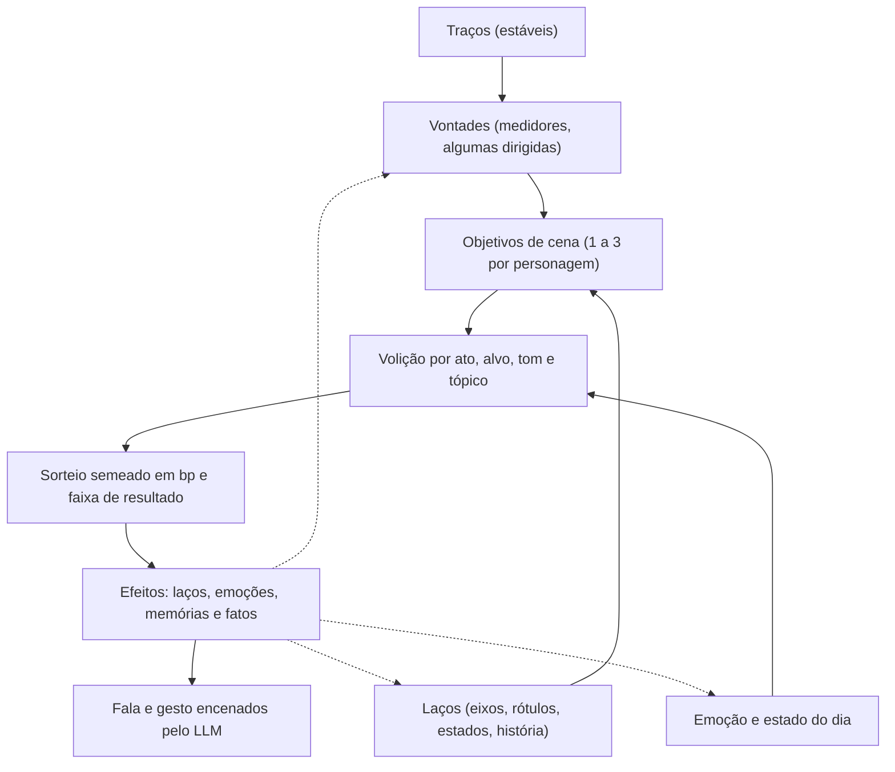
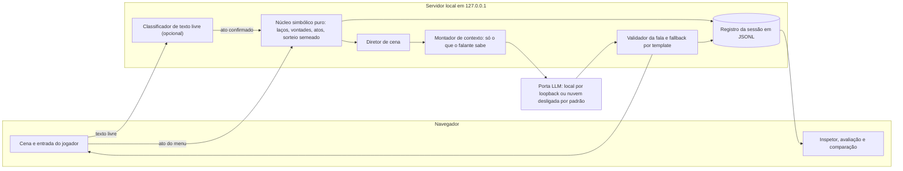

# Estudos e mudança de direção — MVP de conversa

> **Estado:** documento de discussão para decidirmos juntos a mudança de direção do MVP.
> **Nada aqui está ratificado.** D-01…D-08, os ADRs aceitos e os contratos DOC-02 e
> CTR-01…CTR-05 continuam valendo até uma decisão explícita os substituir
> (instrução direta do maintainer > `CLAUDE.md` > ADR > docs).
>
> **Versão 2 — 2026-11-09.** Reescreve a versão 1 (PR #10), que organizava nove notas sobre os
> estudos. As notas foram preservadas e relidas na [seção 5](#sec-5).
>
> **Como responder:** as perguntas estão à parte, no
> [formulário de decisões](<decisoes-mvp-conversa.html>). Abra-o com
> `plannotator annotate docs/studies/decisoes-mvp-conversa.html`, marque as opções, escreva o que
> quiser e cole no chat o prompt que ele gera no fim.

## Sumário

- [0. Resumo em uma tela](#sec-0)
- [1. Como usar este documento](#sec-1)
- [2. Onde paramos](#sec-2)
- [3. A nova direção](#sec-3)
- [4. O que os estudos trazem para ela](#sec-4)
- [5. As nove notas relidas](#sec-5)
- [6. Rascunho v0 do sistema de interações e vontades](#sec-6)
- [7. Rascunho v0 do Laboratório de Conversa](#sec-7)
- [8. Impacto nos documentos](#sec-8)
- [9. Dúvidas e sugestões, com opções e trade-offs](#sec-9)
- [10. Riscos](#sec-10)
- [11. Próximos passos propostos](#sec-11)
- [12. Glossário dos termos novos](#sec-12)
- [13. Referências](#sec-13)

## 0. Resumo em uma tela

- **Onde paramos.** Fase F0, só documentação. O planejamento foi aprovado no Plannotator em
  2026-11-08; DOC-02 e CTR-01…CTR-05 estão na `main` (`fad0a57`), mas ainda se declaram
  propostas para freeze. O scaffold Rust (SCI-01) foi interrompido sem commit, não existe uma
  linha de código e PD-01…PD-09, P-04, P-07, PA-06…PA-09 e INT-04 seguem abertos. A retomada
  registrada em `CLAUDE.md` ainda aponta para o SCI-01.
- **A nova direção.** Antes do motor, validar a **conversa**: definir um sistema de interações e
  vontades, gerar personagens (o nosso incluído) com laços sorteados e experimentar, num site,
  diálogos encenados por LLM em várias situações, para medir a **naturalidade** antes de
  aprofundar o sistema.
- **O que ela toca.** Inverte a ordem de D-01; retoma a opção "laboratório de cenários", que foi
  recusada em D-07; cria uma interface web que D-06/PA-08 ainda não escolheram; e, conforme o
  lugar onde o LLM rodar, esbarra no ADR-0001 (offline) e no princípio 5 da governança. Mantém, e
  precisa manter, "o modelo propõe, o núcleo dispõe".
- **O que dá para reaproveitar.** Os 6 atos sociais do DOC-02, relações direcionadas em basis
  points, labels, RNG semeado com sorteios registrados, NLG verificada contra o registro de fatos
  e fallback por template.
- **O que falta.** Vontades, emoções, personalidade em uso, turnos de conversa, conversa em grupo,
  persona na NLG, gerador de laços, entrada em texto livre contratada e qualquer métrica de
  naturalidade.
- **Minha recomendação central.** Tratar o site como **Laboratório de Conversa**: um instrumento
  de validação, com código descartável e contrato portátil. Nele, um núcleo simbólico pequeno e
  determinístico (laços, vontades, atos, sorteio semeado) decide, e o LLM só encena. A
  naturalidade é medida com rubrica e com comparação cega contra um baseline de "LLM livre".
- **O que preciso de você.** 38 dúvidas e 8 sugestões no
  [formulário de decisões](<decisoes-mvp-conversa.html>), cada uma com opções e trade-offs. Treze
  são bloqueantes: sem elas, o laboratório não deve começar.

## 1. Como usar este documento

- **Seções 2 a 5 — análise:** o estado real, o pedido, o que os estudos oferecem e as nove notas
  relidas.
- **Seções 6 e 7 — proposta v0:** como ficariam o sistema e o site **se** as recomendações do
  formulário forem aceitas. Cada escolha remete ao item correspondente (`Q-xx` ou `S-xx`).
- **Seção 8 — impacto:** que documentos mudam e quando.
- **Seção 9 — decisões:** aponta para o [formulário](<decisoes-mvp-conversa.html>), onde cada
  item traz a dúvida, as opções com o que se ganha e o que se perde, a minha recomendação e o que
  faço se ficar em aberto.
- **Seções 10 a 13:** riscos, próximos passos, glossário e referências.

**Prioridades usadas no formulário:** **bloqueante** (antes de qualquer código do laboratório),
**cedo** (durante a primeira fatia) e **depois** (pode esperar evidência).

**Regra que continua valendo:** os estudos são matéria-prima, não contrato. Nada vira contrato
sem decisão humana registrada, revisão do contrato afetado e testes.

### 1.1 O que aconteceu com as oito perguntas da versão 1

Elas não foram respondidas; foram absorvidas, já com opções, pelos itens do formulário.

| Pergunta da v1 | Onde está agora |
| --- | --- |
| 1. Probabilidade com replay ou resultados diferentes com a mesma seed? | Q-12 e Q-17 |
| 2. Confirmar o slice social como primeira entrega | Q-01, Q-02 e Q-03 |
| 3. Que modelos e com que papéis | Q-08, Q-09 e Q-16 |
| 4. Alcance de audição, paredes e silhuetas | Q-31 |
| 5. Lista mínima de drives | Q-13 e Q-14 |
| 6. Fisiologia, incapacitação e regra não letal | N-09 na [seção 5](#sec-5) (adiada) e Q-18 |
| 7. Apego a coisas, itens e PD-04 | Q-14 e Q-21 |
| 8. Adiar mundo, economia e combate | Q-03 e Q-04 |

## 2. Onde paramos (retrato em 2026-11-09)

### 2.1 Linha do tempo

| Commit | O que entrou |
| --- | --- |
| `0416613` | Fundação open-source (licença, governança, CI de documentação). |
| `a6c9ba6` | Errata JEV, arquitetura, regras de desenvolvimento, TDD/E2E. |
| `47b1b81` | Memória CoALA local do projeto. |
| `6350d09` (#5) | MLP por personagem, mundo em blocos e vista 2D isométrica. |
| `c53e6cf` (#6) | FOV, memória de ambiente e silhuetas de oclusão. |
| `c412cd4` (#7) | ROADMAP final e prompts de execução multiagente. |
| `fad0a57` (#8) | Contratos CTR-01…CTR-05 e ADRs 0010–0012. |
| `2a550b6` (#9) | Checkpoint do roadmap e ponto de pausa. |
| `05dea65` (#10) | Estudos e a versão 1 deste README. |

### 2.2 O que está pronto

- **Planejamento aprovado** no Plannotator em 2026-11-08, com escopo só documental: não autoriza
  código, scaffold, worktrees nem releases ([aprovação](<../planning/approval.md>)).
- **D-01…D-08 decididas**, com a regra de não reapresentá-las como questionário
  ([decisões](<../planning/decisions.md>)). Esta revisão não as reabre: a nova direção é uma
  instrução nova do maintainer, que precisa ser registrada como decisão nova.
- **ADRs 0001–0007 aceitos** (offline, Rust + Flecs, JEV não é runtime, modelo propõe e núcleo
  dispõe, determinismo, TDD, licença). Os ADRs 0008–0012 estão **propostos**.
- **DOC-02 e CTR-01…CTR-05 integrados** na `main`, mas cada contrato se descreve como "PROPOSTA
  PARA FREEZE" e o DOC-02 como "proposta não aprovada". O ROADMAP ainda lista o freeze entre os
  trabalhos não iniciados.
- **Execução planejada:** 46 cartões com prompts de trabalhador e de revisor, orquestrador e
  juiz. O manifesto `wave-spec.md` tem SHA-256 `328a8c7e…a360769`, fixado em 92 dos 95 prompts e
  em 6 documentos; mudar o manifesto obriga a regenerar ou declarar obsoletos esses prompts.

### 2.3 O que está parado ou em aberto

- **SCI-01 (scaffold Rust)** interrompido sem commit; worktree e branch removidas; não existe
  `Cargo.toml`. O motivo da interrupção não está registrado.
- **SCI-02…REL-02** pendentes; o manifesto tem `execution_enabled: false`.
- **Retomada registrada:** o README raiz diz que "a única tarefa pronta é SCI-01", com
  autorização explícita, e `CLAUDE.md`, `AGENTS.md` e o índice de prompts apontam para o mesmo
  lugar. Se a direção mudar e isto não for atualizado, agentes futuros vão retomar o plano antigo.

Pendências e o que a nova direção faz com cada uma:

| ID | O que é | Com a nova direção |
| --- | --- | --- |
| PD-01 | Escala de tempo (1 tick, atos de 2–6, sessão de 100) | Muda de sentido: no laboratório o turno de conversa importa mais que o tick. |
| PD-02 | Movimento cardinal; alcance social de 2 células | Quase irrelevante; sobra "quem ouve" (Q-31). |
| PD-03 | Viagem abstrata com teto de 240 ticks | Irrelevante para o laboratório. |
| PD-04 | Sem combate, itens ou economia; só moedas | Continua válida e vira anti-escopo do laboratório. |
| PD-05 | Eixos empatia, medo e confiança, com limiares | **Mais urgente:** é o modelo dos laços (Q-21). |
| PD-06 | Mentira com dois sorteios | Relevante se mentir entrar no catálogo (Q-15). |
| PD-07 | Parâmetros de rumor | Secundária numa cena; volta com a continuidade (Q-20). |
| PD-08 | Agenda regional | Irrelevante para o laboratório. |
| PD-09 | Fixture de 4 localidades e 8 NPCs | **Muda de sentido:** vira elenco com laços sorteados (Q-22, S-08). |
| P-04 | Memória de ambiente e genoma | Irrelevante para o laboratório. |
| P-07 | Atributos linguagem e inteligência | **Mais urgente:** modulam como cada um fala (Q-17, Q-33). |
| PA-06/07 | Dados de silhueta e overlay de debug | Irrelevantes para o laboratório. |
| PA-08 | Stack, ponte, build, assets e testes do cliente | **Muda de sentido e urge:** passa a ser a stack do site (Q-10). |
| PA-09 | Seed canônica da fixture | **Muda de sentido:** política de seed dos laços (Q-12). |
| INT-04 | Fórmula do modificador e `ResolvedCheck` | **Mais urgente:** é a resolução das interações (Q-17). |

### 2.4 O que o contrato atual já diz sobre conversa

O DOC-02 define seis atos sociais. Todos são unilaterais (jogador → um alvo), resolvidos num
único passo e registrados como fatos simbólicos, sem texto:

| Ato | Intenção (CTR-01) | Custo | Sorteios | Observação |
| --- | --- | --- | --- | --- |
| `falar` | `SOCIAL_TALK` | 2 ticks | 0 | Só 4 registros (saudação, agradecimento, despedida, comentário neutro); sempre +100 de empatia e +50 de confiança. |
| `negociar` | `NEGOTIATE` / `INFORM_PATH` | 6 ticks | 1 | Pedido e oferta de moedas; acordo ou recusa. |
| `mentir` | `LIE` | 4 ticks | 2 | Crença e detecção; a mentira detectada aplica `LIAR`. |
| `perguntar_rumor` | `ASK_RUMOR` | 3 ticks | 1 | Recebe a cópia do rumor com −1000 bp de fidelidade. |
| `contar_rumor` | `SHARE_RUMOR` | 3 ticks | 1 | Exige fidelidade ≥ 4000 bp. |
| `ameaçar` | `EXTORTION` | 4 ticks | 1 | Exigência; testemunhas semeiam o rumor `AMEACA`. |

O resto do estado social e do diálogo, hoje:

- **Laços:** relações direcionadas `(observador, alvo)` em basis points, de −10000 a 10000. O
  CTR-01 tem 5 eixos (confiança, medo, empatia, dependência, hostilidade); o DOC-02 usa 3.
  Labels: `FRIENDSHIP`, `MARRIAGE`, `ENMITY`, `FAMILY`, `ALLIANCE`, `LIAR`. Só `LIAR` tem regra,
  e a remoção de label não existe na v2.
- **Conversa:** não há turnos, sessão de conversa, grupo, interrupção nem NPC que puxe conversa
  com o jogador. A "resposta" do NPC é o resultado do sorteio. NPCs só agem em pulsos de agenda
  de 10 ticks, e a escolha deles é "utilidade determinística" sem função definida.
- **Psicologia:** não há vontades, objetivos, emoções, personalidade em uso, necessidades, apego a
  coisas nem força de memória. Traços e os 8 atributos aparecem na arquitetura, não nos contratos.
- **Texto do jogador:** nenhum texto entra na intenção. A NLU de texto livre (LFM3 + d1-2B) está
  prevista na arquitetura, mas não foi contratada; a `LlmPort` só tem `propose_rule` e
  `render_narrative`.
- **NLG:** preguiçosa e fora do tick. Recebe até 16 fatos, 32 claims e 16 KiB; **não recebe
  persona, voz nem histórico de prosa**. Devolve `{prose, claims}` verificados contra o registro;
  se falhar, usa templates (locale padrão pt-PT, pt-BR suportado). Nunca altera estado.
- **Aleatoriedade:** ChaCha20 por streams (`social`, `rumor`…), sorteios registrados e replay
  exato dos fatos. A saída do modelo é registrada como entrada externa; o texto não entra no estado
  nem é reproduzido pelo replay. **Não existe stream contratado para gerar laços** (`spawn` está
  reservado e não é usado).
- **Percepção:** não há modelo de audição. Alcance social de 2 células; testemunhas até 6 células
  (no máximo 4); porta e vidro não bloqueiam.
- **Naturalidade:** nenhuma métrica. A qualidade da NLG em português é "medição futura" (O-06), e
  o cartão NLG-02 diz "não usar LLM para julgar lógica".

### 2.5 Incoerências encontradas pelo caminho

Valem em qualquer cenário; a arrumação está em S-07.

- ROADMAP §1 e README raiz dizem "scaffold aprovado localmente"; `prompts/sci-01.md` diz "o
  scaffold não foi iniciado".
- A tabela de riscos do ROADMAP diz "assinatura final do planejamento ainda pendente";
  `approval.md` registra `approved`.
- Contratos "concluídos e integrados" convivem com "PROPOSTA PARA FREEZE".
- O mapa de `docs/README.md` está desatualizado: não lista `contracts/`, `prompts/` nem `studies/`
  e fala só dos ADRs até 0009.
- A versão 1 deste README citava `DECISOES.md` e `PLANO-DE-MECANICAS-E-LOGICA.md`, que não
  existem no repositório (corrigido nesta versão; ver [4.4](#sec-4-4)).
- O ADR-0005 deriva os streams de "seed + hash do nome"; o CTR-02 usa o código numérico do stream.
- `testing-strategy.md` tem um exemplo com `"kind": "tick", "count": 10` e outro com
  `"kind": "command", "text": …`, que contradizem o tempo por ação e a intenção simbólica.
- O fallback da NLG usa pt-PT por padrão, enquanto `docs/README.md` pede pt-BR para produto.
- O roadmap original existe duas vezes, idêntico: na raiz e nesta pasta.

## 3. A nova direção

### 3.1 O pedido

> "Definir o sistema de interações e vontades para criar um demo de conversa com representação
> de diálogo com LLM;
> Criar um novo apenas estilo de conversa pra validar a naturalidade antes de aprofundar no
> sistema; criando uns personagens e nosso personagem e definindo os laços de maneira randômica
> para podermos experimentar em um site o nosso sistema de diálogo e várias situações."

### 3.2 Como li cada parte

| Trecho | Minha leitura | Onde decidir |
| --- | --- | --- |
| "sistema de interações e vontades" | Um catálogo de atos de conversa e um modelo de motivação que escolhe entre eles. | Q-13 a Q-17 |
| "demo de conversa com representação de diálogo com LLM" | O sistema decide o que acontece; o LLM transforma isso em falas. | Q-16, Q-32 |
| "um novo apenas estilo de conversa" | Um modo só de conversa: uma cena, sem mapa, movimento ou economia. | Q-01 |
| "validar a naturalidade antes de aprofundar no sistema" | A naturalidade é o critério principal; motor, MLP, SOM e economia esperam o resultado. | Q-07, Q-35 |
| "uns personagens e nosso personagem" | Um elenco pequeno e um personagem do jogador com papel na trama. | Q-23, Q-24 |
| "laços de maneira randômica" | Um gerador semeado de relações, reproduzível pela seed. | Q-21, Q-22 |
| "experimentar em um site" | Uma interface web de experimentação, não o cliente final. | Q-08, Q-10, Q-11 |
| "várias situações" | Um catálogo e um gerador de cenas com tensão. | Q-25, S-01, S-02 |

### 3.3 Hipótese, objetivo e não-objetivos

**Hipótese principal:** um núcleo simbólico de laços, vontades e atos, com resultados sorteados e
consequências que persistem, produz conversas que um jogador percebe como naturais e interessantes
quando um LLM as encena, e mais consequentes do que as de um LLM sozinho.

Ela se divide em cinco perguntas que o laboratório precisa responder:

1. **Naturalidade:** as falas soam como pessoas, com voz própria e subtexto?
2. **Variedade:** laços sorteados geram situações realmente diferentes?
3. **Consequência:** o que acontece numa cena muda a próxima de forma perceptível?
4. **Controle:** o LLM encena sem inventar fatos nem decidir resultados?
5. **Viabilidade de modelo:** qual é o menor modelo, de preferência local, que mantém 1 a 4?

**Objetivo do MVP:** responder a essas cinco perguntas com evidência registrada, no menor tempo,
e decidir com ela se e como o motor volta (go/no-go, Q-07).

**Não-objetivos:** mapa, movimento e viagem; economia, itens e combate; render 2D; o motor Rust;
MLP, SOM e genética; fisiologia completa; publicação aberta; voz e multimodalidade; otimização.

### 3.4 Onde a nova direção encosta no plano vigente

| Item | O que diz hoje | Efeito da nova direção | Como conciliar |
| --- | --- | --- | --- |
| D-01 | Motor validado antes do jogável 2D. | **Conflito:** a experiência é validada antes do motor. | Decisão nova que reordena só o MVP (Q-03). |
| D-02 | Tempo avança por mover e falar. | Tensão: no laboratório o tempo é o turno. | Fala continua ato simbólico; ticks opcionais (Q-29). |
| D-03 | Relações e rumores no centro. | **Alinhada**; o critério passa a incluir naturalidade. | Nada a mudar. |
| D-04 | Silhuetas atrás das construções. | Irrelevante no laboratório. | Adiar. |
| D-05 | CPU/GPU da própria máquina. | Tensão se o LLM for remoto. | Q-08. |
| D-06 | 2D isométrico; stack de cliente aberta (PA-08). | Tensão: um site é uma escolha de stack de cliente. | Site como instrumento, não como cliente final (Q-02, Q-10). |
| D-07 | Região multi-localidades; o "laboratório de cenários sem campanha" foi a opção **recusada**. | **Conflito direto** com a escolha feita. | D-07 já admite "cenários curados como instrumentos de teste"; o laboratório pode ser isso sem rebaixar o escopo do produto (Q-02, Q-04). |
| D-08 | Subagents sem limite, barreira e juiz. | Processo pesado para um experimento. | Laboratório fora das ondas (Q-04, Q-06). |
| ADR-0001 | Runtime hermético; só sidecars de modelo no loopback; nuvem (Jev/OpenRouter) rejeitada. | Conflito se houver servidor web ou LLM na nuvem. | Laboratório como ferramenta fora do runtime, ou só modelo local (Q-04, Q-08). |
| ADR-0002 | Rust 2024 + Flecs. | Tensão se o site for em outra linguagem. | Vale para o motor; o laboratório é instrumento (Q-10). |
| ADR-0004 | O modelo propõe, o núcleo dispõe. | **Precisa ser preservado.** | O LLM encena; quem decide é o núcleo (Q-16). |
| ADR-0005/0006 | Determinismo; TDD com cobertura e mutação. | Tensão com a velocidade de um experimento. | Replay exato do simbólico e gates leves (Q-06, Q-12). |
| ADR-0007 | Pesos não são distribuídos. | Rodar o modelo no navegador de terceiros exigiria servir os pesos. | Modelo sempre no servidor local (Q-08, Q-11). |
| Governança | Linguagem, stack ou modelo de IA = mudança grande (RFC de 14 dias + ADR). Offline-first e "modelo propõe" são inegociáveis. | Depende de como o laboratório é classificado. | Q-04. |
| `wave-spec.md` | ANTI-04 (rede, texto como autoridade) e ANTI-05 (vila isolada). | Conflita se o laboratório for "o produto". | Laboratório fora do grafo de ondas, como instrumento (Q-04). |

## 4. O que os estudos trazem para a nova direção

Os três estudos foram escritos para o plano antigo (motor regional primeiro). Reli cada um
procurando o que serve a um laboratório de conversa. Legenda: **já** (entra no laboratório),
**teste** (entra como chave experimental), **motor** (fica para depois do go/no-go) e
**revisar** (precisa ser verificado antes de usar).

### 4.1 Avaliação e Arquitetura

| Ideia | Uso |
| --- | --- |
| Diálogo em duas fases: resolver simbolicamente e depois dramatizar com subtexto, sem expor números. | **já** — é o coração do laboratório. |
| Dissonância: quando sentimentos fortes se contradizem (empatia e hostilidade altas), a fala fica ambivalente e o NPC hesita. | **já**, por regra simples, sem SOM. |
| Arquétipos de postura com nome (`CAUTIOUS_CORDIAL`, `CORNERED_PARANOID`, `NEUTRAL_PRAGMATIC`) como dica para o LLM. | **teste** — calculados por faixas, não por SOM. |
| Memória em camadas (8 curtas, 8 longas e núcleo) inspirada em Dwarf Fortress. | **teste**, na forma leve de "memórias marcantes" (Q-19). |
| Linguagem e inteligência (P-07) modulando o estilo e a eficácia da fala. | **já** como traço de voz; **motor** como fórmula. |
| Fórmula do modificador de check (INT-04) a partir de atributos e relação. | **revisar** — o laboratório prefere probabilidade em bp (Q-17). |
| Micro-MLP 6×4×5 em ponto fixo, genoma de espécie, plasticidade Hebbiana (trauma), SOM 3×3, RSOM de clima social e deriva cultural. | **motor**. |
| Janela de sessão de 320 ticks e decaimento inteiro de rumor (9659 bp por pulso). | **motor**. |
| "Validámos numa simulação de protótipo" (números da plasticidade). | **revisar** — não há código nem fonte (`unknown_url`). |

### 4.2 Expansão Sistêmica

| Ideia | Uso |
| --- | --- |
| Cinco necessidades psicológicas (segurança, pertença, estatuto, curiosidade, justiça) com taxas e efeitos. | **já** como base das vontades (Q-14). |
| IAUS em aritmética inteira, com fator de compensação, para pontuar ações. | **já** para pontuar atos (Q-13). |
| Tensão mental: culpa por agir contra quem se ama e alívio ao prejudicar um inimigo (catarse de vingança). | **teste** — é material direto de vontade e emoção. |
| Segredos e ganchos (fraco e forte, à la Crusader Kings 3) para chantagem e favores. | **já** como gancho de cena (S-02). |
| Interações públicas: denúncia, brinde e mediação. | **teste** nas cenas de grupo (Q-24). |
| Taverna como palco de convergência social. | **já** como cenário padrão. |
| Promessas com prazo (`ScheduledPact`): faltar vira quebra de palavra. | **teste** com continuidade entre cenas (Q-20). |
| Socorro que gera gratidão e dívida (`DEBTOR_WEAK`). | **teste** como laço de história (Q-22). |
| Calendário lógico, fisiologia metabólica, coma, sanidade com status 6, economia de 6 itens e spread, velhice e sucessão. | **motor**. |
| Taxas e limiares numéricos. | **revisar** — propostas sem medição; muitas fontes são wikis e fóruns. |

### 4.3 Roadmap original (LFM3)

| Ideia | Uso |
| --- | --- |
| Registro objetivo da conversa: cada interação é uma tupla (falante, ouvinte, intenção, valência, deltas, labels, status, rumor). | **já** como formato de evento do laboratório. |
| Leitura evolutiva: o LLM recebe a sequência de eventos entre duas pessoas e reconstrói a relação. | **já** — a história vira subtexto (Q-19, Q-22). |
| Modal de conversa com texto livre e triagem por um decisor tipado (arquétipo da ação, escopo, dificuldade). | **já** na entrada híbrida (Q-26). |
| Auditoria de fidelidade: zero alucinação mecânica, conferida contra os eventos. | **já** na avaliação (Q-35). |
| Cache do texto gerado pelo hash da sequência. | **já**. |
| Regras emergentes por tool call (o LLM propõe uma regra nova). | **motor**. |
| Família LFM3 multimodal (voz, visão) e benchmark de 10 mil entidades. | **motor**, ou nunca. |
| Números de modelos (latência, memória, benchmarks). | **revisar** — vêm do fabricante e de terceiros e não foram medidos aqui. |

### 4.4 Cuidados ao usar os estudos

- **Fontes que não estão no repositório.** Os estudos citam `00-LEIA-ME.md`, `DECISOES.md`,
  `GLOSSARIO.md`, `PLANO-DE-MECANICAS-E-LOGICA.md` e `AI-FANTASY-PLANO.md`. Parecem pacotes
  exportados para a pesquisa. Os equivalentes prováveis (hipótese) são as
  [decisões](<../planning/decisions.md>), o [glossário](<../glossary.md>), o
  [DOC-02](<../planning/gameplay-spec.md>) e o [ROADMAP](<../../ROADMAP.md>).
- **Fórmulas em imagem.** Entre 90% e 94% dos bytes de cada estudo são imagens em base64, e muitas
  fórmulas só existem como imagem. O texto sozinho não as carrega.
- **Validações sem código.** Frases como "validámos" e "verificado" não têm código nem dados no
  repositório. Os números são hipótese.
- **Fontes fracas.** Parte das referências são wikis de fãs, Reddit e `unknown_url`.
- **Exportação com lacunas.** O roadmap original perdeu as seções 4 e 5.1 e tem um artefato
  (`visual_element`) no meio do texto.
- **Vocabulário histórico.** "JEV" nos estudos é termo histórico; no código vale `system_one`
  (errata do roadmap de arquitetura).

## 5. As nove notas relidas sob a nova direção

As notas são as observações do maintainer registradas na versão 1. O texto original de cada uma
está no histórico do git (`05dea65`); aqui ficam o resumo, o papel no laboratório e a dúvida que a
resolve.

| Nota | O que dizia | No laboratório | Onde decidir |
| --- | --- | --- | --- |
| N-01 | A velocidade das ações físicas depende do estado (fome, fadiga, ferimento, medo). | Fora: não há movimento. Fica o "estado do dia" mudando tom e paciência. | Q-18 |
| N-02 | Não é só LFM3: há decisão (SOM ou utilidade) e um LLM que converte o simbólico em diálogo para quem ouve. | **Central:** o núcleo decide e o LLM encena. SOM e MLP esperam. | Q-16, Q-09 |
| N-03 | Só ouve o diálogo quem está perto. | Versão leve: zonas e cochicho. | Q-31 |
| N-04 | Interações não são determinísticas, nem entre NPCs. | **Central:** sorteio semeado e registrado; mesma seed, mesma história. | Q-12, Q-17 |
| N-05 | Faltam drives sociais como vingança e saudade. | **Central:** são as vontades. | Q-13, Q-14 |
| N-06 | Rumores persistem por repetição; o tempo degrada a memória. | Parcial: memória do que foi dito e ouvido, com reforço por repetição. A propagação regional espera. | Q-19, Q-20 |
| N-07 | O MVP começa por diálogo, negociação, paquera, provocação e conversa. | **Confirmada e afinada:** é o laboratório. | Q-01 a Q-03, Q-15 |
| N-08 | Apego também a coisas, não só a pessoas. | Barato: objetos e lugares como alvo de vontade e tópico de conversa, sem economia. | Q-14, Q-21 |
| N-09 | Necessidades fisiológicas movem o personagem. | Adiada; fica só o "estado do dia". Incapacitação e regra não letal ficam para o motor. | Q-18 |

As consequências transversais da versão 1 continuam válidas: probabilidade não é caos (precisa de
seed e registro); decisão, proposta de regra e diálogo são papéis separados e nenhum escreve no
estado; ver, ouvir e conversar são camadas diferentes; e laços sem drives deixam o diálogo plano.

## 6. Rascunho v0 do sistema de interações e vontades

Esta seção monta o sistema **com as recomendações do formulário de decisões**. Se você escolher
outra opção, a peça correspondente muda. Os números são ilustrativos.

### 6.1 A pilha, de cima para baixo

1. **Traços** (estáveis) definem a voz e as inclinações. Ex.: orgulhoso, tímido, irônico.
2. **Vontades** (medidores lentos, 0 a 10000 bp) dizem o que a pessoa quer da vida; algumas são
   dirigidas a alguém ou a algo (Q-13, Q-14).
3. **Objetivos de cena** (1 a 3 por personagem) dizem o que ela quer *desta* conversa, a partir
   das vontades e dos laços. Ex.: "cobrar a dívida sem perder a pose".
4. **Volição por ato:** cada ato possível (alvo, tom, tópico) recebe uma pontuação de quanto avança
   os objetivos, dados os laços e a emoção do momento.
5. **Sorteio semeado:** a reação do outro é sorteada a partir da volição dele, e o resultado cai
   numa faixa (Q-17).
6. **Efeitos** mudam laços, emoções, memórias e fatos, e podem satisfazer ou frustrar vontades.
7. **Fala:** o LLM encena o que já foi decidido (Q-16, Q-32).

### 6.2 Ficha de personagem

| Campo | Exemplo | Para que serve |
| --- | --- | --- |
| Identidade | Dalva, 41 anos, taberneira | Apresentação e prompt; fica fora do estado autoritativo. |
| Traços (3) | orgulhosa, prática, protetora | Voz e pesos de volição. |
| Voz | frases curtas, ditados, nunca pede desculpa direto | Guia de estilo para o LLM. |
| Atributos | linguagem 6200 bp, inteligência 5800 bp | Eficácia e registro da fala (P-07). |
| Vontades | estatuto 6000; pertença 4000; justiça → Otávio 2500 | Motor da conversa. |
| Segredos (0 a 2) | deve dinheiro ao moleiro | Gancho e tópico proibido. |
| Apegos (1 ou 2) | o anel da mãe; a própria taverna | Vontade dirigida a coisa ou lugar (N-08). |
| Estado do dia | cansada, sem fome | Tom e paciência (N-01 e N-09 em versão leve). |
| Memórias marcantes | IDs de eventos da história | Âncoras para o LLM citar sem inventar. |

### 6.3 Laços

- **Eixos direcionados** (bp, de −10000 a 10000): os 5 do CTR-01 (confiança, medo, empatia,
  dependência, hostilidade) e três candidatos para o que o MVP quer testar: **atração**
  (paquera), **respeito** (provocação e estatuto) e **intimidade** (saudade e história)
  (Q-21).
- **Rótulos:** os 6 do CTR-01 e candidatos como `EX`, `PAIXAO_SECRETA`, `CREDOR` e `DEVEDOR`,
  `RIVAL`, `MENTOR` e `APRENDIZ`. Precisam poder ser removidos, o que a v2 não permite.
- **Estados transitórios dirigidos**, com duração: com ciúme de, zangado com, envergonhado diante
  de, grato a, intimidado por (o status 7 do CTR-01).
- **História:** 1 ou 2 eventos passados por laço importante, que viram fatos do registro e podem
  ser citados (Q-22).

### 6.4 Vontades candidatas

| Vontade | Dirigida? | Sobe quando | Satisfeita por | Atos típicos |
| --- | --- | --- | --- | --- |
| Pertença | geral | fica sozinho ou é ignorado | conversa calorosa, ser incluído | conversar, elogiar, convidar |
| Afeto e desejo | a uma pessoa | atração sem retorno | flerte aceito, intimidade | elogiar e convidar em tom sedutor, confidenciar |
| Estatuto | geral | humilhação, ser ignorado | vencer discussão, ser elogiado, bom acordo | provocar, gabar-se, negociar |
| Segurança | geral ou a uma pessoa | ameaça, medo alto | afastar a ameaça, aliança | apaziguar, recusar, pedir ajuda, sair |
| Curiosidade | geral | novidade, segredo pressentido | saber algo novo | perguntar, escutar |
| Justiça e vingança | a uma pessoa | ofensa sofrida, mentira descoberta | reparação, desculpa, ver o ofensor exposto | acusar, provocar, ameaçar, expor |
| Saudade | a pessoa, lugar ou coisa | ausência, lembrança | reencontro, falar do passado | relembrar, perguntar por, confidenciar |
| Diversão | geral | tédio | piada, provocação bem recebida | provocar em tom brincalhão, contar história |

### 6.5 Atos de conversa e tom

Proposta composicional (Q-15): **ato × tom × tópico**. Paquera e provocação deixam de ser
atos isolados e viram combinações.

- **Atos (12):** cumprimentar, conversar, perguntar, contar, elogiar, provocar, acusar, pedir,
  oferecer, desculpar-se, ameaçar, recusar ou encerrar. "Mentir" é uma marca de falsidade em
  contar, oferecer ou pedir.
- **Tons (6):** caloroso, neutro, brincalhão, sedutor, irônico, agressivo.
- **Tópicos:** uma pessoa, uma coisa, um lugar, um evento, um segredo ou um rumor.
- **Exemplos:** paquera = elogiar ou conversar em tom sedutor sobre o alvo; provocação = provocar
  em tom brincalhão, irônico ou agressivo sobre algo sensível ao alvo.

Compatibilidade com os 6 atos do DOC-02:

| DOC-02 | No laboratório |
| --- | --- |
| `falar` (`SOCIAL_TALK`) | cumprimentar ou conversar |
| `negociar` (`NEGOTIATE`) | pedir ou oferecer com contrapartida |
| `mentir` (`LIE`) | contar, oferecer ou pedir com marca de falsidade |
| `perguntar_rumor` (`ASK_RUMOR`) | perguntar com tópico rumor |
| `contar_rumor` (`SHARE_RUMOR`) | contar com tópico rumor |
| `ameaçar` (`EXTORTION`) | ameaçar |

### 6.6 Resolução e consequências

1. O ato do jogador é validado: alvo presente, tópico conhecido, ato permitido.
2. O núcleo calcula a probabilidade de cada reação do alvo (aceitar, desviar, recusar,
   contra-atacar) a partir dos laços dele com o jogador, das vontades e objetivos dele, da emoção
   do momento, do encaixe entre tom e traços e de quem está ouvindo.
3. Um sorteio semeado em bp escolhe a reação e a faixa: falha dura, falha, parcial, sucesso ou
   sucesso marcante (Q-17).
4. Os efeitos são aplicados (deltas de laço, estados transitórios, memórias, fatos), com o motivo
   de cada um registrado.
5. O diretor de cena decide quem fala a seguir (Q-30).

### 6.7 Memória e continuidade

- Cada interação vira um evento simbólico, no formato do roadmap original ([4.3](#sec-4)).
- Eventos com efeito forte viram **memórias marcantes** do personagem e podem ser citados depois.
- Entre cenas passa "tempo": emoções se acalmam, saudade cresce, promessas vencem
  (Q-20).
- Repetir um assunto reforça a memória dele; o esquecimento vem do tempo e da falta de repetição
  (N-06 em versão leve).

### 6.8 Cena com várias pessoas

- O lugar tem **zonas** (mesa, balcão, porta). Quem está na mesma zona ouve; cochichar só chega ao
  alvo; falar alto chega à sala toda (Q-31).
- Depois de cada turno, o **diretor de cena** dá a vez a quem tem volição acima de um limiar, com
  no máximo 1 ou 2 interjeições por turno (Q-30).
- Quem ouve guarda o fato na própria perspectiva (direto ou de segunda mão), como no CTR-04.

### 6.9 Papel do LLM

- **Encenar (sempre):** recebe um pacote só com o que o falante sabe — ficha resumida, laço
  descrito em palavras, objetivo da cena, ato, tom e resultado a encenar, memórias relevantes e
  últimas falas — e devolve um JSON curto `{fala, gesto}` (Q-32).
- **Validar a saída:** formato, tamanho, nenhum número de mecânica, nenhum fato fora do que o
  falante sabe, limites de conteúdo (Q-37). Se falhar, entra um template, como o fallback
  do CTR-04.
- **Classificar texto livre (opcional):** transforma a frase do jogador em ato, tom, alvo e
  tópico, com confirmação na tela (Q-26).
- **Escolher o ato (só em modo experimental):** dentro da lista permitida, com validação do núcleo
  (Q-16).
- **Nunca:** decidir resultado, alterar laços ou inventar história.

### 6.10 Um turno do início ao fim (exemplo ilustrativo)

Situação "Cobrança na taverna", noite de chuva. Presentes: Dalva (taberneira, credora do
jogador), Otávio (ferreiro, rival de infância do jogador e apaixonado em segredo por Nina), Nina
(aprendiz de costureira, curiosa) e você, no papel de "o filho que volta" depois de cinco anos.
Nomes e números são inventados para mostrar o fluxo.

1. **Você escreve:** "Nina, você cresceu… ainda costura os vestidos da festa da colheita?"
2. **Classificador:** conversar · sedutor · alvo Nina · tópico festa da colheita. Você confirma a
   etiqueta "entendido como".
3. **Núcleo:** Nina tem curiosidade alta e uma atração leve por você, e o tom combina com o traço
   "extrovertida": chance de aceitar com interesse = 6200 bp. O sorteio dá 4410: **sucesso**.
4. **Efeitos:** a atração de Nina por você sobe 600 e a intimidade, 300. Otávio está na mesma zona
   e ouviu: ganha o estado "com ciúme de você" e +900 de hostilidade. A vontade "desejo → Nina"
   dele sobe, e a volição de provocar você chega a 7100 bp, acima do limiar.
5. **Diretor de cena:** Nina responde; Otávio interrompe.
6. **O LLM encena**, só com o que cada um sabe (Nina conhece a dívida por um rumor):
   - **Nina** *(ri, sem tirar os olhos da agulha)*: "Costuro. E você, voltou para a festa ou
     para acertar as contas com a Dalva?"
   - **Otávio** *(bate a caneca no balcão)*: "Cinco anos fora e a primeira coisa que faz é
     rondar a mesa dos outros."
7. **Inspetor:** mostra a classificação, as probabilidades, os sorteios, os efeitos, o contexto
   enviado ao LLM, a saída bruta e a validação.
8. **Avaliação:** você dá nota às duas falas na rubrica ([7.8](#sec-7-8)).

## 7. Rascunho v0 do Laboratório de Conversa (o site)

### 7.1 Para que serve e para que não serve

- **Serve para:** responder às cinco perguntas da [hipótese](#sec-3-3) com sessões registradas,
  comparar variantes (modelo, prompt, sistema ligado ou desligado) e montar situações rápido.
- **Não serve para:** ser o cliente final do jogo, ser publicado aberto, guardar campanha de forma
  durável nem substituir os contratos do motor.

### 7.2 Fluxo de uso

1. Gerar um elenco a partir de uma seed, ou carregar o elenco de referência (S-08).
2. Ver as fichas e o grafo de laços; travar ou editar o que quiser (Q-25).
3. Escolher uma situação do catálogo, ou deixar o gerador montar uma com ganchos de tensão.
4. Conversar em turnos e observar as interjeições.
5. Avaliar as falas e a cena.
6. Salvar, ramificar ou voltar a um turno para tentar outra fala.
7. Comparar variantes às cegas (A/B).
8. Exportar a transcrição em Markdown.

### 7.3 Telas

| Tela | Conteúdo |
| --- | --- |
| Elenco | Fichas, grafo de laços, seed, sortear de novo, travar e editar laços. |
| Cena | Falas e gestos, quem está em que zona, entrada do jogador com a etiqueta "entendido como". |
| Inspetor | Vontades, objetivos, volições, probabilidades, sorteios, efeitos, contexto e saída do LLM. |
| Avaliação | Rubrica por fala e por cena; comentário livre. |
| Sessões | Histórico, replay, ramificações, exportação. |
| Comparar | A mesma cena com duas variantes, às cegas. |

### 7.4 Arquitetura

- O **núcleo simbólico** é puro (sem I/O, sem relógio), usa inteiros em bp e um PRNG semeado e
  conversa por um esquema JSON versionado. É a parte que pode virar contrato do motor
  (Q-02, Q-10).
- O **servidor local** escuta só em `127.0.0.1`, guarda a chave do LLM, se houver, e grava o
  registro (Q-11, Q-38).
- A **porta do LLM** aceita um adaptador local (loopback) e, se aprovado, um de nuvem desligado
  por padrão (Q-08).

### 7.5 Gerador de elenco e laços

1. Sortear N personagens a partir de arquétipos (ofício, idade, 3 traços, voz).
2. Sortear vontades e apegos coerentes com os traços.
3. Para cada par relevante, sortear um **arquétipo de laço** (irmãos, ex-noivos, credor e
   devedor, rivais de ofício, paixão não correspondida, mentor e aprendiz, amigos de infância,
   desconhecidos) e derivar os eixos com ruído e reciprocidade (Q-22).
4. Gerar 1 ou 2 **eventos de história** por laço importante, sem contradições.
5. Checar a coerência do grafo: um só cônjuge, família transitiva, nenhum triângulo impossível.
6. Garantir pelo menos um **gancho de tensão** por cena (S-02).

Parâmetros: seed, tamanho do elenco, densidade de drama e intensidade de conteúdo
(Q-37). Tudo reproduzível pela seed.

### 7.6 Catálogo inicial de situações

| # | Situação | Tensão principal | Atos que exercita |
| --- | --- | --- | --- |
| 1 | Cobrança na taverna | dívida diante de testemunhas | pedir, oferecer, mentir, provocar |
| 2 | Reencontro de ex-noivos | saudade e ciúme de um terceiro presente | relembrar, confidenciar, acusar |
| 3 | Paquera sob o olhar do rival | desejo contra estatuto | elogiar e conversar em tom sedutor, provocar |
| 4 | Feira: rivais de ofício | estatuto e diversão | provocar, gabar-se, negociar |
| 5 | Desculpas depois de um boato | justiça contra pertença | desculpar-se, acusar, recusar |
| 6 | Negociar com quem acha que você mente | rótulo `LIAR` | pedir, oferecer, ameaçar |
| 7 | O segredo descoberto | chantagem ou proteção | ameaçar, pedir, confidenciar |
| 8 | Velório e herança | apego a um objeto | pedir, acusar, oferecer |
| 9 | O forasteiro | ninguém conhece ninguém | cumprimentar, perguntar, contar |
| 10 | Mediação | dois amigos brigados e você no meio | conversar, pedir, apaziguar |

### 7.7 Registro, replay e avaliação

Cada sessão vira um arquivo JSONL fora do git (S-04) com:

- seed e versões do núcleo, do prompt e do modelo;
- por turno: entrada do jogador, classificação, ato, volições, sorteios (stream, valor, faixa),
  efeitos, contexto enviado, saída bruta, fala exibida, validação e tempo de resposta;
- notas da rubrica e comentários.

Com isso dá para refazer a sessão exatamente, re-renderizar um turno com outro modelo e comparar
variantes (Q-12).

### 7.8 O que "natural" quer dizer aqui (rubrica v0)

Cada fala recebe uma nota de 1 a 5 em seis critérios e passa por três checagens de sim ou não.

| Critério | Pergunta |
| --- | --- |
| 1. Personagem | Soa como esta pessoa (voz, traços, idade, ofício)? |
| 2. Relação | Combina com o laço e a história entre quem fala e quem ouve? |
| 3. Resposta | Responde ao que acabou de ser dito? |
| 4. Subtexto | Mostra sem dizer (sem números, sem explicar a mecânica), com ambivalência quando cabe? |
| 5. Língua | É português natural, no registro certo, sem tom de assistente? |
| 6. Economia | Tem o tamanho certo, sem repetir? |

| Checagem | Falha se… |
| --- | --- |
| Fato inventado | cita algo que não está no registro nem no que o falante sabe. |
| Quebra de papel | sai do personagem, fala como IA ou cita regras. |
| Limite de conteúdo | ultrapassa o que foi definido em Q-37. |

Por cena: "foi interessante?" (1 a 5), "as consequências fizeram sentido?" (1 a 5) e um
comentário.

## 8. Impacto nos documentos (se as recomendações forem aceitas)

| Documento | O que muda | Quando |
| --- | --- | --- |
| `docs/planning/decisions.md` | D-09 em diante: direção do MVP, natureza do laboratório, LLM, stack, entrada do jogador; nota na §3 sobre o que foi superado. | Ao responder Q-02 a Q-04 |
| `docs/architecture/adr/0013-…` (novo) e índice | Laboratório como instrumento fora do runtime: fronteira de rede, relação com o motor, regra de descarte, exceção de gates. | Ao responder Q-04 |
| `ROADMAP.md` | §1: SCI-01…REL-02 como "Adiado"; §2: decisões novas; §3: marco "M-LAB"; corrigir a assinatura pendente e o freeze. | Ao responder Q-03 e Q-04 |
| `CLAUDE.md` e `AGENTS.md` (espelhos) | Estado e retomada, que hoje mandam retomar o SCI-01; §2 só se a regra de rede mudar para o laboratório. | Idem |
| `README.md` (raiz) e `docs/planning/prompts/README.md` | Estado e próximos passos; contradição sobre o SCI-01. | Idem |
| `docs/planning/wave-spec.md` | Nada agora, para preservar o hash `328a8c7e…`; só muda se Q-04 for C. | Depois |
| Spec do laboratório (novo, ex.: `docs/planning/lab-spec.md`) | Sistema escolhido, rubrica, situações, critério de saída. | Depois das bloqueantes |
| `docs/planning/gameplay-spec.md` (DOC-02) | Atos e tons novos, vontades, conversa por turnos, grupos, laços sorteados. | Depois do go/no-go |
| `docs/planning/contracts/identity-events.md` (CTR-01) | Eixos e rótulos novos, remoção de label, estados transitórios, vontades, memórias marcantes. | Depois do go/no-go |
| `docs/planning/contracts/model-schema.md` (CTR-04) | Contexto da NLG com persona e voz, fala por turno, porta de classificação, locale padrão. | Depois do go/no-go |
| `docs/planning/contracts/time-replay-save.md` (CTR-02) | Stream para gerar elenco e laços, registro de classificações, custos dos atos novos. | Depois do go/no-go |
| `docs/planning/contracts/region-perception-overlay.md` (CTR-03) | Audição e zonas, se Q-31 for B ou C. | Depois do go/no-go |
| `docs/engineering/offline-ai.md` | Exceção do laboratório (se houver nuvem) e protocolo de comparação de modelos. | Ao responder Q-08 |
| `docs/engineering/testing-strategy.md` | Avaliação de naturalidade como verificação distinta de teste; cenas douradas. | Depois |
| `docs/glossary.md` e `docs/README.md` | Termos da [seção 12](#sec-12); mapa com `contracts/`, `prompts/`, `studies/` e `lab/`. | Ao responder / S-07 |
| `.github/workflows/ci.yml` | Job do laboratório (lint e testes do núcleo), se Q-05 for A. | Ao criar o laboratório |

## 9. Decisões

As 38 dúvidas e as 8 sugestões — cada uma com opções, trade-offs, a minha recomendação e o que faço
se ficar em aberto — estão no [formulário de decisões](<decisoes-mvp-conversa.html>), um HTML local
e autocontido. Treze são bloqueantes.

- **Como abrir:** `plannotator annotate docs/studies/decisoes-mvp-conversa.html` (o Plannotator
  mostra o HTML como página, com as caixas de seleção funcionando) ou o próprio arquivo no
  navegador.
- **Como responder:** marque uma ou mais opções por item, escreva se quiser outra opção ou um
  ajuste e, no fim do formulário, copie o prompt gerado e cole no chat.
- **Neste README,** `Q-xx` e `S-xx` remetem aos itens do formulário.

## 10. Riscos

| Risco | Sinal | Mitigação |
| --- | --- | --- |
| O laboratório vira produto por inércia | Pedidos de "só mais uma feature" de jogo | Critério de saída (Q-07) e regra de descarte no ADR (Q-04). |
| Validar o LLM em vez do sistema | Notas altas também com o sistema desligado | Baseline e A/B cego (Q-35, Q-36). |
| Falso negativo por modelo fraco | Notas baixas só no modelo local | Comparar com um modelo forte na mesma cena (Q-08, Q-09). |
| Viés de assistente | NPCs sempre gentis, sem vingança nem provocação | Ato decidido pelo núcleo (Q-16); critério "tom de assistente" na rubrica. |
| Fatos inventados | Falas citando o que não aconteceu | Contexto só com o que o falante sabe, validação e checagem na rubrica. |
| Avaliação enviesada pelo autor | Notas sobem sem mudança real | Avaliação cega, cenas douradas e testers externos depois (Q-11). |
| Escopo explode | Mapa, economia ou combate entrando "só para testar" | Não-objetivos da [seção 3.3](#sec-3-3); ideias como chaves (S-03). |
| Custo de API | Fatura alta | Local por padrão, teto de gasto e cache (Q-38). |
| Documentos dessincronizados | Agentes retomando o SCI-01 | Atualizar estado e retomada junto com a decisão (Q-04). |
| Conteúdo impróprio | Flerte explícito ou ofensa real | Limites fixos e validação (Q-37). |
| Privacidade das transcrições | Conversas publicadas sem querer | Registro fora do git e acesso só local (Q-11, S-04). |

## 11. Próximos passos propostos

1. Você responde às 13 bloqueantes (ou aceita as recomendações) no
   [formulário](<decisoes-mvp-conversa.html>) e cola aqui o prompt que ele gera.
2. Eu registro as respostas: D-09 em diante em `decisions.md`, ADR-0013 (se Q-04 for A) e a
   atualização de estado e retomada no ROADMAP, em `CLAUDE.md`/`AGENTS.md`, no README raiz e no
   índice de prompts, sem tocar o `wave-spec.md`.
3. Um PR pequeno de arrumação documental (S-07).
4. A spec do laboratório (por exemplo, `docs/planning/lab-spec.md`) com o sistema escolhido, a
   rubrica, o catálogo de situações e o critério de saída.
5. **Pedido explícito de implementação** do laboratório, que o `CLAUDE.md` exige.
6. Fatia 1: gerador de elenco, núcleo simbólico, inspetor e falas por template, sem LLM.
7. Fatia 2: LLM encenando, rubrica, cenas douradas e comparação entre o modelo local e um forte.
8. Fatia 3: texto livre com classificador, grupo, diretor de cena e modo observador.
9. Fatia 4: continuidade entre cenas, ramificação e baseline A/B.
10. Go/no-go: revisar DOC-02, CTR-01, CTR-04, CTR-02 e CTR-03 com a evidência e decidir a volta
    do motor.

## 12. Glossário dos termos novos

| Termo | Significado aqui |
| --- | --- |
| Laboratório de Conversa | O site de experimentação: instrumento de validação, não cliente final. |
| Vontade | Motivação duradoura medida em bp; pode ser geral ou dirigida a alguém ou a algo. |
| Objetivo de cena | O que um personagem quer desta conversa, derivado das vontades e dos laços. |
| Volição | Pontuação de quanto um ato (alvo, tom, tópico) serve aos objetivos de quem age. |
| Ato | Unidade simbólica de interação: perguntar, provocar, pedir… |
| Tom | O modo do ato: caloroso, neutro, brincalhão, sedutor, irônico, agressivo. |
| Laço | Relação direcionada entre duas pessoas: eixos, rótulos, estados transitórios e história. |
| Estado transitório | Condição dirigida e com prazo: com ciúme de, zangado com, grato a. |
| Gancho de tensão | O que dá drama à cena: segredo, dívida, paixão, rancor, herança, promessa. |
| Faixa de resultado | Falha dura, falha, parcial, sucesso ou sucesso marcante. |
| Diretor de cena | A regra que decide quem fala a seguir e permite interjeições. |
| Encenar | O que o LLM faz: transformar um ato já resolvido em fala e gesto. |
| Baseline | A mesma cena com o LLM interpretando livre, para comparação. |
| Cena dourada | Cena fixa usada para comparar versões. |
| Inspetor | Painel que mostra o estado oculto e o porquê de cada fala. |
| Naturalidade | A nota na rubrica da [seção 7.8](#sec-7-8). |

## 13. Referências

**Do repositório**

- [ROADMAP](<../../ROADMAP.md>), [Governança](<../../GOVERNANCE.md>) e [CLAUDE.md](<../../CLAUDE.md>)
- [Decisões do maintainer](<../planning/decisions.md>), [revisão do projeto](<../planning/project-review.md>),
  [aprovação](<../planning/approval.md>) e [manifesto de ondas](<../planning/wave-spec.md>)
- [DOC-02](<../planning/gameplay-spec.md>), [CTR-01](<../planning/contracts/identity-events.md>),
  [CTR-02](<../planning/contracts/time-replay-save.md>),
  [CTR-03](<../planning/contracts/region-perception-overlay.md>) e
  [CTR-04](<../planning/contracts/model-schema.md>)
- [ADR-0001](<../architecture/adr/0001-offline-first-runtime.md>),
  [ADR-0002](<../architecture/adr/0002-rust-flecs-deterministic-core.md>),
  [ADR-0004](<../architecture/adr/0004-model-proposes-core-disposes.md>) e
  [ADR-0007](<../architecture/adr/0007-license-and-model-distribution.md>)
- [Arquitetura](<../architecture/overview.md>), [roadmap de arquitetura](<../architecture/roadmap.md>),
  [IA offline](<../engineering/offline-ai.md>), [estratégia de testes](<../engineering/testing-strategy.md>)
  e [regras de desenvolvimento](<../engineering/development-rules.md>)

**Estudos desta pasta**

- [Formulário de decisões do MVP de conversa](<decisoes-mvp-conversa.html>)

- [Avaliação e Arquitetura AI Fantasy](<Avaliação e Arquitetura AI Fantasy.md>)
- [Expansão Sistêmica Do AI Fantasy](<Expansão Sistêmica Do AI Fantasy.md>)
- [Original — Roadmap Jogo Procedural Com LFM3](<Original - Roadmap Jogo Procedural Com LFM3.md>)

**Trabalhos de referência** (citados de memória, por título; conferir antes de usar como fonte)

- McCoy, Treanor, Samuel, Mateas e Wardrip-Fruin — *Comme il Faut* e *Prom Week* (UC Santa Cruz):
  volições sociais por regras de influência; trocas sociais como paquera e provocação.
- *Ensemble Engine* (UC Santa Cruz): sucessor do Comme il Faut, em JavaScript.
- Mateas e Stern — *Façade* (2005): texto livre do jogador convertido em atos de discurso.
- Evans e Short — *Versu* (2014): práticas sociais e agentes com desejos.
- Ryan et al. — *Talk of the Town* (já citado no estudo de Avaliação): diálogo gerado a partir do
  conhecimento dos personagens.
- Park et al. — *Generative Agents* (2023): memória por recência, importância e relevância.
- Maxis — *The Sims 2* (2004): "wants and fears" como vontades concretas.
- Dave Mark — *Infinite Axis Utility System* (já citado no estudo de Expansão).

## Histórico deste README

| Versão | Data | Mudança |
| --- | --- | --- |
| 1 | 2026-11-09 | Nove notas sobre os estudos e oito perguntas (PR #10). |
| 2 | 2026-11-09 | Reescrita para a mudança de direção: estado, leitura do pedido e proposta v0. As 38 dúvidas e as 8 sugestões, com opções e trade-offs, foram para o formulário `decisoes-mvp-conversa.html`. |
