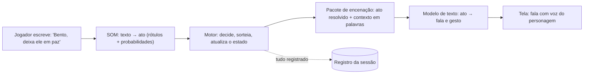
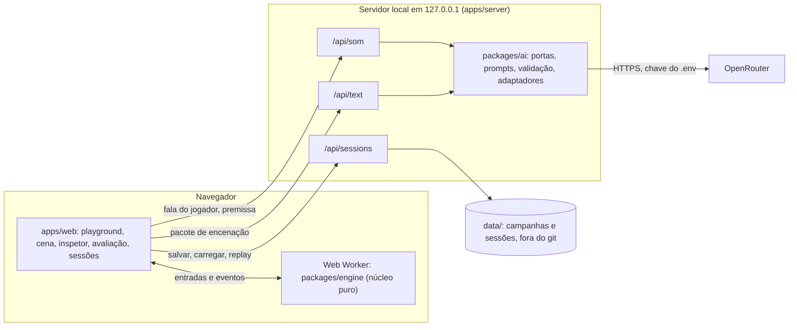
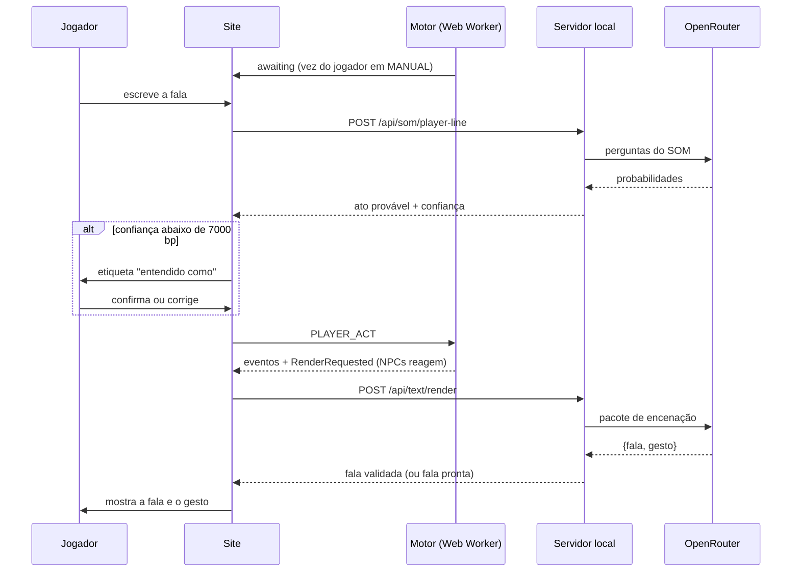
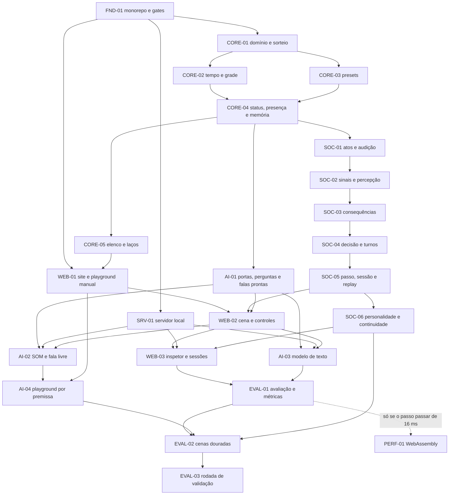

# AI Fantasy: o projeto inteiro, explicado para o time

> **Documento de apresentação**, escrito em 2026-11-09 para explicar o AI Fantasy a quem chega
> ao time. Ele conta o que o projeto é, como vai funcionar, com que tecnologias, como vamos
> construir e o que esperamos alcançar. É um **resumo que aponta para as fontes**: em caso de
> dúvida ou conflito, valem o [produto](<product.md>), as especificações em
> [`architecture/`](<architecture/overview.md>), as [decisões](<planning/decisions.md>) e os
> [ADRs](<architecture/adr/README.md>).
>
> **Estado hoje:** a fundação documental está pronta e integrada na `main`. **Ainda não existe
> código.** A próxima tarefa é a [FND-01](<planning/prompts/FND-01.md>).

## Sumário

1. [Em 30 segundos](#1-em-30-segundos)
2. [O problema que atacamos](#2-o-problema-que-atacamos)
3. [A tese do projeto](#3-a-tese-do-projeto)
4. [O produto visto por quem usa](#4-o-produto-visto-por-quem-usa)
5. [Uma conversa por dentro](#5-uma-conversa-por-dentro)
6. [O motor Hermeneutic Core](#6-o-motor-hermeneutic-core)
7. [As duas IAs](#7-as-duas-ias)
8. [Presets e qualquer cenário](#8-presets-e-qualquer-cenário)
9. [Arquitetura técnica](#9-arquitetura-técnica)
10. [Stack e tecnologias](#10-stack-e-tecnologias)
11. [Qualidade de engenharia](#11-qualidade-de-engenharia)
12. [Segurança, privacidade e licenças](#12-segurança-privacidade-e-licenças)
13. [Como vamos construir](#13-como-vamos-construir)
14. [Cronograma estimado](#14-cronograma-estimado)
15. [Como saberemos que deu certo](#15-como-saberemos-que-deu-certo)
16. [O que esperamos alcançar](#16-o-que-esperamos-alcançar)
17. [O que fica de fora](#17-o-que-fica-de-fora)
18. [Riscos e mitigação](#18-riscos-e-mitigação)
19. [Decisões e ADRs](#19-decisões-e-adrs)
20. [Buzzwords e glossário](#20-buzzwords-e-glossário)
21. [Perguntas frequentes](#21-perguntas-frequentes)
22. [Onde está cada coisa](#22-onde-está-cada-coisa)
23. [Estado atual e próximos passos](#23-estado-atual-e-próximos-passos)

**Como ler:** quem é de produto pode ler as seções 1 a 5, 15 a 17 e 21. Quem vai programar lê
tudo, com atenção às seções 6, 9, 11 e 13. Quem cuida de IA começa pelas seções 3, 7 e 8.

---

## 1. Em 30 segundos

O **AI Fantasy** é um **simulador web de conversas com NPCs que simulam pessoas**.

- A cada fala dita ou ouvida, um motor determinístico, o **Hermeneutic Core**, recalcula o
  corpo, as emoções, as vontades, os laços e a percepção de cada personagem. Ele considera o
  lugar, o horário, o clima e quem está por perto, e **decide por porcentagens** o que acontece.
- **Duas IAs só traduzem.** O **SOM**, um decisor tipado, converte o texto livre do jogador em
  rótulos e valores. O **modelo de texto** transforma o ato que o motor já decidiu em fala viva,
  com sotaque e jeito de gente. Nenhuma das duas decide nada.
- **Qualquer cenário:** o usuário digita uma premissa (uma taverna medieval, uma cozinha de
  família, uma nave) e ela vira presets genéricos. A **pirâmide de Maslow** organiza o que cada
  personagem quer.
- O jogador é **um personagem como os outros**: sente, transparece e pode largar o controle,
  como no The Sims. Também dá para só assistir os NPCs conversando.
- **O motor é o produto.** No futuro, ele deve servir de base para **sistemas de NPCs melhores em
  jogos e mods**.

> **A regra zero do projeto:** o motor decide; os modelos só traduzem.

---

## 2. O problema que atacamos

### 2.1 NPCs de hoje

A maioria dos NPCs de jogos funciona com **árvores de diálogo e scripts**:

- **são previsíveis:** o mesmo gatilho dá a mesma fala;
- **são caros:** cada linha é escrita à mão, e a combinação de situações explode;
- **não lembram:** o que você fez ontem raramente muda o que dizem hoje;
- **são cegos ao contexto:** não sentem frio, cansaço ou medo do lugar, nem percebem quem está
  perto.

### 2.2 O LLM solto como NPC

A reação natural é ligar um modelo de linguagem (LLM) direto no personagem. Ele fala bonito, mas:

- **inventa fatos** (alucinação) e esquece o que disse;
- **decide coisas que o jogo não controla**: dá itens, muda regras, resolve conflitos sozinho;
- **não tem estado confiável:** emoção e relação viram texto solto no prompt;
- **não é reproduzível:** a mesma situação dá resultados diferentes, e não dá para testar;
- **custa caro** quando cada decisão passa por uma chamada grande ao modelo;
- **faz qualquer coisa**, inclusive o que quebra a ficção.

### 2.3 O que falta

Falta uma camada que simule **pessoas com estado** (corpo, emoção, motivação, memória, relação e
percepção dos outros) e que **decida com regras auditáveis**. A linguagem entra só no fim, para
dar voz ao que já foi decidido. É isso que o AI Fantasy quer provar.

**Inspirações:** a profundidade sistêmica de *Dwarf Fortress*, a autonomia dos personagens de
*The Sims* e a pesquisa em simulação social e em modelos de emoção.

---

## 3. A tese do projeto

### 3.1 Separar o cérebro da voz



- **Simbólico no centro, neural nas bordas.** Isso é o que se chama de **IA neuro-simbólica**: um
  núcleo de regras e números decide, e os modelos neurais ficam na entrada (ler texto livre) e
  na saída (escrever a fala).
- **LLM como renderizador:** um motor de jogo desenha a cena que a simulação já calculou. Do
  mesmo jeito, o modelo de texto "desenha" em palavras o ato que o motor já resolveu.

### 3.2 O que ganhamos com isso

| Ganho | Por quê |
| --- | --- |
| **Controle** | Só o motor muda o estado. Um modelo não dá um item, não muda um laço e não inventa uma regra. |
| **Testabilidade** | O motor é puro e determinístico: cada regra tem teste com valor exato. |
| **Replay** | Mesma seed e mesmas entradas, mesma conversa. Dá para reproduzir bugs e comparar versões. |
| **Explicabilidade** | O inspetor mostra por que cada coisa aconteceu: estados, sorteios, probabilidades. |
| **Custo** | Os modelos só traduzem. Decisões e números não passam por chamada de IA. |
| **Robustez** | Se a IA falhar, o produto continua: menu de atos e falas prontas. |
| **Portabilidade** | O motor não depende de interface nem de modelo, e por isso pode ir para jogos e mods. |

### 3.3 Quem faz o quê

| Papel | Faz | Nunca faz |
| --- | --- | --- |
| **Motor** | decide quem age, o que faz, como cada um interpreta, o que muda e quem vai embora | depender de rede, relógio ou acaso fora do gerador com seed |
| **SOM** | converte texto livre (fala, premissa, descrição de personagem) em rótulos, presets e valores, com probabilidades | escrever texto, decidir resultado, mudar estado |
| **Modelo de texto** | encena um ato já resolvido como fala e gesto | decidir o que acontece, inventar fatos, mudar laços ou status |
| **Jogador** | escolhe os atos do próprio personagem (ou deixa no automático) | escolher o resultado: a reação dos outros é do motor |

---

## 4. O produto visto por quem usa

### 4.1 O ciclo de uso

1. **Criar um playground.** Você digita a premissa e, se quiser, uma linha por personagem (até 8;
   uma delas pode ser "eu sou…"). O SOM traduz tudo para presets: lugar, clima, horário,
   arquétipos, laços e acontecimentos da história. A **ficha** montada aparece para você revisar
   e editar, com destaque nos campos em que o SOM teve dúvida. Também dá para montar tudo à mão.
2. **Rodar uma fatia de conversa.** A cena é um lugar desenhado numa grade, num horário e num
   clima. Você joga com um personagem, deixa o motor jogar por ele (como no The Sims) ou só
   assiste os NPCs.
3. **Ler a conversa.** Cada ato decidido vira uma fala com gesto, escrita com o sabor da
   premissa: um anão ranzinza não fala como uma cientista de nave.
4. **Entender o porquê.** O **inspetor** mostra o estado de cada personagem, os sorteios e suas
   probabilidades, a leitura do SOM e o pacote enviado ao modelo de texto.
5. **Avaliar.** Você dá notas às falas e às cenas, de preferência em modo cego, e o produto
   calcula as métricas de validação.
6. **Continuar.** Encerrada a fatia, você escolhe quanto tempo passa (horas ou dias, e quem
   passou o intervalo junto) e abre a próxima. Laços, memórias e personalidade carregam o que
   aconteceu.

### 4.2 Telas

| Tela | O que tem |
| --- | --- |
| **Playground** | premissa e linhas de personagem → ficha montada pelo SOM → revisão e edição → começar; criação manual com as mesmas peças |
| **Cena** | grade com os personagens; falas e gestos; entrada livre com a etiqueta "entendido como"; controles de passo, automático, pausa, tomar a vez e modo de controle |
| **Inspetor** | camadas de cada personagem, laços, percepção, vontade de agir e de sair, sorteios, leitura do SOM, pacote de encenação; seeds, forçar caminho e modo "mais provável" |
| **Avaliação** | notas por fala e por cena, modo cego, painel de métricas |
| **Sessões** | campanhas e fatias, replay passo a passo, ramificação, exportação da transcrição em Markdown, continuar para a próxima fatia |

### 4.3 Três jeitos de jogar

| Modo | Como funciona |
| --- | --- |
| **Jogar** (`MANUAL`) | Na sua vez, o mundo **pausa e espera**. Você escreve o que quer dizer ou escolhe no menu de atos. Seu personagem ainda sente: cansa, tem medo, transparece sinais. |
| **Piloto automático** (`AUTO`) | O motor escolhe os atos do seu personagem com as mesmas regras dos NPCs. Você pode retomar o controle quando quiser. |
| **Observar** | Nenhum personagem é seu: os NPCs conversam entre si, passo a passo ou sozinhos. |

---

## 5. Uma conversa por dentro

Um exemplo inventado para mostrar as peças funcionando juntas. Os números seguem as regras das
especificações; as falas são ilustrativas.

### 5.1 A premissa

> "Uma taverna de beira de estrada, tarde da noite, chovendo. Otávio, um ferreiro orgulhoso, bebe
> com a filha, Lia, uma menina tímida. Bento, um agiota, aparece para cobrar uma dívida. Eu sou
> Rafa, um aventureiro amigo de Otávio."

### 5.2 Da premissa aos presets

O SOM responde perguntas fechadas, e o motor monta a cena:

| O quê | Preset escolhido | Efeito |
| --- | --- | --- |
| Lugar | `social_interior` (interior social) | perigo 2000, conforto 6000, privacidade 2000, ruído 5000, iluminado, tags `crowd` e `enclosed` |
| Clima | `rain` | −1000 na temperatura, +1500 de ruído |
| Horário | `LATE_NIGHT` → começa às 22h30 (minuto 1350) | cansaço sobe 1,5× mais rápido; +1500 na vontade de ir embora |
| Otávio | arquétipo `proud_worker` | orgulho alto; quer propósito, reconhecimento e dignidade |
| Lia | arquétipo `shy_observer` | muito reservada; quer companhia, segurança e curiosidade |
| Bento | arquétipo `merchant` | desconfiado, eloquente; quer segurança material e influência |
| Rafa (jogador) | arquétipo `adventurer` | corajoso, impulsivo; quer diversão, curiosidade e propósito |
| Otávio → Lia | laço `parent_child` (Otávio é o pai) | afeto e confiança altos; Otávio tem `care` dirigido à filha |
| Bento → Otávio | laço `creditor_debtor` + acontecimento `lent_not_repaid` | Bento ressentido; Otávio com culpa e vergonha de base; Otávio é o **ofensor** desse fato |
| Rafa ↔ Otávio | laço `old_friends` | afeto, confiança e proximidade altos |

Já existe **tensão**, porque há uma dívida entre Bento e Otávio. Por isso o gerador não precisa
acrescentar um gancho.

### 5.3 O contexto pesa

- **Luz:** à noite a base seria `DARK`, mas a taverna é iluminada, então fica `DIM`. O alcance
  visual é de 8 células.
- **Audição:** o ruído é 5000 do salão mais 1500 da chuva. A fala normal alcança
  `max(3, 8 − 6500/2000) = 5` células; um sussurro, 1 célula; um grito, 30.
- **Corpo:** tarde da noite, o cansaço sobe 3 por tick em vez de 2. Um tick vale 5 segundos.
- **Presença protetora:** Lia está ao lado do pai. Com confiança 7000 e afeto 7000 (os valores
  típicos do arquétipo) e nenhum medo dele, a ameaça que ela sente cai 1750 com ele colado nela e
  só 350 com ele do outro lado do salão.

### 5.4 Bento age

O motor calcula a **vontade de agir** de todos. A de Bento passa do limiar de 4000, e o sorteio
dá a vez a ele. Na **decisão**, os candidatos combinam ato, alvo, tom e tópico:

- a vontade dominante `material_security` de Bento está alta, e o objeto `MONEY` a satisfaz →
  `REQUEST` (pedir dinheiro);
- o ressentimento por Otávio puxa para os tons `IRONIC` e `AGGRESSIVE`;
- a utilidade de cada candidato soma vontades, emoções, traços, laço e percepção; os 5 melhores
  vão para um sorteio ponderado.

Resultado: **`REQUEST` de `MONEY` para Otávio, em tom `IRONIC`**.

- **Quem ouve:** Otávio a 1 célula, Lia a 2 e Rafa a 4 ouvem tudo (`DIRECT`). Quem está a 6–10
  células pode ouvir um **fragmento**: sabe que Bento cobrou alguém, mas não o quê.
- **Interpretação:** cada ouvinte pode ler o tom errado. `IRONIC` tem ambiguidade 2500; quem
  desconfia de Bento tende a ouvir `AGGRESSIVE`.
- **Obrigação:** Otávio agora deve uma resposta e tem 12 ticks (1 minuto de ficção) para dá-la.

### 5.5 O modelo de texto dá voz

O motor emite `RenderRequested`, e o servidor monta o **pacote de encenação**:

- a premissa;
- a cena em palavras;
- quem fala: arquétipo, voz "persuasiva, interesseira", as emoções e necessidades mais fortes em
  palavras;
- como Bento vê cada ouvinte;
- o ato: pedir dinheiro, irônico, firme;
- só os fatos que Bento conhece: o empréstimo.

Nenhum número de estado vai no pacote. A resposta vem em JSON validado:

```json
{ "fala": "Otávio, meu caro... a chuva lava muita coisa, mas não lava dívida.", "gesto": "tamborila os dedos no balcão" }
```

### 5.6 Otávio responde, e a faixa já estava escrita

Quando Otávio, em modo automático, ganha a vez, o motor **sorteia a faixa de resultado** do
pedido:

```text
p = 5000 (base de REQUEST)
  + (confiança − ressentimento)/5 + afeto/10          // Otávio por Bento: perto de 0
  + (sinceridade percebida − 5000)/5                   // perto de 0
  + (eloquência de Bento − 5000)/10                    // ≈ +250 (Bento é eloquente)
  − 700 (tom IRONIC)
  − 700 (ceder humilha: há testemunhas, privacidade baixa e Otávio é orgulhoso)
  ≈ 3850 → 38,5% de aceitar
```

Nesta seed, o sorteio cai na faixa **`REFUSE`**. A resposta de Otávio fica fixada: recusar, em
tom neutro. A única alternativa dele é ignorar o pedido, o que tem custo social. O modelo de texto
encena algo como *"Hoje não, Bento. Você sabe que eu pago o que devo — quando der."*

Os efeitos se espalham: Bento fica com mais vontade de influência (foi contrariado) e de
dinheiro, a raiva e a tristeza dele sobem, e o ressentimento entre os dois se mantém.

### 5.7 Você entra na conversa

Você escreve: *"Calma, Bento. A próxima rodada é minha, senta aí."* O SOM lê:

| Pergunta | Leitura | Probabilidade |
| --- | --- | --- |
| ato | `OFFER` | 0,64 |
| alvo | Bento | 0,91 |
| tom | `WARM` | 0,77 |
| objeto | `ITEM` | 0,58 |
| intensidade | nota 4 (de 2 a 10) | — |

A confiança da leitura, que é a menor entre a maior probabilidade do ato e a do alvo, ficou em
**6400 bp**, abaixo de 7000. Por isso aparece a etiqueta **"entendido como: oferecer · caloroso ·
Bento · intensidade 4"**, e você confirma ou corrige. A leitura e a correção vão para o registro.

### 5.8 O corpo e os sinais falam

- A raiva de Otávio passa de 5000, e ele pode emitir **punhos cerrados** (`clenchedFists`). A
  chance cai quanto maior o autocontrole dele.
- Lia nota o sinal se o vê e passa no sorteio de percepção. Ela interpreta a causa por sorteio
  ponderado: raiva, provavelmente. A hostilidade e a ameaça que ela percebe no pai sobem.
- **Mal-entendidos** nascem aqui: um tremor de frio pode ser lido como medo, e um rubor de
  vergonha, como atração.

### 5.9 A fatia termina e a história continua

- Lia, cansada e tarde da noite, acumula vontade de ir embora. Quando a vontade de sair supera a
  de ficar por pelo menos 3000, há sorteio. Se ela sair, se despede (`FAREWELL`) e caminha até a
  porta.
- A fatia acaba quando sobra uma pessoa ou depois de 60 ticks seguidos de silêncio (5 minutos:
  "a conversa morreu").
- Você escolhe **72 horas** de intervalo. Otávio guarda como **memória marcante** a cobrança em
  público (alta importância). A saudade sobe para quem passou o intervalo separado de alguém
  querido, e a vontade de vingança decai.
- A próxima fatia pode ser na loja de Bento, com os mesmos personagens e o que eles carregam.

### 5.10 O inspetor mostra tudo

Cada sorteio aparece com finalidade, probabilidade e resultado. Dá para **forçar** o sorteio do
pedido para "aceitar" e ver o outro ramo da história, ou ligar o modo **"mais provável"**. Como
tudo é registrado, o **replay** reproduz a sessão idêntica e confere o hash do estado a cada passo.

---

## 6. O motor Hermeneutic Core

O nome vem de **hermenêutica**, a arte da interpretação. O coração do motor é que cada personagem
**interpreta** o que ouve e vê, e pode interpretar errado. A especificação completa está no
[modelo de simulação](<architecture/simulation-model.md>), com atos e tabelas em
[atos de conversa](<architecture/dialogue-acts.md>) e catálogos em [presets](<architecture/presets.md>).
As três estão na versão 1.2.

### 6.1 Princípios

1. **O motor decide tudo**, com regras e sorteios registrados.
2. **Determinismo:** mesma seed e mesmas entradas, mesmos eventos e mesmo hash.
3. **Inteiros:** todo valor de estado é inteiro, em *basis points* (bp, de 0 a 10000).
4. **Presets:** o motor só conhece catálogos fechados; texto livre nunca entra no estado.
5. **Maslow no centro:** necessidades de baixo, quando não atendidas, abafam as de cima.
6. **Tudo é recalculado a cada fala dita ou ouvida.**
7. **Sem lacuna para inventar:** se faltar um número, ele entra primeiro na especificação, com
   teste.

### 6.2 Unidades e convenções

| Conceito | Convenção |
| --- | --- |
| Escala unipolar | `0..10000` bp |
| Escala bipolar | `−10000..10000` bp |
| Probabilidade | inteiro em bp; sorteio uniforme em `[0, 10000)`; sucesso se o valor sorteado < p |
| Divisão | sempre inteira, truncada em direção a zero |
| Multiplicação em bp | `mulBp(a, b) = a × b / 10000` (truncado) |
| Tick | 5 segundos de ficção; 12 ticks = 1 minuto |
| Proibido no estado | `Math.random`, `Date`, `Math.pow`, `Math.exp`, trigonometria, números quebrados |

### 6.3 A fatia: lugar, tempo, luz e clima

- **Grade** de até 48 × 48 células, com 7 tipos de célula:

  | Tipo | Atravessar | Visão | Fala normal |
  | --- | --- | --- | --- |
  | `FLOOR` | 1 tick | livre | livre |
  | `ROUGH` | 2 ticks | livre | livre |
  | `DOOR_OPEN` | 1 tick | livre | livre |
  | `DOOR_CLOSED` | 2 ticks | bloqueia | bloqueia |
  | `WINDOW` | não | livre | alcance pela metade |
  | `LOW_OBSTACLE` | não | livre | livre |
  | `WALL` | não | bloqueia | bloqueia |

- **Marcas por célula:** `exit` (saída da cena) e `roofed` (coberta, protege do clima).
- **Distância:** Chebyshev, ou seja, o maior entre a diferença horizontal e a vertical. **Linha
  de visão:** supercobertura da reta.
- **Fases do dia:** `DAWN` (0h–5h), `MORNING` (5h–12h), `AFTERNOON` (12h–18h), `EVENING`
  (18h–22h), `LATE_NIGHT` (22h–24h).
- **Luz:** `DAY` (alcance 20), `DIM` (8) ou `DARK` (3), calculada pela fase, por o lugar ser
  iluminado, pela tag `dark` e pela tempestade. A neblina corta o alcance pela metade.
- **Temperatura sentida:** temperatura do lugar mais o clima; numa célula coberta só 25% do clima
  chega.

### 6.4 O personagem em camadas

| Camada | O que é | Persiste entre fatias? |
| --- | --- | --- |
| Identidade | nome, faixa etária, papel, registro de fala (só apresentação, fora do hash) | sim |
| Corpo | 7 necessidades | recupera entre fatias |
| Emoções | 10 emoções com linha de base | voltam à base |
| Vontades | 15 vontades da pirâmide de Maslow | sim |
| Laços | 8 eixos e rótulos, um registro por pessoa | sim |
| Percepção do momento | como cada um vê os outros agora | não |
| Traços e aptidões | 10 traços bipolares e 3 aptidões | sim (mudam devagar) |
| Tendências | o "jeito recente" de cada traço | sim |
| Associações | medos e apegos a lugares, coisas e pessoas | sim |
| Memórias | cópias de fatos; só as marcantes atravessam fatias | só as marcantes |

#### Corpo

| Necessidade | Por tick | Observações |
| --- | --- | --- |
| `fatigue` (cansaço) | +2 | +4 de madrugada, +3 tarde da noite, +5 por célula andada, +1 com medo ou raiva altos |
| `hunger` (fome) | +1 | — |
| `thirst` (sede) | +2 | +3 com calor |
| `bladder` (necessidade fisiológica) | +3 | — |
| `pain` (dor) | −1 | vem da cena ou de eventos |
| `thermal` (frio ↔ calor) | aproxima-se da temperatura sentida | bipolar |
| `intoxication` (alteração) | −1 | álcool, febre |

Faixas: **incômodo** ≥ 5000, **urgente** ≥ 7500, **crítico** ≥ 9000. Um NPC com necessidade
crítica vai embora da cena. O corpo também mexe nas emoções: dor dá tristeza e raiva, fome urgente
dá irritação.

#### Emoções

`joy` (alegria), `sadness` (tristeza), `fear` (medo), `anger` (raiva), `disgust` (nojo),
`surprise` (surpresa), `shame` (vergonha), `guilt` (culpa), `jealousy` (ciúme) e `boredom` (tédio).

- Cada uma volta à **linha de base** do personagem (calculada pelos traços) com meia-vida de uns
  6 minutos de ficção.
- O **tédio** não decai: cresce quando nada interessa e cai quando algo interessa.

#### Vontades: a pirâmide de Maslow

| Nível | Vontades |
| --- | --- |
| 1. Fisiológico | `physical_relief` (alívio físico: calculado a partir do corpo) |
| 2. Segurança | `physical_safety` (segue a ameaça), `material_security`, `predictability` |
| 3. Pertença | `company`, `intimacy` (dirigida), `desire` (dirigida), `care` (dirigida) |
| 4. Estima | `recognition`, `dignity`, `influence` |
| 5. Realização | `curiosity`, `purpose`, `fun`, `justice` (dirigida; inclui vingança) |

Cada vontade tem um **déficit** (o quanto falta) e um **peso** (o quanto importa para aquele
personagem). Cada um tem de 2 a 3 vontades **dominantes**. As **dirigidas** têm um déficit por
pessoa: dá para querer justiça contra Bento e intimidade com Lia ao mesmo tempo.

**Precedência de Maslow:** quando o pior déficit de um nível de baixo passa de 5000, as vontades
de cima perdem peso. Com o alívio físico em 7500, elas pesam metade; em 10000, somem da decisão.
Quem está apertado para ir ao banheiro não está pensando em reconhecimento.

#### Laços

Registro **direcionado**: o que A sente por B não é o que B sente por A.

| Eixo | Nome |
| --- | --- |
| `trust` | confiança |
| `affection` | afeto |
| `respect` | respeito |
| `dependence` | dependência |
| `attraction` | atração |
| `fearOf` | medo de B |
| `resentment` | ressentimento |
| `closeness` | proximidade (quanto se conhecem) |

Há também 24 **rótulos**: família, casal, amizade, rivalidade, dívida, trabalho, paixão,
protetor e protegido. Os familiares e de papel têm recíproca obrigatória (`PARENT` ↔ `CHILD`,
`CREDITOR` ↔ `DEBTOR`…).

#### Percepção do momento: uma teoria da mente simples

Cada personagem mantém, sobre cada presente, o que **acha** que está acontecendo:

| Campo | Significado | Sem sinais novos, volta para… |
| --- | --- | --- |
| `perceivedThreat` | quanto o outro parece perigoso | o medo que se tem dele |
| `perceivedHostility` | quanto parece hostil | o ressentimento e a desconfiança |
| `perceivedInterest` | quanto parece interessado em mim | o afeto e a atração projetados |
| `perceivedSincerity` | quanto parece sincero | a confiança e a crença nos outros |
| `apparentEmotion` | que emoção parece sentir (pode estar errada) | — |
| `apparentState` | cansado, com frio, alterado, ferido | — |

A percepção pesa na ameaça, nos vieses da decisão, na chance de aceitar um pedido e de acreditar
numa mentira, e no cuidado com quem se ama.

#### Traços e aptidões

| Traço (polo negativo ↔ positivo) | Traço (polo negativo ↔ positivo) |
| --- | --- |
| `courage`: medroso ↔ corajoso | `empathy`: frio ↔ empático |
| `trustInOthers`: desconfiado ↔ crédulo | `pride`: humilde ↔ orgulhoso |
| `temper`: calmo ↔ explosivo | `honesty`: mentiroso ↔ honesto |
| `sociability`: reservado ↔ expansivo | `humor`: sério ↔ brincalhão |
| `selfControl`: impulsivo ↔ contido | `romanticBoldness`: recatado ↔ galanteador |

As aptidões vão de 0 a 10000:

- `perceptiveness` (perspicácia): ler sinais e intenções;
- `eloquence` (eloquência): convencer e ferir com palavras;
- `memory`: lembrar com fidelidade.

#### Associações

Medos e apegos a uma **tag** de lugar (`forest`, `water`, `dark`, `crowd`, `storm`…), a uma coisa
ou a uma pessoa ausente. **Exemplo do produto:** quem tem medo da floresta sente mais as ameaças
lá, o medo sobe a cada tick e a própria segurança cai. Associações também tornam tópicos
preferidos ou evitados.

### 6.5 Ameaça e presença

```text
ameaça = perigo do lugar / 2
       + medos associados às tags presentes − apegos
       + 1000 se está escuro
       + Σ pessoas que assustam ou ressentem, pesadas pela proximidade / 2
       − Σ pessoas de confiança e afeto, pesadas pela proximidade / 4
       − 20% do conforto do lugar
```

A proximidade vale 100% até 1 célula, 70% até 3, 40% até 6, 20% até 12 e 0 além disso ou sem
ver nem ouvir a pessoa. **É por isso que o filho se sente mais seguro com o pai perto do que com o
pai longe**: esse era um pedido explícito do produto.

### 6.6 Sinais e transparência

O estado **transparece**, inclusive o do jogador. São 18 sinais, visuais ou vocais:

| Sinal | Causas possíveis |
| --- | --- |
| tremor | medo, frio |
| voz trêmula | medo, tristeza |
| olhar desviado | vergonha, culpa, medo, mentira |
| passo atrás | medo, nojo |
| punhos cerrados | raiva |
| voz alta | raiva, alegria |
| rubor | vergonha, atração, raiva |
| olhar fixo | raiva, ciúme, atração |
| olhar baixo | vergonha, tristeza |
| riso nervoso | vergonha, medo |
| sorriso | alegria, atração |
| risada | alegria |
| voz baixa | tristeza, cansaço |
| lágrimas | tristeza, alegria |
| careta | nojo, dor |
| bocejo | cansaço, tédio |
| ombros caídos | cansaço, tristeza |
| fala arrastada | alteração, cansaço |

Cada sinal passa por três etapas:

1. **Emissão:** acima de 5000 de intensidade, há chance de emitir, reduzida pelo autocontrole.
2. **Notar:** depende de linha de visão ou audição, perspicácia, cansaço e distância.
3. **Interpretar:** quem nota escolhe uma causa por sorteio ponderado. O contexto pesa (frio no
   clima favorece "frio"), a perspicácia favorece a causa verdadeira e a desconfiança favorece
   causas ameaçadoras. **A interpretação pode estar errada**, e é daí que vêm os mal-entendidos.

### 6.7 Atos de conversa

Toda fala e toda ação é um **ato**, com tom, tópico e valores (intensidade, volume e marca de
mentira).

**14 atos de fala:**

| Ato | O que é | Cria obrigação de resposta? |
| --- | --- | --- |
| `GREET` | cumprimentar | não |
| `CHAT` | conversar sobre um tópico | não |
| `ASK` | perguntar | sim |
| `TELL` | contar um fato, rumor ou segredo | não |
| `PRAISE` | elogiar | não |
| `TEASE` | provocar | não |
| `ACCUSE` | acusar | sim |
| `REQUEST` | pedir | sim (é **pedido**: tem faixa de resultado) |
| `OFFER` | oferecer ajuda, presente, acordo, promessa ou encontro | sim (pedido) |
| `APOLOGIZE` | desculpar-se | sim (pedido de perdão) |
| `THREATEN` | ameaçar | sim (pedido sob coação) |
| `ACCEPT` | aceitar | — (é resposta) |
| `REFUSE` | recusar, negar ou não responder | — (é resposta) |
| `FAREWELL` | despedir-se (e sair) | não |

**6 atos sem fala:** `STAY_SILENT` (ficar calado), `MOVE` (ir até uma célula), `APPROACH`
(aproximar-se), `WITHDRAW` (afastar-se), `LEAVE` (sair da cena) e `TOUCH` (contato físico, cujo
gesto depende do tom: de abraço a empurrão).

**6 tons**, cada um com uma ambiguidade, ou seja, a chance de ser lido errado:

| Tom | Efeito | Ambiguidade | Costuma ser confundido com |
| --- | --- | --- | --- |
| `WARM` (caloroso) | reforça o positivo | 500 | sedutor |
| `NEUTRAL` | sem modulação | 300 | irônico (por desconfiados) |
| `PLAYFUL` (brincalhão) | suaviza ofensas entre quem se gosta | 1500 | agressivo, irônico |
| `SEDUCTIVE` (sedutor) | mexe com atração; constrange quando indesejado | 1500 | caloroso, brincalhão |
| `IRONIC` (irônico) | morde com elegância | 2500 | agressivo, brincalhão |
| `AGGRESSIVE` (agressivo) | negativo forte; medo e raiva | 500 | brincalhão |

**Tópicos:** pessoa, coisa, lugar, acontecimento, segredo, rumor, sentimento, amenidades, ou
nenhum (atos sem fala). **Objetos de pedido:** ajuda, informação, item, dinheiro, companhia,
favor, promessa, sigilo e encontro. Cada objeto satisfaz uma vontade de quem recebe e outra de
quem dá.

**Paquera e provocação não são atos próprios; são combinações:**

| O que se quer | Combinação |
| --- | --- |
| Paquera | elogiar ou conversar em tom sedutor; toque sedutor; oferecer um encontro |
| Provocação amistosa | provocar em tom brincalhão |
| Provocação hostil | provocar em tom irônico ou agressivo |
| Deboche | elogiar em tom irônico |
| Ameaça velada | ameaçar em tom irônico ou caloroso ("o sorriso que gela") |
| Desculpa falsa | desculpar-se em tom irônico ou mentindo |
| Confidência | contar um segredo sussurrando |
| Fofoca | contar um rumor sobre um ausente |
| Chantagem | ameaçar com o segredo do outro |

### 6.8 Quem ouve

| Volume | Alcance | Paredes e portas |
| --- | --- | --- |
| sussurro | 1 célula | qualquer bloqueio de visão bloqueia |
| normal | 8 − ruído/2000 (mínimo 3) | parede e porta fechada bloqueiam; janela corta pela metade |
| grito | 30 | parede corta pela metade; atravessa portas |

Cada presente recebe uma **perspectiva** do ato:

- **`DIRECT`**: ouviu tudo e sofre as consequências completas;
- **`FRAGMENT`**: até o dobro do alcance, com chance; sabe que houve o ato, não o tópico;
- **`SEEN`**: viu, mas não ouviu.

### 6.9 Consequências: avaliação emocional

Cada ouvinte avalia o ato **interpretado**, não o real. A unidade de efeito é
`u = 8% da intensidade` (no máximo 800). Uma tabela por ato diz quanto muda, em múltiplos de `u`:
emoções, laço com quem agiu (em meias unidades, com teto de 1500 por eixo) e vontades. Exemplos:

| Ato | Valência | Efeito típico em quem recebe |
| --- | --- | --- |
| elogio | +2 | alegria +2u, afeto e respeito, reconhecimento satisfeito |
| acusação | −2 | raiva +3u; se for verdade, vergonha e culpa; confiança cai, ressentimento sobe, justiça contra o autor |
| ameaça | −3 | medo +3u (maior se já tem medo do autor), raiva, confiança −3, segurança física em falta |
| provocação entre amigos | +1 | diverte: alegria +2u, afeto, diversão satisfeita |
| toque sedutor sem atração | −2 | nojo, vergonha, ressentimento, dignidade ferida |

Por cima da tabela entram várias regras:

- **O tom multiplica:** o caloroso aumenta o positivo; o agressivo zera o positivo e aumenta o
  negativo; o irônico morde.
- **Fatores de traço:** o temperamento escala a raiva, a coragem reduz o medo, a honestidade
  aumenta a culpa.
- **Testemunhas:** quem ouve sem ser alvo sente metade. Quem vê um ato feio contra alguém querido
  sente raiva e cuidado.
- **Ciúme:** surge em quem vê alguém flertar com quem ele deseja ou com o próprio cônjuge.
- **Surpresa:** vem quando um inimigo faz um gesto bom ou um amigo faz um gesto ruim.
- **Efeitos em quem agiu:** mentir dá culpa a quem é honesto; ferir quem se ama dá culpa; ferir
  um ofensor alivia a vontade de justiça.

### 6.10 Pedidos e faixas de resultado

Os quatro **pedidos** (pedir, oferecer, desculpar-se e ameaçar) têm uma probabilidade de aceite
calculada pelo laço, pela sinceridade percebida, pela eloquência de quem pede, pelo tom, pelas
vontades de quem responde e pela humilhação de ceder diante de testemunhas. O resultado cai numa
de cinco **faixas**:

| Faixa | Fatia da probabilidade | Resposta |
| --- | --- | --- |
| `ENTHUSIASTIC` | primeiros 20% de p | aceita com entusiasmo |
| `ACCEPT` | até 80% de p | aceita |
| `PARTIAL` | o resto de p | aceita com condição ou hesitação (efeitos pela metade) |
| `REFUSE` | 70% do que sobra | recusa |
| `HARD_REFUSE` | o restante | recusa firme, com ofensa |

A faixa é sorteada **quando quem deve a resposta ganha a vez** e, a partir daí, a resposta fica
fixada. Se quem deve a resposta é o jogador, nada é sorteado: ele responde como quiser.

### 6.11 Decisão: como um NPC escolhe o ato

1. **Obrigação primeiro.** Se ele deve resposta, só entram as respostas possíveis (com bônus de
   4000) e ignorar.
2. **Candidatos.** Os atos permitidos (com pré-condições), cada alvo que ouviria, os 3 tons de
   maior viés e até 4 tópicos salientes.
3. **Utilidade** de cada candidato:

   ```text
   U = Σ vontades (peso efetivo × déficit × quanto o ato satisfaz)
     + viés das emoções + viés dos traços + viés do laço com o alvo
     + viés da percepção do alvo + viés das associações do tópico
     + bônus de objetivo (vontade dominante dirigida ao alvo)
     − penalidade por repetir o mesmo ato e tópico
   ```

4. **Escolha.** Os 5 melhores vão para um sorteio ponderado. Quem tem autocontrole alto escolhe
   de forma mais previsível; quem é impulsivo, de forma mais variada.

Os vieses são **tabelas de dados**: a raiva favorece acusar e ameaçar, o medo favorece afastar-se
e calar, o humor favorece o tom brincalhão, o ressentimento favorece o irônico. Isso é **Utility
AI** com Maslow por cima.

### 6.12 Turnos: quem fala agora

- **Vontade de agir** de cada um: base pela sociabilidade, mais se o último ato foi para ele (e
  mais ainda se lhe deixou obrigação), mais pela emoção mais forte, mais pela pressão das
  vontades sociais, mais com o silêncio, menos com o cansaço.
- Entre quem passa de 4000, um **sorteio ponderado** escolhe quem age. Se ninguém passa, há
  **silêncio**: o tédio sobe e a vontade de falar cresce.
- **Interrupção:** se alguém devia responder e outra pessoa fala, quem foi interrompido fica com
  raiva e perde respeito pelo interruptor.
- **Saída:** a vontade de sair (corpo, ameaça, tédio, horário, chuva, objetivo cumprido ou
  perdido) é comparada com a de ficar (companhia, desejo por alguém presente, curiosidade,
  resposta devida). Necessidade crítica força a saída. O jogador em modo manual nunca sai
  sozinho.
- **O mundo espera:** na vez do jogador em modo manual, nada anda.
- **Fim:** sobrou uma pessoa, ou houve 60 ticks seguidos de silêncio.

### 6.13 Memória, fofoca e mentiras

- Cada ato vira um **fato**: quem, o quê, para quem, tom, tópico, ofensor e marca de mentira.
- Cada personagem guarda **cópias** do que percebeu, com perspectiva e fidelidade: ouviu tudo
  (10000), ouviu pedaços (5000), viu (3000) ou alguém contou (80% da fidelidade de quem contou).
- **Fofoca:** contar um fato a quem não sabe cria uma cópia "contada". Assim os boatos se
  espalham e perdem fidelidade.
- **Mentiras** contam o mesmo fato com outro culpado, ou com nenhum. Quem tem a própria cópia pode
  detectar a mentira; quem não tem acredita conforme a confiança no autor e a sinceridade
  percebida. Uma mentira descoberta derruba a confiança. **Uma mentira em que alguém acreditou
  se espalha**, e uma acusação feita com base nela é falsa.
- **Ninguém cita o que não sabe:** o modelo de texto só recebe os fatos de que o falante tem
  cópia.
- **Memórias marcantes:** cópias com importância ≥ 6000 atravessam fatias, até 50 por personagem.

### 6.14 Personalidade que muda

Esta seção é um pedido direto do maintainer: as decisões passadas formam a personalidade, e um
padrão mantido vira característica fixa.

1. Cada ato emite **sinais de traço**. Ameaçar com agressividade puxa o temperamento para cima;
   pedir desculpas puxa o orgulho para baixo; mentir puxa a honestidade para baixo.
2. A **tendência** de cada traço segue os atos recentes, com 10% por ato. O **traço efetivo** de
   agora é o traço mais 30% da tendência.
3. **Cristalização:** com a tendência acima de 6000 por 30 atos, espalhados por pelo menos 2
   fatias, o traço muda 500 bp de vez.

Vale para todos, inclusive o personagem do jogador.

### 6.15 Entre uma fatia e outra

- O usuário escolhe o intervalo em horas e quem passou esse tempo junto.
- Uma vez por intervalo: as emoções voltam à base; percepção, obrigações e cópias sem importância
  são descartadas; o corpo é refeito na abertura da próxima cena.
- Por dia de intervalo:
  - a saudade sobe +500 entre quem se quer bem e ficou separado;
  - a vontade de vingança decai 10%;
  - a fidelidade das memórias cai de 0,5% a 1%, conforme a aptidão de memória;
  - as tendências decaem 10%.

### 6.16 Aleatoriedade, replay e forçar caminho

| Peça | Como é |
| --- | --- |
| Gerador | `sfc32`, de 32 bits, só operações inteiras, semeado por `splitmix32` |
| Sementes das streams | `hash32` = FNV-1a de 32 bits sobre `"<seed>:<nome da stream>"` |
| Streams | `generation`, `setup`, `turn`, `choice`, `signal`, `perception`, `resolution` e `leave`, uma por finalidade |
| Seeds | a seed do **elenco** gera personagens, laços e história; a seed da **cena** gera o resto. Dá para variar uma sem mexer na outra. |
| Sorteio sem viés | rejeição para entregar inteiros uniformes |
| Registro | todo sorteio fica no log: sequência, tick, stream, finalidade, limite, valor, probabilidade e resultado |
| Forçar caminho | o inspetor força um sorteio específico ou liga o modo **"mais provável"**; forçar é uma entrada registrada |
| Hash do estado | FNV-1a de 64 bits sobre a serialização canônica |
| Replay exato | reconstrói a sessão só do registro, confere o hash a cada passo e **nunca chama os modelos** |

### 6.17 O passo do motor

Cada chamada de `step` resolve um **ponto de decisão**, nesta ordem fixa:

1. Aplicar a entrada (ato do jogador, tomar a vez, mudar o modo, forçar um sorteio).
2. **Saídas:** no máximo um personagem começa a sair por ponto de decisão.
3. **Quem age** (ou um tick de silêncio).
4. Se é o jogador em modo manual: devolver "aguardando" e parar.
5. **Resolver o ato:** validar; ouvintes e interpretação; consequências e obrigações; fatos;
   tendências; destino do movimento.
6. **Avançar os ticks do ato.** Em cada tick: movimento, corpo, emoções, luz e ameaça, vontades,
   sinais, obrigações vencidas e chegada à saída.
7. Ver se a fatia acabou.
8. Emitir os eventos (`ActResolved`, `SignalPerceived`, `StatusChanged`, `Silence`,
   `CharacterLeft`, `SceneEnded`, `RenderRequested`) e atualizar o hash.

### 6.18 Invariantes que viram testes

1. Mesma seed e mesmas entradas ⇒ mesmos eventos e mesmo hash, em qualquer máquina.
2. Todo valor fica sempre na faixa da sua escala.
3. O estado não contém texto livre.
4. Pai confiável e sem medo por perto ⇒ ameaça menor ou igual à de com ele longe.
5. Sussurro nunca chega inteiro a mais de 1 célula; parede bloqueia a fala normal.
6. Déficit de baixo nunca aumenta o peso das vontades de cima.
7. Um NPC com necessidade crítica sai em número finito de passos, se houver caminho.
8. Forçar um sorteio muda só o que decorre dele, e o replay com o mesmo forçamento é idêntico.
9. O jogador em modo manual nunca recebe um ato escolhido pelo motor.
10. Nenhuma saída de IA muda o estado sem virar ato ou preset validado.
11. Ninguém ocupa célula intransponível nem divide célula com outro personagem.
12. Toda obrigação de resposta termina, respondida ou ignorada, em até 12 ticks.

---

## 7. As duas IAs

Os contratos completos estão em [integração de IA](<architecture/ai-integration.md>).

### 7.1 Onde rodam

```text
Navegador (site)  ──HTTP──►  Servidor local em 127.0.0.1  ──HTTPS──►  OpenRouter
                             lê OPENROUTER_API_KEY do .env
```

O navegador **nunca** fala com o OpenRouter nem vê a chave. Por enquanto não há IA local.

### 7.2 O SOM: o decisor tipado

O **SOM** (*System One Model*) leva o nome do "Sistema 1" de Kahneman, o pensamento rápido e
intuitivo. Ele **não escreve texto**: responde a perguntas fechadas com probabilidades.

| Tipo de pergunta | O que devolve | Exemplo |
| --- | --- | --- |
| `noul` | probabilidade de "sim" | "a fala afirma algo que contradiz os fatos?" |
| `choice` | a opção escolhida, com a distribuição | ato, tom, alvo, tópico, objeto |
| `score` | nota de 2 a 10, com a distribuição | intensidade |

Ele aparece em três usos:

- **Fala do jogador → ato:** 10 perguntas numa chamada (ato, tom, alvo, tipo e referência do
  tópico, objeto, intensidade, volume, mentira e quem a mentira culpa).
- **Premissa → cena:** lugar, tag natural, clima, fase do dia, presença do jogador e número de
  personagens.
- **Personagens e laços → presets:** arquétipo, faixa etária, vontades dominantes, estado do dia,
  associação e registro de fala. Para os laços, o arquétipo (com direção) e até 2 acontecimentos.

As regras:

- no máximo **16 perguntas por chamada**;
- probabilidades convertidas para bp com arredondamento;
- validação fechada: uma resposta incoerente é falha, e uma falha cai no **menu de atos**;
- se a confiança da leitura ficar **abaixo de 7000 bp**, aparece a etiqueta **"entendido
  como"** para o jogador confirmar ou corrigir.

### 7.3 O modelo de texto: o ator

O modelo recebe um **pacote de encenação** (premissa, cena, quem fala, quem ouve, o ato com a
faixa de resultado, até 12 fatos conhecidos e as últimas 8 falas) e devolve
`{ "fala", "gesto" }` em **saída estruturada**, com esquema JSON.

- **Validação:** esquema, tamanho, nada de números ou palavras de mecânica, e só nomes de pessoas
  conhecidas. Um nome ou acontecimento fora dos fatos conhecidos fica marcado como possível fato
  inventado.
- **Caminho alternativo:** se a resposta falhar, há uma nova tentativa com instrução reforçada.
  Se falhar de novo, se o modelo recusar ou se o tempo estourar, entra a **fala pronta**, um
  modelo por ato e tom, marcada no registro.
- **Cache** pela soma do pacote, do modelo e da versão do prompt. **Teto de custo** por conversa:
  ao passar dele, a sessão segue só com falas prontas e avisa.
- **O mundo espera** a fala chegar.

### 7.4 Modelos e configuração

| Papel | Modelo agora (via OpenRouter) | Rota | Futuro local |
| --- | --- | --- | --- |
| SOM | `typesafe/jev-1.14` | `/api/alpha/decisions` (alpha) | d1, da Liquid AI |
| Texto | `xiaomi/mimo-v2.6-pro` | `/api/v1/chat/completions` | LFM3-1.7B |

- **Alternativas** que já estão no catálogo e se trocam por configuração:
  `perplexity/pplx-decider-v1.2` e `liquid/d1`.
- **Preços** conferidos em 2026-11-09: SOM a US$ 0,042 por milhão de tokens de entrada; texto a
  US$ 0,435 de entrada e US$ 0,87 de saída por milhão. Eles mudam; confira antes de decidir.
- **Configuração** do servidor: `OPENROUTER_API_KEY`, `AI_SOM_MODEL`, `AI_TEXT_MODEL`,
  `AI_TEXT_TEMPERATURE` (0.8), `AI_TEXT_REASONING_EFFORT`, `AI_TIMEOUT_MS` (15000) e
  `AI_BUDGET_USD_PER_CONVERSATION` (fixado depois de medir 5 cenas).
- **Nomes no código:** papéis, não modelos. O código usa `systemOne` e `textModel`, nunca `jev` ou
  `mimo`. Ids de modelo só aparecem na configuração.

### 7.5 Conteúdo

O produto **não tem limites de conteúdo próprios** (D-22). Valem as políticas do OpenRouter, as
de cada modelo e a lei. Recusas viram caminho alternativo e ficam marcadas no registro.

---

## 8. Presets e qualquer cenário

### 8.1 A ideia

O motor só conhece **presets genéricos**. "Interior social" serve para taverna, bar, café ou
cantina de nave. **O que muda de um cenário para outro é a premissa**, e só o modelo de texto a
vê. Como as vontades seguem Maslow, que é universal, o mesmo motor funciona numa fantasia
medieval, numa família de hoje ou numa estação espacial. Isso é **design orientado a dados**.

### 8.2 Os catálogos

| Catálogo | Quantos | Exemplos |
| --- | --- | --- |
| Lugares | 10 | lar, interior social, local de trabalho, comércio, espaço público, ermo natural, lugar perigoso, lugar solene, transporte, abrigo precário |
| Climas | 8 | limpo, nublado, chuva, tempestade, neve, calor forte, frio forte, neblina |
| Arquétipos de personagem | 16 | cuidador, protetor, trabalhador orgulhoso, negociante, aventureiro, estudioso, sedutor, rebelde, autoritário, tímido observador, devoto, malandro, ancião, criança, solitário amargo, boêmio |
| Arquétipos de laço | 17 | pai e filho, irmãos, cônjuges, ex, namorados, velhos amigos, rivais, inimigos, credor e devedor, mentor e aprendiz, patrão e empregado, colegas, vizinhos, conhecidos, desconhecidos, paixão não correspondida, protetor e protegido |
| Acontecimentos de história | 21 | ajudou numa crise, salvou a vida, emprestou e não recebeu, traiu a confiança, humilhou em público, abandonou, roubou, mentiu, delatou, caso secreto, perdoou, cumpriu ou quebrou uma promessa… |
| Tags de associação | 10 | floresta, água, escuro, altura, multidão, fechado, tempestade, fogo, animais, sagrado |
| Estados do dia | 7 | descansado, cansado, com fome, de ressaca, apertado, bem-humorado, abalado |

Cada acontecimento de história tem **ofensor**, diz se é **segredo** e diz **quem sabe**. Um
roubo pode ser conhecido só por quem roubou, até ser descoberto.

### 8.3 Da premissa à cena

1. Você digita a premissa e as linhas de personagem.
2. O SOM escolhe lugar, tag, clima, fase do dia (que vira o horário inicial) e quantos
   personagens.
3. Para cada personagem (em lotes de 2 por chamada): arquétipo, faixa etária, vontades
   dominantes, estado do dia, associação e registro de fala.
4. Para cada par (em lotes de 3 por chamada): arquétipo de laço com direção e até 2
   acontecimentos, dizendo quem fez.
5. O gerador sorteia o resto dentro das faixas e confere a coerência: um cônjuge só, sem ciclos de
   parentesco, avós e irmãos deduzidos.
6. **Gancho de tensão:** se ninguém tem tensão com ninguém, o gerador acrescenta uma traição, uma
   dívida, um caso secreto, um amor rejeitado, uma promessa quebrada ou uma delação. É o que dá
   do que falar.
7. A ficha aparece para revisão, com os campos de baixa confiança destacados.

---

## 9. Arquitetura técnica

### 9.1 Visão em uma tela



### 9.2 Monorepo e pacotes

```text
ai-fantasy/
├── packages/
│   ├── engine/   núcleo puro e determinístico (domínio, presets, sorteio, regras, passo, replay)
│   └── ai/       portas do SOM e do texto, prompts, validação, falas prontas
│                 + adaptadores do OpenRouter (só o servidor importa)
├── apps/
│   ├── server/   servidor local (Node 24): /api/som, /api/text, /api/sessions; guarda a chave
│   └── web/      site (React + Vite)
├── data/         campanhas e sessões gravadas (fora do git)
└── docs/         produto, especificações, engenharia, planejamento
```

| Pacote | Pode depender de | Não pode |
| --- | --- | --- |
| `packages/engine` | nada interno | I/O, DOM, APIs do Node, rede, relógio, `Math.random`, números quebrados no estado |
| `packages/ai` (parte pura) | `engine` (tipos e presets) | rede, DOM |
| `packages/ai` (adaptadores) | parte pura, `fetch` | ser importado pelo site |
| `apps/server` | `ai`, `engine` (tipos) | escutar fora de `127.0.0.1` |
| `apps/web` | `engine`, `ai` (parte pura) | chamar o OpenRouter, guardar a chave |

Essas regras são impostas por **lint** (imports proibidos) e por um teste que falha se o motor
importar algo proibido. O padrão é o de **portas e adaptadores** (arquitetura hexagonal): toda
dependência externa entra por uma porta (`SystemOnePort`, `TextModelPort`).

### 9.3 Módulos do motor

| Módulo | Responsabilidade |
| --- | --- |
| `domain` | tipos, ids, aritmética em bp, versões |
| `rng` | gerador por stream, sorteio sem viés, registro, forçar caminho |
| `time` | ticks, relógio, fases do dia, luz e alcance visual |
| `space` | grade, células cobertas e saídas, distância, linha de visão, audição, caminhos, movimento |
| `presets` | catálogos e validação |
| `character` | camadas de status, traços, aptidões, associações |
| `context` | ameaça, presença, clima, horário |
| `signals` | emissão, percepção e interpretação de sinais |
| `acts` | catálogo, quem ouve, interpretação, avaliação, pedidos |
| `decision` | utilidade, precedência de Maslow, escolha |
| `turns` | vontade de agir, silêncio, interrupção, saída, fim |
| `memory` | fatos, cópias, perspectiva, fidelidade, memórias marcantes |
| `personality` | tendências e cristalização |
| `generation` | elenco e laços a partir de presets |
| `scene` | o passo do motor e os eventos |
| `session` | registro, hash, replay |
| `continuity` | regras entre uma fatia e outra |

### 9.4 API pública do motor (esboço)

```ts
// primeira fatia: elenco (seed do elenco) e cena (seed da cena)
createScene(setup: SceneSetup, seeds: { cast: number; scene: number }): SceneState;
// fatias seguintes: os mesmos personagens, com a história levada adiante
createSlice(campaign: CampaignState, setup: SliceSetup, sceneSeed: number): SceneState;
step(state: SceneState, input?: EngineInput): StepResult;
endSlice(state: SceneState, gap: TimeGap): CampaignState;
replay(log: SessionLog): ReplayResult;
hashState(state: SceneState): string;

type EngineInput =
  | { kind: "PLAYER_ACT"; act: ActLabel }
  | { kind: "TAKE_TURN"; characterId: CharacterId }
  | { kind: "SET_CONTROL"; characterId: CharacterId; mode: "MANUAL" | "AUTO" }
  | { kind: "FORCE_DRAW"; selector: DrawSelector; outcome: number }
  | { kind: "SET_DRAW_MODE"; mode: "NORMAL" | "MOST_LIKELY" };
```

### 9.5 Servidor local

| Rota | Faz |
| --- | --- |
| `POST /api/som/player-line` | lê a fala do jogador e devolve o ato provável com a confiança |
| `POST /api/som/premise` | mapeia a premissa e as linhas de personagem para presets |
| `POST /api/text/render` | encena um pacote e devolve `{fala, gesto}` validado, ou a fala pronta |
| `GET/POST /api/sessions…` | lista, grava e lê campanhas e fatias em `data/` |
| `GET /api/health` | diz se há chave configurada, sem revelá-la |

Ele escuta só em `127.0.0.1`. Em desenvolvimento, o Vite encaminha `/api` para o servidor, que no
uso normal entrega o site compilado.

### 9.6 O fluxo de um turno



### 9.7 Dados e persistência

| Coisa | Formato | Onde |
| --- | --- | --- |
| Campanha | JSON: personagens persistentes, memórias, tempo entre fatias | `data/campaigns/<id>/campaign.json` |
| Fatia | JSONL: cabeçalho (versões, seeds, cena) + entradas, sorteios, eventos e chamadas de IA | `data/campaigns/<id>/slices/<n>.jsonl` |
| Avaliações | JSON por fatia | junto da fatia |
| Presets | dados tipados versionados | `packages/engine/src/presets/` |

Todo formato tem `formatVersion`. O registro da fatia funciona como **event sourcing**: o estado
se reconstrói das entradas.

### 9.8 Desempenho

O orçamento é um passo do motor com 8 personagens em **até 16 ms**, o tempo de um quadro a 60 fps,
numa máquina comum. Um benchmark roda a cada PR que toca o motor. Se o orçamento estourar de forma
consistente, entra a tarefa **PERF-01** (WebAssembly).

---

## 10. Stack e tecnologias

As versões exatas serão fixadas na FND-01, sempre com versões estáveis.

### 10.1 Produto

| Tecnologia | Para quê | Situação |
| --- | --- | --- |
| **TypeScript** (estrito) | todo o código: motor, IA, servidor, site | decidido (ADR 0014) |
| **Node 24** | servidor local e ferramentas | decidido |
| **npm workspaces** | monorepo com quatro pacotes | decidido |
| **React + Vite** | site | decidido |
| **Web Worker** | o motor roda fora da thread da interface | decidido |
| **WebAssembly** (provavelmente Rust) | só se o passo do motor passar de 16 ms | condicional (PERF-01) |
| **OpenRouter** | gateway dos modelos de IA | decidido (ADR 0015) |
| **`typesafe/jev-1.14`** | SOM: decisões tipadas | decidido (trocável por configuração) |
| **`xiaomi/mimo-v2.6-pro`** | modelo de texto | decidido (trocável por configuração) |
| **LFM3-1.7B e d1 (Liquid AI)** | modelos locais no futuro | fora por agora |
| **sfc32, splitmix32, FNV-1a** | gerador com seed e hashes determinísticos | decidido (especificação) |
| **JSONL** | registro de sessão para replay | decidido |

### 10.2 Testes e qualidade

| Tecnologia | Para quê |
| --- | --- |
| **Vitest** | testes de unidade, integração e cobertura |
| **fast-check** | testes de propriedade (as invariantes) |
| **Stryker** | testes de mutação |
| **Playwright** | testes E2E do site com IA falsa |
| **Testing Library** | testes de componentes |
| **ESLint + Prettier** | complexidade, imports proibidos, APIs proibidas no motor, formatação |
| Snapshots de **transcrições simbólicas** | testes de ouro |

### 10.3 Repositório, CI e segurança

| Tecnologia | Para quê |
| --- | --- |
| **GitHub Actions** | CI com o job agregador `build` (documentação e, depois da FND-01, Node) |
| **CodeQL** | análise estática de segurança (passa a cobrir TypeScript na FND-01) |
| **Dependabot** | atualização semanal de dependências (npm e Actions) |
| **Dependency Review** | bloqueia dependências vulneráveis em PR |
| **GitGuardian** | varredura de segredos |
| **OpenSSF Scorecard** | nota de boas práticas de segurança da cadeia de suprimentos |
| **Actions fixadas por SHA** | proteção contra ataques de cadeia de suprimentos |
| **markdownlint-cli2 + lychee** | lint da documentação e checagem de links |
| **Mermaid** | diagramas no próprio Markdown |
| **Conventional Commits + squash merge** | histórico limpo; versão e changelog calculados |

### 10.4 Como o time e os agentes trabalham

| Ferramenta | Para quê |
| --- | --- |
| **Agentes de IA** (como o Claude Code) | executam as tarefas do ROADMAP, uma por branch e PR, a partir dos prompts |
| **Memória CoALA** (SQLite + FTS5, ranking BM25F) | memória e catálogo locais do projeto para os agentes: decisões, procedimentos, onde está cada coisa; não é usada pelo produto |
| **Plannotator** | revisão e anotação de documentos pelo maintainer |
| **Skill `opensource-project`** | gates de commit e push, varredura de segredos, regras de branch e merge |

---

## 11. Qualidade de engenharia

### 11.1 TDD como regra

**Nenhum código de produção sem um teste que falhou antes** (ADR 0018). O ciclo é
**vermelho → verde → refatorar**:

1. a lista de testes vem antes do primeiro teste;
2. o menor teste que falha pelo motivo certo;
3. o mínimo de código para passar;
4. limpar com os testes verdes.

Os nomes seguem o formato **given / when / then** (no estilo BDD), um comportamento por teste e
sem lógica condicional no teste:

```ts
it("given a son with trust 8000, affection 9000 and no fear toward his father when the father is adjacent then threat drops by 2125", () => {
  // arrange, act, assert
});
```

### 11.2 As suítes

| Suíte | Ferramenta | Roda em |
| --- | --- | --- |
| Unidade | Vitest | todo PR |
| Propriedades | fast-check | todo PR |
| Ouro (transcrições simbólicas) | Vitest + snapshots | todo PR |
| Replay | Vitest | todo PR |
| Contrato das portas de IA | Vitest + falsos + gravações | todo PR |
| Servidor | Vitest + servidor em memória | todo PR |
| Componentes | Vitest + Testing Library | todo PR |
| E2E | Playwright com IA falsa | todo PR |
| Benchmark do motor | script próprio | PR que toca o motor |
| Mutação | Stryker | PR (incremental) e noturno (completo) |
| Ao vivo | `npm run smoke:live` | só sob comando, com a chave |

**Hermeticidade:** nenhum teste de PR depende de rede, chave, relógio real ou modelo de verdade. A
IA entra por **falsos determinísticos** e **gravações** de respostas reais.

### 11.3 Gates

| Escopo | Linhas | Ramos | Mutação |
| --- | --- | --- | --- |
| Repositório | ≥ 90% | ≥ 85% | ≥ 80% |
| Motor (`packages/engine`) | ≥ 95% | ≥ 90% | ≥ 90% |
| Linhas novas do PR | ≥ 95% | — | — |

| Complexidade (ESLint) | Limite |
| --- | --- |
| Ciclomática | ≤ 10 por função |
| Cognitiva | ≤ 10 por função |
| Tamanho de função | ≤ 40 linhas |
| Parâmetros | ≤ 5 |
| Aninhamento | ≤ 3 |
| Arquivo | ≤ 400 linhas |

### 11.4 Regras de código

- TypeScript estrito: sem `any`; erros esperados como valores (`Result`); dados de fora validados
  por esquema.
- Motor puro e imutável: devolve o estado novo, nunca muda o antigo.
- **Tabelas em vez de `switch` gigante:** efeitos, vieses e satisfação são dados. Isso facilita a
  calibração e mantém a complexidade baixa.
- Documentação no mesmo PR: TSDoc, especificações e ADR quando a decisão é estrutural.

### 11.5 Definition of Done

- [ ] Teste primeiro, com casos de erro e limite.
- [ ] Lint, tipos, testes, cobertura e mutação verdes nos limiares.
- [ ] Complexidade dentro dos limites.
- [ ] Determinismo preservado (replay verde quando o motor mudou).
- [ ] Nenhuma saída de IA aplicada ao estado sem validação.
- [ ] Chave e dados pessoais fora do código, dos logs e do git.
- [ ] Documentação, ADRs e estado no ROADMAP atualizados.
- [ ] Commits convencionais e PR com plano de testes.

---

## 12. Segurança, privacidade e licenças

| Tema | Regra |
| --- | --- |
| Chave do OpenRouter | só no `.env` do servidor local; nunca no navegador, em logs, em respostas ou no git |
| Rede | o servidor escuta só em `127.0.0.1`, nunca em `0.0.0.0` |
| Saída de modelo | é dado não confiável: validada por esquema e exibida como texto, nunca como HTML |
| Sessões | ficam em `data/`, fora do git; transcrições reais não são versionadas |
| Custos e tempos | cada chamada de IA registra modelo, tempo e custo no registro local da sessão |
| Repositório | varredura de segredos no commit, no push e no CI; Actions fixadas por SHA |
| Licença do código | MIT, sem CLA |
| Dependências | só licenças compatíveis com MIT (MIT, Apache-2.0, BSD, ISC…), verificadas no CI |
| Pesos de modelos | nunca distribuídos pelo projeto |

---

## 13. Como vamos construir

### 13.1 O processo

- **Uma tarefa por branch e por PR**, cada uma com um **prompt próprio** em
  [`planning/prompts/`](<planning/prompts/README.md>) e um **guia comum dos agentes**.
- Tarefas sem dependência pendente **podem correr em paralelo**, cada uma na sua worktree.
- **Especificação primeiro:** se faltar um número, ele entra na especificação no mesmo PR.
- Revisão pelo maintainer ou por um **agente revisor**. Um modelo não aprova o próprio código.
- **Merge, nunca rebase**; squash merge na `main`, que é protegida.
- A **memória CoALA** dá a cada agente o contexto do projeto antes de começar.

### 13.2 Anatomia de um prompt de tarefa

| Seção | Conteúdo |
| --- | --- |
| Cabeçalho | fase, dependências, branch e título do PR |
| Objetivo | o que a tarefa entrega, em uma frase |
| Leia antes | documentos e seções exatas |
| Escopo | o que inclui e o que **não** inclui |
| Entregáveis | pastas e arquivos |
| Lista de testes | escrita primeiro, em *given / when / then*, com valores exatos calculados das fórmulas |
| Critérios de aceite | lista para marcar, mais a Definition of Done e a atualização do ROADMAP |
| Cuidados | armadilhas conhecidas |

### 13.3 Fases e marcos

| Fase | Objetivo | Tarefas | Marco |
| --- | --- | --- | --- |
| F1 Base TypeScript | monorepo, gates e CI | FND-01 | base pronta para receber código |
| F2 Núcleo determinístico | domínio, sorteio, tempo, grade, presets, status, elenco | CORE-01 a 05 | motor calcula estado e contexto |
| F3 Comportamento social | atos, sinais, consequências, decisão, turnos, sessão, personalidade | SOC-01 a 06 | **motor completo, sem IA** |
| F4 Servidor e site sem IA | servidor, playground, cena, inspetor, sessões, portas e falas prontas | SRV-01, WEB-01 a 03, AI-01 | **simulador jogável com falas prontas** |
| F5 IA via OpenRouter | SOM, modelo de texto, playground por premissa | AI-02 a 04 | **simulador com IA** |
| F6 Validação | avaliação, cenas douradas, rodada com o maintainer | EVAL-01 a 03 | **produto validado** |
| F7 Condicional | WebAssembly | PERF-01 | só se a medição pedir |

**O núcleo vem antes da IA.** Primeiro o motor dirige conversas com falas prontas; só depois os
modelos dão voz. Assim, um problema do motor nunca se confunde com um problema de modelo.

### 13.4 O grafo de dependências (DAG)



### 13.5 Rodadas de execução paralela

A rodada de uma tarefa é 1 mais a maior rodada entre as suas dependências. Tudo o que está na
mesma rodada pode correr ao mesmo tempo.

| Rodada | Tarefas |
| --- | --- |
| 1 | FND-01 |
| 2 | CORE-01 · SRV-01 |
| 3 | CORE-02 · CORE-03 |
| 4 | CORE-04 |
| 5 | CORE-05 · SOC-01 · AI-01 |
| 6 | SOC-02 · WEB-01 |
| 7 | SOC-03 |
| 8 | SOC-04 |
| 9 | SOC-05 |
| 10 | SOC-06 · WEB-02 |
| 11 | WEB-03 · AI-02 · AI-03 |
| 12 | AI-04 · EVAL-01 |
| 13 | EVAL-02 |
| 14 | EVAL-03 (precisa do maintainer) · PERF-01 (só se a medição pedir) |

**Caminho crítico:** FND-01 → CORE-01 → CORE-02 → CORE-04 → SOC-01 → SOC-02 → SOC-03 → SOC-04 →
SOC-05 → WEB-02 → WEB-03 → EVAL-01 → EVAL-02 → EVAL-03. São 14 tarefas em sequência. Em nenhuma
rodada há mais de 3 tarefas em paralelo, então **2 ou 3 agentes bastam**.

### 13.6 As 24 tarefas

| Id | Tarefa | O que entrega |
| --- | --- | --- |
| FND-01 | Monorepo TypeScript, gates e CI | quatro pacotes compilando, Vitest, Stryker, Playwright, ESLint, CI em Node, CodeQL, licenças, cobertura de diff, etapa de benchmark |
| CORE-01 | Domínio, aritmética em bp, sorteio e registro | tipos, `div`/`mulBp`, `sfc32`, streams, registro de sorteios, forçar caminho, hash canônico |
| CORE-02 | Tempo, contexto e grade | relógio, fases, luz, grade, linha de visão, audição geométrica, caminhos, movimento |
| CORE-03 | Catálogos de presets v0 | todos os catálogos como dados tipados, validados na carga |
| CORE-04 | Status em camadas, ameaça, presença e modelo de memória | corpo, emoções, vontades com Maslow, laços, ameaça, percepção, fatos e cópias |
| CORE-05 | Geração de elenco e laços | personagens, laços com direção, história, gancho de tensão, gerar de novo com travas |
| SOC-01 | Atos: validação, custo, quem ouve e interpretação | perspectivas, leitura errada do tom, obrigações, cópias contadas |
| SOC-02 | Sinais e percepção do momento | emissão, notar, interpretar, efeitos na percepção |
| SOC-03 | Consequências: avaliação emocional, pedidos e mentiras | tabela de avaliação, tons, testemunhas, ciúme, faixas, mentiras |
| SOC-04 | Decisão e turnos | candidatos, utilidade, vontade de agir, silêncio, interrupção, saída |
| SOC-05 | Passo do motor, sessão e replay | `createScene`, `step`, eventos, registro JSONL, replay, ramificação, benchmark, ouro |
| SOC-06 | Personalidade que muda e continuidade entre fatias | tendências, cristalização, `endSlice`, `createSlice` |
| SRV-01 | Servidor local | configuração, saúde, armazenamento, limites, só `127.0.0.1` |
| WEB-01 | Site base e playground manual | rotas, worker, tema, criação manual até a ficha |
| WEB-02 | Cena e controles (sem IA) | começar a cena, grade, transcrição com falas prontas, controles, menu de atos |
| WEB-03 | Inspetor e sessões | inspetor, forçar caminho, salvar, replay, ramificar, exportar, continuar a campanha |
| AI-01 | Portas de IA, perguntas do SOM e falas prontas | portas, construtores de perguntas, conversões, validações, 120 falas prontas, falsos |
| AI-02 | SOM via OpenRouter e fala livre do jogador | adaptador de decisões, etiqueta "entendido como", `smoke:live` |
| AI-03 | Modelo de texto via OpenRouter e encenação | pacote de encenação, adaptador de chat, validação, cache, teto de custo |
| AI-04 | Playground por premissa | premissa → presets pelo SOM, ficha com campos de baixa confiança |
| EVAL-01 | Avaliação no site e painel de métricas | rubrica, modo cego, métricas automáticas |
| EVAL-02 | Cenas douradas | 20 cenas em 5 cenários, ouro no CI, executor com IA falsa e real |
| EVAL-03 | Rodada de validação com o maintainer | notas, calibração, relatório, teste cego, decisão |
| PERF-01 | Núcleo em WebAssembly (só se a medição pedir) | o mesmo motor, mais rápido, com hashes idênticos |

### 13.7 Como uma tarefa é executada

1. Conferir no ROADMAP que todas as dependências estão concluídas.
2. Criar a branch e a worktree a partir da `main` atualizada.
3. Puxar o contexto da memória CoALA.
4. Ler os documentos indicados no prompt.
5. Escrever a lista de testes antes do primeiro teste.
6. TDD até os critérios de aceite; `npm run check` verde.
7. Atualizar especificações e o estado da tarefa no ROADMAP, no mesmo PR.
8. Fazer a varredura de segredos, o push e abrir o PR com o plano de testes.
9. Revisão do maintainer ou do agente revisor, checks verdes e squash merge.
10. Registrar na memória só o que for durável.

### 13.8 Uma decisão em aberto

As **ondas com portão** e o **BDD com cenários** ainda não estão nos prompts. Ondas com portão
seriam as rodadas acima, com todos os PRs da onda integrados e verdes antes de abrir a próxima. Os
cenários seriam "Dado / Quando / Então" nos critérios de aceite. Hoje existem o DAG, as rodadas e
os nomes de teste em *given / when / then*. O maintainer escolhe entre:

| Opção | O que muda |
| --- | --- |
| A | ondas com portão + BDD leve, com cenários em português ligados a testes do Vitest e do Playwright |
| B | ondas com portão + BDD completo, com arquivos Gherkin executáveis |
| C | só BDD leve, com o DAG livre |
| D | deixar como está |

---

## 14. Cronograma estimado

> Estimativa, não medição: nenhuma tarefa foi executada ainda. Depois das 3 primeiras, medimos e
> refazemos a conta.

| Fase | Horas de agente |
| --- | --- |
| F1 Base | 4–8 |
| F2 Núcleo | 20–40 |
| F3 Comportamento social | 35–60 |
| F4 Site, servidor e IA sem rede | 25–45 |
| F5 IA via OpenRouter | 12–22 |
| F6 Avaliação (sem a EVAL-03) | 10–18 |
| **Total até a EVAL-02** | **~110–200** |

O caminho crítico concentra umas **70 a 130 horas**. Em calendário, até a EVAL-02:

| Cenário | Prazo |
| --- | --- |
| Agentes trabalhando o dia todo, agente revisor, maintainer só aprova o merge | ~2–3 semanas |
| Maintainer revisa cada PR no mesmo dia | ~4–6 semanas |
| Maintainer com algumas horas por semana | ~2–4 meses |

A **EVAL-03** soma de 1 a 3 semanas. São umas 5 a 10 horas do maintainer jogando e dando nota,
depois calibração e o teste cego com 3 a 5 pessoas. As ondas com portão somariam uns 5–10% de
espera, e o BDD com Gherkin, uns 10–20% de esforço.

**O que mais pode atrasar:** a meta de 90% de mutação no motor, lacunas da especificação que
aparecem na implementação e a disponibilidade da chave para os testes ao vivo.

---

## 15. Como saberemos que deu certo

A **hipótese do produto**: um motor de laços, vontades e atos, com resultados sorteados e
consequências que persistem, produz conversas que parecem naturais quando o modelo de texto as
encena. A avaliação responde a cinco perguntas:

1. **Naturalidade:** as falas soam como pessoas, com voz própria e subtexto?
2. **Variedade:** elencos e laços sorteados geram situações realmente diferentes?
3. **Consequência:** o que acontece numa fatia muda a próxima?
4. **Controle:** o modelo encena sem inventar fatos nem decidir resultados?
5. **Viabilidade:** custo, tempo de resposta e desempenho cabem no uso real?

### 15.1 Métricas e metas (pacote B)

| Métrica | Como se mede | Meta |
| --- | --- | --- |
| Naturalidade | nota de 1 a 5 em "soa natural" e "parece gente", por fala | média ≥ 4 nas 20 cenas douradas |
| Coerência | a fala combina com status, laços e contexto? | ≥ 90% |
| Fatos inventados | marcação humana + validação automática | **0** |
| Leitura do SOM | falas do jogador que seguiram sem correção | ≥ 90% |
| Tempo de resposta | do fim do ato até a fala aparecer | ≤ 5 s em 95% dos casos (p95) |
| Custo por conversa | soma do uso das chamadas da fatia | dentro do teto fixado após 5 cenas |
| Passo do motor | benchmark com 8 personagens | ≤ 16 ms |

### 15.2 Cenas douradas

São **20 cenas em 5 cenários**: taverna de fantasia, cozinha de família de hoje, acampamento
numa floresta à noite, escritório e nave espacial. Cada mecânica central tem pelo menos uma cena:
paquera, provocação, cobrança de dívida, segredo, reencontro com saudade, medo do lugar, presença
protetora, conversa só entre NPCs, saída por necessidade do corpo e continuidade entre duas
fatias. Cada cena é uma configuração versionada, e a transcrição simbólica dela é teste de ouro.

### 15.3 A rodada de validação e o teste cego

1. Rodar as 20 cenas com a IA real.
2. Dar as notas da rubrica em **modo cego**: o inspetor só abre depois das notas, para que
   conhecer a mecânica não influencie o julgamento.
3. O painel calcula as métricas.
4. Escrever o relatório.
5. Calibrar números, prompts e presets, e repetir.

Antes de declarar o produto validado, **3 a 5 pessoas que não conhecem o sistema** jogam pelo
menos 3 cenas cada. A pergunta é "os personagens pareciam pessoas?", e a maioria precisa responder
sim. É um teste cego no espírito do teste de Turing, só que para NPCs.

| Resultado | Decisão |
| --- | --- |
| Metas e teste cego aprovados | **validado**: decisão nova e próximo passo do produto |
| Metas próximas | calibrar e repetir |
| Naturalidade muito abaixo com o motor certo | revisar o modelo de simulação ou os prompts |
| Passo acima de 16 ms de forma consistente | ativar a PERF-01 |
| Custo acima do teto | ajustar prompts, contexto ou modelo |

---

## 16. O que esperamos alcançar

### 16.1 Agora: provar a tese

- Conversar **sem fim** com NPCs que parecem pessoas, com a profundidade de um *Dwarf Fortress*
  aplicada à conversa.
- Mostrar que **um motor simbólico e determinístico + modelos que só traduzem** gera conversas
  naturais, coerentes e baratas, sem alucinação de fatos.
- Ter um **laboratório**: o inspetor, o replay e o forçar caminho deixam calibrar comportamento
  social como se ajusta física num jogo.

### 16.2 Depois: o motor como produto para jogos e mods

Esta é a visão D-24. O motor foi desenhado para isso:

- **independente de cenário:** presets genéricos e Maslow servem para qualquer mundo;
- **independente de interface:** uma API pura (`createScene`, `step`, `endSlice`), sem DOM nem
  rede;
- **determinístico:** facilita salvar e carregar, reproduzir bugs e testar. Em tese, também
  facilitaria sincronizar várias máquinas no mesmo estado, mas isso ainda é uma hipótese;
- **barato de rodar:** as decisões não custam chamada de IA; só a voz custa;
- **modelos trocáveis:** as portas aceitam outros modelos, inclusive locais.

Os candidatos naturais depois da validação dependem, cada um, de uma decisão nova:

- um pacote para usar o motor em jogos e mods;
- modelos locais atrás das mesmas portas: o LFM3-1.7B para o texto e o d1 para as decisões.
  Isso dá IA embarcada, sem custo por chamada e sem rede;
- publicar o site para outras pessoas;
- um mundo vivo em volta das fatias.

### 16.3 Para o time

- Uma base de código **pequena, testada e explicável**, onde cada número tem dono e cada decisão
  tem registro.
- Um processo em que **agentes de IA constroem com segurança**: prompts com testes exatos, gates
  automáticos, revisão e memória do projeto.

---

## 17. O que fica de fora

Por decisão do maintainer (D-09), fica fora do produto atual:

- mundo contínuo, região com várias localidades, viagem e agenda de NPCs fora da conversa;
- visual 2D isométrico, silhuetas e campo de visão do plano antigo;
- rede neural por personagem, genética e evolução por gerações;
- IA local (LFM3, d1-2B), por enquanto;
- economia, itens, combate e regras inventadas por modelo;
- o processo antigo de 46 cartões com ondas, juiz e manifesto com hash.

Qualquer item desta lista só volta com uma decisão nova registrada.

---

## 18. Riscos e mitigação

| Risco | Mitigação |
| --- | --- |
| As falas não soarem naturais | avaliação desde cedo, cenas douradas, calibração de números e prompts; se preciso, revisar o modelo (ADR) |
| O SOM ler mal o jogador | etiqueta "entendido como" abaixo de 7000 bp, correção registrada, meta de ≥ 90% |
| O modelo de texto inventar fatos ou citar números | pacote só com fatos conhecidos, validação fechada, marcação automática, meta de zero fatos inventados |
| Latência e custo dos modelos | cache, teto por conversa, falas prontas, troca de modelo por configuração |
| A rota de decisões do OpenRouter é alpha e pode mudar | portas e adaptadores isolam a troca; alternativas já mapeadas |
| Regras complexas demais para manter | tabelas como dados, testes com valor exato, inspetor, limites de complexidade |
| Lacunas na especificação geram código divergente | especificação primeiro, testes exatos nos prompts, duas revisões independentes já feitas |
| Desempenho | benchmark a cada PR do motor; WebAssembly só se a medição pedir |
| Gargalo no maintainer único | agente revisor, regras claras de merge, tarefas paralelas onde o DAG permite |
| Conteúdo sem limites próprios | uso local, valem as políticas do provedor e a lei; publicar exige decisão nova |
| Mudança de preço ou disponibilidade de modelo | ids só na configuração; preços conferidos e datados |

---

## 19. Decisões e ADRs

### 19.1 Decisões do maintainer (2026-11-09)

| Id | Decisão |
| --- | --- |
| D-09 | O motor é o produto: um simulador web de conversas com NPCs que simulam pessoas |
| D-10 | Simula-se uma fatia de conversa, não o mundo; a presença dos outros afeta cada um conforme o laço |
| D-11 | O mundo espera o jogador; os ticks andam pelos atos |
| D-12 | Status em camadas: corpo, emoções, 15 vontades de Maslow, laços, percepção e traços |
| D-13 | Cada fala é ato × tom × tópico, com valores; paquera e provocação são combinações |
| D-14 | O jogador é um personagem simulado; padrões mantidos viram traços, para todos |
| D-15 | Turnos pela vontade de agir; a fatia acaba quando sobra uma pessoa (e por silêncio prolongado) |
| D-16 | A cena é uma grade com paredes; distância e audição saem da geometria |
| D-17 | Personagens e laços nascem de arquétipos com história gerada |
| D-18 | Núcleo em TypeScript puro; WebAssembly só se o passo passar de 16 ms |
| D-19 | Site em localhost, IA só via OpenRouter; o motor decide, os modelos só traduzem |
| D-20 | Entrada livre; abaixo de 7000 bp de confiança, a etiqueta "entendido como" |
| D-21 | Qualquer cenário via presets; Maslow é o coração |
| D-22 | Sem limites de conteúdo próprios |
| D-23 | Validação pelo pacote de métricas B e pelo teste cego |
| D-24 | Visão: sistemas de NPCs melhores para jogos e mods |
| D-25 | Gates completos de qualidade desde já |
| D-26 | Replay exato e forçar caminho |
| D-27 | Processo enxuto: uma tarefa por branch e PR, paralelismo pelo DAG |
| D-28 | Código neste repositório, em monorepo |
| D-29 | Governança: "o motor decide" vira princípio inegociável; regra da fase com um único maintainer |

### 19.2 ADRs vigentes

| ADR | Decisão estrutural |
| --- | --- |
| 0013 | O produto é um simulador de fatias de conversa |
| 0014 | Núcleo em TypeScript puro, site web local e WebAssembly só sob medição |
| 0015 | IA via OpenRouter, sem modelos locais por agora |
| 0016 | O motor decide; os modelos só traduzem |
| 0017 | Determinismo, replay exato e forçar caminho |
| 0018 | TDD e gates completos em TypeScript |
| 0019 | Licenças do código, das dependências e dos modelos |

Os ADRs 0001 a 0007 são do plano antigo (Rust, Flecs, runtime offline) e estão marcados como
substituídos.

---

## 20. Buzzwords e glossário

Os termos que vão aparecer em conversas, apresentações e PRs, com o que significam **aqui**.

### 20.1 IA

| Termo | No AI Fantasy |
| --- | --- |
| **IA neuro-simbólica** | núcleo simbólico (regras e números) decide; modelos neurais ficam nas bordas |
| **LLM como renderizador** | o modelo de texto "desenha" em palavras um ato já decidido |
| **"O motor decide, os modelos só traduzem"** | a regra zero; princípio inegociável da governança |
| **SOM / System One / decisor tipado** | modelo que responde perguntas fechadas (`noul`, `choice`, `score`) com probabilidades, sem gerar texto |
| **Saída estruturada (structured outputs)** | o modelo de texto devolve `{fala, gesto}` num esquema JSON |
| **Grounding** | as falas ficam presas aos fatos que o personagem conhece; o contexto é montado pelo motor, sem busca vetorial |
| **Alucinação zero** | a meta de nenhum fato inventado nas cenas avaliadas |
| **Guardrails / validação fechada** | toda saída de modelo passa por esquema e regras; inválida = caminho alternativo |
| **Degradação graciosa (fallback)** | sem IA, o produto segue com menu de atos e falas prontas |
| **Human-in-the-loop** | a etiqueta "entendido como" pede confirmação quando o SOM hesita |
| **Limiar de confiança** | 7000 bp: acima, segue direto; abaixo, confirma |
| **Versionamento de prompt** | `PROMPT_VERSION`; mudou o prompt, roda de novo as cenas douradas |
| **Modelos pequenos locais (SLM, edge AI)** | o futuro com LFM3-1.7B e d1, sem rede e sem custo por chamada |
| **Gateway de modelos** | o OpenRouter: uma conta e uma API para vários modelos |

### 20.2 Simulação e comportamento

| Termo | No AI Fantasy |
| --- | --- |
| **Simulação determinística** | mesma seed e mesmas entradas ⇒ mesmo resultado, bit a bit |
| **PRNG com seed** | gerador pseudoaleatório (`sfc32`) com semente; nada de `Math.random` |
| **Streams de aleatoriedade** | uma sequência de sorteios por finalidade, para mudar uma sem afetar as outras |
| **Replay exato / event sourcing** | o registro JSONL de entradas e sorteios reconstrói a sessão inteira |
| **Forçar caminho** | escolher o resultado de um sorteio para testar um ramo da história |
| **Basis points (bp)** | inteiros de 0 a 10000 (10000 = 100%); nada de ponto flutuante no estado |
| **Tick** | 5 segundos de ficção |
| **Fatia (slice)** | uma conversa num lugar, num intervalo de tempo, com um conjunto de pessoas |
| **Campanha** | a sequência de fatias com os mesmos personagens |
| **Utility AI** | cada ato candidato ganha uma pontuação de utilidade; os melhores vão a sorteio |
| **Pirâmide de Maslow** | as 15 vontades em 5 níveis; necessidades de baixo abafam as de cima |
| **Teoria da avaliação emocional (appraisal)** | emoções nascem da interpretação do ato, não do ato em si |
| **Teoria dos atos de fala (speech acts)** | falar é agir: pedir, prometer, ameaçar, desculpar-se |
| **Teoria da mente (simplificada)** | cada personagem tem uma percepção dos outros, que pode estar errada |
| **Comunicação não verbal** | 18 sinais que transparecem o estado |
| **Mal-entendido modelado** | leitura errada de tom e de sinais, com chance calculada |
| **Simulação social / baseada em agentes** | cada personagem é um agente com estado próprio |
| **Comportamento e narrativa emergentes** | histórias que surgem da interação das regras, sem roteiro |
| **Design sistêmico** | sistemas que se afetam: corpo × emoção × laço × lugar × horário |
| **Design orientado a dados** | catálogos e tabelas como dados; código pequeno e genérico |
| **Gancho de tensão** | um acontecimento acrescentado para garantir conflito e assunto |
| **Personalidade dinâmica** | tendências recentes colorem os traços; padrões mantidos cristalizam |
| **Estado epistêmico por personagem** | cada um sabe só o que viu, ouviu ou lhe contaram |
| **Fofoca e boatos** | fatos se espalham por cópias "contadas", perdendo fidelidade |
| **Hermenêutica** | arte da interpretação; dá nome ao motor |
| **Autonomia estilo The Sims** | o piloto automático do personagem do jogador |
| **Profundidade estilo Dwarf Fortress** | muitos sistemas simples interagindo, gerando histórias ricas |

### 20.3 Engenharia

| Termo | No AI Fantasy |
| --- | --- |
| **TDD** | teste antes do código: vermelho → verde → refatorar |
| **Given / when / then** | formato dos nomes de teste, no estilo BDD |
| **BDD** | hoje só no estilo dos nomes; cenários com portão estão em decisão (seção 13.8) |
| **Teste de propriedade** | fast-check gera milhares de casos para provar as invariantes |
| **Teste de mutação** | Stryker altera o código para ver se os testes percebem; meta de 90% no motor |
| **Testes de ouro (snapshot)** | transcrições simbólicas que não podem mudar sem explicação |
| **Testes de contrato** | as portas de IA testadas contra falsos e gravações reais |
| **Testes herméticos** | sem rede, chave, relógio ou modelo de verdade |
| **Cobertura de diff** | as linhas novas do PR precisam de ≥ 95% de cobertura |
| **Orçamento de 16 ms** | um passo do motor cabe num quadro a 60 fps |
| **Monorepo / workspaces** | quatro pacotes num repositório, com dependências controladas |
| **Portas e adaptadores (hexagonal)** | dependências externas entram por interfaces trocáveis |
| **Web Worker** | o motor roda fora da thread da interface |
| **WebAssembly** | código compilado rodando no navegador; só se a medição pedir |
| **Especificação como contrato** | regras na especificação; mudar regra exige ADR; número é calibração |
| **ADR** | registro de decisão arquitetural: o porquê de cada escolha estrutural |
| **Definition of Done** | a lista que todo PR cumpre antes do merge |
| **Conventional Commits** | `tipo(escopo): descrição`; versão e changelog saem disso |
| **Squash merge / merge, nunca rebase** | cada PR vira um commit na `main`; o histórico nunca é reescrito |
| **Segurança da cadeia de suprimentos** | Actions fixadas por SHA, Dependabot, Dependency Review, CodeQL, Scorecard, varredura de segredos |
| **DAG de tarefas / caminho crítico / rodadas** | dependências entre tarefas, a sequência mais longa e os grupos que podem rodar em paralelo |
| **Engenharia com agentes** | agentes de IA executam tarefas a partir de prompts com testes exatos, sob gates e revisão |
| **Memória CoALA** | memória local do projeto para agentes (*Cognitive Architectures for Language Agents*), em SQLite com busca BM25F |
| **Calibração** | ajustar números do motor, prompts e presets com base na avaliação, sem mudar as regras |

### 20.4 Produto e avaliação

| Termo | No AI Fantasy |
| --- | --- |
| **Playground** | a cena criada a partir de uma premissa ou à mão |
| **Premissa** | o texto livre que descreve o cenário e o enredo |
| **Ficha** | o resumo dos presets montados, para revisar antes de começar |
| **Inspetor** | a tela que explica cada decisão do motor (explicabilidade) |
| **Avaliação cega** | dar a nota antes de ver a mecânica |
| **Nota de naturalidade** | escala de 1 a 5, no espírito de um *Mean Opinion Score* |
| **p95** | 95% das falas aparecem em até 5 segundos |
| **Custo por conversa** | quanto uma fatia gasta em chamadas de IA |
| **Teste cego com pessoas** | 3 a 5 pessoas dizem se os NPCs parecem gente |
| **Cenas douradas** | as 20 cenas de referência, usadas como teste e como avaliação |

---

## 21. Perguntas frequentes

### Por que não deixar o LLM decidir tudo?

Porque perderíamos controle, testabilidade, reprodutibilidade e custo baixo. Um LLM decidindo
inventa regras, esquece o estado e não pode ser testado com valores exatos. Aqui ele faz o que faz
de melhor, que é linguagem, e o motor faz o resto.

### Isso é um jogo?

Ainda não. É um **simulador** para validar que conversas com NPCs simulados parecem de gente. O
motor validado é a base para jogos e mods depois.

### O motor funciona sem IA?

Sim. Sem chave, o jogador escolhe atos num menu e os personagens falam com **falas prontas**. É
assim que o simulador fica jogável antes das tarefas de IA, na fase F4.

### Por que TypeScript e não Rust, C# ou Unity?

O maintainer decidiu na D-18. O produto é web, o time ganha velocidade com uma linguagem só em
todo o projeto, e o motor puro roda num Web Worker. Se o desempenho não bastar, o caminho quente
vai para WebAssembly (PERF-01) sem mudar a API.

### Por que OpenRouter e não modelos locais?

Para validar a naturalidade agora, com modelos fortes e sem montar infraestrutura (D-19). Os
modelos locais (LFM3 e d1) entram depois, atrás das mesmas portas.

### O que acontece se a IA cair, demorar ou recusar?

Nada quebra:

- uma falha do SOM leva ao menu de atos;
- uma falha do modelo de texto leva a uma nova tentativa e, depois, à fala pronta;
- tempo esgotado tem limite de 15 s;
- passar do teto de custo deixa a sessão só com falas prontas.

Tudo fica marcado no registro.

### Por que inteiros e não ponto flutuante?

Ponto flutuante pode dar resultados diferentes entre máquinas e acumular erro. Com inteiros em
bp, o mesmo replay dá o mesmo hash em qualquer lugar.

### Por que tanto rigor de testes?

As regras sociais interagem de jeitos sutis, e uma mudança pequena muda histórias inteiras. A
mutação de 90% no motor garante que os testes realmente percebem quando uma regra quebra. Além
disso, agentes de IA vão escrever o código, e os gates são a rede de segurança.

### Os NPCs aprendem?

Não há aprendizado de máquina rodando no produto. Eles **mudam por regras**: tendências,
cristalização de traços, memórias marcantes e laços que se acumulam entre fatias.

### Quantos personagens por cena?

Até 8. É o tamanho usado no benchmark de desempenho.

### Dá para qualquer cenário mesmo?

Sim, dentro dos presets. A premissa vira lugar, clima, horário, arquétipos e laços genéricos, e o
modelo de texto usa a premissa para dar o sabor do mundo. Se um cenário pedir algo que os presets
não cobrem, o caminho é propor um preset novo, com teste.

### Existem limites de conteúdo?

Não temos limites próprios (D-22). Valem as políticas do OpenRouter, as de cada modelo e a lei.

### Quanto custa rodar?

Depende dos modelos e do tamanho das cenas. O SOM é muito barato por token; o modelo de texto
custa mais. O teto por conversa será fixado depois de medir as 5 primeiras cenas.

### Como eu começo a contribuir?

Leia o `CLAUDE.md`, o [produto](<product.md>) e o [guia dos agentes](<planning/prompts/README.md>).
Pegue uma tarefa com as dependências concluídas no [ROADMAP](<../ROADMAP.md>) e siga o prompt dela.

---

## 22. Onde está cada coisa

| Para saber… | Leia |
| --- | --- |
| O que é o produto | [`product.md`](<product.md>) |
| As regras do motor | [modelo de simulação](<architecture/simulation-model.md>) |
| Atos, tons, tabelas de efeito e vieses | [atos de conversa](<architecture/dialogue-acts.md>) |
| Catálogos e premissa → presets | [presets](<architecture/presets.md>) |
| SOM e modelo de texto | [integração de IA](<architecture/ai-integration.md>) |
| Pacotes, API, servidor e fluxo | [arquitetura](<architecture/overview.md>) |
| Regras do dia a dia | [regras de desenvolvimento](<engineering/development-rules.md>) |
| Testes | [estratégia de testes](<engineering/testing-strategy.md>) |
| Complexidade e padrões | [qualidade de código](<engineering/code-quality.md>) |
| Métricas e validação | [avaliação](<engineering/evaluation.md>) |
| O porquê das decisões | [decisões](<planning/decisions.md>) e [ADRs](<architecture/adr/README.md>) |
| Tarefas, grafo e estado | [ROADMAP](<../ROADMAP.md>) |
| Como executar uma tarefa | [guia dos agentes](<planning/prompts/README.md>) |
| Vocabulário | [glossário](<glossary.md>) |
| O formulário de decisões | [`studies/decisoes-mvp-conversa.html`](<studies/decisoes-mvp-conversa.html>) |
| Contrato dos agentes | [`CLAUDE.md`](<../CLAUDE.md>) e [`AGENTS.md`](<../AGENTS.md>) |
| Como contribuir | [`CONTRIBUTING.md`](<../CONTRIBUTING.md>) |
| Governança | [`GOVERNANCE.md`](<../GOVERNANCE.md>) |

---

## 23. Estado atual e próximos passos

### 23.1 Como chegamos até aqui

| Quando | O que aconteceu |
| --- | --- |
| até 2026-11-08 | plano antigo: região procedural em Rust com Flecs, IA local (LFM3), 46 tarefas em ondas com juiz |
| 2026-11-09 | o maintainer considera o plano inchado, responde a um formulário de decisões e fecha o produto numa conversa, uma pergunta por vez |
| 2026-11-09 | refundação documental integrada no PR #11: produto, especificações, ADRs, decisões, ROADMAP e prompts |
| 2026-11-09 | duas revisões independentes (41 e depois 25 achados), todas aplicadas; especificações na v1.2 |
| 2026-11-09 | memória CoALA do projeto atualizada (PR #12) |

### 23.2 Hoje

- **Pronto:** produto definido, especificações v1.2, 7 ADRs vigentes, 21 decisões vigentes
  (D-09 a D-29), ROADMAP com 24 tarefas e um prompt por tarefa, guia dos agentes, governança, CI
  de documentação e memória do projeto.
- **Não existe código ainda.**
- **Em aberto:** a escolha sobre ondas com portão e BDD (seção 13.8).

### 23.3 Próximos passos

1. Decidir ondas com portão e BDD (A, B, C ou D).
2. Executar a **FND-01**: monorepo, gates e CI em Node.
3. Seguir as rodadas do ROADMAP até o simulador jogável com falas prontas (F4).
4. Ligar a IA (F5) e validar (F6).
5. Com o produto validado, decidir o próximo passo: o motor para jogos e mods, modelos locais ou
   publicar o site.

> **Em uma frase para levar:** estamos construindo um motor que simula pessoas com regras
> auditáveis e deixa a IA só dar voz, para que NPCs finalmente pareçam gente, de forma testável,
> reproduzível e barata.
